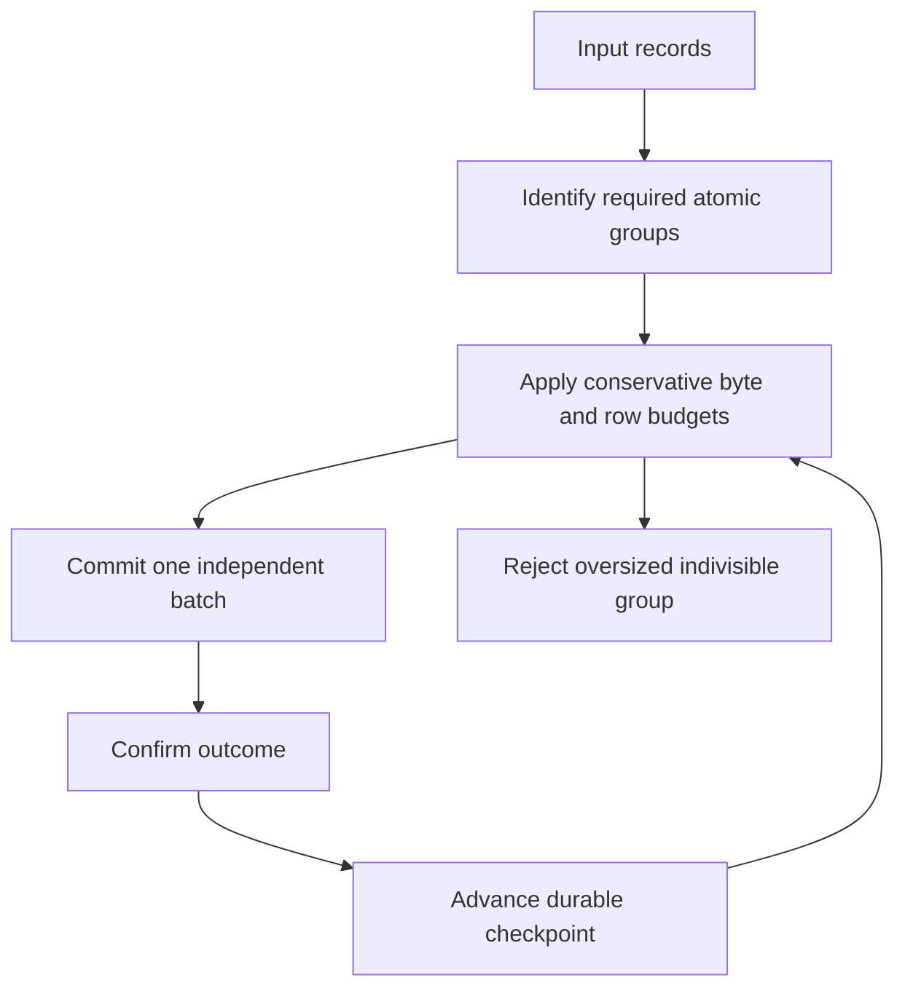

# Fix YDB Datashard Program-Size Errors During Batch Writes

Author: [nawazdhandala](https://www.github.com/nawazdhandala)

Tags: Database, SQL, Performance, Troubleshooting

Description: Reduce oversized YDB write transactions with byte-aware batching, preserve required atomicity, and choose bulk import only when its guarantees fit.

An importer works for small files but fails when a batch contains large documents. The row count has not changed, so increasing a timeout seems tempting. However, `Datashard program size limit exceeded` describes an oversized unit of database work, not simply a slow request.

The [YDB error FAQ](https://ydb.tech/docs/en/faq/errors) explains that the program, including parameter values, exceeded the documented50 MB limit for a participating shard. It recommends reducing transaction size and keeping ordinary batches to a few megabytes. Confirm applicable limits for your deployed release; do not aim for a payload just below50 MB and assume the compiled work will fit.

The important question is where one transaction ends. Splitting one large parameter list into several execute calls inside the same transaction may leave the underlying problem unchanged.

## Find the actual unit of work

Capture the failing SQL, parameter types, approximate payload sizes, transaction boundaries, server version, and SDK version. Avoid logging the actual document contents or credentials. Separate logical job size from request size and transaction size.

For example, a10 GB import can be reasonable if it consists of many independently committed small batches. A much smaller job can fail if every record is accumulated into one transaction. Several modest write statements may also combine into an oversized transaction.



An atomic group means records that must succeed or fail together. Account transfers and related ledger entries may form such a group. Unrelated historical measurements often do not. Define that boundary before implementing automatic splitting.

## Budget bytes as well as rows

A fixed batch of1000 rows can represent kilobytes or hundreds of megabytes. Set both a row cap and a conservative byte estimate, and record observed batch distributions rather than only averages.

The following Python helper is for independent records containing `id` and `payload`. It estimates UTF-8 JSON bytes for those two fields and adds a per-record allowance. That estimate is an application batching policy, not YDB's wire size or compiled-program measurement.

```python
import json


def batches(records, max_bytes=2 * 1024 * 1024, max_rows=500):
    if max_bytes <= 0 or max_rows <= 0:
        raise ValueError("Batch limits must be positive")
    batch, used = [], 0
    for record in records:
        row = {"id": record["id"], "payload": record["payload"]}
        encoded = json.dumps(
            row, ensure_ascii=False, separators=(",", ":")
        ).encode("utf-8")
        estimated = len(encoded) + 256
        if estimated > max_bytes:
            raise ValueError("One record exceeds the batch budget")
        if batch and (used + estimated > max_bytes
                      or len(batch) >= max_rows):
            yield batch
            batch, used = [], 0
        batch.append(row)
        used += estimated
    if batch:
        yield batch
```

The helper is included as [batching.py](./batching.py). Run it with validated input records and consume one yielded batch at a time. The2 MiB default leaves deliberate space below the documented limit but cannot guarantee success for every schema, query, index configuration, or record shape.

The generator can raise after earlier batches have already been consumed. Therefore, a rejected later record does not imply the import wrote nothing. Keep confirmed progress and provide a way to repair or quarantine the rejected input. Do not silently discard it and report a complete import.

## Give each independent batch a real commit boundary

For a staging row table `import_items`, a parameterized write can use this shape:

```sql
DECLARE $rows AS List<Struct<id: Uint64, payload: Utf8>>;
UPSERT INTO import_items (id, payload)
SELECT id, payload FROM AS_TABLE($rows);
```

The table must already have `id Uint64 NOT NULL` as its primary key and `payload Utf8` as a value column. Bind the list using your SDK's declared types. The [UPSERT syntax for YDB26.2.1.16](https://github.com/ydb-platform/ydb/blob/26.2.1.16/ydb/docs/en/core/yql/reference/syntax/upsert_into.md) specifies that existing rows have the supplied columns updated and missing rows are inserted. The official [parameterized upsert recipe](https://ydb.tech/docs/en/recipes/ydb-sdk/upsert) shows the list-of-structures pattern.

Submit one batch in one transaction and confirm its commit before advancing its checkpoint. Do not keep a transaction open around the entire loop. Use bounded retries appropriate to your SDK and the operation's replay semantics.

Stable primary keys and stable values make repeated upserts easier to reason about, but they are not universal replay protection. Replaying an old batch can overwrite a newer value written by another producer. Establish exclusive ownership, version checks, or another explicit conflict rule when concurrent updates are possible.

If a commit response is lost, treat the outcome as uncertain. Reconcile using the job's durable identifiers or use an operation designed for safe replay. Blindly skipping the batch risks missing data; blindly rerunning arbitrary writes risks applying an unwanted change.

## Consider bulk import only for independent rows

YDB's [bulk-upsert recipe](https://ydb.tech/docs/en/recipes/ydb-sdk/bulk-upsert) documents writes split into independent partition transactions. A successful call guarantees the supplied data was inserted, but the operation does not provide all-or-nothing atomicity across the entire input.

For a staging import where those semantics are acceptable, YDB CLI2.35.0 supports:

```bash
ydb --profile staging import file csv \
  --path import_items \
  --header \
  --batch-bytes 2097152 \
  --max-in-flight 2 \
  --threads 1 \
  ./items.csv
```

Prerequisites are an existing `staging` profile with approved connection and authentication settings, the existing compatible table, and a reviewed CSV file with `id,payload` headers. This command writes data. The names are examples to replace in an isolated staging environment.

The command's flags were checked against the actual2.35.0 binary's help, but the import was not executed. The [file-import documentation](https://ydb.tech/docs/en/reference/ydb-cli/export-import/import-file) explains that it uses bulk upsert. The byte option controls input portions; it does not turn the whole file into one transaction or guarantee an exact server-side program size.

Low initial concurrency also makes it easier to distinguish oversized work from overload. Raise throughput gradually only after correctness and resource measurements are satisfactory.

## Verify recovery as well as successful ingestion

Local tests exercised the Python helper's row limit, byte limit, UTF-8 accounting, empty input, invalid budgets, and oversized-record rejection. They checked that flattening accepted batches preserves input order and records. No YDB write, transaction-size failure, or bulk import was performed.

In staging, test representative large payloads and concentrated keys, not just uniformly small rows. Compare confirmed records with the input manifest and verify the expected final values. Interrupt the client after some successful batches, then resume from the durable checkpoint and inspect replay behavior.

Keep oversized input errors separate from transient database failures. Repeatedly retrying an unchanged oversized transaction adds work without changing its size. If an indivisible business operation remains too large, redesign how the operation is represented or processed; splitting it silently would change its correctness guarantee.

A successful fix leaves you with bounded work, explicit commit boundaries, and a recoverable import. Throughput tuning comes after those properties are demonstrated.
