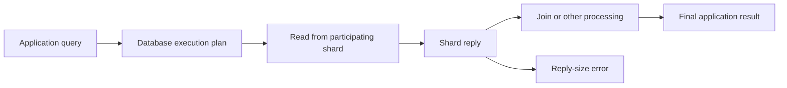

# Fix YDB Datashard Reply-Size Errors in Large Reads and Joins

Author: [nawazdhandala](https://www.github.com/nawazdhandala)

Tags: Database, SQL, Performance, Troubleshooting

Description: Diagnose YDB datashard reply-size failures, narrow wide reads, paginate by primary key, and inspect joins before increasing client limits.

A report returns only a few columns, yet YDB rejects it with `Datashard: Reply size limit exceeded`. Increasing the application's response buffer does not address where this error occurs. The database can move substantially more data between execution stages than it eventually returns to the caller.

The [YDB error FAQ](https://ydb.tech/docs/en/faq/errors) describes this failure as a participating data shard attempting to return more than 50 MB. Treat that as the documented explanation for this error, and check the limits and execution behavior of your deployed release. It is not a promise that every query returning less than 50 MB will succeed.

The practical fix starts with identifying which read or join produces too much intermediate data, then reducing that work while preserving the requested result.

## Separate the three sizes

A data shard manages part of a row-oriented table. A query may involve several shards, combine their results, and then apply additional operations before delivering the final response.



Keep these measurements separate:

| Size | What it describes | Useful response |
| --- | --- | --- |
| Selected table data | Rows and columns read by an access path | Narrow predicates and projections |
| Intermediate shard reply | Data crossing an internal execution boundary | Reduce the relevant stage's work |
| Final client result | Rows delivered to your application | Page or stream when appropriate |

Streaming the final response may help application memory, but does not establish that an earlier stage stays within its limit. Likewise, a final `LIMIT` is not proof that every upstream join or scan processes only that many rows.

## Capture the failing query shape

Record the exact issue text, server release, query API, SQL text, parameter types, and approximate parameter sizes. Remove credentials and sensitive values before sharing diagnostics. Note whether the failure follows a large tenant, a particular date range, or a newly populated wide column.

Inspect the plan before changing several things at once. YDB's [plan reference](https://ydb.tech/docs/en/yql/query_plans) identifies full scans, key-range scans, point lookups, and their read columns. A full scan for a request that needs one tenant is an important lead. So is a projection that reads a large payload never used by the caller.

Compare a failing parameter set with a smaller successful one. Do not assume success on a lightly populated development table proves the access path is suitable for production. Preserve the baseline plan and result requirements so that the revised query can be compared fairly.

## Remove unnecessary wide columns

Suppose an order list displays an identifier and status, while each stored order also contains a large raw document. A list endpoint should not retrieve that document simply because `SELECT *` is convenient.

This staging schema uses the table syntax from [YDB26.2.1.16](https://github.com/ydb-platform/ydb/blob/26.2.1.16/ydb/docs/en/core/yql/reference/syntax/create_table/index.md):

```sql
CREATE TABLE orders (
    tenant_id Utf8 NOT NULL,
    order_id Uint64 NOT NULL,
    status Utf8,
    payload String,
    PRIMARY KEY (tenant_id, order_id)
);
```

The first key column groups one tenant's orders. The second provides a unique order within that tenant. The listing below intentionally selects only `order_id` and `status`. Fetch the payload separately by the full key when a user opens an individual order, with an appropriate authorization check.

This is a change to the endpoint's data contract, not an instruction to discard required data. If a report actually needs every payload, plan a bounded extraction workflow instead of silently omitting them.

## Page by the last complete key

Use a staging database and bind parameters through your SDK; do not interpolate tenant identifiers into SQL. For the first page, bind `$tenant_id` to an authorized tenant and `$page_size` to a positive bounded value such as100:

```sql
DECLARE $tenant_id AS Utf8;
DECLARE $page_size AS Uint64;
SELECT order_id, status
FROM orders
WHERE tenant_id = $tenant_id
ORDER BY order_id
LIMIT $page_size;
```

For subsequent pages, take the final returned `order_id` and bind it as `$last_id`:

```sql
DECLARE $tenant_id AS Utf8;
DECLARE $page_size AS Uint64;
DECLARE $last_id AS Uint64;
SELECT order_id, status
FROM orders
WHERE tenant_id = $tenant_id AND order_id > $last_id
ORDER BY order_id
LIMIT $page_size;
```

The examples are included as [schema.sql](./schema.sql), [first_page.sql](./first_page.sql), and [next_page.sql](./next_page.sql). A page returns at most the requested row count; an empty result ends the traversal. Persist the cursor only after the page has been handled according to your workflow's replay requirements.

There is deliberately no fabricated initial cursor of zero: an order with identifier0 belongs in the first page. Keep the tenant fixed throughout a traversal. If pagination spans tenants, the cursor must include both key columns in primary-key order. The [release-pinned pagination guide](https://github.com/ydb-platform/ydb/blob/26.2.1.16/ydb/docs/en/core/dev/paging.md) demonstrates that tuple form and explains why nullable keys complicate comparisons.

A row count is not a byte budget. Start with a conservative page size and test representative large rows. If even one required row is too large for the execution path, reducing the page to one cannot solve the data-model problem.

## Check joins separately

For a join failure, inspect how the right-hand table is accessed. An index lookup join uses keys from the left side to find matching rows on the right, avoiding a broad right-side read when the available key structure supports it. The [JOIN reference](https://ydb.tech/docs/en/yql/reference/syntax/select/join) describes primary- and secondary-index access for this purpose.

Ask whether the join columns match a usable key prefix, whether their types agree, and whether the left side is already reasonably small. Confirm the chosen access path in the actual plan. Adding an index without verifying its use does not establish a fix.

Also check result multiplication: one selected customer can match millions of events. A key lookup can be efficient and still return too much data. Page the actual business result or constrain its time/key range; do not assume a small left side guarantees a small joined result.

## Preserve consistency and prove the change

Separate page requests do not automatically share one point-in-time view. Concurrent inserts behind the cursor may be missed, and later pages may reflect newer updates. If the requirement is a consistent export, choose a supported snapshot or backup workflow with an explicit lifetime and recovery plan. Review [YDB transaction modes](https://ydb.tech/docs/en/concepts/transactions) rather than stretching an interactive pagination loop into a long-lived transaction by accident.

The local review adapted these page queries to SQLite and traversed205 fixture orders in pages of100,100, and5. It verified order0, uniqueness, and tenant separation. That checks cursor logic only; no YDB server, optimizer, shard transfer, or limit was exercised.

In staging, compare complete results on a fixed dataset, then inspect read columns, access paths, observed read volume, latency, and errors under realistic large-tenant data. Test restart from a saved cursor and define what concurrent changes mean for the consumer. Accept the fix when required rows remain correct and the problematic read is bounded, rather than merely when one small sample stops failing.
