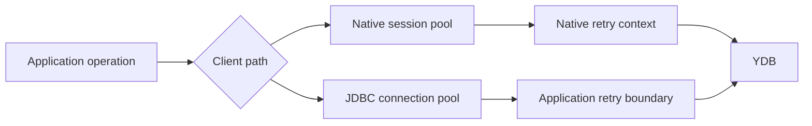

# Integrate YDB with Java: SDK, JDBC, Pools, and Safe Retries

Author: [nawazdhandala](https://www.github.com/nawazdhandala)

Tags: Java, Database, Performance

Description: Choose YDB's native Java SDK or JDBC, bound session usage, and place retries around operations that can safely run again.

A Java application connecting to YDB has two separate design decisions: which client API to use, and how much concurrent work to allow. Neither decision answers a third question: what should happen when a request fails after the database may already have processed it?

Treat API choice, pooling, and retries as separate responsibilities. A larger pool does not make a failed transaction safe to repeat. A retry helper does not remove the need to close resources. This guide shows the boundaries with small, compiled examples rather than hiding them behind a framework configuration.

## Choose the API your application needs

The native SDK exposes YDB-specific clients and asynchronous operations. JDBC, the Java Database Connectivity API, provides familiar `Connection`, `Statement`, and `ResultSet` interfaces for applications and libraries built around SQL connections.

| Requirement | Starting point |
|---|---|
| Direct use of YDB query clients and asynchronous results | Native SDK |
| Existing JDBC-based application infrastructure | JDBC driver |
| Explicit native session retry context | Native SDK |
| External JDBC connection pooling | JDBC with a pool such as HikariCP |

JDBC support does not imply that every SQL dialect or ORM-generated statement will work unchanged. Test the statements your application actually emits, including schema changes and transaction boundaries.

The examples use **native SDK 2.5.0** in one project and **JDBC driver 2.4.1 with HikariCP 6.3.0** in another. Keep these as separate examples: JDBC 2.4.1's [parent dependency configuration](https://github.com/ydb-platform/ydb-jdbc-driver/blob/v2.4.1/pom.xml) selects native SDK 2.4.10 internally. Adding a newer SDK alongside it changes dependency resolution and requires its own compatibility review.

The accompanying [native Maven project](./native/pom.xml) and [JDBC Maven project](./jdbc/pom.xml) pin their dependencies. Both compiled with Java 17 during review. Neither was connected to a database.

## Own the native client for the application lifetime

Create a transport with the deployment's endpoint, database, authentication provider, and TLS trust. Pass that configured transport into the accompanying [NativeRead class](./native/src/main/java/NativeRead.java). The caller owns the transport and closes it after closing `NativeRead`.

The class creates one query client with a bounded session pool:

```java
client = QueryClient.newClient(transport)
        .sessionPoolMinSize(0).sessionPoolMaxSize(16).build();
retry = SessionRetryContext.create(client)
        .maxRetries(3).idempotent(true)
        .sessionCreationTimeout(Duration.ofSeconds(5)).build();
```

Sixteen is an illustrative limit, not a recommendation for every service. The session creation timeout applies to obtaining a session through this retry context; it is not a five-second deadline for the whole business operation. Three retries can mean an initial attempt plus three further attempts when the helper classifies the failure as retryable.

The exact builder methods and retry counter behavior are in the tagged [SessionRetryContext implementation](https://github.com/ydb-platform/ydb-java-sdk/blob/v2.5.0/query/src/main/java/tech/ydb/query/tools/SessionRetryContext.java). The `idempotent(true)` choice is appropriate for this constant read. Idempotent means repeating an operation does not create an additional unwanted effect. Do not copy that declaration onto an arbitrary write.

The read probe uses the context to obtain a session and execute `SELECT 1`:

```java
retry.supplyResult(session -> session.createQuery("SELECT 1;", TxMode.NONE).execute())
        .join().getStatus().expectSuccess("Read probe failed");
```

The callback may run again. Keep email, payment calls, file writes, and other external side effects outside it. For a real application, consume and verify the query result as well as its status. This probe only checks successful execution.

## Use a JDBC pool as a shared resource

The accompanying [JdbcRead class](./jdbc/src/main/java/JdbcRead.java) creates a Hikari data source once and borrows connections inside `checkQuery()`. Use one instance for the service's relevant database configuration, then close it during shutdown. Creating a new pool on every request defeats pooling.

Its configuration includes:

```java
config.setJdbcUrl(url);
config.setDriverClassName("tech.ydb.jdbc.YdbDriver");
config.addDataSourceProperty("secureConnectionCertificate", caFile);
config.addDataSourceProperty("tokenFile", tokenFile);
config.setMaximumPoolSize(16);
config.setMinimumIdle(0);
config.setConnectionTimeout(5000);
```

Supply a URL such as `jdbc:ydb:grpcs://REPLACE_HOST:2135/REPLACE_DATABASE`, an absolute CA file path, and an access-token file appropriate to your deployment. The constructor requires the encrypted `grpcs` scheme. The driver's [connection properties](https://github.com/ydb-platform/ydb-jdbc-driver/blob/v2.4.1/jdbc/src/main/java/tech/ydb/jdbc/settings/YdbConnectionProperties.java) define the certificate and token file settings. Do not place token contents in the URL.

Hikari's connection timeout is the wait to obtain a connection from the pool, not the SQL execution timeout. Its [versioned documentation](https://github.com/brettwooldridge/HikariCP/blob/HikariCP-6.3.0/README.md) describes these settings. A pool timeout can indicate exhausted capacity or connections held too long; increasing it may only lengthen the queue.

The example uses try-with-resources for the borrowed connection, statement, and result set. Closing the borrowed connection returns it to Hikari. Closing the data source shuts down the pool itself. These are different lifecycle events.

## Budget concurrency across all replicas

YDB sessions consume server resources. The official [session pool guide](https://ydb.tech/docs/en/recipes/ydb-sdk/session-pool-limit) explains that the JDBC driver adjusts its session pool in response to externally opened connections. Configure the external pool intentionally rather than assuming it is unrelated to server session usage.

Sixteen connections per instance across twenty replicas creates a potential budget of 320 JDBC connections. Deployment overlap, background jobs, and separate data sources can raise that number. Count those consumers before treating a per-process limit as a cluster-wide limit.

Measure active work, waiting borrowers, query latency, and server pressure. Requests per second and simultaneous requests are different quantities: slow queries hold capacity longer even when incoming request rate stays constant.



The diagram shows responsibility, not an exact sequence of network calls. JDBC can perform some internal recovery, but the application still owns business-level retry safety.

## Retry the right unit of work

JDBC does not automatically inherit the native example's `SessionRetryContext`. The JDBC driver's [BAD_SESSION tests](https://github.com/ydb-platform/ydb-jdbc-driver/blob/v2.4.1/jdbc/src/test/java/tech/ydb/jdbc/context/BadSessionRetryTest.java) demonstrate recovery before a transaction has started and the different behavior after one is active. Setting autocommit false is not, by itself, evidence that a transaction has already begun.

For application retries, decide whether the whole operation can run again. If a transaction reads a value and then updates it, replaying only the final statement can use stale assumptions. Recreate the transaction's reads and writes together when the error and operation semantics permit it.

A timeout near commit is especially important: the client may not know whether the write committed. Use an application request identifier or another deliberate deduplication design for operations that must not happen twice. Do not interpret an unknown outcome as a guaranteed rollback.

Bound retry attempts and total elapsed time, use backoff, and preserve interruption or cancellation. Avoid several independently multiplying retry loops in the HTTP handler, repository layer, and driver. YDB's [retry guidance](https://ydb.tech/docs/en/recipes/ydb-sdk/retry) distinguishes native helpers from JDBC error handling.

## Verify behavior before increasing traffic

Compile each sample from its own directory with `mvn compile`. Supply real connection configuration only in an approved test environment. Then test a read, an application transaction, pool saturation, and an interrupted request. Record which layer retried and whether any business effect repeated.

The local review established compilation and checked the cited source behavior. It did not measure pool throughput, execute queries, inject database failures, or verify a transaction's commit outcome. Those tests are necessary before treating the example limits as production settings.
