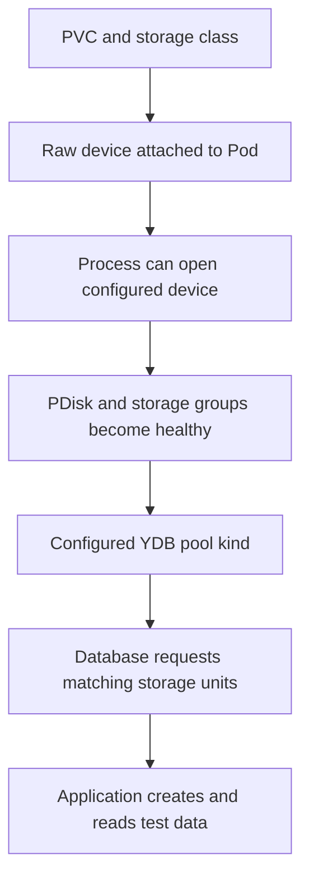

# Deploy YDB on Kubernetes: Fix PDisk and Storage-Pool Failures

Author: [nawazdhandala](https://www.github.com/nawazdhandala)

Tags: Kubernetes, Database, Storage, Troubleshooting

Description: Trace YDB Kubernetes failures from PVC binding and raw-device access to matching storage-pool kinds, using pinned Operator source and safe inspections.

A YDB storage Pod can fail before it opens a device, while opening the device, or after the device is healthy but the database cannot allocate its storage. Those failures need different repairs. Recreating a persistent volume claim or enabling privileged mode can destroy evidence without fixing the actual mismatch.

Work through the dependency chain in order. This guide reviews **YDB Kubernetes Operator 0.8.0**, including its generated container security settings and raw-block volume handling. It is a troubleshooting and deployment-review procedure, not a complete production cluster manifest.

## Understand the two meanings of storage

Kubernetes provides a PersistentVolumeClaim, or PVC, that requests storage from a storage class. YDB then uses the device through PDisk, its physical-disk subsystem, and allocates database storage using YDB storage pools.

A Kubernetes storage class named `fast-ssd` and a YDB pool kind named `ssd` are different identifiers. Kubernetes does not translate one into the other. A bound PVC proves that Kubernetes found storage; it does not prove that YDB can open the device or allocate a healthy storage group.



The [YDB Kubernetes deployment guide](https://ydb.tech/docs/en/devops/deployment-options/kubernetes/initial-deployment) separates Storage resources from Database resources. Preserve that sequence: bring up healthy storage before treating a database allocation failure as an application problem.

## Pin and review the deployment inputs

Save the Operator chart version, custom-resource definitions, server image digest, storage class, and full Storage/Database manifests together. Do not mix fields from a newer Operator release into an older cluster without checking its schema.

The [0.8.0 storage sample](https://github.com/ydb-platform/ydb-kubernetes-operator/blob/0.8.0/samples/storage-block-4-2.yaml) demonstrates eight storage nodes, block volumes, and matching device/pool settings. Its server image is `23.3.17`; that historical sample tag is not a recommendation to deploy that server version today. Select and test a supported server image separately, and keep storage and database nodes on the intended release.

For a new disposable deployment, review admission without persisting the custom resources:

```bash
kubectl -n REPLACE_WITH_NAMESPACE apply --dry-run=server -f storage.yaml
kubectl -n REPLACE_WITH_NAMESPACE apply --dry-run=server -f database.yaml
```

These require installed CRDs and a reachable Operator webhook. A custom-resource dry run does not make the Operator create its eventual Pods, so it cannot prove their admission or device access. Perform the actual staged rollout only after reviewing the full configuration and dedicated test devices.

## Verify the Kubernetes device first

Start with read-only inspection in the affected namespace:

```bash
kubectl -n REPLACE_WITH_NAMESPACE get pods,pvc
kubectl -n REPLACE_WITH_NAMESPACE describe pvc REPLACE_WITH_PVC
kubectl -n REPLACE_WITH_NAMESPACE describe pod REPLACE_WITH_STORAGE_POD
kubectl -n REPLACE_WITH_NAMESPACE get pod REPLACE_WITH_STORAGE_POD -o yaml
```

Inspect binding events, node placement, volume attachment errors, and generated container configuration. If the claim remains Pending, investigate provisioner support, available capacity, access modes, and scheduling constraints before changing YDB settings.

For the raw-block design, the PVC uses `volumeMode: Block`. The generated container must expose it through `volumeDevices` with the path expected by YDB. Operator 0.8.0's [StatefulSet builder](https://github.com/ydb-platform/ydb-kubernetes-operator/blob/0.8.0/internal/resources/storage_statefulset.go) handles block devices separately from filesystem mounts.

The following is an excerpt to merge into a reviewed Storage specification, not a standalone resource:

```yaml
spec:
  dataStore:
    - accessModes: [ReadWriteOnce]
      storageClassName: REPLACE_WITH_BLOCK_CAPABLE_CLASS
      volumeMode: Block
      resources:
        requests:
          storage: 100Gi
```

A filesystem-mounted PVC is not interchangeable with a raw block device. Kubernetes documents the distinction in its [persistent-volume guide](https://kubernetes.io/docs/concepts/storage/persistent-volumes/#raw-block-volume-support). Do not format a device to repair a YDB open error; formatting writes to the device.

## Diagnose access without broadening every privilege

Read the storage container logs, selecting the actual container name from the Pod:

```bash
kubectl -n REPLACE_WITH_NAMESPACE logs REPLACE_WITH_STORAGE_POD \
  -c REPLACE_WITH_CONTAINER --tail=200
```

If that container is running and includes a shell and basic utilities, inspect its identity and the configured device without opening it for writes:

```bash
kubectl -n REPLACE_WITH_NAMESPACE exec REPLACE_WITH_STORAGE_POD \
  -c REPLACE_WITH_CONTAINER -- sh -c \
  'id; ls -l /dev/kikimr_ssd_00; test -b /dev/kikimr_ssd_00'
```

The device path is the first device in the reviewed sample; use the actual generated path for your configuration. A successful block-device test confirms the object type, not that every required I/O operation will succeed. Compare ownership, process identity, device mapping, and the exact error. Review runtime, Container Storage Interface (CSI) driver, SELinux, or AppArmor evidence when those controls reject access.

The Operator's [security-context merger](https://github.com/ydb-platform/ydb-kubernetes-operator/blob/0.8.0/internal/resources/security_context.go) defaults `privileged` to false and adds `SYS_RAWIO` even when a custom capability list is supplied. Therefore, setting a smaller list in `spec.securityContext` does not necessarily remove that capability from generated containers.

Kubernetes [Pod Security Standards](https://kubernetes.io/docs/concepts/security/pod-security-standards/) do not allow `SYS_RAWIO` under the Restricted policy. Resolve that deployment-policy compatibility deliberately with the platform owner and inspect generated Pods; changing the CR alone is not proof of compliance. Do not treat `fsGroup` as a universal raw-device permission repair: its documented ownership behavior applies to supported volume types and storage drivers. See the [security-context guide](https://kubernetes.io/docs/tasks/configure-pod-container/security-context/).

## Match the YDB pool names end to end

Once PDisk and storage groups are healthy, compare the pool configuration with the Database request:

| Location | Value to compare in the reviewed SSD example |
| --- | --- |
| `domains_config.domain[].storage_pool_types[].kind` | `ssd` |
| Corresponding `pool_config.kind` | `ssd` |
| `channel_profile_config.profile[].channel[].storage_pool_kind` | `ssd` |
| Database `spec.resources.storageUnits[].unitKind` | `ssd` |

Also compare the erasure scheme (the redundancy layout) and PDisk filter with the actual storage layout. A name match cannot create missing eligible disks or enough failure domains for a storage group.

The [tagged Database sample](https://github.com/ydb-platform/ydb-kubernetes-operator/blob/0.8.0/samples/database.yaml) requests one storage unit of kind `ssd` and references its Storage resource. Confirm `storageClusterRef.name` points to the intended cluster. The [domains configuration reference](https://ydb.tech/docs/en/reference/configuration/domains_config) explains storage-pool types.

Change the Operator-owned custom resource or its supported configuration source rather than manually patching generated StatefulSets. Reconciliation can overwrite manual changes. Review the Operator status and logs after the update and verify that the intended database received storage.

## Prove readiness with a small application check

After Storage and Database report ready, use an authorized application client to create a disposable table, write a uniquely identifiable row, read it back, and clean up that test table through the normal application procedure. Confirm the query reaches the intended database path.

Local review parsed the pinned samples and checked device-path and pool-kind relationships, including deliberately mismatched inputs. No Kubernetes deployment, admission request, or PDisk I/O test ran. In staging, retain PVC events, generated Pod settings, storage health evidence, and the successful application check together. That makes the deployment result reproducible and distinguishes a repaired disk-access problem from a repaired allocation problem.
