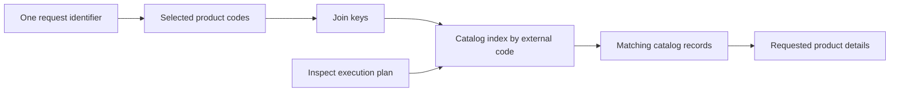

# Turn a Large YDB Join into a Targeted Index Lookup

Author: [nawazdhandala](https://www.github.com/nawazdhandala)

Tags: Database, SQL, Performance

Description: Give a YDB join a suitable indexed access path, keep its input small, preserve join semantics, and verify the chosen plan and read costs.

A request needs details for three selected products, but its query reads a large product catalog. The result may be small while the database work grows with the catalog. This is a useful situation to investigate an index lookup join: use values from a small input to find matching records in an indexed table.

YDB's [query FAQ](https://ydb.tech/docs/en/faq/all) describes index lookup joins as a good fit for transactional queries with a small left side and a usable primary- or secondary-key prefix on the right. The word “small” matters. Converting a full scan into millions of random lookups is not automatically a performance improvement.

This guide builds a specific access path for a staging catalog. The SQL follows YDB26.2.1.16 documentation; the inspection commands use CLI2.35.0. These are source-verified examples, not results from a live YDB benchmark.

## Start with the business relationship

Suppose `requested_products` contains the product codes selected in one request. The product catalog has a numeric primary key but the application receives an external code. A join on that code cannot directly use the numeric primary key to find catalog rows.



The target is bounded lookup work for the selected codes. Before changing SQL, establish whether codes are unique, whether unmatched requests should remain visible, and whether multiple catalog matches are legitimate. Those choices affect correctness independently of performance.

## Build the staging schema

In an isolated database, create these row-oriented tables:

```sql
CREATE TABLE requested_products (
    request_id Utf8 NOT NULL,
    external_code Utf8 NOT NULL,
    PRIMARY KEY (request_id, external_code)
);

CREATE TABLE catalog (
    product_id Uint64 NOT NULL,
    external_code Utf8,
    display_name Utf8,
    PRIMARY KEY (product_id)
);
```

A primary key is the table's unique row identifier and its built-in ordered access path. Filtering `requested_products` by `request_id` selects a key prefix. The right-hand table, however, is keyed by `product_id`, not `external_code`.

Add a secondary index that starts with the join column:

```sql
ALTER TABLE catalog
ADD INDEX by_external_code GLOBAL ON (external_code);
```

This syntax follows the [release-pinned JOIN guide](https://github.com/ydb-platform/ydb/blob/26.2.1.16/ydb/docs/en/core/yql/reference/syntax/select/join.md). A secondary index is another stored access path, maintained as data changes. It does not change the table's primary key or make `external_code` unique.

For an existing populated table, wait until index construction finishes before directing requests to it. The [index development guide](https://ydb.tech/docs/en/dev/secondary-indexes) explains that construction runs in the background and the index is unavailable until complete. Schedule a real production index build with capacity and change controls rather than treating it as a free metadata edit.

## Select the intended index explicitly

The demonstration query below uses the fixed staging request identifier `request-demo`. Production code should bind the request identifier through its SDK and enforce the caller's access to that request.

```sql
SELECT
    r.external_code AS requested_code,
    c.product_id AS product_id,
    c.display_name AS display_name
FROM requested_products AS r
INNER JOIN catalog VIEW by_external_code AS c
    ON r.external_code = c.external_code
WHERE r.request_id = 'request-demo'u
ORDER BY requested_code, product_id;
```

The `VIEW by_external_code` clause selects the named index for the catalog access. It is not a separate database view definition. The [JOIN reference](https://ydb.tech/docs/en/yql/reference/syntax/select/join) documents the `JOIN table VIEW index AS alias` form.

The projection names each returned column explicitly. That avoids ambiguous names and excludes catalog fields the endpoint does not need. Both join columns use `Utf8`, so the example does not require a conversion around the indexed column.

Files [schema.sql](./schema.sql), [index.sql](./index.sql), and [lookup.sql](./lookup.sql) contain the snippets. Use them with fixture data that includes a known match, a missing code, and a code shared by more than one catalog row. Do not assume the demonstration query forces a particular physical operator solely because the index is named; inspect the plan on your release.

## Inspect before measuring

With an approved `staging` CLI profile and the schema/index already available, request a plan:

```bash
ydb --profile staging sql --explain --file ./lookup.sql
```

CLI2.35.0 help states that `--explain` requests the logical plan without executing the query. This still contacts the database and requires the relevant permissions and schema. It is not a local SQL syntax checker.

Look for bounded access to the requested-products key range and indexed catalog lookup work. The [plan reference](https://ydb.tech/docs/en/yql/query_plans) describes table access operations and their read columns and ranges. Operator names and plan structure may vary, so inspect the actual inputs and access paths rather than searching for one display label alone.

Then execute the read in staging with statistics:

```bash
ydb --profile staging sql --stats full --file ./lookup.sql
```

Compare with the same query without the `VIEW` clause, using identical data and request identifiers. Automatic optimization may already choose a useful index in some configurations; the baseline is evidence, not a guaranteed full scan. Record result equivalence, rows and bytes read where reported, execution latency, and resource use.

## Diagnose an unsuitable lookup

If the plan still does too much work, examine the shape of the lookup rather than repeatedly adding indexes.

| Observation | What to investigate |
| --- | --- |
| Many requested codes | Whether one request should be paginated or processed in bounded groups |
| Many matches per code | Whether the business key needs another discriminating column |
| Index starts with an unrelated field | Whether the join supplies the leading key fields |
| Expressions transform the catalog code | Whether stored normalized values and matching types would provide a usable access path |
| Frequent base-table reads after index access | Whether a covering index is justified by the read/write tradeoff |

A covering index stores additional projected columns, potentially reducing extra reads. It also consumes storage and adds maintenance work. Evaluate it only after measuring the current query, and retain the consistency guarantees required by the application.

## Preserve the result while changing the access path

An inner join drops requested codes with no catalog match. If the endpoint must report missing products, use a left join and handle null catalog fields explicitly. Avoid adding a right-table filter in `WHERE` that unintentionally removes those unmatched rows.

A non-unique code produces multiple output rows. Do not add `DISTINCT` merely to make the result resemble a one-product lookup: that may hide a data-quality problem or remove legitimate records. Decide whether code uniqueness belongs in the data model or application validation.

The local review used a SQLite adaptation of the example. Adding an equivalent index preserved the inner-join results, including two matches for one code; a left-join variant retained the missing code. This verifies the fixture's result semantics only, not YDB's optimizer, index construction, or performance.

For acceptance, grow the catalog while keeping the selected request small, then repeat with a realistically large request and a heavily duplicated code. Verify correct rows and useful read-cost improvements in each case. An index lookup is successful when it serves the workload efficiently without quietly changing what the application means by a match.
