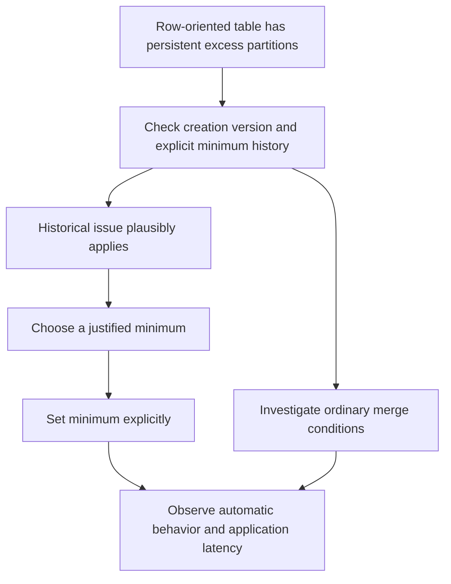

# Restore Partition Merging on Older YDB Row Tables

Author: [nawazdhandala](https://www.github.com/nawazdhandala)

Tags: Database, Performance, Troubleshooting

Description: Identify YDB row tables affected by the pre-22.2 merging issue, set an explicit minimum partition count, and verify behavior without forcing consolidation.

A YDB table has many partitions after a busy period, but their count never falls during quieter periods. That observation alone does not prove a fault: the table may still need those partitions, or a configured minimum may deliberately keep them available.

There is, however, a documented historical case. YDB's [known-issues page](https://ydb.tech/docs/en/faq/known-issues) identifies tables created before version22.2 that never had an explicit minimum partition count. Their partitions may fail to merge even when the ordinary conditions are satisfied. The documented remedy is to set that minimum explicitly.

This is a focused repair for affected row-oriented tables. It is not a command to merge every table, remove data, or reduce the whole database to one partition.

## Check the table's history, not just today's server version

The relevant version is the version on which the table was created. A table retained through several upgrades can have an older history than the running cluster. Conversely, a recently recreated table with the same name may not have that history.

Check schema migration records, creation scripts, backup provenance, and previous configuration changes. Establish whether a minimum was ever specified. A displayed default is not necessarily evidence that the setting was explicitly stored when the old table was created.

If the history is unknown, record that uncertainty. Do not label every table with a high partition count as affected. First collect the current configuration and workload evidence, then decide whether the narrow setting change is appropriate.



## Capture the current state

The following read-only inspection uses YDB CLI2.35.0. Replace `staging` with an approved profile and `legacy_events` with the exact table path in that profile's database:

```bash
ydb --profile staging scheme describe legacy_events \
  --stats --partition-stats --partition-boundaries \
  > legacy-events-before.txt
```

The profile supplies connection and authentication settings. The command writes a local evidence file, not database data. Protect the output according to your environment's rules because key boundaries and schema information may be sensitive.

The actual2.35.0 binary's help confirms these flags. YDB's [split/merge troubleshooting guide](https://ydb.tech/docs/en/troubleshooting/performance/schemas/splits-merges) recommends inspecting the table's automatic partitioning settings, including the minimum, maximum, and load-based mode.

Record the current partition count, configured limits, partition sizes, and the read/write load over a representative quiet and busy period. Also record application error rates and tail latency. Without a baseline, an apparent reduction in partition count is difficult to distinguish from a workload change.

## Choose a floor that preserves useful capacity

`AUTO_PARTITIONING_MIN_PARTITIONS_COUNT` is a floor for automatic merging of row-table partitions. The [YDB26.2.1.16 table documentation](https://github.com/ydb-platform/ydb/blob/26.2.1.16/ydb/docs/en/core/concepts/datamodel/_includes/table.md) states that merging occurs only above that floor and recommends retaining useful capacity for load-based partitioning rather than always allowing a fall to one.

Choose the floor from the workload's capacity needs and key distribution. Suppose a staging table currently has24 partitions and prior load tests support a floor of8. Setting8 allows eligible consolidation above that floor. It does not establish that8 is right for another table, or that the database will immediately produce exactly8 partitions.

Check the maximum at the same time for consistency, but do not change unrelated settings as part of this narrow repair. A floor above the configured maximum is not a coherent policy. A floor equal to the current count leaves no room for the count to decrease below that point.

Keep a short decision record: why this value, which workload measurements support it, and what application behavior would cause you to reconsider it. This is more useful than copying the documentation's example value of1 without considering the traffic pattern.

## Apply only the intended setting

After a staging rehearsal and normal change approval, the specific alteration is:

```sql
ALTER TABLE `legacy_events`
SET (AUTO_PARTITIONING_MIN_PARTITIONS_COUNT = 8);
```

The table name and8 are examples. Save the reviewed statement as [set-minimum.sql](./set-minimum.sql) and apply it with the profile that targets the intended database:

```bash
ydb --profile staging sql --file ./set-minimum.sql
```

This changes table configuration. Inspect the file and connection profile before execution; neither the filename nor a successful CLI connection proves the target is correct. The SQL form is the documented historical workaround with a workload-selected value.

Do not add a table recreation, data reload, or manual shard deletion. Those operations are unnecessary for this documented remedy and introduce a different recovery problem.

## Verify configuration first, behavior second

Repeat the same inspection after the alteration:

```bash
ydb --profile staging scheme describe legacy_events \
  --stats --partition-stats --partition-boundaries \
  > legacy-events-after.txt
```

First confirm that the explicit minimum is present. Then observe automatic partition behavior over an appropriate workload interval. A successful alteration means the setting was accepted; it does not mean every existing partition was eligible to merge.

Merging depends on more than the floor. Review size, load, adjacent key ranges, and the operating conditions described for your release. Split and merge work also has a cost, so include query latency and retries in the observation. The [troubleshooting guide](https://ydb.tech/docs/en/troubleshooting/performance/schemas/splits-merges) describes dashboard and table-inspection evidence for identifying this activity.

If the count stays unchanged, check whether it is already at the floor or whether the table remains busy. If it falls during quiet periods and rapidly rises again with normal traffic, reassess the floor instead of repeatedly alternating settings.

## Keep rollback expectations realistic

Restoring a previous explicit setting is a configuration correction, not an undo operation for physical partition changes already performed. Do not promise that restoring a number recreates the exact earlier shard layout immediately. Keep the table available and monitor the normal partitioning process while correcting the policy.

This article's local validation checked CLI help, shell syntax, the documented SQL setting, and diagram structure. No legacy table was altered, no merge was observed, and no timing or capacity benefit was measured.

A complete staging acceptance record should include the table history, before/after configuration, chosen floor rationale, observed partition activity, and application performance through a representative traffic cycle. The repair is complete when the historical configuration gap is addressed and the resulting behavior fits the workload, not simply when an ALTER statement returns successfully.
