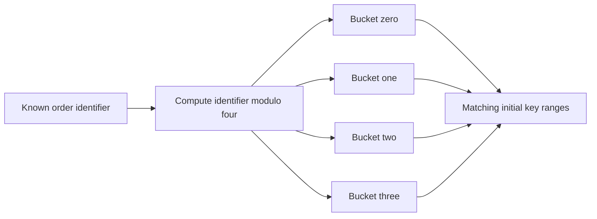

# Design YDB Primary Keys and Partitions to Prevent Hot Shards

Author: [nawazdhandala](https://www.github.com/nawazdhandala)

Tags: Database, Performance, Database Design

Description: Match YDB row-table keys, traffic patterns, and partition boundaries so extra partitions can actually share the application's load.

A table can have many partitions and still behave like a single busy server. The important question is not just how many partitions exist, but which key ranges receive the current requests. If most traffic targets one narrow range, adding empty ranges elsewhere does little for that workload.

For YDB row tables, design the key and partitioning policy together. Start from the reads and writes the application needs, then check whether the resulting prefixes can distribute that traffic. This guide uses a small tenant-order example to show the tradeoffs and a common prepartitioning mistake.

## Separate three kinds of imbalance

A shard is a portion of a table handled as a unit of database work. In a range-partitioned row table, its boundaries come from ordered primary-key values. YDB documents that model in its [table reference](https://ydb.tech/docs/en/concepts/datamodel/table).

| Pattern | Why more partitions may not help immediately |
|---|---|
| Increasing leading key | New writes continue toward the high end |
| One dominant tenant prefix | Traffic concentrates within that tenant's range |
| One frequently updated row | A single key cannot be divided across independent key ranges |

These are different problems. Reordering columns may help the first. Spreading a tenant's work across several prefixes may help the second. The third often needs a different application data model, such as sharded counters with defined aggregation semantics.

Do not assume an even row count means an even workload. A large historical partition can be idle while a small current range is saturated. YDB's [overloaded-shard troubleshooting guide](https://ydb.tech/docs/en/troubleshooting/performance/schemas/overloaded-shards) recommends reviewing both partitioning settings and key behavior.

## Begin with the access contract

Suppose order IDs are application-supplied unsigned integers, known before a write. The main operation is a point lookup using tenant and order ID. A secondary operation lists all orders for one tenant. The current key is `(tenant_id, order_id)`.

That layout keeps a tenant's data together, which is convenient for reads. It also means a very active tenant can concentrate new work in a small part of the key space. Merely hashing the tenant name still gives that tenant one hash prefix.

An alternative adds a bounded routing bucket before the tenant. For this example, define `bucket = order_id % 4`. This is an application contract for supplied integer IDs; it does not work before a database-generated identifier is known. If IDs have a biased pattern, inspect the bucket frequencies before choosing this function.



The four prefixes let one tenant's different orders reach different initial ranges. They do not split updates to the same order across shards.

## Match the boundaries to the actual bucket values

The accompanying [candidate.sql](./candidate.sql) creates a fresh staging table. It follows YDB **26.2.1.16** documented row-table partition options:

```sql
CREATE TABLE tenant_orders_partition_lab (
    bucket Uint32 NOT NULL,
    tenant_id Utf8 NOT NULL,
    order_id Uint64 NOT NULL,
    payload Utf8,
    PRIMARY KEY (bucket, tenant_id, order_id)
)
WITH (
    PARTITION_AT_KEYS = (1, 2, 3),
    AUTO_PARTITIONING_BY_LOAD = ENABLED,
    AUTO_PARTITIONING_MIN_PARTITIONS_COUNT = 4,
    AUTO_PARTITIONING_MAX_PARTITIONS_COUNT = 64
);
```

The boundaries separate values below one, one to below two, two to below three, and three upward. All writers must supply buckets zero through three. The schema does not enforce that modulo rule for you.

The minimum partition count provides a floor against automatic merging; the maximum leaves room for further splitting. Neither number guarantees that original boundaries remain forever or that there will be one partition on each physical server. These are illustrative staging settings, not universal production sizing advice.

The release's [partition parameter documentation](https://github.com/ydb-platform/ydb/blob/26.2.1.16/ydb/docs/en/core/concepts/datamodel/_includes/table.md) distinguishes explicit boundaries from uniform initial partitioning.

A subtle mistake is to replace the explicit boundaries with `UNIFORM_PARTITIONS = 4` while retaining bucket values only zero through three. Uniform boundaries across a `Uint32` key space are very different from boundaries at one, two, and three. The tiny bucket values remain clustered near the beginning of the integer range.

## Check the routing model before deploying it

The accompanying [partition_model.py](./partition_model.py) uses only Python's standard library. Run it with Python 3.14:

```bash
python partition_model.py
```

For 10,000 consecutive example IDs, the locally observed output was:

```text
Explicit: {0: 2500, 1: 2500, 2: 2500, 3: 2500}
Uniform Uint32: {0: 10000}
```

This is a mathematical range model, not a YDB load test. It demonstrates why the range boundaries must match the values produced by the routing function. It says nothing about transaction latency, server placement, or actual split decisions.

Replace the synthetic IDs with a representative, non-sensitive sample of your own workload and count requests, not just distinct keys. If all IDs are divisible by four, this particular modulo rule produces only bucket zero. If one order receives most requests, the model should preserve that frequency rather than hide it behind a unique-key sample.

## Price the read-side change

For a point lookup, recompute the bucket from the supplied order ID and include all key components. Tenant-wide listing now spans four bucket prefixes. The application must issue the relevant reads and combine their results, including ordering and pagination.

Do not concatenate four independently limited pages and call that a globally correct page. Define a merge strategy and continuation state that preserve the requested ordering across buckets. The extra complexity may outweigh the write benefit for a workload dominated by tenant-wide scans.

Changing the bucket count also changes where some existing IDs map. Treat that as a versioned routing migration, not a harmless configuration tweak. Readers and writers need a coordinated transition if historical data retains the old layout.

YDB's [primary-key guidance](https://ydb.tech/docs/en/dev/primary-key/row-oriented) discusses the tradeoff between varied prefixes and locality. The right key depends on which operations need to stay together.

## Verify real partitions and load

With an existing authorized CLI profile, inspect the staging table:

```bash
ydb -p REPLACE_WITH_PROFILE scheme describe tenant_orders_partition_lab \
  --partition-boundaries --partition-stats
```

The flags were checked in YDB CLI **2.35.0** help. The [schema description command](https://ydb.tech/docs/en/reference/ydb-cli/commands/scheme-describe) is read-only. Compare the actual boundaries with your intended layout, then inspect per-partition load under representative traffic.

Track latency, overload errors, partition count, and skew over time. Load-based splitting is a response to observed conditions, not instant relief for every hot key. Watch the configured maximum: a table at its ceiling cannot keep expanding its partition count under the same policy.

Before production, test both write distribution and the changed read paths. The local review ran the range model and checked source documentation and CLI help. No table was created, no shard split observed, and no throughput improvement measured. Use those deployment checks to decide whether this routing design earns its added application complexity.
