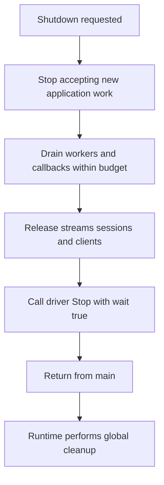

# Shut Down the YDB C++ SDK Before gRPC Teardown

Author: [nawazdhandala](https://www.github.com/nawazdhandala)

Tags: C++, Database, Troubleshooting

Description: Give YDB C++ clients an explicit lifetime, drain application work before stopping the driver, and test normal and exceptional shutdown paths.

An application can complete its final database query successfully and still crash while exiting. That points to a different class of problem from a failed query: objects are being destroyed while the networking machinery they depend on is already shutting down.

For the YDB C++ SDK, make resource ownership and shutdown order explicit. Stop accepting application work, finish or account for outstanding operations, release client-owned resources, and stop the driver while the application's normal runtime is still alive.

This article checks the API against **YDB C++ SDK v3.27.0**. The pattern applies to application lifecycle design; it is not a diagnosis of every crash whose stack trace happens to mention gRPC.

## Recognize a lifetime-order problem

The [YDB SDK FAQ](https://ydb.tech/docs/en/faq/sdk) warns about SDK objects held in global singletons whose lifetime extends beyond `main()`. Client cleanup may need networking to empty session pools, while gRPC's global state may already have been destroyed. It recommends explicitly calling `Stop(true)` before leaving `main()` when a global driver cannot be avoided.

Look for evidence around the failure:

| Observation | Investigation |
| --- | --- |
| Crash happens after the final application log | Global or static destruction order |
| Shutdown hangs with callbacks still active | Unjoined workers, blocked callbacks, or unfinished streams |
| Normal exit works but error exit crashes | An early return or exception skips cleanup |
| Queries fail only after shutdown begins | Application work still submits requests after admission closes |

Collect the SDK version, linked gRPC version, shutdown logs, and a symbolized stack trace. A memory error earlier in the program can also surface during destruction, so retain sanitizer findings and avoid concluding that teardown order is the only possible cause.

## Know what Stop(true) guarantees

The tagged [driver header](https://github.com/ydb-platform/ydb-cpp-sdk/blob/v3.27.0/include/ydb-cpp-sdk/client/driver/driver.h) defines `Stop(bool wait = false)`. Stopping cancels running and future requests. With `wait=true`, it waits for the underlying client thread pool to stop.

That is a networking shutdown boundary, not a promise that pending business operations completed successfully. If the application wants accepted work to finish, drain that work before stopping the driver. If the drain deadline expires, record unresolved operations and follow the application's cancellation and reconciliation policy.

Do not interpret cancellation as proof that a write never committed. The [gRPC cancellation guide](https://grpc.io/docs/guides/cancellation/) describes cancellation as a signal that the caller no longer needs the result; the business outcome still needs to be handled by your database-operation design.



## Keep clients inside an explicit scope

The accompanying [shutdown_example.cpp](./shutdown_example.cpp) contains a small integration function. Its caller supplies a `TDriverConfig` with the intended database, credentials, and trusted TLS configuration. It performs a read-only probe and returns an exit code:

```cpp
int RunProbe(const NYdb::TDriverConfig& config) {
    NYdb::TDriver driver(config);
    return WithStoppedDriver(driver, [&driver] {
        NYdb::NQuery::TQueryClient client(driver);
        auto result = client.ExecuteQuery(
            "SELECT 1 AS one;",
            NYdb::NQuery::TTxControl::NoTx(),
            NYdb::NQuery::TExecuteQuerySettings()
                .ClientTimeout(TDuration::Seconds(5)))
            .GetValueSync();
        return result.IsSuccess() ? 0 : 2;
    });
}
```

The client is local to the callback. Waiting for the result finishes this single probe before the callback returns. The callback's local objects then leave scope before driver shutdown. The five-second request setting prevents this example from intentionally waiting forever on its one query; it is not a total shutdown deadline.

The query methods and settings were checked against the tagged [query client](https://github.com/ydb-platform/ydb-cpp-sdk/blob/v3.27.0/include/ydb-cpp-sdk/client/query/client.h), [query settings](https://github.com/ydb-platform/ydb-cpp-sdk/blob/v3.27.0/include/ydb-cpp-sdk/client/query/query.h), and [request settings](https://github.com/ydb-platform/ydb-cpp-sdk/blob/v3.27.0/include/ydb-cpp-sdk/client/types/request_settings.h). This fragment was source-reviewed, not linked against the complete SDK locally.

## Handle the exception path too

[with_stopped_driver.h](./with_stopped_driver.h) supplies the small wrapper used above:

```cpp
template <class Driver, class Work>
int WithStoppedDriver(Driver& driver, Work&& work) {
    int exitCode = 1;
    std::exception_ptr failure;
    try {
        exitCode = work();
    } catch (...) {
        failure = std::current_exception();
    }
    driver.Stop(true);
    if (failure) {
        std::rethrow_exception(failure);
    }
    return exitCode;
}
```

It preserves an application exception until the explicit stop has completed. The caller can catch that exception at its outer application boundary and report it. A failure inside `Stop` itself is a separate shutdown failure; this helper does not hide it or guarantee recovery from a broken runtime.

The callback contract matters: it must finish and release its own clients and callbacks before returning. Capturing a shared client that survives elsewhere, detaching a worker thread, or storing a session in a global object defeats that ownership boundary. The wrapper cannot discover those references automatically.

## Coordinate a real service separately

A network service needs more than the one-query example. Remove it from readiness or stop its listener, stop background producers, and prevent scheduled jobs from submitting new database work. Then join application workers and wait for outstanding futures or streams according to the shutdown budget.

Call the blocking driver stop from the controlling application thread after callback work has drained. Avoid calling it from an SDK callback that could be part of the thread pool being stopped. Do not hold an application lock while waiting if a callback needs that lock to finish.

An operating-system signal should request shutdown through the application's supported signal or event mechanism. Do not run complex SDK cleanup directly inside an asynchronous signal handler. The Linux [signal-safety documentation](https://man7.org/linux/man-pages/man7/signal-safety.7.html) explains why ordinary library operations are not generally safe there.

Finally, ensure the process manager's termination grace period covers the intended drain and cleanup stages. If a platform forcefully kills the process, C++ scopes cannot complete their destructors. Record that separately from a clean shutdown so operational dashboards do not count forced termination as successful draining.

## Test the order, then test the integration

The included [lifecycle_test.cpp](./lifecycle_test.cpp) uses a fake driver and a scoped client to check the wrapper's ordering. With a C++17 compiler, run it from the article directory:

```bash
c++ -std=c++17 -Wall -Wextra -Werror lifecycle_test.cpp \
  -o /tmp/ydb-lifecycle-test
/tmp/ydb-lifecycle-test
```

The test passes silently. It verifies that work completion precedes client destruction, which precedes `Stop(true)`, on both normal and throwing paths. It also checks the returned exit code and the original exception.

That local test ran successfully, but it does not exercise real gRPC threads. In staging, test an idle shutdown, shutdown during an active read, an application exception, and an unreachable endpoint. Log each lifecycle stage and its duration. Add a write-specific test that records uncertain outcomes rather than assuming every interrupted operation failed. A clean result requires both orderly resource release and an explicit account of the work accepted before shutdown began.
