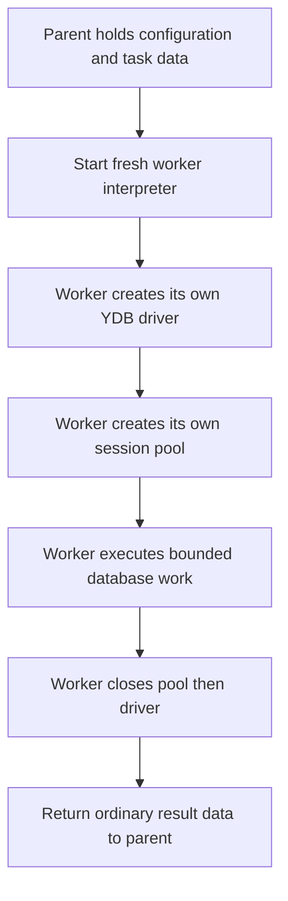

# Avoid YDB SDK Failures When Starting Child Processes

Author: [nawazdhandala](https://www.github.com/nawazdhandala)

Tags: Python, Database, Troubleshooting

Description: Keep YDB drivers and session pools local to each process, avoid inheriting live gRPC state through fork, and test an explicit spawn-based worker pattern.

A database call works in the parent process but hangs in a worker. Authentication and networking appear healthy, and increasing the query timeout changes only how long the failure takes. Before tuning the database, check when the application creates its YDB driver relative to starting child processes.

YDB SDKs use background threads and gRPC networking. Copying the parent's memory through `fork()` does not create a fresh, functioning copy of every thread and connection. The practical design is to start workers first and create their database resources inside the process that will own them.

## Why copying a driver is different from copying configuration

On Linux, `fork()` duplicates the process address space, but the child contains only the calling thread. Mutex state and other thread-related objects remain in the copied memory. The [Linux fork documentation](https://man7.org/linux/man-pages/man2/fork.2.html) explains these constraints and the restrictions on operations in a multithreaded child before `exec`.

An endpoint string is ordinary configuration. A driver is active runtime state: connections, background execution, locks, callbacks, and session management. A pointer that still exists in the child is not evidence that its supporting machinery survived correctly.

The [YDB SDK FAQ](https://ydb.tech/docs/en/faq/sdk) explicitly warns that SDK and gRPC multithreading makes post-fork stability uncertain. Do not pass a live driver or session pool into child work, keep it in a preloaded module, or construct it in a parent-side singleton and assume workers can reuse it.

## Find the hidden initialization point

Trace the startup path, not just the function that executes SQL. Check module imports, dependency-injection setup, health checks, logging exporters, and framework preload hooks. A harmless-looking import can construct a client before the worker boundary.

Record process IDs at driver construction and at query submission. If a worker uses an object created under the parent's process ID, the ownership model is wrong. Log identities and lifecycle stages, not tokens or complete connection configuration.

| Pattern | What to change |
| --- | --- |
| Driver constructed during module import | Move construction into worker initialization |
| Parent passes a driver as a task argument | Pass ordinary task data and configuration references |
| Framework preloads the application before forking | Use its documented post-worker initialization hook |
| Child closes an inherited driver and recreates it | Avoid inheritance in the first place; cleanup may touch invalid copied state |

Do not repair this by adding arbitrary sleeps. Timing can hide the failure while leaving the same unsafe object ownership in place.

## Select process creation explicitly

Python offers multiple process start methods. `spawn` starts a fresh interpreter, so the child imports the program rather than inheriting an already-running Python interpreter's complete state. The [Python 3.14 multiprocessing guide](https://docs.python.org/3.14/library/multiprocessing.html) documents the methods and the requirement to protect process startup with the `__main__` guard.

Defaults vary by platform and Python release. Set the context explicitly for the worker pool instead of assuming `multiprocessing` always forks, or always spawns.



Other libraries can still create processes themselves. Review the actual server or job-runner lifecycle; choosing a context for one pool does not globally redesign every component in the program.

## Run the process-only check first

The accompanying [spawn_probe.py](./spawn_probe.py) targets Python **3.14** and YDB Python SDK **3.35.0**. Its default mode starts workers and reports process identities without importing YDB or connecting to a database:

```bash
python3 spawn_probe.py
```

Run this from a saved file, not by pasting the worker function into an interactive prompt. Expected output contains the parent's process ID and worker results with `method` equal to `spawn`, different process IDs from the parent, and `database_contacted` equal to false. A process pool may schedule multiple tasks on one worker; the check does not require a different process for every task.

The pool setup is explicit:

```python
context = multiprocessing.get_context("spawn")
with ProcessPoolExecutor(max_workers=2, mp_context=context) as workers:
    results = list(workers.map(run_worker, [args.connect] * 2))
```

The [ProcessPoolExecutor reference](https://docs.python.org/3.14/library/concurrent.futures.html#processpoolexecutor) describes `mp_context`, importable worker functions, and serialization requirements. Only the Boolean connection choice crosses the task boundary here. Results are simple dictionaries.

## Add a worker-local database probe

For a staging connection test, install the pinned dependency from [requirements.txt](./requirements.txt). Supply endpoint and database configuration plus paths to existing protected credential and CA files:

```bash
export YDB_ENDPOINT='grpcs://REPLACE_WITH_HOST:2135'
export YDB_DATABASE='/REPLACE_WITH_DATABASE_PATH'
export YDB_TOKEN_FILE='/REPLACE_WITH_PROTECTED_TOKEN_FILE'
export YDB_CA_FILE='/REPLACE_WITH_CA_PEM_FILE'
python3 spawn_probe.py --connect
```

The worker imports YDB inside `run_worker`, reads those files itself, and creates nested resources:

```python
with ydb.Driver(
    endpoint=endpoint,
    database=database,
    credentials=ydb.AccessTokenCredentials(token),
    root_certificates=roots,
) as driver:
    driver.wait(timeout=5, fail_fast=True)
    with ydb.QuerySessionPool(driver, size=2) as pool:
        # The complete file runs SELECT 1 with explicit request/retry limits.
        ...
```

The complete file checks the query result and closes the pool before its driver. Constructor options were reviewed against the [tagged driver source](https://github.com/ydb-platform/ydb-python-sdk/blob/3.35.0/ydb/driver.py). It requires a secure endpoint and nonempty credential/trust files; it does not disable certificate verification.

This is a short diagnostic task, so each task owns a short-lived driver. For a service processing many small tasks, move that ownership into a documented worker-lifetime initialization and cleanup mechanism so each worker reuses its own bounded pool. Do not move it back into the parent to reduce setup cost. Include all worker pools when budgeting database sessions.

## Do not assume a gRPC switch fixes the SDK

The [gRPC Python fork-support document](https://github.com/grpc/grpc/blob/v1.85.0/doc/fork_support.md) describes limited opt-in client-side support tied to particular polling strategies. It also recommends constructing gRPC objects after process creation as an alternative to inheriting them.

That document is not a blanket compatibility guarantee for every YDB SDK, credential provider, framework, or operating system. Prefer a process model that avoids inherited live networking state. If a framework requires forking, check its supported initialization hooks and the exact library versions rather than treating environment switches as a universal repair.

## Validate the complete worker lifecycle

The process-only mode ran locally under CPython 3.14.10: both results came from spawned child processes, and neither contacted a database. The connected mode was source-reviewed but not executed against YDB.

In staging, test first startup, repeated task batches, worker replacement, an unavailable endpoint, and credential-file access failure. Verify bounded query behavior and orderly cleanup. The executor's context manager waits for submitted work; per-query timeouts do not by themselves guarantee a total process-exit deadline.

When migrating an existing service, compare error rates and latency before and after changing ownership. A successful fix should remove inherited-client failures without creating a new pool per normal request or an uncontrolled number of database sessions.
