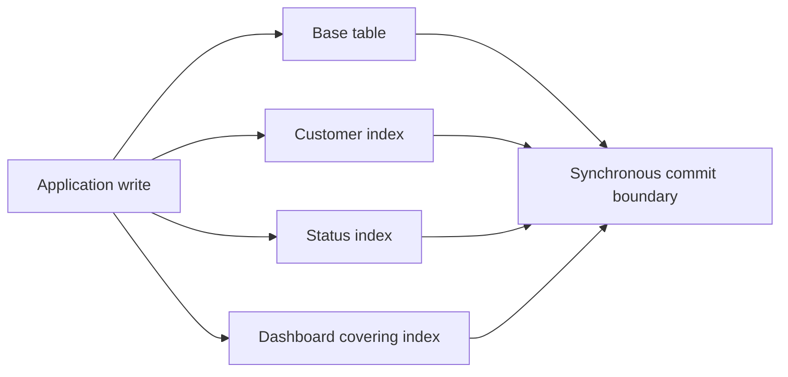

# Avoid Write Amplification from Too Many YDB Secondary Indexes

Author: [nawazdhandala](https://www.github.com/nawazdhandala)

Tags: Database, SQL, Performance

Description: Review YDB secondary indexes by query benefit, consistency needs, and write cost, then test a smaller index set without breaking application reads.

An index can turn an expensive lookup into a fast one while making every relevant write more expensive. That tradeoff becomes difficult to see when indexes accumulate one incident at a time: one for a dashboard, another for an old API, and several covering columns added to avoid table reads.

For YDB row tables, review the complete set as a workload decision. The goal is not the smallest possible index count. It is an index set whose read benefit justifies its ongoing storage, maintenance, and transaction costs.

## Understand the additional work

A global secondary index is represented by a separate index table. Synchronous indexes participate in the write transaction; the transaction must complete the required work for the base table and indexes before committing. The additional structures can therefore change the write path even when the original base-table write touches only one partition.

Asynchronous indexes move maintenance into the background and provide eventual consistency. They still consume resources. Changing `SYNC` to `ASYNC` is not a way to erase the maintenance work while keeping identical read semantics. These distinctions are documented in YDB's [secondary-index concepts](https://ydb.tech/docs/en/concepts/query_execution/secondary_indexes).



The diagram illustrates a write requiring changes to all three synchronous indexes. It is not a claim that every update touches every index equally, or that three indexes imply exactly four times the physical writes.

## Build an inventory around real queries

For each index, record its ordered key columns, covered columns, consistency mode, and the application queries that rely on it. Include scheduled jobs and low-frequency operational queries. An index unused during a ten-minute observation window might still serve a monthly report.

Use an existing CLI profile pointing at the intended database:

```bash
ydb -p REPLACE_WITH_PROFILE scheme describe REPLACE_WITH_TABLE --stats
```

This is read-only. The output describes the object and available statistics; it does not establish which application queries use each index. The command's options were checked with YDB CLI **2.35.0** and its [schema description reference](https://ydb.tech/docs/en/reference/ydb-cli/commands/scheme-describe).

Make a short review table before editing the schema:

| Index candidate | Read requirement | Write concern | Decision evidence |
|---|---|---|---|
| Customer and creation time | Recent orders for one customer | New orders add entries | API latency and row-read count |
| Status alone | Background processing queue | Frequent status changes | Actual queue query selectivity |
| Wide dashboard covering index | Avoid base-row reads | Repeatedly copies changing fields | Saved reads versus update cost |

These are questions to investigate, not predetermined instructions to delete the second and third indexes.

## Start with one concrete read path

The accompanying [candidate schema](./candidate.sql) targets YDB's **26.2.1.16** documented secondary-index behavior. It creates a new staging table, not a replacement for an existing production object:

```sql
CREATE TABLE orders_index_candidate (
    order_id Uint64 NOT NULL,
    customer_id Uint64,
    created_at Timestamp,
    status Utf8,
    notes Utf8,
    INDEX by_customer_time GLOBAL SYNC ON (customer_id, created_at) COVER (status),
    PRIMARY KEY (order_id)
);
```

The index serves a specific question: “What are this customer's recent orders?” `status` is copied into the index so that the selected fields can be available there. `notes` is intentionally excluded because the proposed result does not need it. Check the exact index grammar against the release's [INDEX documentation](https://github.com/ydb-platform/ydb/blob/26.2.1.16/ydb/docs/en/core/yql/reference/syntax/create_table/secondary_index.md).

The corresponding parameterized query is:

```sql
DECLARE $customer_id AS Uint64;
SELECT order_id, created_at, status
FROM orders_index_candidate VIEW by_customer_time
WHERE customer_id = $customer_id
ORDER BY created_at DESC, order_id DESC
LIMIT 20;
```

Bind a real customer identifier through your client. The explicit `VIEW` clause selects the index for the reviewed release's query pattern. The `order_id` tie-breaker makes the requested ordering deterministic when timestamps match. Inspect the actual plan to establish how the backend performs the read; do not infer that every sort disappears merely from seeing an index declaration.

YDB's tagged [index usage guide](https://github.com/ydb-platform/ydb/blob/26.2.1.16/ydb/docs/en/core/dev/secondary-indexes.md) documents explicit index access. The main table's primary-key columns are part of global secondary-index storage, so the query can request `order_id` without adding it to `COVER`.

## Compare narrow and covering variants

Build separate, equivalent staging candidates: no secondary index, the narrow index without `COVER`, and the covering version above. Use the same dataset, row sizes, client concurrency, and write mix. Do not compare a cold backfill with a warmed-up steady workload and call the difference index overhead.

Measure new inserts, updates to indexed key columns, updates to covered columns, and changes confined to unrelated columns. A status-heavy application may pay for maintaining the covered `status` field much more often than an append-only workload does.

Record write latency percentiles, achieved throughput, errors, server utilization, and storage growth. Also record the customer query's latency and rows read. An index that improves one read while doubling an already constrained write latency may be the wrong tradeoff; an index supporting a critical lookup can still be worth substantial maintenance cost.

Do not turn the number of indexes into a universal amplification multiplier. Actual work depends on the operation, changed values, row sizes, transaction participants, and implementation. Use index count as a prompt to measure, not as a substitute for measurements.

## Keep consistency requirements visible

Before considering an asynchronous index, ask what happens if a just-written row is temporarily absent from the index result. A customer-facing confirmation flow and a delayed analytical view can have very different answers.

YDB documents asynchronous index reads in the Stale Read Only transaction mode. Changing the index can therefore require client transaction changes as well as accepting lag. Validate the complete read path rather than modifying schema syntax alone.

Covering indexes have another tradeoff: they can avoid reading the base table but duplicate data. Restrict coverage to fields the query actually needs and recheck it when response schemas change. The [index concepts reference](https://ydb.tech/docs/en/concepts/query_execution/secondary_indexes) describes both covering and asynchronous behavior.

## Retire an index with a reversible plan

Search application query text and generated SQL for the index name, especially explicit `VIEW` references. Move those readers to a verified replacement before removing the old index. An apparently redundant prefix index can still differ in coverage, ordering, consistency, or operational usage.

Online index construction also has a cost: YDB builds from existing data while handling ongoing changes. Plan capacity for the build rather than assuming only the final steady-state overhead matters. See the documented [online creation process](https://ydb.tech/docs/en/concepts/query_execution/secondary_indexes#online-index).

Retain the old definition and a recovery plan, but recognize that rebuilding a deleted index is not instantaneous rollback. Roll out one justified change at a time, compare the same workload evidence, and keep the indexes that earn their cost.

The DDL and query were reviewed against official syntax and versioned documentation. CLI help ran locally; no index was created, no query plan captured, and no read or write benchmark executed during this review.
