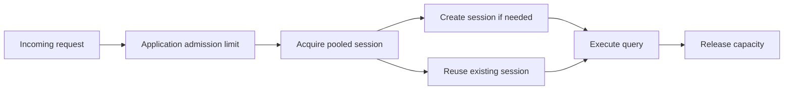

# Size YDB Session Pools for Cold Starts and Overload

Author: [nawazdhandala](https://www.github.com/nawazdhandala)

Tags: Database, Python, Performance

Description: Set YDB session limits from measured concurrency, reuse pools across warm requests, and separate cold-start delays from queueing and database overload.

A function scales from two running instances to forty, and database latency suddenly rises. Increasing each instance's session pool can make the situation worse: every new instance may now open more sessions while the database is already handling the traffic burst.

Pool tuning is a fleet-level capacity decision. Start by identifying how many independent pools exist, how much work each admits, and where requests spend their time. Then choose a small, explicit limit and test the complete scaling event.

Here, “serverless cold start” means a newly started application worker or function environment. It is separate from any provisioning behavior of the database service. Reusing application objects can reduce repeated client setup, but it cannot eliminate all network, authentication, or database delays.

## Count pools before choosing their size

A session holds client/server state used to execute queries. A pool reuses sessions instead of creating one for every operation. YDB's [session-pool sizing guide](https://ydb.tech/docs/en/recipes/ydb-sdk/session-pool-limit) explains the server resource cost of sessions and distinguishes request rate from simultaneous requests.

For a deployment with multiple processes per instance, a useful planning ceiling is:

```text
potential sessions = maximum instances × worker processes × pool limit
```

This is a budget estimate, not a prediction that every allowed session will open immediately. Include scheduled workers, administration tools, and other services in the overall budget.

For example, 40 instances with two worker processes and a limit of eight sessions have a potential application total of 640 sessions. A rolling deployment that temporarily doubles those instances changes the budget to 1,280. Both numbers matter even if steady-state traffic usually uses far fewer sessions.

Do not divide the database's capacity among only the currently warm instances and ignore the autoscaling maximum.

## Estimate concurrency, then measure it

A starting estimate is arrival rate multiplied by average session-holding time:

```text
200 operations/second × 0.020 seconds = 4 occupied sessions on average
```

The holding time includes the work done while a session is checked out, including transaction round trips and response consumption. It is not necessarily the duration of one SQL statement.

An average of four does not prove that a limit of four meets a latency target. Bursts, uneven routing, slow queries, retries, and transaction contention all change the distribution. A trial limit of eight might provide useful headroom, but it is an experiment to measure, not a universal recommendation.

If the application performs only one database operation at a time per worker, a huge pool does not create useful parallelism. Conversely, a long-lived streaming read can occupy capacity that short requests need.

## Reuse one bounded pool per worker

The example uses Python SDK **3.35.0**. Its `QuerySessionPool` has an explicit `size` setting and creates sessions on demand; its constructor does not eagerly create every allowed session. Check the [tagged implementation](https://github.com/ydb-platform/ydb-python-sdk/blob/3.35.0/ydb/query/pool.py) when selecting defaults for your release.

The accompanying [pool_limits.py](./pool_limits.py) accepts an already configured, ready driver. Construct `ReadGateway(driver, capacity=8)` once during worker initialization. Retain it across warm invocations where the hosting platform permits that lifecycle. Use your authenticated endpoint, database path, and trusted certificate configuration when building the driver.

The helper also applies an application admission limit:

```python
@contextmanager
def admitted(self, timeout=0.05):
    if not self._slots.acquire(timeout=timeout):
        raise AdmissionBusy("Database admission capacity is busy")
    try:
        yield
    finally:
        self._slots.release()
```

Admission happens before entering the database retry loop. If no slot becomes available within the configured short wait, the caller receives `AdmissionBusy`. The hosting application can translate that into a bounded retry response or retain work in a durable queue. It should not create a second pool to bypass the limit.

The semaphore controls the number of admitted operations, not the number of incoming HTTP requests. Your web server or function runtime still needs a sensible incoming-concurrency or queue limit so that a traffic spike does not create an unlimited number of waiting threads.

## Separate the waiting stages



The helper's read-only probe calls:

```python
return self.pool.execute_with_retries(
    "SELECT 1 AS one;",
    retry_settings=ydb.RetrySettings(
        max_retries=2,
        max_session_acquire_timeout=0.5,
        idempotent=True,
    ),
    settings=ydb.BaseRequestSettings().with_timeout(2),
)
```

This is a connectivity probe, not a benchmark for real business queries. The acquisition setting controls waiting for a session; the request setting supplies the query timeout. Two retries allow up to three attempts. Their delays do not form a single end-to-end deadline. The [retry recipe](https://ydb.tech/docs/en/recipes/ydb-sdk/retry) describes the SDK retry interface.

Give the overall request a budget that includes admission, acquisition, execution, and retry delays. Avoid layering an unlimited application retry loop around the SDK. For writes, determine whether replay is safe before enabling idempotent retries.

## Identify the bottleneck before increasing capacity

| Evidence | Likely investigation | First experiment |
| --- | --- | --- |
| First request slow, subsequent requests fast | Driver setup, session creation, authentication, network establishment | Compare fresh-worker and warm-worker timings |
| Session acquisition waits rise while database execution remains stable | Pool too small or sessions held unnecessarily | Inspect holding time, then test a modest limit increase |
| Database latency and overload responses rise together | Too much admitted work or a slower database workload | Reduce concurrency and inspect expensive queries |
| Sessions grow with each request | Per-request pool construction or resource leakage | Correct lifecycle ownership before tuning limits |

YDB's [OpenTelemetry metric reference](https://ydb.tech/docs/en/reference/ydb-sdk/observability/metrics/opentelemetry) includes session creation duration, session counts, acquisition timeouts, and retry attempts. `ydb.query.session.pending_requests` is documented as a cumulative counter of acquisitions that entered the wait queue; do not display its raw value as the current queue length. Configure a metrics exporter to collect these signals rather than assuming they are automatically available in your monitoring backend.

## Rehearse the burst and the recovery

Use staging traffic with representative transaction sizes. Measure a warm steady state, a burst that starts new workers, and recovery after reducing the burst. Include deployment overlap and a deliberately slow query path. Compare completed throughput, tail latency, acquisition failures, server load, and retry counts at each pool limit.

A larger limit is useful only if it improves completed work within the latency objective without pushing the database into overload. If latency grows while throughput stays flat, admitting more concurrent work may only enlarge the queue.

Stop new application work and drain active calls before closing the pool, then close its driver. Do not close shared resources at the end of every warm invocation. Hosting platforms can terminate workers abruptly, so cleanup is a best-effort lifecycle responsibility rather than a guarantee of graceful shutdown.

Local tests exercised SDK 3.35.0 pool logic with simulated sessions: lazy creation, reuse, capacity exhaustion, and cleanup. They also checked that the admission slot is released when caller code fails. No database was contacted, and no throughput result is claimed. The useful production limit still comes from your measured workload and fleet budget.
