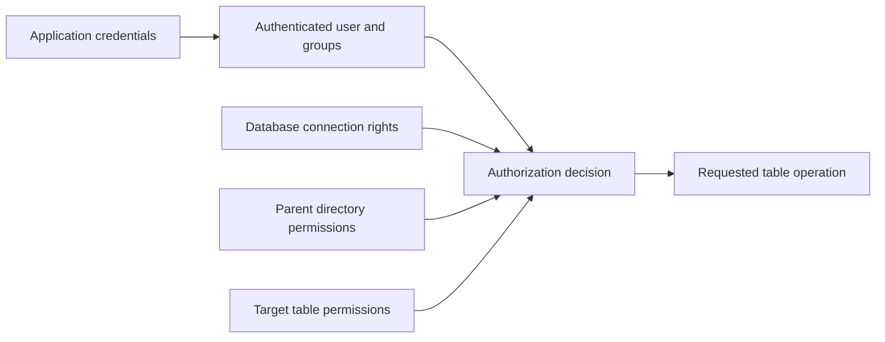

# Grant YDB Permissions to the Right User or Group

Author: [nawazdhandala](https://www.github.com/nawazdhandala)

Tags: Database, Security, Troubleshooting

Description: Match YDB grants to the authenticated identity and exact object path, distinguish connection and read rights, and verify access with the intended account.

An administrator grants table access, but the application still receives an authorization error. A common mistake is changing permissions for the name in a deployment document rather than the identity YDB actually sees. Another is granting a table operation while overlooking the database connection or schema-description rights it depends on.

Treat a permission change as a precise mapping: which authenticated subject needs which operation on which object? Verify all three before adding broader privileges.

This tutorial uses source-verified YDB26.2.1.16 grant syntax and CLI2.35.0 inspection commands. The database paths, group names, and profiles are staging examples to replace with your reviewed values.

## Identify the caller first

Authentication establishes who is calling. Authorization determines what that caller may do. A successfully authenticated identity can still lack table access; an invalid credential cannot be repaired by granting permissions to a guessed username.

Using the same credentials as the application, inspect the identity:

```bash
ydb --profile app-staging discovery whoami --groups
```

The `app-staging` profile must use the application's intended authentication method, endpoint, and database. The CLI2.35.0 binary documents `--groups` for displaying group information. Do not run this with the administrator profile and assume it describes the application.

YDB distinguishes local and externally sourced identities. Its [authorization guide](https://ydb.tech/docs/en/security/authorization) explains source suffixes such as `@ldap`; an unsuffixed local user and an external identity with a similar name are not interchangeable. Record the returned subject identifier and relevant groups, without recording tokens or passwords.

If identity lookup fails, resolve the connection or authentication failure first. If the expected group is absent, investigate membership or identity-provider mapping rather than granting unrelated users access as a workaround.

## Select the object and operation

YDB organizes schema objects under database paths. A grant to a directory can affect its descendants through inheritance, while a table grant targets a narrower object.



For this example, the database root is `/Root/shop`, the directory is `/Root/shop/reports`, and the table is `/Root/shop/reports/orders`. An existing group named `reportreaders` should read that table. Group provisioning and membership approval are prerequisites; a grant does not by itself enroll a user in the group.

Inspect the current objects as an authorized administrator:

```bash
ydb --profile admin-staging scheme describe /Root/shop --permissions
ydb --profile admin-staging scheme describe /Root/shop/reports --permissions
ydb --profile admin-staging scheme describe /Root/shop/reports/orders --permissions
```

These commands are read-only. Review the owner and permission information before editing it. Save the baseline in your change record so you can distinguish a new grant from access already provided through a group or parent.

## Understand the permission names

Do not transfer assumptions about SQL privilege names from another database. The [YDB26.2.1.16 permission mapping](https://github.com/ydb-platform/ydb/blob/26.2.1.16/ydb/docs/en/core/yql/reference/_includes/permissions_list.md) defines these relationships:

| YQL keyword | Relevant meaning |
| --- | --- |
| `CONNECT` | Connect to the database |
| `LIST` | Describe schema objects |
| `SELECT` | Read rows and describe the object |
| `UPDATE ROW` | Granular row-update permission |
| `INSERT` | A broader composite write permission, including schema operations |

The same reference describes prerequisite layers for row operations. A granular update grant alone is not a complete writable application role. In particular, do not choose `INSERT` simply because the application executes SQL inserts and assume it grants only that action.

For the read-only role here, keep connection, navigation, and table reading distinct. Review any directory-wide visibility before granting it, because schema names can themselves be sensitive.

## Apply a narrow read role

The following statements assume the existing group is correct and that directory description is acceptable:

```sql
GRANT CONNECT ON `/Root/shop` TO reportreaders;
GRANT LIST ON `/Root/shop/reports` TO reportreaders;
GRANT SELECT ON `/Root/shop/reports/orders` TO reportreaders;
```

The first supplies database connection access. The second provides schema-description access at the reports directory, subject to normal inheritance. The third provides table reading. This does not intentionally grant reads on every table in the directory.

The syntax follows the [release-pinned GRANT reference](https://github.com/ydb-platform/ydb/blob/26.2.1.16/ydb/docs/en/core/yql/reference/syntax/grant.md). An administrator executing it must hold the necessary delegation rights and cannot use ordinary grant authority to delegate rights beyond their own scope.

Save the reviewed statements from [grant-reader.sql](./grant-reader.sql), then apply them through the administrator's staging profile:

```bash
ydb --profile admin-staging sql --file ./grant-reader.sql
```

This changes permissions. Substitute actual paths and the exact verified group before running it. For an external subject containing a source suffix, use the documented identifier quoting form, such as backticks around `user1@ldap`, with the actual identity from your environment.

`WITH GRANT OPTION` is intentionally absent: reading reports does not require the ability to delegate access. Avoid broad `ALL` or `USE` grants as a way to bypass diagnosis.

## Test with the application identity

Re-run identity inspection with `app-staging`, then execute a bounded read against a staging table whose schema is known. For example, if the orders table has `order_id`:

```sql
SELECT order_id
FROM `/Root/shop/reports/orders`
LIMIT 1;
```

A successful empty result is still a successful authorized query when the table has no rows. A denied query requires inspecting the actual subject, database path, effective grants, and operation prerequisites. Do not confuse a misspelled table or invalid column with missing authorization.

Also test the intended boundary. Reading an unrelated table should remain denied unless another approved role permits it. Test prohibited writes only against disposable staging fixtures, using operations whose effect you can safely inspect; never use a destructive production command as a permission probe.

If the identity owns the object or belongs to an administrative group, it is not a meaningful least-privilege test account. Test with a subject whose broader memberships match the application's real deployment.

## Record what the grant proved

Local validation checked the CLI commands against2.35.0 help and the SQL against tagged official documentation. Shell syntax checks passed. No credentials were used, no grants were applied, and no authorization result was observed on a live database.

Your staging evidence should include the returned subject, relevant group membership, exact object paths, baseline and revised permissions, the allowed read, and a denied out-of-scope operation. Keep secret material out of that record.

If access is broader than intended, investigate inherited grants and other group memberships before revoking random entries. The [permission-management guide](https://ydb.tech/docs/en/reference/ydb-cli/commands/scheme-permissions) documents inspection and changes, while the [authentication guide](https://ydb.tech/docs/en/security/authentication) explains the separate identity mechanisms.

The useful outcome is an application role that performs its required operation and whose scope can be explained. A successful administrator query or a newly added ACL entry alone does not establish that result.
