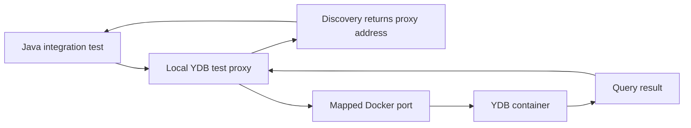

# Run YDB in Testcontainers Without Breaking Endpoint Discovery

Author: [nawazdhandala](https://www.github.com/nawazdhandala)

Tags: Java, Docker, Testing, Database

Description: Use YDB's Java test helper to handle container endpoint discovery, with pinned dependencies, a query smoke check, and clear limits for local tests.

A YDB container can be healthy, accept a connection on its published port, and still fail when your application starts a query. The first address is only the entrance. During discovery, the client asks YDB which endpoints serve the database. If the reply contains a container hostname or an unpublished port, the next connection can fail.

Increasing the startup timeout does not repair that address. You need the addresses returned by discovery to work from the network where the client runs. This guide uses the official YDB Java SDK's test helper to solve that specific problem in an isolated integration test.

## Separate the two connections

An endpoint is a host and port. A database path, such as `/local`, identifies the database behind that endpoint. Neither replaces the other. YDB documents both as connection inputs in its [connection guide](https://ydb.tech/docs/en/concepts/connect).

Testcontainers normally publishes container ports on dynamically chosen host ports. A Java process on the host therefore connects through the container's reachable host address and mapped port. An address meaningful inside Docker may be meaningless to that Java process. See Testcontainers' [networking documentation](https://java.testcontainers.org/features/networking/).

For example, reaching `localhost:49172` does not establish that `container-name:2136` is reachable. Checking only the first TCP connection misses the failure that happens after discovery.



The proxy in this diagram belongs to the test helper. It keeps discovery and subsequent requests on a path the host-side test can use.

## Use a versioned helper, not a guessed server setting

This example pins `tech.ydb.test:ydb-tests-common` and `tech.ydb:ydb-sdk-query` to **2.5.0**. That release's parent pins Testcontainers **2.0.3**. Its `YDB_DOCKER_ISOLATION` mode selects a proxy-based helper. The proxy intercepts `ListEndpoints` and returns its own address; other RPCs, or remote procedure calls, are forwarded to the container.

These details are visible in the tagged [factory](https://github.com/ydb-platform/ydb-java-sdk/blob/v2.5.0/tests/common/src/main/java/tech/ydb/test/integration/YdbHelperFactory.java), [proxy implementation](https://github.com/ydb-platform/ydb-java-sdk/blob/v2.5.0/tests/common/src/main/java/tech/ydb/test/integration/docker/GrpcProxyServer.java), and [discovery response](https://github.com/ydb-platform/ydb-java-sdk/blob/v2.5.0/tests/common/src/main/java/tech/ydb/test/integration/docker/DiscoveryServiceProxy.java). They are test infrastructure, not a production gateway recommendation.

The proxy path uses plaintext gRPC and anonymous access. Use disposable data on an isolated development machine or CI runner. Do not use this fixture to validate TLS certificates, authentication, authorization, or real cluster failover. It does not disable certificate verification on your production client; it creates a separate plaintext test connection.

## Prepare a reproducible fixture

You need Java 17 or newer, Maven, and a Docker-compatible runtime supported by Testcontainers. Use a runner whose architecture your selected YDB image supports. The helper enables in-memory disks; this fixture is disposable and does not test persistence. Review the image's [configuration requirements](https://ydb.tech/docs/en/reference/docker/configuration) before choosing runner resources.

The accompanying [pom.xml](./pom.xml) pins the Java dependencies and build plugins. Save the accompanying [DiscoveryCheck.java](./src/main/java/DiscoveryCheck.java) at `src/main/java/DiscoveryCheck.java` beside that project.

Choose and review a YDB local image release, then record its immutable registry digest. The following is a placeholder, deliberately not a fabricated release digest:

```bash
export YDB_DOCKER_IMAGE='ydbplatform/local-ydb@sha256:REPLACE_WITH_REVIEWED_64_HEX_DIGEST'
mvn compile
mvn exec:java -Dexec.mainClass=DiscoveryCheck
```

Compilation needs access to the Maven artifacts unless already cached. Execution needs the selected image and Testcontainers' runtime dependencies. The Java program rejects the placeholder before starting Docker. Replace it with a real digest appropriate for the runner architecture; keep that choice in the test project's configuration history.

The helper normally defaults to a moving `latest` image. Supplying the digest avoids quietly changing the database when you rerun the same Java dependencies. A compile check alone cannot establish compatibility between a selected database image and the SDK.

## Keep the fixture's behavior explicit

The program creates a `YdbEnvironment` that overrides five settings:

```java
YdbEnvironment environment = new YdbEnvironment() {
    @Override public boolean useDockerIsolation() { return true; }
    @Override public boolean dockerReuse() { return false; }
    @Override public boolean disableIntegrationTests() { return false; }
    @Override public String ydbEndpoint() { return null; }
    @Override public String ydbDatabase() { return null; }
};
```

Isolation selects the discovery proxy. Disabling reuse gives this run a disposable container. The final two overrides prevent unrelated `YDB_ENDPOINT` and `YDB_DATABASE` environment variables from redirecting the fixture to an external database. The container database remains the helper's separate `/local` default. Review the release's [environment class](https://github.com/ydb-platform/ydb-java-sdk/blob/v2.5.0/tests/common/src/main/java/tech/ydb/test/integration/YdbEnvironment.java) when changing those choices.

The program also checks `factory.isEnabled()` and fails if Docker is unavailable. This matters because an unavailable test environment should not look like a successful database integration test.

## Require a query, not just successful construction

Creating a transport is insufficient evidence. The example builds a query client, acquires a session through the SDK retry context, and executes:

```java
retry.supplyResult(session -> session.createQuery("SELECT 1;", TxMode.NONE).execute())
        .join().getStatus().expectSuccess("YDB query failed");
```

This follows the SDK's [query example API](https://github.com/ydb-platform/ydb-java-sdk/blob/v2.5.0/query/src/test/java/tech/ydb/query/QueryExampleTest.java). Success prints the helper endpoint and database path. A failed status raises an error rather than printing a success message. The complete file closes the query client, transport, and helper in reverse construction order.

Use a CI job timeout around the smoke test. This minimal example does not define a whole-test deadline. After this connection check, add your application's own assertions for returned values, transactions, and schema behavior. `SELECT 1` does not establish those properties.

## Interpret failures at the right boundary

| Observation | Next check |
|---|---|
| Image cannot start | Digest, platform support, runtime availability, memory, and container logs |
| Health check never completes | Database initialization and image/helper compatibility |
| Bootstrap succeeds but later connections fail | Whether the client actually uses the helper-created transport |
| Query reports a missing database | Container database path and selected image configuration |
| Local fixture passes but staging fails | Real discovery addresses, TLS trust, credentials, and routing |

Avoid replacing every hostname with `localhost`: that can conceal incorrect ports and breaks when the client itself moves into another container. Likewise, the proxy's synthetic discovery response is not evidence that every node in a real cluster is reachable.

For production-like discovery testing, use a separate environment where the client can resolve and reach the actual advertised endpoints. Keep both tests: the disposable proxy fixture checks application behavior conveniently, while the network-realistic test checks deployment assumptions.

The Java example was compiled against the pinned artifacts during review. No YDB container or database query was executed here, so the selected image, runtime startup, and end-to-end behavior still require verification on your runner.
