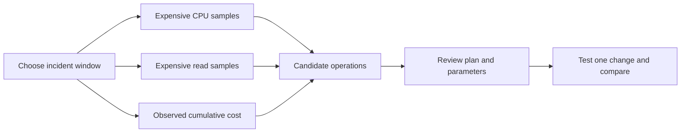

# Find YDB's CPU-Heavy and Read-Heavy Queries with System Views

Author: [nawazdhandala](https://www.github.com/nawazdhandala)

Tags: Database, Monitoring, Performance, SQL

Description: Use YDB system views to distinguish expensive individual queries from repeated workload cost, with bounded SQL and careful metric interpretation.

When a YDB database becomes busy, the slowest query is not always the largest CPU consumer. A rare analytical query can dominate a latency report while a small query executed thousands of times consumes more total resources. Queries that read many bytes are another useful view of the workload, but bytes read are not the same thing as time spent waiting.

Use the database's `.sys` views to build a short list of candidates, then investigate their plans and application context. The queries below are read-only and scoped to a time window. They target the view names and fields documented in YDB **26.2.1.16**.

## Choose the view that answers your question

System views are available under `.sys` at the database root. Use a connection to the intended database with permission to inspect them. Do not accidentally investigate an unrelated database because a CLI profile points somewhere else.

| Question | View |
|---|---|
| Which individual runs used the most CPU? | `.sys/top_queries_by_cpu_time_one_minute` |
| Which individual runs read the most bytes? | `.sys/top_queries_by_read_bytes_one_minute` |
| Which query texts accumulated CPU across repeated runs? | `.sys/query_metrics_one_minute` |

The first two are leaderboards of expensive runs. The third contains grouped measurements for runs with identical query text. The distinction is documented in the release's [system-view reference](https://github.com/ydb-platform/ydb/blob/26.2.1.16/ydb/docs/en/core/dev/system-views.md).

Do not treat either source as an unlimited audit log. The reviewed documentation describes minute-level history covering six hours, with only the top five queries per interval in each top-query view. Query-detail statistics have their own bounded coverage and can be incomplete under heavy load.

## Use an explicit observation window

The downloadable [cpu_samples.sql](./cpu_samples.sql) retrieves the largest CPU samples inside a bounded interval:

```sql
DECLARE $since AS Timestamp;
DECLARE $until AS Timestamp;
SELECT IntervalEnd, Rank, CPUTime, Duration, ReadRows, ReadBytes, Partitions, QueryText
FROM `.sys/top_queries_by_cpu_time_one_minute`
WHERE IntervalEnd >= $since AND IntervalEnd < $until
ORDER BY CPUTime DESC
LIMIT 20;
```

Bind `$since` and `$until` as YDB timestamps. They filter `IntervalEnd`, the end of the statistics interval, rather than the exact start time of each query. Align them with the bucket ends you intend to inspect. A short query that completed around a boundary can appear in a different bucket from the one an application log reader first expects.

YDB's [parameter declaration reference](https://ydb.tech/docs/en/yql/reference/syntax/declare) documents typed values supplied separately from SQL text. This avoids editing timestamps into ad hoc query strings for every investigation.

The result's `Rank` is the rank within its original interval. The `ORDER BY CPUTime` clause reranks the selected samples across your requested window. A row with rank one is not necessarily the highest CPU sample across the entire incident.

## Read CPU time and duration differently

`CPUTime` is reported in microseconds. Divide by one million to express it in CPU-seconds. `Duration` is an interval representing elapsed query duration. They are different measurements and should not be subtracted or compared without considering their meaning.

Parallel work can accumulate CPU across workers while wall-clock time advances once. Waiting for resources can lengthen duration without an equivalent amount of active CPU. Therefore, a high duration is not by itself proof of a CPU-heavy plan, and high aggregate CPU is not a direct CPU utilization percentage.

Use `Partitions` as another clue. A query involving many partitions may have a legitimate distributed workload or may be reaching much more data than intended. The number alone does not establish the cause; the execution plan and parameters provide that context.

## Build a separate read-heavy list

The [read_samples.sql](./read_samples.sql) query uses the read-byte leaderboard:

```sql
DECLARE $since AS Timestamp;
DECLARE $until AS Timestamp;
SELECT IntervalEnd, Rank, ReadBytes, ReadRows, CPUTime, Partitions, QueryText
FROM `.sys/top_queries_by_read_bytes_one_minute`
WHERE IntervalEnd >= $since AND IntervalEnd < $until
ORDER BY ReadBytes DESC
LIMIT 20;
```

Compare rows read with the rows the application needed. Reading many rows to return a few can point toward a broad scan, a weak filter, or a missing access path. It can also be expected for an aggregate over a large dataset. Investigate before labeling it waste.

Do not translate `ReadBytes` directly into physical device reads or network egress. It is the query statistic described by this view. Cache behavior and other layers can change the relationship between logical work and hardware activity. The separate [metrics reference](https://ydb.tech/docs/en/reference/observability/metrics/) helps correlate query observations with database-level monitoring.

## Find cumulative cost from frequent queries

A query taking fifty milliseconds of CPU one thousand times consumes fifty CPU-seconds. A single ten-CPU-second query looks larger in an individual-run leaderboard, but costs less in total for that example workload.

Use [aggregate_cpu.sql](./aggregate_cpu.sql) for the grouped view:

```sql
DECLARE $since AS Timestamp;
DECLARE $until AS Timestamp;
SELECT QueryText,
       SUM(Count) AS ObservedRuns,
       SUM(SumCPUTime) AS ObservedCPUUs,
       SUM(SumReadBytes) AS ObservedReadBytes
FROM `.sys/query_metrics_one_minute`
WHERE IntervalEnd >= $since AND IntervalEnd < $until
GROUP BY QueryText
ORDER BY ObservedCPUUs DESC
LIMIT 20;
```

The aliases say “observed” because the view's contents are bounded, not a guaranteed complete database accounting record. Do not sum the CPU leaderboard instead: it retains representative expensive runs, not every execution's contribution.

Grouping by text also has practical limits. Literal values embedded in SQL can produce separate texts for otherwise similar requests. The documented text-length limit can complicate analysis of very large statements. Keep application operation names and tracing context available to connect these observations to the actual code path.

## Turn candidates into an investigation



Review one candidate at a time. Capture its representative parameters safely, inspect the plan, and compare the same workload after a targeted change. YDB documents plan structure in its [query-plan reference](https://ydb.tech/docs/en/yql/query_plans).

Query text may contain sensitive literals. Restrict access to exported results and redact before sharing them in an incident channel. Prefer a narrow capture over repeatedly dumping all retained text.

System views themselves create database work. Avoid aggressive polling during an incident; the versioned documentation advises against exceeding one request per second. Use these views for bounded diagnosis alongside normal metrics, not as an unbounded high-frequency query log.

The local review checked view schemas against official source and tested the grouped query's window and ordering with an adapted SQLite fixture. The frequent-small-query example ranked above the rare expensive query, and the upper boundary was excluded. No live YDB system view, query plan, or performance improvement was observed during review.
