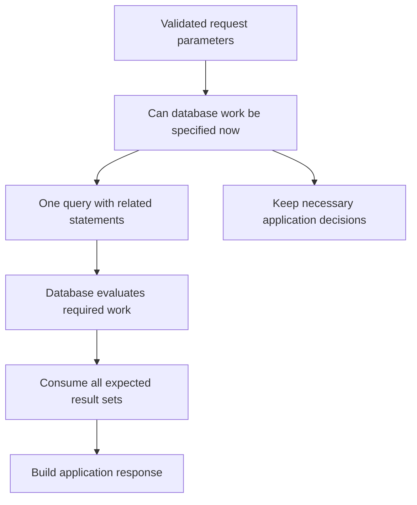

# Reduce YDB Round Trips with One Combined YQL Query

Author: [nawazdhandala](https://www.github.com/nawazdhandala)

Tags: Database, SQL, Performance

Description: Combine related YDB operations into one query to reduce client round trips while preserving transaction isolation, result handling, and retry boundaries.

A page makes three sequential database calls before it can respond: load a customer, load recent orders, and calculate a summary of those orders. Each query is fast on its own, yet the endpoint feels slow because the application waits for a network response between steps.

YDB's [YQL FAQ](https://ydb.tech/docs/en/faq/yql) recommends expressing non-interactive transaction work in one query when possible. This reduces repeated client-to-database communication. It does not eliminate database reads, guarantee parallel execution, or make an expensive query cheap.

The useful optimization is to remove unnecessary client pauses while retaining the same business result and consistency requirements.

## Decide whether the transaction is interactive

An interactive transaction returns data to application code so that the application can decide what to do next. That is necessary when the next operation depends on logic that cannot reasonably be expressed in the database.

However, code often performs a read, rearranges its fields, and sends another query whose intent was already known. Those round trips are candidates for consolidation.



Start with tracing. Separate connection acquisition, query submission, server work, result transfer, and application processing. If most time is spent scanning data, reducing two network round trips may make little difference. If the database is distant and the individual reads are small, it may be valuable.

## Define a bounded example

Consider a customer overview containing a profile, the20 latest orders, and a total for those displayed orders. The summary is deliberately for the displayed page, not lifetime spending.

The staging schema below follows [YDB26.2.1.16 CREATE TABLE syntax](https://github.com/ydb-platform/ydb/blob/26.2.1.16/ydb/docs/en/core/yql/reference/syntax/create_table/index.md):

```sql
CREATE TABLE customers (
    customer_id Uint64 NOT NULL,
    display_name Utf8,
    PRIMARY KEY (customer_id)
);

CREATE TABLE customer_orders (
    customer_id Uint64 NOT NULL,
    order_id Uint64 NOT NULL,
    amount_cents Int64 NOT NULL,
    PRIMARY KEY (customer_id, order_id)
);
```

Assume order identifiers increase in the order the application wants to display. If that is not your business ordering, design a suitable key or index rather than calling this a timestamp sort. The example uses integer cents to avoid introducing floating-point money arithmetic.

Create the schema separately from application reads. The [transaction documentation](https://ydb.tech/docs/en/concepts/transactions) distinguishes data-definition statements from data manipulation and does not support mixing them in one transaction.

## Send the related reads together

Bind an authorized `$customer_id` through the SDK. The following query expresses all required work before submitting it:

```sql
DECLARE $customer_id AS Uint64;

$recent = (
    SELECT order_id, amount_cents
    FROM customer_orders
    WHERE customer_id = $customer_id
    ORDER BY order_id DESC
    LIMIT 20
);

SELECT display_name
FROM customers
WHERE customer_id = $customer_id;

SELECT order_id, amount_cents
FROM $recent
ORDER BY order_id DESC;

SELECT COUNT(*) AS displayed_order_count,
       SUM(amount_cents) AS displayed_total_cents
FROM $recent;
```

The files [schema.sql](./schema.sql) and [overview.sql](./overview.sql) contain the examples. `$recent` is a named expression: it gives a reusable name to a subquery. It is not a temporary table created in the database. The [release-pinned expression reference](https://github.com/ydb-platform/ydb/blob/26.2.1.16/ydb/docs/en/core/yql/reference/syntax/expressions.md) describes substitution of named expressions and optimizer treatment of identical subgraphs.

There are three result sets. The first contains the customer name or no rows if the customer is absent. The second contains the selected orders. The third contains the page count and aggregate amount. Handle an empty aggregate deliberately: the total can be null when there are no rows, so the application must define how it displays an empty page.

The explicit final ordering applies to the displayed order rows. A named expression does not establish a general promise that every later consumer inherits its row order.

## Keep the transaction contract explicit

One submission does not mean every transaction mode provides the same consistency. Execute the combined read using an appropriate supported transaction mode, such as Serializable when that is the existing contract, and complete it through the SDK's normal transaction controls. Do not add SQL commit barriers or enable per-statement autocommit merely to make a multi-statement request run.

YDB supports both multiple queries within a transaction and multiple expressions within a query. The [query-execution guide](https://ydb.tech/docs/en/concepts/query_execution/) explains that a query can return several result sets. Preserve the distinction between reducing submissions and changing transaction boundaries.

For a streaming SDK API, consume the stream completely and handle its result-set identifiers or documented result containers. Receiving the profile result does not establish that every later statement completed successfully. Buffering is reasonable for this small example; copying the pattern to an unbounded report could create a new memory problem.

Missing customer data also needs an explicit response rule. Do not accidentally show orphaned orders simply because another result set contains rows. Application authorization and consistency checks still apply to the combined response.

## Do not turn consolidation into giant transactions

The same principle can help related writes, but preserve their data dependencies and required commit boundary. Move database-dependent decisions into supported query expressions only when their semantics are understood and tested. Keep network calls to external services outside retryable database callbacks unless their effects have independent replay protection.

Avoid collecting unrelated requests into one transaction to save network calls. Larger transactions can increase contention, transferred data, and the cost of a retry. A few bounded operations serving one response are a different workload from thousands of independent customer updates.

Do not assume statement order is an imperative program with a round trip removed after every line. Review YQL dependency and transaction semantics when reads depend on writes. The example here contains only reads, so it avoids that additional correctness problem.

## Measure a fair before-and-after comparison

A local SQLite adaptation checked the example's result intent using25 orders for one customer and unrelated orders for another. It selected the newest20 identifiers, calculated the same count and total from those displayed rows, and checked the empty-customer aggregate. This was not a YDB compilation or execution test and measured no latency improvement.

In staging, compare the original sequential reads with the combined query using the same isolation mode, parameter distribution, data, connection pool, and concurrency. Record complete endpoint latency, server query duration, rows and bytes read, retry attempts, and response size. Test empty, missing, and busy customers as well as the typical case.

Inspect the plan to confirm that the bounded key-range read remains bounded. Verify that the summary describes the displayed rows and that the application consumes every result set correctly. Then test a transient failure and confirm the whole logical operation follows the intended retry policy.

Accept the change when the endpoint returns equivalent correct data with fewer avoidable waits. Keep it only if the measured benefit outweighs added query and result-handling complexity.
