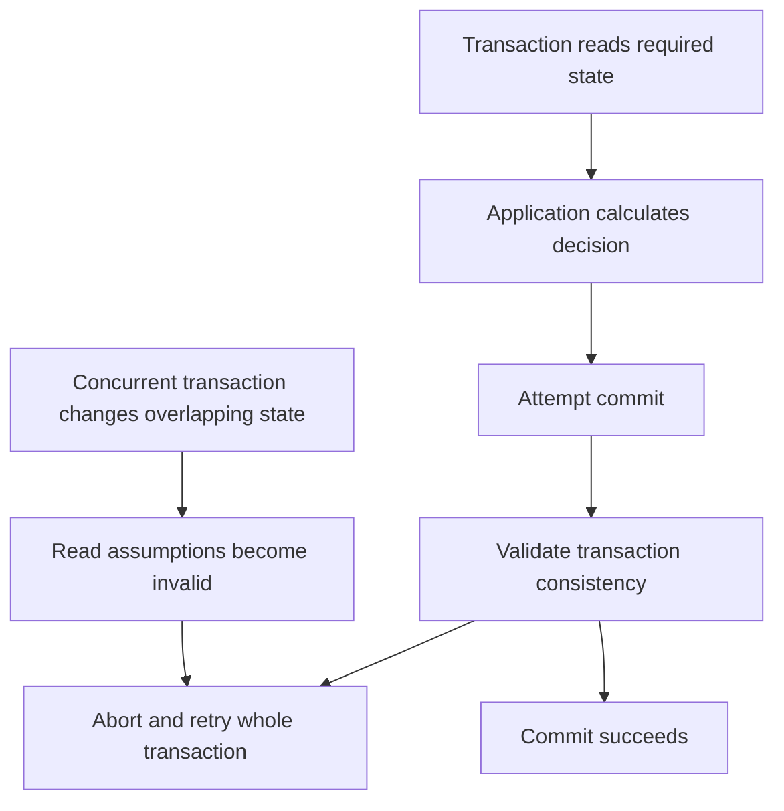

# Reduce YDB Transaction Conflicts from Broad Reads and Hot Rows

Author: [nawazdhandala](https://www.github.com/nawazdhandala)

Tags: Database, SQL, Performance, Troubleshooting

Description: Reduce YDB transaction-lock invalidations by narrowing necessary reads, shortening transaction lifetimes, and controlling contention on shared rows.

A transaction reads data, makes a decision, and then fails with `Transaction locks invalidated`. Retrying can make the request succeed, but a growing retry rate means the application repeatedly performs work that cannot commit.

YDB's [error FAQ](https://ydb.tech/docs/en/faq/errors) identifies two common contributors: transactions reading unnecessarily many rows and transactions competing for the same hot rows. Address both before increasing retry counts. A smaller, shorter transaction often has fewer opportunities to conflict, but it must still read everything required for its business decision.

## Understand what was invalidated

YDB's Serializable transaction mode uses optimistic concurrency control. Transactions proceed on the assumption that they can finish consistently; conflicting changes can invalidate that assumption and force an abort. The [transaction guide](https://ydb.tech/docs/en/concepts/transactions) explains the mode and its guarantees.

This is different from treating every conflict as a conventional lock wait. Increasing a lock-wait timeout does not repair a decision based on data that changed during the transaction.

The read set is the data on which the transaction's decision depends. Its exact database representation is an implementation detail; operationally, ask which keys or ranges the queries access and which concurrent writers can affect them. The number of rows returned to the application alone is not a complete description of that dependency.



The goal is not to suppress every abort. The goal is to preserve correctness while reducing unnecessary conflict opportunities and keeping retries affordable.

## Identify the transaction shape first

Collect the failing status and issue text, transaction duration, query identifiers, attempt counts, and the relevant key categories. Correlate conflicts with a particular workflow instead of aggregating every database operation into one error percentage.

Compare three patterns:

| Pattern | Likely source of avoidable overlap |
| --- | --- |
| Read a large range, then update one selected row | Unnecessary reads or application-side filtering |
| Read one shared counter, then update it in every request | A genuine hot row |
| Read necessary rows, wait on an external service, then write | An unnecessarily long transaction window |

Also distinguish an aborted attempt from a failed logical request. A request that succeeds after several retries still consumes additional database work and caller latency.

## Replace application-side filtering with a key lookup

Consider a staging inventory table whose primary key identifies one item in one warehouse:

```sql
CREATE TABLE inventory (
    warehouse_id Utf8 NOT NULL,
    sku Utf8 NOT NULL,
    available Int64,
    PRIMARY KEY (warehouse_id, sku)
);
```

The schema follows the [YDB26.2.1.16 table syntax](https://github.com/ydb-platform/ydb/blob/26.2.1.16/ydb/docs/en/core/yql/reference/syntax/create_table/index.md). In this example, the business operation needs availability for exactly one known SKU, meaning one stock-keeping unit.

A broad read fetches the whole warehouse and leaves the application to select its item:

```sql
DECLARE $warehouse_id AS Utf8;
SELECT sku, available
FROM inventory
WHERE warehouse_id = $warehouse_id;
```

For that specific operation, replace it with a complete primary-key predicate:

```sql
DECLARE $warehouse_id AS Utf8;
DECLARE $sku AS Utf8;
SELECT sku, available
FROM inventory
WHERE warehouse_id = $warehouse_id AND sku = $sku;
```

These files are included as [schema.sql](./schema.sql), [broad_read.sql](./broad_read.sql), and [point_read.sql](./point_read.sql). Execute the selected read inside the same intended transaction as the dependent inventory change. The snippet does not implement a complete reservation workflow or its validation and write logic.

YDB's [index execution guide](https://ydb.tech/docs/en/concepts/query_execution/secondary_indexes) explains primary-key access and the extra structures involved in secondary indexes. Verify the actual plan and read statistics rather than assuming any added `WHERE` clause creates a point lookup. A predicate on an unrelated non-key column can still require broad access.

The narrower query is correct only when the operation truly needs one item. If the decision depends on total warehouse inventory or an invariant across multiple items, removing those reads changes the business rule. Preserve necessary checks and redesign the operation explicitly if they are too expensive.

## Shorten the time between read and commit

Do validation that depends only on the incoming request before opening the transaction. Parse the payload, verify required fields, and calculate stable request metadata first. Keep database-dependent decisions inside the transaction so they use the state that will be validated at commit.

Avoid calling an external API, waiting for a user, or performing unrelated expensive computation between the first database read and commit. If the workflow needs an external effect, separate that effect using an explicit durable workflow or outgoing-work record rather than holding the database transaction open across it.

Combine related database steps when the query language and SDK allow it without changing semantics. Reducing network round trips can shorten the conflict window, but bundling unrelated operations into a larger transaction can increase the read set. Measure both effects.

## Treat a hot row as a design constraint

A primary-key lookup can still conflict frequently when every request updates the same key. Examples include one global sequence row, one tenant-wide usage total, or one heavily requested inventory item.

First reduce simultaneous contenders through bounded application concurrency or a queue scoped to the affected key. That may trade some queueing latency for fewer aborted transactions; measure successful throughput and end-to-end latency together.

Some counters can be split into independently updated buckets and aggregated later. Others represent a strict global limit that cannot be weakened. Sharding a counter changes the consistency problem and requires a design for aggregation, reconciliation, and limit enforcement. Do not apply it mechanically to a balance or reservation guarantee.

A secondary index may reduce read work, but synchronous indexes also add transactional write work. The [secondary-index development guide](https://ydb.tech/docs/en/dev/secondary-indexes) is useful when choosing a supported access path. Validate the resulting read/write tradeoff with the actual workload.

## Keep whole-transaction retries bounded

YDB's [status reference](https://ydb.tech/docs/en/reference/ydb-sdk/ydb-status-codes) directs applications to retry the entire transaction after `ABORTED`. Re-read the state and recompute the decision; do not replay only a final write calculated from the failed attempt's snapshot.

Use your SDK's bounded retry mechanism and retain the caller's overall time budget. Keep external side effects out of retry callbacks unless they have their own replay protection. An uncertain commit outcome is a different case from a confirmed abort and needs appropriate idempotency or reconciliation.

Track attempts per successful operation. If reducing the read set lowers retries but shifts load into a new shared summary row, the bottleneck has moved rather than disappeared.

## Prove both correctness and improvement

A local SQLite adaptation checked the example's intended result semantics: the warehouse read returned 100 fixture rows, while the key lookup returned the same selected item as application-side filtering. It did not test YDB plans, read sets, locking, or conflict rates.

In staging, compare baseline and revised transactions under the same key distribution and arrival rate. Include a heavily contended item, unrelated items, and the business edge cases such as insufficient stock. Measure completed operations, attempts, aborts, read volume, and tail latency. Verify the final business state, not just successful status codes.

Accept the change when the required invariants still hold and useful work completes with less repeated effort. A lower conflict count caused by accidentally skipping a necessary consistency check is a regression, even if the latency chart looks better.
