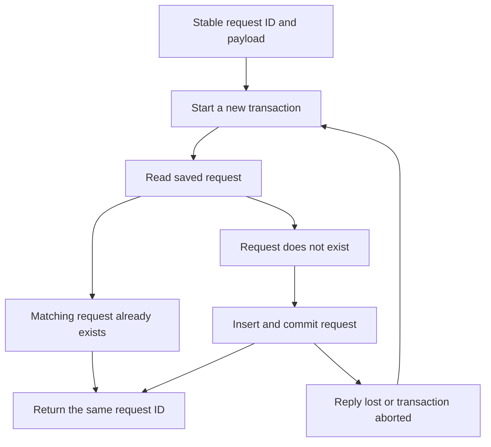

# Retry YDB Transactions Without Duplicating Committed Work

Author: [nawazdhandala](https://www.github.com/nawazdhandala)

Tags: Database, Python, Troubleshooting

Description: Retry complete YDB transactions, recognize uncertain commit outcomes, and use a stable request record to avoid duplicating accepted operations.

A failed database call does not always mean that the database rejected the work. The server can commit a transaction and then lose its connection before the client receives the success response. Repeating an increment, payment instruction, or inventory reservation at that point can apply the business operation twice.

YDB also aborts transactions when concurrent changes prevent the requested isolation. Those failures need retries too, but the reasoning is different: a confirmed abort means the transaction did not commit. A useful retry policy distinguishes these cases and places the retry boundary around the complete operation.

## Understand what the error establishes

A transaction groups database changes into one unit. An aborted transaction does not leave half of that unit committed. An uncertain response leaves the client unsure which complete outcome occurred.

| Outcome | What the application knows | Appropriate response |
| --- | --- | --- |
| `SUCCESS` | The operation completed successfully | Return the recorded result |
| `ABORTED` | This transaction was aborted | Restart the complete transaction with fresh reads |
| `UNDETERMINED` | The transaction outcome is unknown | Retry only when repetition is safe, or reconcile using a durable operation identity |
| Invalid query or denied permission | Repetition does not repair the cause | Correct the query or access configuration |

The [server status reference](https://ydb.tech/docs/en/reference/ydb-sdk/ydb-status-codes) documents these distinctions. A transport failure has its own meaning; do not translate every connection exception into “nothing happened.” Preserve the original status and detailed issue information when reporting a failure.

## Restart the reads as well as the writes

Suppose a transaction reads available inventory, calculates a reservation, and writes the remaining quantity. If a concurrent transaction changes the inventory, retrying only the final write reuses a calculation from an invalidated view of the data.

Put the reads, validation, derived values, and writes inside a callback that starts a new transaction on every attempt. YDB's [query execution guide](https://ydb.tech/docs/en/concepts/query_execution/execution_process) explains why retrying the entire transaction is the correct boundary.

Keep stable input outside that callback: the caller's request ID, requested quantity, and intended account. Keep database-derived decisions inside it. Do not keep an old transaction handle and try to revive it after an abort.



The loop is bounded by the retry policy. The diagram describes a request-recording example, not a claim that an external payment system participates in the database transaction.

## Make a retry recognize the original request

An idempotent operation has the same intended effect when repeated. Setting an SDK option named `idempotent` declares that property; it does not create it.

For a small staging example, create this row table using an authorized YDB client:

```sql
CREATE TABLE retry_requests (
    request_id Utf8 NOT NULL,
    payload Utf8,
    PRIMARY KEY (request_id)
);
```

Each logical request gets one stable key. The payload is immutable text supplied by the caller. Reusing the key with different text is rejected instead of silently replacing the original request. If the text contains JSON, choose a stable serialization before calling the helper; equivalent JSON objects with different whitespace are different strings here.

The accompanying [record_request.py](./record_request.py) targets Python SDK **3.35.0** and takes a caller-owned, authenticated `QuerySessionPool`. Install the pinned dependency from [requirements.txt](./requirements.txt), configure the driver with your database endpoint and trusted TLS certificates, and create the table in a disposable database before using the helper.

Its transaction callback performs this sequence:

```python
with session.transaction(ydb.QuerySerializableReadWrite()) as tx:
    result_sets = list(tx.execute(READ, parameters))
    rows = [row for result in result_sets for row in result.rows]
    if rows:
        if rows[0].payload != payload:
            raise ValueError("Request ID was already used with another payload")
        tx.commit()
        return request_id
    write_parameters = dict(parameters)
    write_parameters["$payload"] = (payload, ydb.PrimitiveType.Utf8)
    list(tx.execute(INSERT, write_parameters, commit_tx=True))
    return request_id
```

`READ`, `INSERT`, and their typed parameters are defined in the complete helper. The lists consume the query response streams before proceeding. `QuerySerializableReadWrite` provides the transaction mode for the read-and-insert decision. The final insert explicitly commits; exiting a transaction context alone is not a successful-commit instruction. These APIs were checked against the [tagged transaction implementation](https://github.com/ydb-platform/ydb-python-sdk/blob/3.35.0/ydb/query/transaction.py) and [session implementation](https://github.com/ydb-platform/ydb-python-sdk/blob/3.35.0/ydb/query/session.py).

If the first attempt saves the request but loses its reply, the next attempt reads that same key and returns it. If two callers race with the same key, handle the resulting transaction failure through the whole callback. Do not bypass the lookup with an unconditional replacement write.

## Bound the retry helper

The complete function submits its callback through the pool:

```python
return pool.retry_operation_sync(
    attempt,
    retry_settings=ydb.RetrySettings(
        max_retries=3,
        max_session_acquire_timeout=5,
        idempotent=True,
    ),
)
```

This allows three retries after the initial attempt. The five-second value bounds session acquisition; it is not a five-second deadline for the entire business request. Account separately for query time, backoff, and the caller's overall deadline.

The [pool implementation](https://github.com/ydb-platform/ydb-python-sdk/blob/3.35.0/ydb/query/pool.py) obtains a session for each callback attempt. The [retry classification](https://github.com/ydb-platform/ydb-python-sdk/blob/3.35.0/ydb/_errors.py) makes `Undetermined` retryable when the idempotent flag is enabled. Error policies differ across SDKs and releases, so use the behavior of your pinned SDK rather than copying another language's status table.

## Preserve the guarantee outside this example

This helper records acceptance of a request. It does not execute a payment, send an email, or decrement inventory. Adding those effects requires another design decision.

For database-only work, store the operation marker and its business changes in the same transaction. For an external service, a common design is a durable outgoing-work record plus a worker that passes the same idempotency key to a destination that supports it. Without destination deduplication or reconciliation, an external call can still be repeated.

Retain request records for the full period during which clients can replay requests. Deleting the marker too early removes the evidence needed to recognize a previous commit. After retry exhaustion, return an explicit unresolved outcome when appropriate and retain the same request ID for investigation. Creating a new ID to “try again” defeats the protection.

## Test the failure boundaries

Local tests exercised the helper with the real SDK retry machinery and simulated transactions: ordinary success, an abort before insertion, a committed insert followed by a lost reply, conflicting payload reuse, and exhausted retries. The lost-reply case stored one request and returned the same ID after replay. Persistent aborts stopped after four total attempts.

These tests did not connect to YDB or prove server-side concurrency behavior. Before rollout, repeat the scenarios against a staging database with concurrent clients and controlled connection interruption. Record attempt counts, final outcomes, latency, and unresolved requests, without logging sensitive payloads. Treat growing retry rates as a contention or capacity signal rather than increasing the retry budget indefinitely.
