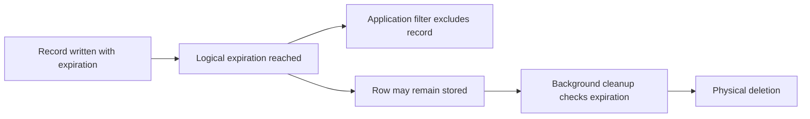

# Configure YDB TTL and Explain Why Expired Rows Still Appear

Author: [nawazdhandala](https://www.github.com/nawazdhandala)

Tags: Database, SQL, Troubleshooting

Description: Separate YDB's background TTL cleanup from application expiry rules, with a safe staging schema, explicit read filters, and practical checks.

A row whose expiration timestamp has passed can still be returned by a YDB query. That does not necessarily mean the time-to-live configuration is broken. TTL is a background cleanup mechanism; an application's rule for whether a record is still valid is a separate decision.

If a record must stop appearing at a precise logical cutoff, put that rule in the query or application operation. Use TTL to reclaim expired data afterward. Treating those two responsibilities separately makes both correctness and troubleshooting easier.

## Understand the two clocks in the problem

For the reviewed YDB **26.2.1.16** behavior, the deletion threshold is the TTL column's value plus the configured delay. Cleanup does not promise deletion at that exact instant. YDB's [versioned TTL documentation](https://github.com/ydb-platform/ydb/blob/26.2.1.16/ydb/docs/en/core/concepts/_includes/ttl.md) explicitly recommends query filtering when logically expired rows must be excluded.

There are therefore two relevant moments: when the application considers the row invalid, and when background cleanup physically removes it. You can observe the row between those moments without violating the documented TTL behavior.



A raw query without the filter observes stored data. A filtered query observes your application's validity rule. Do not compare those outputs as if they were intended to mean the same thing.

## Choose one timestamp convention

There are two common models:

| Column meaning | TTL configuration idea | Read validity rule |
|---|---|---|
| Absolute expiration time | Zero additional delay on `expire_at` | Expiration is later than the cutoff |
| Creation or modification time | Retention delay on that timestamp | Timestamp plus retention is later than the cutoff |

Do not store an already-calculated expiry time and then unintentionally add the retention period again in the TTL configuration. That produces a longer retention period than the application author expected.

The example below uses an absolute expiration timestamp and a zero delay. It creates a fresh, disposable row table; do not use a new retention rule on existing production data before assessing what it makes eligible for deletion.

```sql
CREATE TABLE ttl_records_lab (
    record_id Utf8 NOT NULL,
    expire_at Timestamp,
    payload Utf8,
    PRIMARY KEY (record_id)
)
WITH (
    TTL = Interval("PT0S") ON expire_at
);
```

The schema is also available in [schema.sql](./schema.sql). YDB documents this form in its [table TTL syntax](https://ydb.tech/docs/en/yql/reference/syntax/create_table/with). Zero delay means the stored timestamp supplies the threshold; it does not request synchronous deletion during every read.

## Make the application read rule explicit

The corresponding point-read query is in [live_record.sql](./live_record.sql):

```sql
DECLARE $record_id AS Utf8;
DECLARE $as_of AS Timestamp;
SELECT record_id, payload
FROM ttl_records_lab
WHERE record_id = $record_id
  AND expire_at > $as_of;
```

Bind the identifier and a timestamp cutoff through your client. The example defines expiration as exclusive: at equality, the record is no longer returned. This is an explicit application policy, not a prediction of exactly when the cleanup worker will delete the row.

For a multi-step business operation, establish where the cutoff comes from and which consistency guarantees the operation requires. A timestamp supplied by a client with a badly skewed clock can produce the wrong validity decision. For access checks or other sensitive decisions, use a trusted time source and enforce the rule in the authoritative operation rather than only in a display query.

YDB's [DECLARE reference](https://ydb.tech/docs/en/yql/reference/syntax/declare) describes passing typed values separately from query text. Parameters also make it straightforward to test boundary cases with a fixed cutoff instead of waiting for wall-clock time to pass.

## Decide what a missing expiry means

In the sample schema, `expire_at` is nullable. A comparison such as `expire_at > $as_of` does not include a row whose expiry is `NULL`. That is useful if your application treats missing expiry as invalid, but it must be deliberate.

TTL itself does not trigger for a `NULL` TTL value. Therefore, a row can be hidden by the application filter yet remain indefinitely because it has no cleanup timestamp. Either require an expiry on writes, use a non-nullable design where appropriate, or define an explicit policy for records that never expire.

Do not add `OR expire_at IS NULL` merely to make a test pass. That changes the validity rule. Check the application's intended treatment of incomplete records and legacy data first.

## Inspect configuration before changing it

Use a profile authorized for the target database:

```bash
ydb -p REPLACE_WITH_PROFILE scheme describe REPLACE_WITH_TABLE --stats
```

The command is read-only and is documented in the [schema inspection reference](https://ydb.tech/docs/en/reference/ydb-cli/commands/scheme-describe). Confirm the actual TTL column, delay, and data type against the writer's implementation. The CLI syntax was checked with version **2.35.0**.

If expiry is stored as an integer instead of `Timestamp`, verify its unit. Seconds, milliseconds, microseconds, and nanoseconds are not interchangeable. A value interpreted in the wrong unit can make data eligible much too early or far in the future. Do not fix that by randomly changing the retention delay.

Also check whether writers extend expiration. The documented cleanup process rechecks the TTL value before deletion, so a row that was eligible earlier can become ineligible after an update. Inspect the latest value rather than relying on an old log entry.

## Separate cleanup delay from a failed expiry policy

The background operation works per partition. Cleanup frequency is not an end-to-end deletion guarantee, and additional work such as maintaining secondary indexes can matter. Observe whether old eligible data is accumulating over time rather than diagnosing failure from one expired row.

YDB exposes cleanup scheduling options through its [TTL configuration command](https://ydb.tech/docs/en/reference/ydb-cli/table-ttl-set). Reducing the interval can increase CPU and I/O work. It does not replace the read filter and should be evaluated against the server version's limits and the workload's resource budget.

Changing TTL also changes which existing rows are eligible. Disabling TTL does not restore already deleted records. Keep a data recovery plan and test the proposed policy against a sample of existing timestamps before enabling or shortening retention.

## Test both responsibilities independently

For the logical rule, check four cases at a fixed cutoff: expired, exactly equal, future, and missing expiry. During local review, an adapted SQLite comparison over normalized UTC timestamp strings returned only the future case. That verifies the example's comparison and null-handling intent; it is not a YDB timestamp or cleanup test.

For the deployment test, create a disposable table, insert records with controlled expiration values, and verify filtered reads separately from eventual physical removal. Observe cleanup over an appropriate window rather than asserting immediate deletion. Include expiry extension and missing-expiry cases.

The YDB schema, parameters, and cleanup behavior were source-reviewed. No live YDB table, TTL worker, or deletion timing was tested here. Keep application correctness tied to the explicit validity rule while measuring background cleanup as its own operational process.
