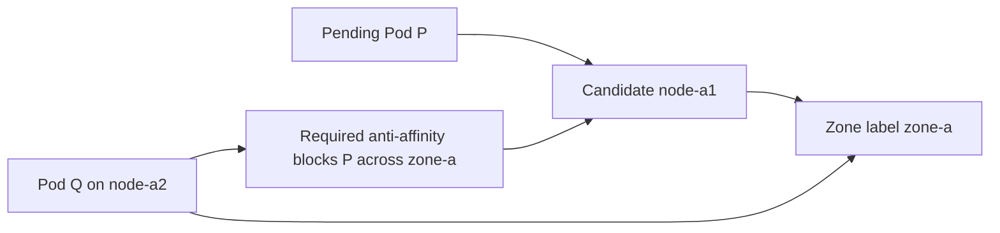

# Why Zone Anti-Affinity Can Defeat Kubernetes Preemption

Author: [nawazdhandala](https://www.github.com/nawazdhandala)

Tags: Kubernetes, Scheduling, Troubleshooting

Description: Trace zone-wide anti-affinity blockers across nodes, understand the default scheduler's local victim search, and choose an appropriate placement policy.

A node has enough free CPU and memory for an important Pod, but scheduling still fails. The blocker is a lower-priority Pod on a different node in the same zone. Increasing the incoming Pod's priority does not necessarily help: the default scheduler does not perform cross-node preemption to make the candidate node usable.

This is a topology problem. The resource capacity belongs to one node, while the anti-affinity rule covers an entire zone. Diagnosing only the candidate node's running Pods misses the actual conflict.

The behavior discussed here is grounded in **Kubernetes 1.34.0** default scheduler source and the documented cross-node limitation. It does not assume a custom scheduler or newer workload-group behavior.

## Draw the placement before changing it

Imagine two nodes in `zone-a`:

| Node | Free requested capacity | Existing workload |
|---|---|---|
| `node-a1` | Enough for incoming Pod P | No matching conflict locally |
| `node-a2` | Cannot otherwise host P | Lower-priority Pod Q labeled `app: zone-blocker` |

P has required anti-affinity to `app: zone-blocker` across `topology.kubernetes.io/zone`. Although Q is not on `node-a1`, both nodes have the same zone label. Q therefore blocks P from using `node-a1`.



Deleting Q could remove the topology conflict, but the default preemption search for `node-a1` does not choose Q on `node-a2` as a remote victim. The [cross-node preemption documentation](https://kubernetes.io/docs/concepts/scheduling-eviction/pod-priority-preemption/#cross-node-preemption) describes this limitation.

This does not mean zone anti-affinity always prevents preemption. If P can run on Q's own node after eligible local victims are removed, that local candidate may work. The specific failure requires the useful placement and the necessary victim to be on different nodes.

## Inspect the rule's actual domain

The following complete Pod illustrates the zone-wide restriction. It assumes an existing staging namespace and an approved PriorityClass named `important-zone-example`. BusyBox 1.37.0 is only a placeholder workload; the example is for placement review, not an instruction to generate production contention.

```yaml
apiVersion: v1
kind: Pod
metadata:
  name: zone-affinity-example
  namespace: scheduling-test
  labels:
    app: incoming-example
spec:
  priorityClassName: important-zone-example
  restartPolicy: Never
  affinity:
    podAntiAffinity:
      requiredDuringSchedulingIgnoredDuringExecution:
        - labelSelector:
            matchLabels:
              app: zone-blocker
          topologyKey: topology.kubernetes.io/zone
  containers:
    - name: workload
      image: busybox:1.37.0
      command: ["sh", "-c", "sleep 3600"]
      resources:
        requests:
          cpu: "1"
          memory: "128Mi"
        limits:
          cpu: "1"
          memory: "128Mi"
```

With namespace fields omitted, the selector applies to matching Pods in `scheduling-test`. The topology key defines the domain: matching zone values matter even when hostname values differ. The [affinity reference](https://kubernetes.io/docs/concepts/scheduling-eviction/assign-pod-node/#inter-pod-affinity-and-anti-affinity) explains these relationships.

There is a separate admission issue to check. If `LimitPodHardAntiAffinityTopology` is enabled, it restricts required Pod anti-affinity topology keys to `kubernetes.io/hostname`. The [admission-controller documentation](https://kubernetes.io/docs/reference/access-authn-authz/admission-controllers/#limitpodhardantiaffinitytopology) describes that restriction. A rejected API request never becomes this pending scheduling case.

Have the administrator review the intended policy. Do not disable the admission control globally just to make a sample manifest pass.

## Map matching Pods to zones

Read the incoming Pod, all matching peers in the selected namespace, and node topology labels:

```bash
kubectl --context staging -n scheduling-test get pod zone-affinity-example -o yaml
kubectl --context staging -n scheduling-test get pods \
  -l app=zone-blocker -o wide
kubectl --context staging get nodes \
  -L topology.kubernetes.io/zone,kubernetes.io/hostname
```

Replace `staging` and the object names with your environment. These commands do not change workloads.

Join each matching Pod's `spec.nodeName` to that node's zone label. Check numeric priorities on the admitted objects if preemption is part of the investigation. Also inspect required anti-affinity on existing Pods: their rules can constrain the incoming Pod too.

A missing or incorrect topology label is a different configuration fault. Review label consistency across eligible nodes rather than assuming the cloud zone automatically matches the Kubernetes label.

The [1.34.0 inter-Pod affinity filter](https://github.com/kubernetes/kubernetes/blob/v1.34.0/pkg/scheduler/framework/plugins/interpodaffinity/filtering.go) counts matches using topology key/value pairs. The [default preemption implementation](https://github.com/kubernetes/kubernetes/blob/v1.34.0/pkg/scheduler/framework/plugins/defaultpreemption/default_preemption.go) evaluates removing eligible Pods from a candidate node. Together, these explain how a remote zone-level blocker can survive a local preemption simulation.

## Choose a correction that preserves the intended isolation

First decide what the anti-affinity rule was meant to achieve. “Do not share a host” and “do not share a zone” are materially different availability requirements.

If host separation is sufficient, reviewing a hostname topology key may be appropriate. If zone separation is mandatory, provide an eligible zone without the conflict and enough capacity there. Adding another node inside the already-blocked zone does not remove the zone-level relationship.

If the goal is balancing replica counts rather than forbidding every match within a zone, evaluate topology spread constraints. They express a permitted skew between domains, which differs from hard anti-affinity. A hard `DoNotSchedule` spread constraint can still leave Pods pending, while `ScheduleAnyway` trades strictness for a scheduling preference. Review the [topology spread documentation](https://kubernetes.io/docs/concepts/scheduling-eviction/topology-spread-constraints/) against the actual availability requirement before replacing one policy with another.

A preferred anti-affinity term is another option only when co-location is acceptable under pressure. It cannot preserve a strict isolation promise.

## Avoid manual deletion loops

Removing Q manually is not a durable scheduling policy. Its controller may recreate it, the replacement may land in the same zone, and the deletion itself can interrupt service. Coordinate any relocation through the workload's normal change process and verify the new placement before depending on it.

For staging acceptance, record the candidate node, the remote matching Pod, both zone labels, and every other placement constraint. Confirm that the intended policy change removes the relevant blocker without weakening an unrelated requirement. A successful API dry run checks admission, not cross-node scheduling behavior.

The manifest was validated locally against Kubernetes 1.34.0's OpenAPI schema, and its selector and topology fields were reviewed against the official source. No cluster preemption or live relocation was performed. Treat priority as one input to placement, not a mechanism that can automatically repair a conflict spanning multiple nodes.
