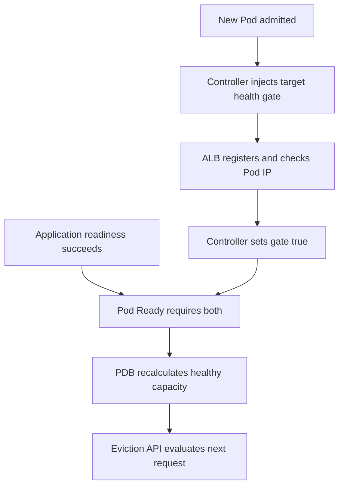

# Include ALB Target Health in PDBs with Readiness Gates

Author: [nawazdhandala](https://www.github.com/nawazdhandala)

Tags: Kubernetes, AWS ALB, PodDisruptionBudget, Troubleshooting

Description: Connect ALB target registration to Pod readiness, verify injected gates, and keep a PDB from counting replacement Pods before the load balancer can use them.

A replacement Pod can pass its application probe while the Application Load Balancer (ALB) is still registering its address. Kubernetes sees capacity that the external traffic path cannot use yet. During node maintenance, that gap can let another healthy Pod leave too soon.

A readiness gate adds another requirement to the Pod's Ready condition. The AWS Load Balancer Controller publishes the result of target registration and health checking; Kubernetes combines it with container readiness. The PodDisruptionBudget (PDB) then uses the resulting Pod condition when calculating permitted voluntary disruptions.

This walkthrough targets the **open-source AWS Load Balancer Controller 2.13.4** and Kubernetes **1.34** APIs. It assumes an installed controller, working AWS permissions, routable Pod addresses, and an existing staging namespace. It does not install an ALB controller or provision production infrastructure.

## Follow the actual decision path

A PDB does not call AWS. Its controller counts selected Ready Pods, excluding terminating Pods and relevant outstanding disruptions. A readiness gate changes the input to that calculation. [Kubernetes 1.34 PDB controller](https://github.com/kubernetes/kubernetes/blob/v1.34.0/pkg/controller/disruption/disruption.go)



For three replicas with `minAvailable: 2`, a replacement waiting on its gate leaves only two Ready Pods. There is ordinarily no room for another healthy eviction. Once all three qualify, the budget can allow one. This assumes the selector matches exactly those replicas and there are no other pending disruptions.

Missing gate conditions count as false. All declared gates must be true alongside container readiness. A container showing `1/1` in the Ready column is therefore insufficient evidence by itself. [Pod readiness gates](https://kubernetes.io/docs/concepts/workloads/pods/pod-lifecycle/#pod-readiness-gate)

## Confirm which controller owns the load balancer

The namespace labels differ:

| Implementation | Namespace label enabling injection |
|---|---|
| Open-source AWS Load Balancer Controller | `elbv2.k8s.aws/pod-readiness-gate-inject=enabled` |
| EKS Auto Mode | `eks.amazonaws.com/pod-readiness-gate-inject=enabled` |

Auto Mode support is documented by AWS; applying the open-source label is not a substitute. The commands below use the open-source implementation. Check the IngressClass and your platform's ownership before choosing a path. [AWS Auto Mode example](https://aws.amazon.com/blogs/containers/how-to-build-highly-available-kubernetes-applications-with-amazon-eks-auto-mode/), [AWS clarification](https://github.com/aws/containers-roadmap/issues/2511)

Injection requires IP targets, a matching Service, and a TargetGroupBinding in the Pod's namespace. A TargetGroupBinding is the controller's Kubernetes object connecting a Service to an AWS target group. Instance targets identify nodes, so they cannot provide this per-Pod registration gate. [Injection prerequisites](https://kubernetes-sigs.github.io/aws-load-balancer-controller/v2.13/deploy/pod_readiness_gate/), [TargetGroupBinding](https://kubernetes-sigs.github.io/aws-load-balancer-controller/v2.13/guide/targetgroupbinding/targetgroupbinding/)

## Create dependencies before creating Pods

Use a new staging workload for the first rehearsal. Replace context `staging`, namespace `retail`, and application name `checkout` consistently. The namespace must already exist. Enable injection:

```bash
kubectl --context staging label namespace retail \
  elbv2.k8s.aws/pod-readiness-gate-inject=enabled
```

This changes admission behavior for matching new Pods in that namespace. Review any existing namespace label and webhook selectors first.

Save the following as `checkout-routing.yaml`. The application must listen on port 8080 and return HTTP 200 from `/readyz` when usable. The existing IngressClass `alb` must belong to your open-source controller. Internal subnet discovery and network access must already work.

```yaml
apiVersion: v1
kind: Service
metadata:
  name: checkout
  namespace: retail
spec:
  selector:
    app: checkout
  ports:
    - name: http
      port: 80
      targetPort: 8080
---
apiVersion: networking.k8s.io/v1
kind: Ingress
metadata:
  name: checkout
  namespace: retail
  annotations:
    alb.ingress.kubernetes.io/scheme: internal
    alb.ingress.kubernetes.io/target-type: ip
    alb.ingress.kubernetes.io/healthcheck-path: /readyz
spec:
  ingressClassName: alb
  rules:
    - http:
        paths:
          - path: /
            pathType: Prefix
            backend:
              service:
                name: checkout
                port:
                  number: 80
---
apiVersion: policy/v1
kind: PodDisruptionBudget
metadata:
  name: checkout
  namespace: retail
spec:
  minAvailable: 2
  selector:
    matchLabels:
      app: checkout
```

This is an internal HTTP rehearsal, not a TLS configuration. It deliberately leaves the Deployment out so Pods cannot race ahead of target-group setup. The annotations select Pod IP targets and an application health path. Do not change an existing production target type casually. [Ingress annotations](https://kubernetes-sigs.github.io/aws-load-balancer-controller/v2.13/guide/ingress/annotations/)

Preview the objects without persisting them:

```bash
kubectl --context staging apply --dry-run=server --validate=strict \
  -f checkout-routing.yaml
```

After reviewing the preview and expected AWS resources, apply the manifest through your normal deployment process. An API preview alone neither creates a target group nor proves AWS permissions. Wait until a binding referring to `checkout` exists with target type `ip`:

```bash
kubectl --context staging -n retail get targetgroupbindings -o json |
  jq '.items[] | select(.spec.serviceRef.name == "checkout") |
      {name: .metadata.name, targetType: .spec.targetType,
       service: .spec.serviceRef, arn: .spec.targetGroupARN}'
```

Only then create the application's three replicas, with Pod label `app: checkout` and a meaningful readiness probe. Existing Pods do not acquire a gate because a namespace was labeled later. For an established Deployment, arrange a controlled rollout after the prerequisites are present, keeping sufficient old capacity until new Pods qualify.

## Verify the gate rather than guessing its name

The controller constructs condition names from each matching TargetGroupBinding. Do not hard-code a name copied from another cluster. The pinned mutator also avoids adding duplicate gates. [Version 2.13.4 injection code](https://github.com/kubernetes-sigs/aws-load-balancer-controller/blob/v2.13.4/pkg/inject/pod_readiness_gate.go), [condition naming](https://github.com/kubernetes-sigs/aws-load-balancer-controller/blob/v2.13.4/pkg/targetgroupbinding/utils.go)

```bash
kubectl --context staging -n retail get pods -l app=checkout -o json |
  jq '.items[] | {pod: .metadata.name, uid: .metadata.uid,
    gates: (.spec.readinessGates // []),
    conditions: [.status.conditions[]? |
      select(.type == "Ready" or .type == "ContainersReady" or
        (.type | startswith("target-health.elbv2.k8s.aws/"))) |
      {type, status, reason, message}]}'
kubectl --context staging -n retail get pdb checkout -o yaml
```

Expect at least one injected gate on each new matching Pod. During registration it may be absent from status, unknown, or false; after successful health checking it should be true. Multiple matching bindings can create multiple gates. Compare the final Ready condition with the PDB's `currentHealthy`, `desiredHealthy`, and `disruptionsAllowed`, allowing for reconciliation delay.

## Diagnose the stalled stage

| Observation | Next check |
|---|---|
| No gate in the Pod specification | Creation time, namespace label, Service selector, binding existence, IP target type, and webhook health |
| Containers are not ready | Application startup and its probe; an ALB gate cannot repair an unhealthy container |
| Containers ready, gate false | Gate reason, target-group health checks, Pod port, and security-group reachability |
| Every gate true, budget still zero | PDB selector, replica count, terminating Pods, and other unhealthy replicas |

Version 2.13 defaults the Pod mutation webhook to `Ignore` on webhook failure. That can admit a Pod without its intended gate. Inspect the installed webhook policy and controller health; choose stricter admission behavior with a scoped platform review rather than assuming the label guarantees injection. [Webhook failure policy](https://kubernetes-sigs.github.io/aws-load-balancer-controller/v2.13/deploy/pod_readiness_gate/#failurepolicy)

Finally, do not treat the condition as a continuously refreshed ALB availability metric. In the pinned implementation, polling continues while readiness is unresolved, while unchanged reconciliation checkpoints can skip further target processing. Keep application probes and external health monitoring. [Target reconciliation](https://github.com/kubernetes-sigs/aws-load-balancer-controller/blob/v2.13.4/pkg/targetgroupbinding/resource_manager.go)

Rehearse one replacement and observe real traffic before allowing maintenance to proceed. Readiness gates address the arrival of usable replacements; connection draining and graceful shutdown still require separate testing. Deployment rollouts also need their own rollout limits because PDBs govern eviction requests, not every way a controller can delete Pods. [Disruption boundaries](https://kubernetes.io/docs/concepts/workloads/pods/disruptions/)
