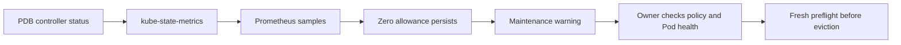

# Alert Before a PDB Blocks Kubernetes Maintenance

Author: [nawazdhandala](https://www.github.com/nawazdhandala)

Tags: Kubernetes, PodDisruptionBudget, Prometheus, Alerting

Description: Build and test a Prometheus warning for exhausted PDB allowance, preserve cluster identity, and distinguish maintenance risk from missing data.

A node upgrade is a poor time to discover that an application has allowed no voluntary Pod disruption for a week. You can detect that condition earlier with `kube_poddisruptionbudget_status_pod_disruptions_allowed`, a metric exported by kube-state-metrics.

The metric is useful, but it needs interpretation. Zero allowance may mean an unhealthy application, a deliberately strict policy, or a normal transition. A warning should prompt maintenance preparation, not automatically declare a service outage.

This example checks metric definitions against kube-state-metrics **v2.17.0** and tests rules with **Prometheus/promtool 3.7.3**. It assumes an existing Prometheus installation already scrapes the relevant PDB metrics. Choose an exporter release compatible with your cluster; this is not an exporter installation guide.

## Understand the signal before alerting

A PodDisruptionBudget, or PDB, tells Kubernetes how much voluntary disruption a selected group of Pods can tolerate. The controller records its current decision in `status.disruptionsAllowed`. The exporter publishes that field directly as a gauge, meaning a value that can rise or fall. Use the reported allowance rather than reconstructing the eviction decision from a subtraction. [Exporter implementation](https://github.com/kubernetes/kube-state-metrics/blob/v2.17.0/internal/store/poddisruptionbudget.go)

Keep these related metrics nearby in a dashboard:

| Metric suffix after `kube_poddisruptionbudget_status_` | What it helps explain |
|---|---|
| `pod_disruptions_allowed` | Reported remaining voluntary disruption allowance |
| `current_healthy` | Pods currently counted as healthy |
| `desired_healthy` | Health floor calculated by the controller |
| `expected_pods` | Expected Pod population for the budget |
| `observed_generation` | Spec generation processed into status |

These names and their namespace/PDB labels are documented in the [tagged metric reference](https://github.com/kubernetes/kube-state-metrics/blob/v2.17.0/docs/metrics/policy/poddisruptionbudget-metrics.md). `cluster` is **not** a built-in label on these metrics. The examples require you to attach it consistently to stored samples through your collection configuration, especially when querying several clusters together.



## Add a sustained maintenance warning

Save the following as `pdb-rules.yaml`. It warns when at least one exporter observation reports zero allowance for a PDB that has an expected Pod population:

```yaml
groups:
  - name: pdb-maintenance
    interval: 1m
    rules:
      - alert: PDBHasNoDisruptionAllowance
        expr: |
          (
            min by (cluster, namespace, poddisruptionbudget) (
              kube_poddisruptionbudget_status_pod_disruptions_allowed
            ) == 0
          )
          and on (cluster, namespace, poddisruptionbudget)
          (
            max by (cluster, namespace, poddisruptionbudget) (
              kube_poddisruptionbudget_status_expected_pods
            ) > 0
          )
        for: 15m
        labels:
          severity: warning
          category: maintenance
        annotations:
          summary: 'PDB {{ $labels.namespace }}/{{ $labels.poddisruptionbudget }} has no allowance'
          description: 'Check policy intent and Pod health before scheduling voluntary eviction.'
```

The `min` aggregation is deliberately conservative when multiple exporter instances report the same PDB: a zero observation is enough to retain the warning. It removes instance-specific labels while preserving cluster, namespace, and PDB identity. If replicas disagree, inspect scrape timestamps and exporter health; aggregation cannot identify which observation is freshest.

The `and on` clause matches the two expressions on that same identity. The positive `expected_pods` condition removes empty budgets from this particular warning. Empty or incorrectly selected budgets still need a separate coverage check. [PromQL matching and aggregation](https://prometheus.io/docs/prometheus/latest/querying/operators/)

Use `== 0`, without `bool`. A comparison without `bool` filters the vector to matching series. The remaining sample can have value zero and still activate an alert. Adding `bool` would retain nonmatching series with zero-valued results too, which is not what this alert intends.

`for: 15m` requires the condition to remain active through successive evaluations before it fires. Scraping, evaluation, and notification routing add latency, so this is a planning warning, not an instantaneous safety check. [Alerting rule behavior](https://prometheus.io/docs/prometheus/latest/configuration/alerting_rules/)

For a single-cluster installation without a stored `cluster` label, the query still groups the available identity labels, but it cannot distinguish clusters later merged into the same query. Prometheus external labels alone should not be mistaken for labels already present on local input samples. Check the actual query results and your [collection configuration](https://prometheus.io/docs/prometheus/latest/configuration/configuration/).

## Test the pending-to-firing boundary

Save this as `pdb-tests.yaml` alongside the rules. The input models a three-Pod budget with zero allowance from the start:

```yaml
rule_files:
  - pdb-rules.yaml
evaluation_interval: 1m
tests:
  - name: sustained-zero-allowance
    interval: 1m
    input_series:
      - series: 'kube_poddisruptionbudget_status_pod_disruptions_allowed{cluster="staging",namespace="retail",poddisruptionbudget="checkout"}'
        values: '0+0x20'
      - series: 'kube_poddisruptionbudget_status_expected_pods{cluster="staging",namespace="retail",poddisruptionbudget="checkout"}'
        values: '3+0x20'
    alert_rule_test:
      - eval_time: 14m
        alertname: PDBHasNoDisruptionAllowance
        exp_alerts: []
      - eval_time: 15m
        alertname: PDBHasNoDisruptionAllowance
        exp_alerts:
          - exp_labels:
              cluster: staging
              namespace: retail
              poddisruptionbudget: checkout
              severity: warning
              category: maintenance
            exp_annotations:
              summary: 'PDB retail/checkout has no allowance'
              description: 'Check policy intent and Pod health before scheduling voluntary eviction.'
```

With the matching `promtool` binary on your path, run:

```bash
promtool check rules pdb-rules.yaml
promtool test rules pdb-tests.yaml
```

The first command checks the rule file. The second evaluates synthetic time series: no firing alert at minute 14, followed by exactly one alert at minute 15 with the expected labels and text. Both should report success. This is a local rule test; no cluster is contacted. [Prometheus rule testing](https://prometheus.io/docs/prometheus/latest/configuration/unit_testing_rules/)

Add cases for allowance returning to one, an empty budget, missing input metrics, identical PDB names in different clusters, and duplicate exporter observations. Otherwise a plausible query can silently merge unrelated applications or behave unexpectedly during recovery.

Load the validated rules through your existing rule-file or Prometheus Operator workflow. A plain rule file is not a `PrometheusRule` Kubernetes resource. Confirm that the rule is loaded and evaluating successfully before assuming CI success has enabled production alerting.

## Route the warning to a decision

Send the warning to the application's maintenance owner with a dashboard and runbook link. Keep service-impact paging based on the application's health and availability objectives. An intentional zero-disruption policy can deserve a scheduled review without deserving repeated overnight pages.

Alertmanager routing, grouping, and silencing are separate from the Prometheus expression. Verify an approved test notification reaches the intended receiver. A firing rule that nobody receives does not help the next maintenance window. [Alertmanager configuration](https://prometheus.io/docs/alerting/latest/configuration/)

When the warning arrives, inspect the exact object in the correct cluster. Replace these example identifiers and use a context with read access:

```bash
kubectl --context staging -n retail get pdb checkout -o yaml
kubectl --context staging -n retail get pods -l app=checkout -o wide
```

The first command shows policy, status, and generation information. Compare `metadata.generation` with `status.observedGeneration`; stale status needs investigation. For the second command, derive the actual label query from the PDB selector instead of assuming every application uses `app=checkout`. Inspect the selected Pods' readiness and placement. [kubectl get reference](https://kubernetes.io/docs/reference/kubectl/generated/kubectl_get/)

A healthy three-Pod application with `minAvailable: 3` intentionally has no room for voluntary eviction. A three-Pod application with a floor of two and only two healthy Pods needs recovery or additional capacity. Those cases call for different changes. Do not delete the PDB merely to clear the warning.

## Keep absence and permission separate

If either input metric disappears, this alert can stop firing because its expression no longer produces a matching element. That does not establish health. Monitor exporter scrape failures, rule-evaluation failures, and expected metric coverage separately. An `up == 0` check detects a failing known target; it does not detect every target that disappeared from discovery.

Likewise, positive allowance is not a reservation for a future drain. Another operation can consume it, overlapping policies may complicate eviction, and Pods can become unhealthy after the scrape. Read fresh state and use your approved eviction preflight immediately before maintenance. PDBs are one input to that decision, not a guarantee against all disruption. [Kubernetes disruption guidance](https://kubernetes.io/docs/concepts/workloads/pods/disruptions/)

The exact rule and displayed test passed locally with promtool 3.7.3. The expanded test suite covered nine scenario groups, including recovery, missing inputs, and cluster separation. No production scrape, real notification delivery, or node drain was performed for this article.
