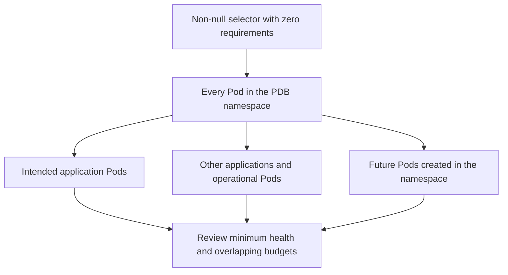

# Audit Empty PDB Selectors Across a Kubernetes Cluster

Author: [nawazdhandala](https://www.github.com/nawazdhandala)

Tags: Kubernetes, PodDisruptionBudget, Troubleshooting, High Availability

Description: Find namespace-wide PDB selectors with a read-only audit, distinguish empty from null, assess affected workloads, and repair coverage without silently removing protection.

An empty PodDisruptionBudget selector can look harmless in a rendered manifest. In `policy/v1`, however, `selector: {}` matches every Pod in that PDB's namespace. It is not a placeholder waiting for the application to fill in its labels.

That can affect unrelated services, Jobs, and another chart's Pods in a shared namespace. It can also overlap their existing PDBs. The right response is to identify the selected population and intended owner before changing the object. [PDB API selector semantics](https://kubernetes.io/docs/reference/kubernetes-api/policy/pod-disruption-budget-v1/).

This guide provides a read-only cluster inventory and a review process. The JSON filter was tested with jq 1.6 and Kubernetes' v0.34.0 selector library. Inventory collection was exercised against an isolated v1.34.0 API server; no production cluster was queried.

## Empty and absent have different meanings

For a `policy/v1` PDB, distinguish these forms:

| Selector representation | Matching behavior |
|---|---|
| `selector: {}` | Every Pod in the PDB namespace |
| `selector: {matchLabels: {}}` | Every Pod in the PDB namespace |
| A non-null selector with empty labels and empty expressions | Every Pod in the PDB namespace |
| `selector: null` or no selector field | No Pods |
| A selector with actual requirements | Pods satisfying all those requirements in the namespace |

The implementation treats a null selector as matching nothing. A non-null selector with zero label and expression requirements matches everything. Checking only whether the field exists, or searching for the literal text `{}`, misses this distinction. [Pinned selector conversion](https://github.com/kubernetes/apimachinery/blob/v0.34.0/pkg/apis/meta/v1/helpers.go).

Historical API versions add another trap. An empty selector in `policy/v1beta1` matched no Pods; in `policy/v1` it matches all namespace Pods. The beta PDB API stopped being served in Kubernetes v1.25. Review selector intent when migrating old configuration, rather than changing only `apiVersion`. [PDB API migration guide](https://kubernetes.io/docs/reference/using-api/deprecation-guide/#poddisruptionbudget-v125).

## Capture the live inventory

Prerequisites are a verified Kubernetes context, permission to list PDBs across namespaces, and jq 1.6 or later. If your access is namespace-limited, run the same process within the namespaces you can inspect and record that coverage limit.

```bash
CTX=staging-context
kubectl --context="$CTX" get poddisruptionbudgets.v1.policy --all-namespaces -o json > pdb-all.json
```

Confirm the command succeeds before processing the file. It reads the cluster and writes a local snapshot. It does not modify any PDB. Record the context and collection time alongside the audit because the snapshot will not reflect later deployments. [kubectl get reference](https://kubernetes.io/docs/reference/kubectl/generated/kubectl_get/).

Run this filter on the captured list:

```bash
jq '[
  .items[]
  | select(.spec.selector != null)
  | select(((.spec.selector.matchLabels // {}) | length) == 0)
  | select(((.spec.selector.matchExpressions // []) | length) == 0)
  | {
      namespace: .metadata.namespace,
      name: .metadata.name,
      generation: .metadata.generation,
      minAvailable: .spec.minAvailable,
      maxUnavailable: .spec.maxUnavailable,
      currentHealthy: .status.currentHealthy,
      desiredHealthy: .status.desiredHealthy,
      disruptionsAllowed: .status.disruptionsAllowed
    }
]' pdb-all.json
```

The version-qualified resource name in the collection command requests `policy/v1` PDBs. The first filter check excludes null or missing selectors. The next two detect the absence of actual requirements, including empty nested maps and arrays. The result is a JSON array of objects requiring review; `[]` means this particular snapshot contains no matches. [jq selection, fallback, and object construction](https://jqlang.org/manual/v1.6/).

This is not a complete PDB-coverage audit. A nonempty but overly broad selector, such as a shared team label, is outside this filter. An empty result also says nothing about a context or namespace you did not successfully inspect.

## Map each finding to the whole namespace

For each result, inspect the complete object and every Pod in its namespace. Replace the following names with one finding:

```bash
NS=payments
PDB=shared-budget
kubectl --context="$CTX" -n "$NS" get pdb "$PDB" -o yaml
kubectl --context="$CTX" -n "$NS" get pods --show-labels -o wide
kubectl --context="$CTX" -n "$NS" get pdb -o yaml
```

Build a short inventory of workload owner, application, readiness, and existing budget coverage. Include Pods from Jobs and operational tools, not just Deployments shown on a dashboard. An empty selector does not filter them out by workload kind. Selection still does not imply that every Pod contributes to the healthy count or takes the same eviction path. [PDB controller selection and health counting](https://github.com/kubernetes/kubernetes/blob/v1.34.1/pkg/controller/disruption/disruption.go).

Also identify future entrants. Any new matching Pod in that namespace falls within the selector's scope. A currently quiet namespace can become shared after another release or maintenance Job is introduced.



## Assess the failure mode, not just the selector shape

Consider this problematic example. It is shown for diagnosis, not as a manifest to apply:

```yaml
apiVersion: policy/v1
kind: PodDisruptionBudget
metadata:
  name: shared-budget
  namespace: payments
spec:
  minAvailable: 1
  selector: {}
```

Suppose the namespace contains one healthy checkout Pod and three healthy reporting Pods, with no other PDB selecting them. A shared minimum of one does not specifically preserve checkout. Evicting its only Pod can leave three healthy reporting Pods and still satisfy the aggregate minimum. This is a scope error even though the global healthy count looks comfortable.

At the other extreme, a restrictive namespace-wide budget can stall maintenance for unrelated workloads. And if a workload already has its own PDB, the empty-selector object can introduce overlap: the normal eviction path does not support a Pod matching multiple budgets. [PDB configuration constraints](https://v1-34.docs.kubernetes.io/docs/tasks/run-application/configure-pdb/).

Do not estimate the effect of a percentage or maximum-unavailable budget by counting every visible Pod alone. Those calculations can depend on the supported owning controllers' scale. Read the actual status and any calculation errors, especially when a broad selector includes mixed or unmanaged workloads. [Expected-scale implementation](https://github.com/kubernetes/kubernetes/blob/v1.34.1/pkg/controller/disruption/disruption.go).

## Repair the intended coverage deliberately

Find the configuration source responsible for the empty selector: a missing chart value, an empty rendered map, an old migration, or an intentionally broad policy. Review the source with its owner before editing the live object.

For an application-specific budget, replace the empty selector with stable labels identifying that application instance and component. First query the proposed labels and compare the resulting Pod names with the intended population. Retain the reviewed healthy floor, and verify coverage of old and new Pods during rollouts. [Label selector rules](https://kubernetes.io/docs/concepts/overview/working-with-objects/labels/).

Do not replace `{}` with `null` merely to make the audit pass. That changes the budget from selecting all namespace Pods to selecting none. It can silently remove the only protection a workload currently has.

If a namespace-wide budget was intentional, document why the selected workloads share an availability requirement, how other PDBs are avoided, and who reviews newly introduced workloads. A namespace boundary alone does not make its applications interchangeable.

After the reviewed correction, re-run the inventory and compare per-workload coverage. Wait for changed PDB generations to be observed, then inspect health and allowance before maintenance resumes. Keep the same structural check in configuration review so an empty nested selector cannot return unnoticed in a later render.
