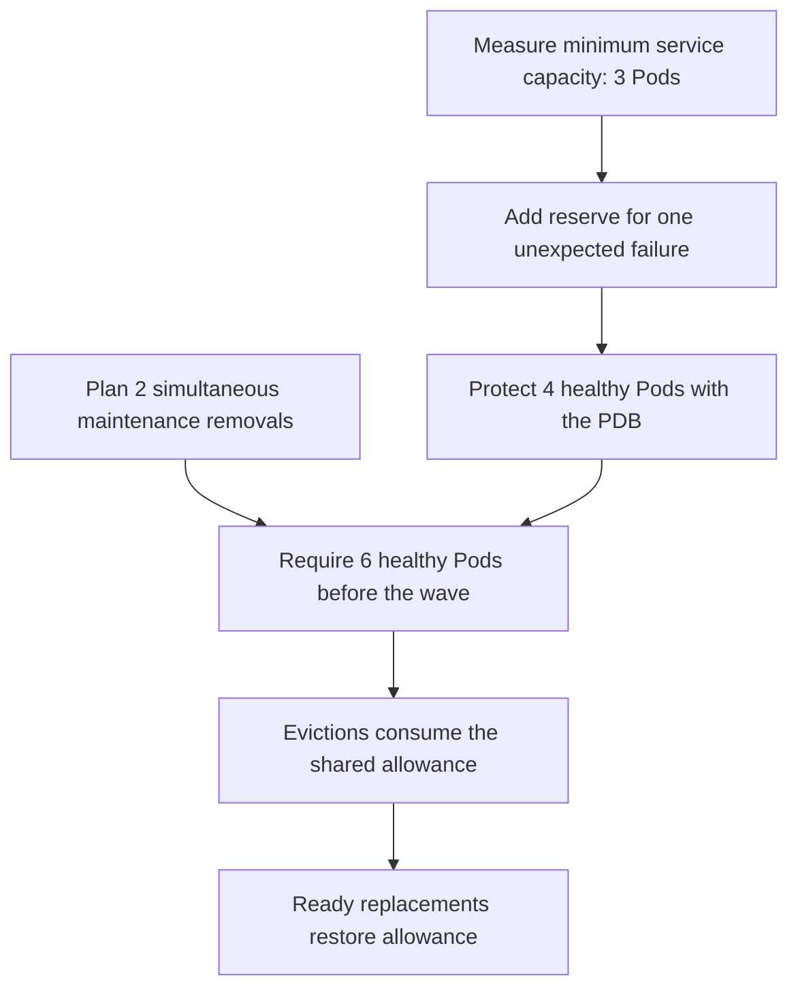

# Calculate a PodDisruptionBudget for Safe Concurrent Drains

Author: [nawazdhandala](https://www.github.com/nawazdhandala)

Tags: Kubernetes, PodDisruptionBudget, High Availability, Capacity Planning

Description: Calculate a Kubernetes disruption budget from application capacity, failure reserve, and concurrent Pod evictions, then verify the assumptions before maintenance.

Six replicas do not automatically mean that two nodes can be drained safely. Those nodes might contain four of the replicas. Another replica might already be unhealthy. Even when enough Pods remain, they might lack the capacity to handle the traffic.

A PodDisruptionBudget, or PDB, limits certain voluntary Pod removals through Kubernetes' eviction API. It cannot decide how many application instances your customers need. That number must come from capacity measurements or the application's availability rules. [Kubernetes disruption overview](https://v1-34.docs.kubernetes.io/docs/concepts/workloads/pods/disruptions/).

This walkthrough uses a six-replica stateless service and Kubernetes v1.34.1 behavior. The YAML was checked against that release's API schema; the arithmetic was checked locally. No live node drains or application load tests were performed for this article.

## Start with the service floor

Call the minimum number of healthy replicas needed to serve the expected load **M**. For a checkout service, suppose a representative load test shows that three replicas meet the latency and error targets. Then M is three.

Do not derive M merely by dividing average traffic by average throughput. Include the workload you expect during maintenance: peak requests, expensive endpoints, dependency delays, and the time replacements need to warm up. If your evidence only covers quiet periods, schedule maintenance within that tested envelope or gather better evidence.

For a voting database, the minimum may also depend on quorum: enough participating members must agree before operations can proceed. A generic replica count cannot establish database safety. Use the database's membership and recovery requirements, and check whether Pod readiness actually represents a usable member.

Next choose two additional quantities:

| Quantity | Meaning | Example |
|---|---|---|
| F | Additional unexpected Pod failures to tolerate during maintenance | 1 |
| D | Pods simultaneously unavailable because of voluntary evictions, before replacements become Ready | 2 |
| R | Desired replica count before maintenance | 6 |

F is a planning reserve. It does not make Kubernetes prevent hardware failures, nor does it guarantee survival of arbitrary correlated failures.

## Calculate the protected floor and maintenance allowance

For this model, protect M + F healthy replicas and provision enough healthy replicas for D maintenance removals:

```text
Protected healthy floor = M + F = 3 + 1 = 4
Required healthy replicas before the planned wave = M + F + D = 6
```

That leads to `minAvailable: 4`. With six healthy Pods, two can be removed while four remain. If one of those four subsequently fails, three remain: the measured service floor.

This is our capacity-planning model, not a guarantee supplied by the PDB API. It assumes the remaining replicas have comparable capacity, share the load successfully, and do not lose a common dependency.

The controller derives an eviction allowance from healthy Pods minus the required healthy count, with a floor of zero. Terminating Pods and Pods reserved for recently approved disruptions are excluded from its healthy count. Use the PDB's reported status rather than counting only `Running` Pods. [Kubernetes v1.34.1 disruption controller](https://github.com/kubernetes/kubernetes/blob/v1.34.1/pkg/controller/disruption/disruption.go).

For the example, after status has settled:

| Healthy Pods counted by the PDB | Protected floor | Further healthy-Pod evictions available |
|---|---|---|
| 6 | 4 | 2 |
| 5 | 4 | 1 |
| 4 | 4 | 0 |
| 3 | 4 | 0; restore health first |

An existing unhealthy Pod has already consumed capacity. With only five healthy Pods, the original two-Pod maintenance wave no longer preserves an additional failure reserve of one. Reduce the wave or restore health; do not keep using R as though every desired replica were available.



## Count affected Pods, not drain processes

Two simultaneous node drains do not necessarily mean D equals two. Inspect where this workload's Pods are running. If each target node holds two checkout Pods, removing all four before any replacement becomes Ready would require D equal to four. Under the same assumptions, that requires eight initially healthy replicas.

You can instead allow the drains to progress in smaller waves as replacements recover. Both drain processes consume the same workload budget; each does not receive its own allowance. Normal `kubectl drain` uses eviction where supported and waits for graceful termination. [kubectl drain reference](https://kubernetes.io/docs/reference/kubectl/generated/kubectl_drain/).

Replacement capacity matters just as much as the subtraction. Spare CPU on an ineligible node does not help a Pod constrained to another zone or storage attachment. Topology spread constraints can distribute replicas across nodes or zones, but their scheduling rules must still leave somewhere for replacements to run. [Pod topology spread constraints](https://kubernetes.io/docs/concepts/scheduling-eviction/topology-spread-constraints/).

## Express the calculation as a narrow PDB

Prerequisites are an existing six-replica Deployment named `checkout`, namespace `payments`, and a verified Pod label `app.kubernetes.io/name: checkout`. These are example names; replace them with the workload you assessed. Ensure another PDB does not also select these Pods.

Save this as `checkout-pdb.yaml`:

```yaml
apiVersion: policy/v1
kind: PodDisruptionBudget
metadata:
  name: checkout
  namespace: payments
spec:
  minAvailable: 4
  selector:
    matchLabels:
      app.kubernetes.io/name: checkout
```

The integer keeps the protected floor explicit. Specify either `minAvailable` or `maxUnavailable`, not both. A `policy/v1` empty selector matches every Pod in the namespace, so retain the intended labels. [PDB configuration guide](https://v1-34.docs.kubernetes.io/docs/tasks/run-application/configure-pdb/).

With permission to inspect this namespace, run these read-only commands. Replace `staging-context` with the intended context:

```bash
CTX=staging-context
NS=payments
kubectl --context="$CTX" -n "$NS" get deployment checkout
kubectl --context="$CTX" -n "$NS" get pods \
  -l app.kubernetes.io/name=checkout -o wide
kubectl --context="$CTX" -n "$NS" get pdb -o yaml
```

Confirm the desired and ready replica counts, selected Pods, node placement, and existing budgets. The `-o wide` output includes node placement; YAML exposes the selectors rather than hiding them behind a short table. [kubectl get reference](https://kubernetes.io/docs/reference/kubectl/generated/kubectl_get/).

Validate the proposed object against the staging API without saving it:

```bash
kubectl --context="$CTX" -n "$NS" apply \
  --dry-run=server -f checkout-pdb.yaml
```

Server dry run checks the API request through the server without persisting the change. It does not test the service floor, scheduling capacity, or a drain. After review, deploy the manifest through your normal configuration process. [kubectl apply reference](https://kubernetes.io/docs/reference/kubectl/generated/kubectl_apply/).

## Reconcile autoscaling, readiness, and rollouts

If a Horizontal Pod Autoscaler can reduce this service to four replicas, `minAvailable: 4` leaves no healthy-Pod eviction allowance at that size. The HPA adjusts the workload's replica count; a PDB is not its minimum-replica setting. Align the autoscaling floor with the maintenance capacity you actually promise. [Horizontal Pod Autoscaling](https://kubernetes.io/docs/concepts/workloads/autoscaling/horizontal-pod-autoscale/).

Likewise, a Pod becoming Ready must mean it can accept its intended traffic. A shallow probe that succeeds before caches or required dependencies are usable can restore an apparent allowance too early. Review startup and readiness behavior against application requirements. [Probe configuration](https://kubernetes.io/docs/tasks/configure-pod-container/configure-liveness-readiness-startup-probes/).

Keep application rollouts separate from the maintenance calculation. Deployment and StatefulSet updates are not constrained by PDBs, although unavailable Pods from those updates consume the budget. Hardware failures and direct Pod deletion also fall outside the protection you get from an eviction-respecting drain. [Disruption limits](https://v1-34.docs.kubernetes.io/docs/concepts/workloads/pods/disruptions/).

## Rehearse the assumptions before scheduling maintenance

In an isolated staging environment, reproduce the replica count, placement rules, readiness behavior, and representative traffic. Record the initial PDB status and service measurements. Rehearse one approved maintenance wave, watching whether the allowance falls and recovers as expected.

The rehearsal passes when the service meets its agreed targets, replacement Pods fit on remaining nodes, and readiness recovers within the maintenance window. Separately exercise the additional failure reserve using your approved fault-testing procedure. Record exactly which failure was simulated; one lost Pod is not equivalent to losing a zone.

If maintenance stalls, identify whether the limiting factor is the protected floor, current health, or replacement scheduling. Restore missing capacity or reduce concurrency before revising the safety requirement. A budget that pauses maintenance at the agreed floor is doing the job you assigned it.
