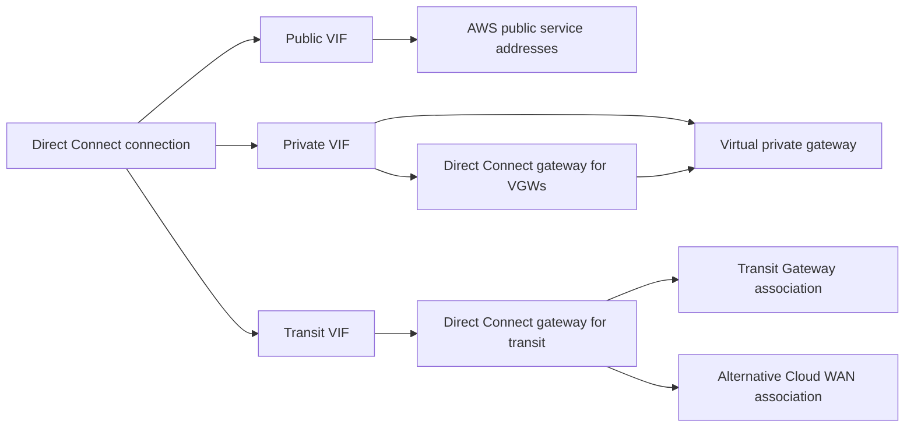

# Choose a Public, Private, or Transit Direct Connect VIF

Author: [nawazdhandala](https://www.github.com/nawazdhandala)

Tags: AWS, Direct Connect, Networking, Cloud Architecture

Description: Choose a Direct Connect virtual interface by destination and gateway model, including public services, VPCs, Transit Gateway, and Cloud WAN.

Choosing a Direct Connect virtual interface starts with the destination you need to reach. “We want private connectivity to AWS” is not precise enough: an application might need a private address in a VPC, a public S3 endpoint, or networks attached to a Transit Gateway.

A **virtual interface**, or VIF, is a logical interface on your Direct Connect connection. It has its own VLAN and BGP configuration. The VIF type determines the supported AWS-side attachment model; it does not replace route tables, DNS, access policies, or encryption.

This guide compares the choices before deployment and provides read-only inventory commands reviewed against **AWS CLI 2.42.1**. Their output filters were checked locally; no AWS attachment was created or changed.

## Choose the destination model first

AWS defines the three [VIF types](https://docs.aws.amazon.com/directconnect/latest/UserGuide/WorkingWithVirtualInterfaces.html) by the networks they reach. Use this starting table:

| Requirement | VIF | AWS-side relationship |
| --- | --- | --- |
| Reach AWS public service addresses | Public | Public AWS routing; no Direct Connect gateway attachment |
| Reach one VPC through its virtual private gateway | Private | Direct attachment to that virtual private gateway |
| Reach several VPCs through their virtual private gateways | Private | Direct Connect gateway associated with the VPC gateways |
| Use a Transit Gateway network | Transit | Direct Connect gateway associated with Transit Gateway |
| Attach to an AWS Cloud WAN core network | Transit | Direct Connect gateway attachment managed through Cloud WAN |

The fourth and fifth rows still carry private network traffic. The word “transit” identifies the attachment model rather than a different privacy level.



This diagram shows supported relationships, not a literal sequence of packet-forwarding appliances. The separate Direct Connect gateway boxes also matter: gateway association modes have compatibility restrictions.

## Use a public VIF for public AWS destinations

A public VIF reaches AWS public prefixes over Direct Connect. It does not provide general internet transit to arbitrary non-AWS destinations. AWS's [public-interface routing description](https://docs.aws.amazon.com/directconnect/latest/UserGuide/WorkingWithVirtualInterfaces.html#public-vif-prefix-advertisement-rules) also notes that announced prefixes can differ in aggregation from the downloadable AWS IP-range file.

For example, an on-premises backup system that deliberately uses public S3 addresses can use this path. It still needs correct DNS resolution, routing, service authorization, and appropriate traffic filtering. Calling the VIF public does not mean the application should send unencrypted requests or accept unrestricted inbound traffic.

Plan public peering addresses, ASN information, and advertised-prefix approval before ordering a change window. The [public VIF creation procedure](https://docs.aws.amazon.com/directconnect/latest/UserGuide/create-public-vif.html) documents the required inputs and validation. A technically configured router cannot bypass an incomplete AWS provisioning approval.

Do not choose this type merely because your workload calls an AWS API. First decide whether it will use that API's public address or a supported private endpoint inside your VPC architecture.

## Use a private VIF for the virtual-private-gateway model

A **virtual private gateway**, abbreviated VGW, is the VPC-side gateway used by this attachment model. A private VIF can connect directly to a VGW for the same-Region VPC case, or attach to a Direct Connect gateway that is associated with multiple VGWs.

The [VGW association documentation](https://docs.aws.amazon.com/directconnect/latest/UserGuide/virtualgateways.html) covers cross-account and cross-Region relationships and prohibits overlapping VPC address ranges among associated VPCs. Each VPC in that model needs its own VGW association.

This is useful when the requirement is on-premises access to a set of VPCs without adopting Transit Gateway as the network hub. It does not automatically create general VPC-to-VPC transit through the Direct Connect gateway. Document who needs to communicate with whom rather than treating “attached to the same gateway” as permission or proof of connectivity.

The Direct Connect gateway's presence does not turn the private VIF into a transit VIF. That distinction becomes important when a team later introduces Transit Gateway.

## Use a transit VIF for Transit Gateway or Cloud WAN

A **Transit Gateway**, or TGW, provides a network hub with its own attachments and route tables. AWS documents the Direct Connect path as a transit VIF attached to a Direct Connect gateway, which is then associated with the TGW.

The [TGW association rules](https://docs.aws.amazon.com/directconnect/latest/UserGuide/direct-connect-transit-gateways.html) prohibit associating a gateway already using a VGW or private-VIF arrangement with a TGW. Plan the appropriate separate resources and migration steps rather than assuming an existing private VIF can serve the new relationship unchanged.

For AWS Cloud WAN, the [core-network association guide](https://docs.aws.amazon.com/directconnect/latest/UserGuide/direct-connect-cloud-wan.html) likewise requires the transit VIF type. The association is managed in Cloud WAN, and a Direct Connect gateway is associated with one core network and one segment. Its other association options are constrained while that relationship exists.

Choose between these network models based on the routing and ownership design. A transit VIF by itself does not configure TGW route-table propagation or select the Cloud WAN segment and edge locations that should be reachable.

## Resolve the S3 endpoint ambiguity

“Access S3 privately” often hides two different designs: use public S3 addresses through a public VIF, or use S3 interface endpoints reached through private network connectivity.

Do not assume a VPC's S3 gateway endpoint is available to on-premises clients over a private or transit VIF. AWS explicitly states that [S3 gateway endpoints cannot be extended to on-premises networks through Direct Connect](https://docs.aws.amazon.com/vpc/latest/privatelink/vpc-endpoints-s3.html). The interface-endpoint design has its own DNS, network, endpoint-policy, and cost considerations.

Write the actual DNS name, expected resolved address type, and intended route into the design. This catches a wrong VIF choice before the first connectivity test.

## Inventory existing attachments before creating another

Use a configured read-only AWS profile, the connection's Region, and its actual connection ID. The following command selects attachment details while omitting authentication secrets:

```bash
aws directconnect describe-virtual-interfaces \
  --profile network-readonly --region us-east-1 \
  --connection-id dxcon-REPLACE_ME \
  --query 'virtualInterfaces[].{ID:virtualInterfaceId,Type:virtualInterfaceType,State:virtualInterfaceState,Owner:ownerAccount,VLAN:vlan,VGW:virtualGatewayId,DXGW:directConnectGatewayId}' \
  --output json --no-cli-pager
```

The [response reference](https://docs.aws.amazon.com/cli/latest/reference/directconnect/describe-virtual-interfaces.html) defines the VIF type and gateway fields. A public VIF should not be interpreted as broken because it lacks a Direct Connect gateway. A private VIF attached directly to a VGW can also legitimately lack that gateway ID.

For each populated Direct Connect gateway ID, inspect its associations:

```bash
aws directconnect describe-direct-connect-gateway-associations \
  --profile network-readonly --region us-east-1 \
  --direct-connect-gateway-id REPLACE_WITH_GATEWAY_ID \
  --query 'directConnectGatewayAssociations[].{State:associationState,Gateway:associatedGateway,CoreNetwork:associatedCoreNetwork}' \
  --output json --no-cli-pager
```

The [association API](https://docs.aws.amazon.com/cli/latest/reference/directconnect/describe-direct-connect-gateway-associations.html) returns VGW/TGW information and, where applicable, the associated Cloud WAN core network. VIF attachment and downstream gateway association are separate relationships; seeing one does not establish the other.

## Turn the choice into an acceptance plan

Before implementation, record the source networks, destination address type, VIF owner, connection owner, gateway owner, route-policy owner, and return path. Check the current [VIF quotas](https://docs.aws.amazon.com/directconnect/latest/UserGuide/limits.html), especially for hosted connections, before assuming another interface can share an existing circuit.

Treat encryption separately. AWS states that [Direct Connect does not encrypt traffic by default](https://docs.aws.amazon.com/directconnect/latest/UserGuide/encryption-in-transit.html). Select application TLS and any required supported network encryption based on your security requirements; choosing a private VIF is not an encryption setting.

Finally, test a named application destination, its DNS resolution, the learned and installed routes, and the reply path. Confirm a permitted flow succeeds and an intentionally disallowed flow remains blocked. That proves the chosen attachment serves the intended network design rather than merely showing an established BGP session.
