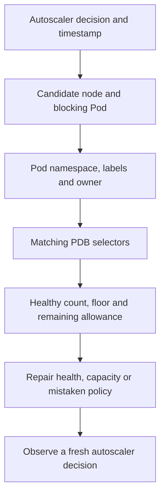

# Find the PDB Blocking Cluster Autoscaler Scale-Down

Author: [nawazdhandala](https://www.github.com/nawazdhandala)

Tags: Kubernetes, PodDisruptionBudget, Cluster Autoscaler, Troubleshooting

Description: Trace a Cluster Autoscaler PDB warning from its node and Pod to the owning workload, explain the missing allowance, and verify a repair without removing availability protection.

A mostly idle node can still be unsafe to remove. If one of its Pods has no available disruption allowance, Cluster Autoscaler may keep the entire node even when its CPU utilization is low. The useful question is not simply which PDB has a zero in its status. It is which budget selects a Pod on the candidate node, and why that budget cannot currently permit eviction.

This walkthrough uses the upstream Cluster Autoscaler `cluster-autoscaler-1.34.0` source for implementation details. Managed services can expose different messages and logging interfaces. In Google Kubernetes Engine (GKE), the documented reason is `no.scale.down.node.pod.not.enough.pdb`, with the blocking Pod identified in the diagnostic information. [GKE scale-down troubleshooting](https://docs.cloud.google.com/kubernetes-engine/docs/troubleshooting/cluster-autoscaler-scale-down).

## Preserve the event context first

Capture the cluster, candidate node, timestamp, namespace, and Pod name from the autoscaler decision. Keep the complete reason, not just a screenshot saying that scale-down failed. A later successful eviction or rollout can make the live objects differ from the original decision.

For a self-managed autoscaler whose Pod and container you have identified, read a bounded log interval:

```bash
CTX=staging-context
CA_NS=replace-with-autoscaler-namespace
CA_POD=replace-with-autoscaler-pod
CA_CONTAINER=replace-with-autoscaler-container
kubectl --context="$CTX" -n "$CA_NS" logs "$CA_POD" -c "$CA_CONTAINER" --since=30m --timestamps
```

Replace the placeholders with your installation's names. This reads logs; it does not restart the autoscaler or change verbosity. Check the active instance if leadership has moved between replicas. For a managed autoscaler, use the provider's autoscaler visibility logs instead of assuming an accessible `kube-system` Deployment exists. [kubectl logs options](https://kubernetes.io/docs/reference/kubectl/generated/kubectl_logs/).

The pinned upstream PDB rule reports a namespace and Pod when a matching budget's remaining allowance is below one. That makes the Pod a better starting point than a cluster-wide list of unrelated zero-allowance budgets. [Upstream PDB drainability rule](https://github.com/kubernetes/autoscaler/blob/cluster-autoscaler-1.34.0/cluster-autoscaler/simulator/drainability/rules/pdb/rule.go).

## List the candidate node's actual Pods

With permission to list Pods across namespaces, inspect the named node:

```bash
NODE=replace-with-candidate-node
kubectl --context="$CTX" get pods --all-namespaces --field-selector "spec.nodeName=$NODE" -o wide
```

`spec.nodeName` is a supported Pod field selector. Unlike a label query, it selects Pods assigned to that exact node, including system and application namespaces. The list can include Pods that the autoscaler treats differently, such as DaemonSet Pods, so do not assume every row is a blocker. [Supported field selectors](https://kubernetes.io/docs/concepts/overview/working-with-objects/field-selectors/).

Compare the recorded blocking Pod with the live list. If it has already moved or disappeared, retain that finding and obtain a newer autoscaler decision before changing policy for an obsolete incident.



## Follow the Pod to its workload and matching budgets

Replace `POD` with the name reported by the autoscaler and `NS` with its namespace. The following uses jq 1.6 or later to summarize identity and controller ownership:

```bash
NS=payments
POD=replace-with-blocking-pod
if ! kubectl --context="$CTX" -n "$NS" get pod "$POD" -o json > blocking-pod.json; then
  exit 1
fi
jq '{
  namespace: .metadata.namespace,
  name: .metadata.name,
  uid: .metadata.uid,
  node: .spec.nodeName,
  labels: .metadata.labels,
  controller: [.metadata.ownerReferences[]?
    | select(.controller == true) | {kind, name}]
}' blocking-pod.json
kubectl --context="$CTX" -n "$NS" get pdb -o yaml
```

A Deployment Pod usually points to a ReplicaSet; inspect that ReplicaSet's owner reference to find the Deployment. A StatefulSet Pod points to its StatefulSet. If no controller is recorded, investigate that separately rather than inventing a workload owner. [Owner references](https://kubernetes.io/docs/concepts/overview/working-with-objects/owners-dependents/), [jq object filtering](https://jqlang.org/manual/v1.6/).

PDB selection is independent of ownership. Compare every budget's complete selector with the Pod's labels in the same namespace. Include both `matchLabels` and `matchExpressions`; their requirements combine with AND. Do not match by similar resource names or by only one label. An empty `policy/v1` selector matches every Pod in its namespace, while an absent selector matches none. [Selector rules](https://kubernetes.io/docs/concepts/overview/working-with-objects/labels/), [PDB API semantics](https://kubernetes.io/docs/reference/kubernetes-api/policy/pod-disruption-budget-v1/).

For example, a budget selecting `app=checkout,component=api` can select a Pod even if its name starts with a generated release prefix. Conversely, a PDB named `checkout` does not select a worker Pod whose labels fail that selector.

## Explain the missing allowance

For each matching budget, record its generation, `observedGeneration`, `currentHealthy`, `desiredHealthy`, `disruptionsAllowed`, conditions, and `disruptedPods`. Then inspect the full selected population, including replicas on other nodes. The PDB represents that population, not just the Pods on the candidate node.

| Evidence | Likely explanation | Useful next step |
|---|---|---|
| Healthy count equals the required floor | No spare healthy replica | Review intended replica floor and maintenance headroom |
| Desired replicas exceed Ready replicas | Startup, readiness, or scheduling failure | Repair the unhealthy or Pending replacement |
| Recent accepted disruptions remain outstanding | Earlier maintenance has consumed allowance | Observe recovery before adding more disruption |
| Observed generation trails the spec | Status has not caught up | Check controller progress and fresh status |
| Selector includes unexpected components | Budget population is wrong | Correct labels or selector ownership in the configuration source |

For an original example, consider four desired checkout replicas with an integer minimum of three. If one replica is unready, only three are healthy and there is no healthy-Pod eviction headroom. Restoring the fourth replica can allow progress without lowering the minimum. If an HPA routinely reduces the Deployment to three replicas, the same zero allowance returns at low traffic. [PDB health calculations](https://github.com/kubernetes/kubernetes/blob/v1.34.0/pkg/controller/disruption/disruption.go).

Do not treat `disruptionsAllowed: 1` as proof that all Pods on a node can disappear together. In the pinned autoscaler, the remaining-budget tracker distinguishes removal eligibility from parallel removal: several selected Pods can exceed the current parallel allowance even when it is positive. Sequential eviction and recovery can still be relevant, with drain timeouts limiting progress. Other candidate removals can also consume simulated remaining allowance. [Pinned remaining-budget tracker](https://github.com/kubernetes/autoscaler/blob/cluster-autoscaler-1.34.0/cluster-autoscaler/core/scaledown/pdb/basic.go), [tracker interface](https://github.com/kubernetes/autoscaler/blob/cluster-autoscaler-1.34.0/cluster-autoscaler/core/scaledown/pdb/pdb.go).

## Repair the cause and observe the next decision

Choose the smallest change that preserves the application's availability requirement. Repair a readiness failure, provide capacity for a stuck replacement, or coordinate a higher HPA minimum with the workload owner. If the selector or healthy floor is incorrect, fix its source configuration after reviewing which Pods would become evictable.

Do not delete the PDB, directly delete the blocking Pod, or add a blanket `safe-to-evict` annotation just to clear a diagnostic. The autoscaler ultimately relies on Kubernetes eviction behavior; an annotation is not a replacement for a valid disruption policy. Overlapping PDBs can create another eviction failure even after an individual allowance becomes positive. [Autoscaler PDB integration](https://github.com/kubernetes/autoscaler/blob/cluster-autoscaler-1.34.0/cluster-autoscaler/FAQ.md#does-ca-work-with-poddisruptionbudget-in-scale-down).

After the repair, capture fresh Pod readiness and PDB status, then wait for a new autoscaler decision. A budget problem disappearing does not guarantee node removal: scheduling constraints, node-group minimums, local storage rules, or other Pods can still block it. Follow the new reason rather than repeatedly changing the same PDB.

Close the investigation with a traceable chain: the original node and Pod, the matching budget, the health or policy cause, the reviewed correction, and the later autoscaler outcome. That evidence distinguishes a repaired configuration from a correctly protected workload whose node should remain running.
