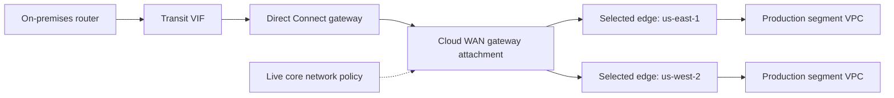

# Connect AWS Cloud WAN to a Direct Connect Gateway

Author: [nawazdhandala](https://www.github.com/nawazdhandala)

Tags: AWS, Direct Connect, Networking, Cloud Architecture, Routing

Description: Attach a Direct Connect gateway to Cloud WAN with explicit segment and edge selection, then verify BGP routes, attachment state, and isolation.

Connecting an existing Direct Connect gateway to AWS Cloud WAN is more than selecting another gateway association. You must decide which routing domain receives the on-premises routes, which Regions participate, and whether the resulting route exchange preserves the intended separation between networks.

Cloud WAN supports a direct gateway attachment, so an intermediate Transit Gateway is not required for this design. This walkthrough starts with an existing core network and a suitable Direct Connect gateway with transit VIF connectivity. Its command examples are reviewed against **AWS CLI 2.42.1**. Local model and output-filter checks were run; no AWS resources were created or changed.

## Understand the two control planes

A **Direct Connect gateway**, or DXGW, connects the transit virtual interfaces to the Cloud WAN attachment. The Cloud WAN **core network** is the managed network spanning your selected Regions. A **core network edge** is its regional routing component, and a **segment** is a separate routing domain within the core network.



The association is managed through Cloud WAN in Network Manager. Direct Connect's interface can show it, but cannot modify it, as explained in the [association documentation](https://docs.aws.amazon.com/directconnect/latest/UserGuide/direct-connect-cloud-wan.html). Keep ownership of the gateway, attachment, and core policy explicit in the change plan.

## Check whether the gateway can be used

The DXGW can associate with one core network and one segment. While associated with Cloud WAN, it cannot also serve incompatible gateway arrangements such as VGW or TGW associations and private VIFs. Use transit VIFs for this path.

Also compare the DXGW's **autonomous system number**, or ASN, with the complete ASN range configured for the core network. It must fall outside that range, not merely differ from an ASN currently assigned to one edge. Review these [attachment prerequisites and limitations](https://docs.aws.amazon.com/network-manager/latest/cloudwan/cloudwan-dxattach-about.html) before scheduling a migration.

For an existing production gateway with incompatible associations, plan a parallel gateway and transit VIF where capacity allows. Do not remove working associations simply to make a creation command pass. First account for route overlap, failover, circuit/VIF quotas, and rollback.

## Establish a policy contract before creating the attachment

This example assumes a segment named `Production` and two deployed edge locations, `us-east-1` and `us-west-2`. The intended attachment carries the tag `RouteDomain=production-dx`.

That tag has no built-in AWS meaning. A rule in the **live core network policy** must match it and associate the attachment with `Production`. The [attachment-policy specification](https://docs.aws.amazon.com/network-manager/latest/cloudwan/cloudwan-policies-json.html#attachment-policies) states that rules are evaluated in order and the first match wins. An earlier broad rule can therefore send the attachment to a different segment.

Have the core-network owner review this contract:

| Setting | Required outcome for this example |
| --- | --- |
| Segment | `Production` exists in both selected Regions |
| Attachment policy | Intended owner and tag map to `Production` |
| Rule ordering | No earlier rule captures the attachment incorrectly |
| Acceptance | Owner approval follows the configured segment/rule requirement |
| Route sharing | Only the approved workload domains are reachable |

Inspect the live policy, not just a saved draft:

```bash
aws networkmanager get-core-network-policy \
  --profile network-readonly --region us-west-2 \
  --core-network-id core-network-REPLACE_ME --alias LIVE \
  --output json --no-cli-pager
```

The [command reference](https://docs.aws.amazon.com/cli/latest/reference/networkmanager/get-core-network-policy.html) distinguishes `LIVE` from `LATEST`. Replace the ID and profile. Any necessary policy edit should go through the core network's policy-version and change-set review before it becomes live; this tutorial does not replace the existing global policy.

## Create a deliberately scoped attachment

Save the following as `dx-attachment.json`. Replace the illustrative core ID, account number, gateway UUID, and edge locations with verified values. An **ARN** is AWS's full resource identifier. The gateway ARN has an empty Region component, reflected in the double colon after `directconnect`.

```json
{
  "CoreNetworkId": "core-network-0123456789abcdef0",
  "DirectConnectGatewayArn": "arn:aws:directconnect::111122223333:dx-gateway/12345678-1234-1234-1234-123456789012",
  "EdgeLocations": ["us-east-1", "us-west-2"],
  "Tags": [
    {"Key": "Name", "Value": "production-dx"},
    {"Key": "RouteDomain", "Value": "production-dx"}
  ],
  "ClientToken": "production-dx-attachment-change-001"
}
```

The payload follows [CreateDirectConnectGatewayAttachment](https://docs.aws.amazon.com/cli/latest/reference/networkmanager/create-direct-connect-gateway-attachment.html). Reuse the client token when retrying this same intended request; choose a new token for a separate creation operation. Keep the exact reviewed payload with the change record.

After prerequisites and owner review, this command creates the attachment:

```bash
aws networkmanager create-direct-connect-gateway-attachment \
  --profile network-change --region us-west-2 \
  --cli-input-json file://dx-attachment.json \
  --query 'DirectConnectGatewayAttachment.Attachment.{ID:AttachmentId,State:State,Segment:SegmentName,Edges:EdgeLocations}' \
  --output json --no-cli-pager
```

The API Region here is separate from the attachment's selected edges. The request explicitly selects two edge locations; it is not an instruction to automatically include every future Region. AWS's [creation guide](https://docs.aws.amazon.com/network-manager/latest/cloudwan/cloudwan-dxattachment-add.html) distinguishes specific edge selection from the console's all-edge option.

Record the returned attachment ID. Creation success means AWS accepted the request, not that the complete network path is operational.

## Verify association and acceptance

Inspect the attachment with its real ID:

```bash
aws networkmanager get-direct-connect-gateway-attachment \
  --profile network-readonly --region us-west-2 \
  --attachment-id attachment-REPLACE_ME \
  --query 'DirectConnectGatewayAttachment.Attachment.{ID:AttachmentId,State:State,Segment:SegmentName,Edges:EdgeLocations,Rule:AttachmentPolicyRuleNumber,Proposed:ProposedSegmentChange,Errors:LastModificationErrors}' \
  --output json --no-cli-pager
```

The [response schema](https://docs.aws.amazon.com/cli/latest/reference/networkmanager/get-direct-connect-gateway-attachment.html) uses `EdgeLocations` for this multi-Region attachment. Check the segment and policy-rule number as well as the state.

If the state is `PENDING_ATTACHMENT_ACCEPTANCE`, the core-network owner must review and accept it through the configured process. `FAILED` warrants inspection of the reported errors; repeatedly creating another attachment is not diagnosis. AWS lists the [attachment states](https://docs.aws.amazon.com/network-manager/latest/cloudwan/cloudwan-create-attachment.html) and their meanings.

## Verify routes in both directions

Advertise only approved on-premises networks over BGP. Cloud WAN does not support a static core-network route whose next hop is a DXGW attachment; these routes are dynamically propagated, as documented under [segment route actions](https://docs.aws.amazon.com/network-manager/latest/cloudwan/cloudwan-policy-network-actions-routes.html).

Do not copy the allowed-prefix-list model from a DXGW/TGW association. The Cloud WAN association does not offer that list. Current [Cloud WAN routing policies](https://docs.aws.amazon.com/network-manager/latest/cloudwan/cloudwan-routing-policies.html) provide supported filtering and other controls, but require their own policy configuration. Segment assignment and routing-policy assignment are separate decisions.

For each selected Region, verify an on-premises prefix in the appropriate segment route table and an intended VPC prefix on the on-premises router. Check both direction-specific Direct Connect prefix quotas. Then inspect the VPC subnet route table: Cloud WAN [does not automatically update VPC route tables](https://docs.aws.amazon.com/network-manager/latest/cloudwan/cloudwan-how-routing-works.html).

## Prove reachability and separation

Run a controlled application request from an approved source to each intended regional destination. Record the selected routes, return path, and result. Also test a destination that the design deliberately excludes.

Pay attention to broad on-premises summaries. AWS warns in its [DXGW segment-isolation guidance](https://docs.aws.amazon.com/network-manager/latest/cloudwan/cloudwan-dxattach-about.html) that traffic can leave the core network through an overlapping supernet and be routed by the DXGW independently of Cloud WAN's internal isolation. Review separate gateways per routing domain or deliberate blackhole routes where appropriate; segment names alone do not establish end-to-end isolation.

Keep the prior path until these checks and a controlled failover rehearsal succeed. A complete handoff includes the attachment ID, live policy version, selected edges, segment, advertised networks, expected exclusions, and evidence that the application works over the intended path.
