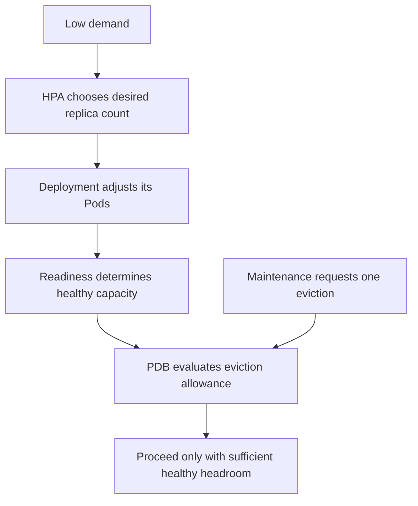

# Coordinate HPA Minimum Replicas with a PDB for Maintenance

Author: [nawazdhandala](https://www.github.com/nawazdhandala)

Tags: Kubernetes, PodDisruptionBudget, Horizontal Pod Autoscaler, Capacity Planning

Description: Align an HPA replica floor with a PDB health requirement, preserve maintenance headroom at low traffic, and verify the result without mistaking desired replicas for healthy Pods.

An application can have a sensible autoscaling policy and a sensible disruption budget that work badly together. At peak traffic, eight replicas leave plenty of room for maintenance. Overnight, the Horizontal Pod Autoscaler (HPA) reduces the application to three replicas. Its PodDisruptionBudget (PDB) requires three healthy Pods, so the next drain cannot evict even one healthy replica.

The budget is enforcing its configured floor. The missing piece is a replica policy that preserves maintenance headroom when demand is low. This guide uses Kubernetes v1.34.0 examples for an existing stateless Deployment; choose replica counts from your application's requirements, not from these sample numbers.

## Understand the two independent controls

The HPA adjusts the desired replica count through the workload's scale interface. A PDB evaluates eligible eviction requests against its healthy-Pod requirement. Neither object turns desired replicas into healthy capacity immediately.

More subtly, a PDB is not a veto on HPA scale-down. The HPA updates the scale target, and the Deployment's ReplicaSets remove surplus Pods through ordinary deletion. That path does not submit an eviction request for every removed replica. Raising `minAvailable` therefore does not stop an HPA configured with an incompatible lower minimum. [HPA scale update](https://github.com/kubernetes/kubernetes/blob/v1.34.0/pkg/controller/podautoscaler/horizontal.go), [ReplicaSet removal](https://github.com/kubernetes/kubernetes/blob/v1.34.0/pkg/controller/replicaset/replica_set.go), [Pod deletion implementation](https://github.com/kubernetes/kubernetes/blob/v1.34.0/pkg/controller/controller_utils.go).



This also explains an alarming status: `currentHealthy: 2` alongside `desiredHealthy: 3`. The PDB cannot create the missing replica. It can deny covered evictions while you repair the underlying capacity or health problem.

## Size the low-traffic floor for the intended operation

Suppose the application must retain three healthy Pods while one Pod is evicted for maintenance. For that steady-state requirement, start with an HPA minimum of four and an integer PDB minimum of three.

| Healthy replicas at the low-traffic floor | PDB minimum | Initial eviction allowance | Consequence |
|---|---:|---:|---|
| 2 | 3 | 0 | Already below the intended healthy floor |
| 3 | 3 | 0 | No room for a healthy-Pod eviction |
| 4 | 3 | 1 | One eligible disruption before recovery |
| 5 | 3 | 2 | Additional headroom, if operational policy allows it |

These rows assume fresh controller status, matching selectors, no existing disruption reservations, and no other budget affecting the Pod. The controller derives allowance from healthy count and the desired healthy floor; zero healthy headroom means zero allowance. [Pinned disruption controller](https://github.com/kubernetes/kubernetes/blob/v1.34.0/pkg/controller/disruption/disruption.go).

For an integer minimum, a useful planning condition is `HPA minReplicas >= PDB minAvailable + planned concurrent Pod losses`. Count affected Pods, not just nodes: one node can host several replicas. Include a separate reserve if the application must tolerate an additional failure during maintenance. This planning condition is not a guarantee that all those replicas will be Ready when work begins.

Keeping four replicas continuously costs more than keeping three. An alternative is a reviewed temporary HPA minimum for a maintenance window. Raise it early enough for scheduling and startup, verify healthy headroom, then restore the normal minimum after maintenance and recovery. Merely running a manual scale command while an HPA remains active does not establish a durable floor.

## Configure a compatible HPA and budget

The following file, `checkout-capacity.yaml`, targets an existing Deployment named `checkout` in `payments`. Its Pod template must carry `app.kubernetes.io/name: checkout` and `app.kubernetes.io/instance: shop-a`.

The CPU metric requires a functioning resource metrics API and appropriate CPU requests on the workload's containers. The sample 60% target is a starting configuration to review against application behavior, not a universal performance recommendation. [Resource utilization prerequisites](https://v1-34.docs.kubernetes.io/docs/tasks/run-application/horizontal-pod-autoscale/#support-for-resource-metrics).

```yaml
apiVersion: autoscaling/v2
kind: HorizontalPodAutoscaler
metadata:
  name: checkout
  namespace: payments
spec:
  scaleTargetRef:
    apiVersion: apps/v1
    kind: Deployment
    name: checkout
  minReplicas: 4
  maxReplicas: 12
  metrics:
    - type: Resource
      resource:
        name: cpu
        target:
          type: Utilization
          averageUtilization: 60
  behavior:
    scaleDown:
      stabilizationWindowSeconds: 300
---
apiVersion: policy/v1
kind: PodDisruptionBudget
metadata:
  name: checkout
  namespace: payments
spec:
  minAvailable: 3
  selector:
    matchLabels:
      app.kubernetes.io/name: checkout
      app.kubernetes.io/instance: shop-a
```

`minReplicas: 4` supplies the normal autoscaling lower bound, while `maxReplicas: 12` caps growth. The maximum must not be below the minimum. The PDB selects the same application instance and retains three healthy Pods during covered evictions. [HPA v2 field definitions](https://github.com/kubernetes/api/blob/v0.34.0/autoscaling/v2/types.go).

The five-minute downscale stabilization window considers recent recommendations to reduce flapping. It is not a permanent availability reserve, and it does not replace the minimum replica count. Once recommendations settle, the HPA can reach its configured floor. [Stabilization behavior](https://v1-34.docs.kubernetes.io/docs/tasks/run-application/horizontal-pod-autoscale/#stabilization-window).

Preview API validation against a verified staging context:

```bash
CTX=staging-context
kubectl --context="$CTX" apply --dry-run=server -f checkout-capacity.yaml
```

A successful response means the API accepted the submitted objects under dry-run rules. It does not confirm that metrics exist, the labels match the intended Pods, or the cluster can schedule four replicas. Review and deploy through your normal configuration workflow. [Server dry-run apply](https://kubernetes.io/docs/reference/kubectl/generated/kubectl_apply/).

## Verify actual capacity before maintenance

Read the autoscaler, workload, Pod population, and budget together. These commands inspect objects and associated diagnostic details. [kubectl get](https://kubernetes.io/docs/reference/kubectl/generated/kubectl_get/), [kubectl describe](https://kubernetes.io/docs/reference/kubectl/generated/kubectl_describe/).

```bash
kubectl --context="$CTX" -n payments get hpa checkout -o yaml
kubectl --context="$CTX" -n payments describe hpa checkout
kubectl --context="$CTX" -n payments get deployment checkout -o yaml
kubectl --context="$CTX" -n payments get pods -l 'app.kubernetes.io/name=checkout,app.kubernetes.io/instance=shop-a' -o wide
kubectl --context="$CTX" -n payments get pdb checkout -o yaml
```

Confirm the HPA references the intended Deployment and has usable metrics. Read its conditions and recent events rather than assuming a configured minimum is already enforced. For example, a target manually set to zero can deactivate normal HPA adjustment when its minimum is greater than zero; that maintenance-mode exception needs deliberate reactivation. [HPA deactivation rules](https://v1-34.docs.kubernetes.io/docs/tasks/run-application/horizontal-pod-autoscale/#implicit-maintenance-mode-deactivation).

Next, require the intended number of nonterminating Ready Pods. A desired count of four with one Pending Pod is only three healthy replicas. A readiness failure has the same headroom consequence, even when all four Pods are Running.

Finally, verify that the PDB controller has observed its current generation and reports at least the allowance needed for the planned operation. Check for overlapping selectors, stale status, and outstanding disruptions. The live budget remains the decision point; HPA settings are supporting capacity policy.

## Rehearse the low-demand case

A maintenance test performed only at peak traffic can conceal the problem. In staging, let the workload reach its configured low-demand floor, then test one eviction through the Eviction API. Observe the surviving healthy count, replacement readiness, and recovery of allowance before another eviction.

Repeat with one replica unready. With a four-replica minimum and a three-healthy minimum, that condition should remove the planned healthy-Pod eviction headroom. Treat the pause as expected protection, not proof that the HPA and PDB are broken.

Also inspect configuration ownership. Reapplying a Deployment manifest with a fixed `spec.replicas` can fight the HPA's replica decisions. Follow Kubernetes' migration guidance when transferring that field to autoscaling; do not casually remove it during a production rollout. [Autoscaling ownership guidance](https://v1-34.docs.kubernetes.io/docs/tasks/run-application/horizontal-pod-autoscale/#migrating-deployments-and-statefulsets-to-horizontal-autoscaling).

If the budget uses a percentage instead of an integer, recalculate its rounded requirement at every relevant replica count, especially the minimum. If it uses `maxUnavailable`, remember that the permitted healthy floor changes with workload scale. A configuration that allows maintenance at eight replicas may have very different availability consequences at one or two. [PDB percentage and maximum-unavailable semantics](https://v1-34.docs.kubernetes.io/docs/tasks/run-application/configure-pdb/).

The acceptance record should include the low-demand replica count, minimum healthy capacity, intended eviction concurrency, and observed recovery time. That makes the next maintenance decision depend on tested operating conditions rather than an apparently compatible pair of YAML values.
