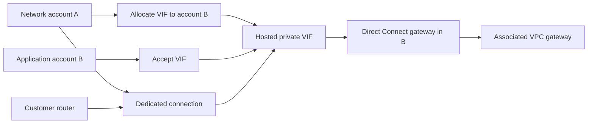

# Operate a Cross-Account Hosted Direct Connect VIF

Author: [nawazdhandala](https://www.github.com/nawazdhandala)

Tags: AWS, Direct Connect, Networking, Security, Routing

Description: Allocate and accept a hosted Direct Connect VIF across AWS accounts, verify gateway ownership, and coordinate routing, maintenance, and incident response.

A network team owns a Direct Connect connection in account A. An application team owns a Direct Connect gateway in account B. The network team allocates a virtual interface to B, but traffic does not start immediately. B must accept the interface, and both teams must finish their parts of the network configuration.

This is a hosted virtual interface, or VIF. It is a logical network interface on somebody else's connection. Accepting it establishes VIF ownership; it does not transfer the underlying connection. AWS documents this cross-account allocation and acceptance process in its [hosted VIF guide](https://docs.aws.amazon.com/directconnect/latest/UserGuide/hosted-vif.html).

The practical challenge is making the ownership boundary visible during both installation and an outage.

## Separate the three resources

A **hosted connection** is a connection provisioned by an AWS Direct Connect Partner for a customer. A **hosted VIF** is an interface allocated to another AWS account. These terms describe different resources and acceptance procedures. The example here uses an existing dedicated connection in A, with a private hosted VIF allocated to B. See the [connection types](https://docs.aws.amazon.com/directconnect/latest/UserGuide/WorkingWithConnections.html).

| Resource | Example owner | Responsibility to record |
| --- | --- | --- |
| Dedicated connection | Network account A | Physical link, capacity, connection maintenance |
| Private hosted VIF | Application account B | Accept interface and choose its gateway destination |
| Direct Connect gateway | Application account B | Gateway associations and intended AWS connectivity |
| Customer router | Network operations team | VLAN, BGP session, filters, and approved route advertisements |

BGP, the Border Gateway Protocol, exchanges routes between your router and AWS. A VLAN is the numbered Ethernet segment used by this VIF. Neither a successful API response nor the correct AWS account replaces the router configuration.



The arrows combine provisioning responsibility and the resulting network path. Gateway associations are a separate prerequisite; this diagram does not imply that accepting the VIF creates a VPC route table or gateway association.

## Agree on the handoff before allocating

Write one change record containing both account IDs, the connection ID, VIF name, Region, VLAN, customer ASN, destination gateway ID, and the people who can change each resource. ASN means autonomous system number: the identity used by a BGP routing domain.

Reserve an unused VLAN on the selected connection. Agree on the routes each side should advertise, including any routes that must never cross this interface. Keep the first deployment at a 1500-byte MTU unless a separate jumbo-frame change has been reviewed. For this private IPv4 example, AWS generates the peering addresses and BGP authentication key. The [hosted VIF prerequisites](https://docs.aws.amazon.com/directconnect/latest/UserGuide/hosted-vif.html) describe these choices.

Prepare two authenticated AWS CLI profiles: `network-owner` for A and `vif-owner` for B. The examples were reviewed against the [AWS CLI 2.42.1 Direct Connect model](https://github.com/aws/aws-cli/blob/2.42.1/awscli/botocore/data/directconnect/2012-10-25/service-2.json). They are source-checked examples, not evidence of a live cross-account deployment.

First verify the identities:

```bash
aws sts get-caller-identity --profile network-owner \
  --query '{Account:Account,Arn:Arn}' --output json --no-cli-pager

aws sts get-caller-identity --profile vif-owner \
  --query '{Account:Account,Arn:Arn}' --output json --no-cli-pager
```

These read-only calls reveal which account and role each profile uses. Compare them with the approved change record. A familiar profile name alone is insufficient. The operation is documented in [get-caller-identity](https://docs.aws.amazon.com/cli/latest/reference/sts/get-caller-identity.html).

## Allocate in the connection owner's account

Replace the account number, connection ID, VLAN, and ASN below. Save this JSON as `hosted-private-vif.json`; `222222222222` represents B. The VLAN and ASN are illustrative values, not defaults for your network.

```json
{
  "connectionId": "dxcon-EXAMPLE",
  "ownerAccount": "222222222222",
  "newPrivateVirtualInterfaceAllocation": {
    "virtualInterfaceName": "application-b-private",
    "vlan": 210,
    "asnLong": 65010,
    "addressFamily": "ipv4",
    "mtu": 1500
  }
}
```

The following command **creates a resource**. Run it only after both teams have agreed on the allocation:

```bash
aws directconnect allocate-private-virtual-interface \
  --profile network-owner --region us-east-1 \
  --cli-input-json file://hosted-private-vif.json \
  --query '{Vif:virtualInterfaceId,Owner:ownerAccount,Connection:connectionId,State:virtualInterfaceState,Vlan:vlan}' \
  --output json --no-cli-pager
```

Record the returned `dxvif-...` ID. The expected initial state is `confirming`: the destination owner has not yet accepted it. The output filter deliberately omits the authentication key and router configuration, which can appear in the full response. See [allocate-private-virtual-interface](https://docs.aws.amazon.com/cli/latest/reference/directconnect/allocate-private-virtual-interface.html).

Do not rerun allocation merely because acceptance is still pending. Inspect the existing VIF first; another allocation is not an acceptance retry.

## Inspect and accept in the VIF owner's account

Before accepting, B should inspect the exact interface:

```bash
aws directconnect describe-virtual-interfaces \
  --profile vif-owner --region us-east-1 \
  --virtual-interface-id dxvif-EXAMPLE \
  --query 'virtualInterfaces[].{Vif:virtualInterfaceId,Owner:ownerAccount,Connection:connectionId,Type:virtualInterfaceType,Vlan:vlan,State:virtualInterfaceState,Gateway:directConnectGatewayId,Peers:bgpPeers[].{Family:addressFamily,State:bgpPeerState,Status:bgpStatus}}' \
  --output json --no-cli-pager
```

The owner, connection, type, and VLAN must match the handoff. Empty results or an authorization error are reasons to check the account, Region, ID, and permissions before changing anything. The [describe operation](https://docs.aws.amazon.com/cli/latest/reference/directconnect/describe-virtual-interfaces.html) supports filtering by one VIF ID.

Check the destination gateway independently:

```bash
aws directconnect describe-direct-connect-gateways \
  --profile vif-owner --region us-east-1 \
  --direct-connect-gateway-id REPLACE-DX-GATEWAY-ID \
  --query 'directConnectGateways[].{Id:directConnectGatewayId,Owner:ownerAccount,State:directConnectGatewayState,AmazonAsn:amazonSideAsn}' \
  --output json --no-cli-pager
```

Expect the intended gateway in B and a usable, available state. This [gateway inspection](https://docs.aws.amazon.com/cli/latest/reference/directconnect/describe-direct-connect-gateways.html) helps catch a copied ID from the wrong environment. Review the gateway's existing associations before proceeding.

Now accept the VIF, replacing both IDs:

```bash
aws directconnect confirm-private-virtual-interface \
  --profile vif-owner --region us-east-1 \
  --virtual-interface-id dxvif-EXAMPLE \
  --direct-connect-gateway-id REPLACE-DX-GATEWAY-ID \
  --output json --no-cli-pager
```

This changes ownership acceptance and attaches the interface to the specified destination. A `pending` response can precede readiness. A private VIF can instead be confirmed against a virtual private gateway; use the appropriate destination, not both options. Transit and public VIFs have different confirmation operations. See [ConfirmPrivateVirtualInterface](https://docs.aws.amazon.com/directconnect/latest/APIReference/API_ConfirmPrivateVirtualInterface.html).

## Finish the network handoff

After acceptance, the **connection owner** can download the router configuration. AWS explicitly says the accepting account does not have that download option. Arrange a secure handoff to the router operator; do not paste the configuration or its BGP key into a general ticket. See [accepting a hosted VIF](https://docs.aws.amazon.com/directconnect/latest/UserGuide/accepthostedvirtualinterface.html).

Configure the VLAN and BGP peer using the approved router procedure. Repeat the VIF inspection and check each required address family's BGP status. Then verify actual route exchange, VPC routes, security controls, and an application transaction in both directions. `available` is an interface lifecycle state, not an end-to-end application test.

If the destination gateway has no usable VPC association, acceptance alone cannot fix that. Cross-account gateway associations are their own workflow, and overlapping VPC address ranges introduce separate restrictions. Review [virtual private gateway associations](https://docs.aws.amazon.com/directconnect/latest/UserGuide/virtualgateways.html) rather than treating every routing problem as VIF ownership trouble.

## Operate across the boundary

Keep a shared incident record with the VIF ID and parent connection ID. If several VIFs fail together, ask A to investigate the common connection. If this VIF alone has BGP down, compare the router configuration, VLAN, and authentication settings. If BGP is up but the application fails, compare learned routes and application-level controls.

Agree who receives maintenance notices, who opens support cases, and who can authorize VIF replacement. Give each role only the required actions; AWS lists allocation and confirmation separately in its [service authorization reference](https://docs.aws.amazon.com/service-authorization/latest/reference/list_directconnect.html).

Finally, separate operating responsibility from cost allocation. Port hours, data transfer, gateway services, and partner contracts can involve different charges. Review the [current pricing model](https://aws.amazon.com/directconnect/pricing/pay-as-you-go/) with both account owners. A completed handoff should leave each team knowing what it controls, what it depends on, and whom to contact when that dependency fails.
