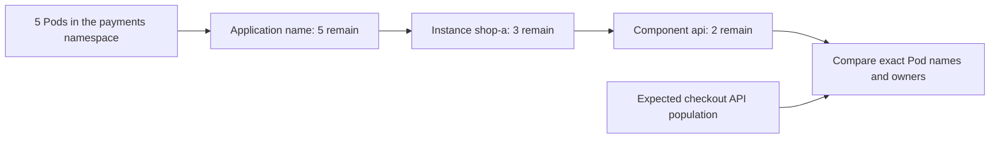

# Fix a PDB Selector That Matches No Pods or Too Many

Author: [nawazdhandala](https://www.github.com/nawazdhandala)

Tags: Kubernetes, PodDisruptionBudget, Troubleshooting, High Availability

Description: Verify the exact Pods selected by a disruption budget, catch namespace and release-label mistakes, and repair selectors without losing coverage during a rollout.

A PodDisruptionBudget can be valid YAML and still protect the wrong population. A typo might leave the intended Pods uncovered. A selector using only the application name might include a second installation or a worker that cannot replace API capacity.

Treat selector debugging as a comparison between two sets: the Pods the application owner expects the budget to cover, and the Pods the selector actually matches. A healthy-looking disruption allowance does not establish that those sets are the same.

The examples below use `policy/v1` PDBs and Kubernetes v1.34.1 selector behavior. The selectors were evaluated locally using the official version-pinned matching library. No labels or budgets were changed in a live cluster.

## Write down the intended population first

For this example, the budget should cover the checkout API belonging to installation `shop-a` in namespace `payments`. It should include both old and new API Pods during a rollout, but exclude checkout workers and another installation named `shop-b`.

That description suggests three useful labels:

| Label | Example value | Why it matters |
|---|---|---|
| `app.kubernetes.io/name` | `checkout` | Identifies the application |
| `app.kubernetes.io/instance` | `shop-a` | Distinguishes one installation from another |
| `app.kubernetes.io/component` | `api` | Separates serving Pods from workers or other components |

These keys follow Kubernetes' recommended label conventions. They are conventions, not automatically generated guarantees: inspect the actual Pod labels before using them. [Recommended labels](https://kubernetes.io/docs/concepts/overview/working-with-objects/common-labels/).

If two selected components cannot substitute for one another, a shared numerical healthy count can misrepresent service capacity. Agree on the population before tuning `minAvailable` or `maxUnavailable`.

## Inspect the PDB and actual Pod labels

Use an identity with read access to the namespace. Replace the context, namespace, and object names with the workload under investigation:

```bash
CTX=staging-context
NS=payments
PDB=checkout

kubectl --context="$CTX" -n "$NS" get pdb "$PDB" -o yaml
kubectl --context="$CTX" -n "$NS" describe pdb "$PDB"
kubectl --context="$CTX" -n "$NS" get pods --show-labels
```

Start with `metadata.namespace` and the entire `spec.selector`. A PDB selects Pods in its own namespace; it does not reach into another namespace with identical labels. The namespace argument must therefore match the PDB you are diagnosing. [PDB controller selection](https://github.com/kubernetes/kubernetes/blob/v1.34.1/pkg/controller/disruption/disruption.go).

`describe` formats the selector into a readable expression, while the YAML preserves its structured form. Do not parse the describe output as a stable machine interface. [kubectl PDB describer](https://github.com/kubernetes/kubernetes/blob/v1.34.0/staging/src/k8s.io/kubectl/pkg/describe/describe.go).

Next inspect the owning Deployment:

```bash
kubectl --context="$CTX" -n "$NS" get deployment checkout -o yaml
```

Compare the Pods' `metadata.labels` with the Deployment's `spec.template.metadata.labels`. Labels on the Deployment object's top-level metadata do not, by themselves, label its Pods. The template defines the Pods that the workload creates. [Deployment Pod templates](https://kubernetes.io/docs/concepts/workloads/controllers/deployment/).

## Translate every selector requirement

This proposed budget protects one healthy Pod among the intended API population. The numerical floor is illustrative; keep your own reviewed availability requirement.

```yaml
apiVersion: policy/v1
kind: PodDisruptionBudget
metadata:
  name: checkout
  namespace: payments
spec:
  minAvailable: 1
  selector:
    matchLabels:
      app.kubernetes.io/name: checkout
      app.kubernetes.io/instance: shop-a
    matchExpressions:
      - key: app.kubernetes.io/component
        operator: In
        values:
          - api
```

The label equalities and the expression must all match. They are joined with AND, not OR. For this exact example, the equivalent read-only query is:

```bash
SELECTOR='app.kubernetes.io/name=checkout,app.kubernetes.io/instance=shop-a,app.kubernetes.io/component in (api)'
kubectl --context="$CTX" -n "$NS" get pods -l "$SELECTOR" \
  --show-labels -o wide
```

Quote the whole selector so the shell does not interpret spaces or parentheses. Do not copy only `matchLabels` and discard `matchExpressions`; that would test a different population. Kubernetes supports equality and set-based requirements for these selectors. [Label selector syntax](https://kubernetes.io/docs/concepts/overview/working-with-objects/labels/).

For a small illustrative inventory, the expected results are:

| Pod | Namespace | Instance | Component | Selected? |
|---|---|---|---|---|
| `checkout-api-old` | payments | shop-a | api | Yes |
| `checkout-api-new` | payments | shop-a | api | Yes |
| `checkout-worker` | payments | shop-a | worker | No |
| `checkout-other` | payments | shop-b | api | No |
| `checkout-unlabeled` | payments | absent | absent | No |
| `checkout-test` | staging | shop-a | api | No |

All six have the application-name label. The last row would match the label expression alone, but is outside the PDB namespace. The old and new API Pods can have different rollout hashes while retaining the stable labels used here.



## Diagnose an empty match

When the query returns no Pods, check the namespace and spelling first. Label keys and values must match the intended requirements; `shop-a` and `shop_a` are different values.

Then check whether the label exists on actual Pods, whether an expression excludes them, and whether a chart rendered an empty or missing selector. For `policy/v1`, `selector: {}` selects all Pods in the namespace, whereas a null selector selects none. These are opposite outcomes, not interchangeable ways to express an unspecified filter. [Pinned selector conversion](https://github.com/kubernetes/apimachinery/blob/v0.34.1/pkg/apis/meta/v1/helpers.go).

An empty match is not healthy protection with zero spare capacity. The intended Pods may have no matching PDB at all. Fix the population error before using status counters to decide whether maintenance is safe.

## Diagnose an unexpectedly broad match

When too many Pods appear, inspect which term failed to distinguish them. A shared application name often needs an installation label. A shared installation may need a component label. Avoid selecting a broad organizational label such as a team name unless the budget was intentionally designed for every matching workload.

Set expressions have another important edge case: `NotIn` matches Pods where the key is absent as well as Pods with other values. If the intent requires the key to exist, include an `Exists` requirement too. Re-run the full selector after any such change. [Set-based label requirements](https://kubernetes.io/docs/concepts/overview/working-with-objects/labels/).

Do not assume `status.expectedPods` is a direct listing count for every budget. Percentage settings and maximum-unavailable settings can derive expected scale from owning controllers. Inspect the actual matched Pod names and owners as the primary evidence for selector scope. [Expected-scale calculation](https://github.com/kubernetes/kubernetes/blob/v1.34.1/pkg/controller/disruption/disruption.go).

## Repair the source and preserve rollout coverage

Edit the configuration that owns the PDB and Pod template, such as the reviewed manifest or chart values. Manually relabeling current Pods may conceal a template error that returns when replacements are created.

Avoid using `pod-template-hash` as a long-lived application selector unless revision-specific coverage is intentional. A Deployment uses that hash to distinguish ReplicaSets, so a selector tied to one hash can miss the next rollout. [Deployment revision labels](https://kubernetes.io/docs/concepts/workloads/controllers/deployment/).

Before applying a correction, preview both the old and proposed selected populations. Check every intended old and new revision, and review whether another PDB also selects the same Pods. Removing an accidental match must not silently remove the only budget covering a workload that still needs protection.

After the reviewed change, wait for the PDB to observe its new generation. Confirm the selected names, workload owners, healthy count, and required minimum again. Keep a small label-inventory fixture in configuration review so future chart changes can be checked against the same expected population. A selector is correct when it consistently identifies the intended workload, not merely when its YAML passes validation.
