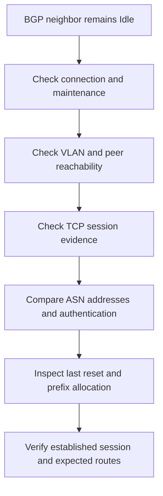

# Troubleshoot AWS Direct Connect BGP Stuck in Idle

Author: [nawazdhandala](https://www.github.com/nawazdhandala)

Tags: AWS, Direct Connect, BGP, Networking, Troubleshooting

Description: Trace an idle Direct Connect BGP session through connection state, VLAN reachability, peer settings, TCP negotiation, and configured prefix limits.

An Idle BGP neighbor is a symptom, not a diagnosis. Border Gateway Protocol, or BGP, exchanges network routes between your router and AWS. It cannot establish a session when the underlying link is unavailable, the peers cannot reach each other, or their session settings disagree.

Start with the lowest failing layer and collect evidence before resetting anything. Repeatedly clearing a neighbor can erase useful timing information and disrupt a session that briefly recovered.

This guide follows AWS's official troubleshooting sequence and uses read-only commands reviewed against **AWS CLI 2.42.1** service definitions. The output filters were tested with local synthetic responses; no AWS connection or router session was tested.

## Establish which object is failing

Direct Connect has several related states:

| Object | Question to answer |
| --- | --- |
| Physical or hosted connection | Is the underlying connection available? |
| Virtual interface, or VIF | Is this logical interface provisioned and configured? |
| BGP peer | Is this address family's routing session established? |
| Routes and application traffic | Are the expected routes installed and usable? |

Do not treat a provisioned peer as an established session. Also check IPv4 and IPv6 independently; one family can work while the other fails.

Use an existing read-only AWS profile with permission to describe Direct Connect resources. Replace the Region, profile, and VIF identifier below with the incident's actual values:

```bash
aws directconnect describe-virtual-interfaces \
  --profile network-readonly --region us-east-1 \
  --virtual-interface-id dxvif-REPLACE_ME \
  --query 'virtualInterfaces[].{VIF:virtualInterfaceId,Type:virtualInterfaceType,State:virtualInterfaceState,Connection:connectionId,VLAN:vlan,AmazonASN:amazonSideAsn,IPv4Allocation:prefixPoolAllocatedCountIpv4,IPv6Allocation:prefixPoolAllocatedCountIpv6,Peers:bgpPeers[].{Family:addressFamily,Customer:customerAddress,Amazon:amazonAddress,CustomerASN:asnLong,Provisioning:bgpPeerState,Session:bgpStatus}}' \
  --output json --no-cli-pager
```

The [API reference](https://docs.aws.amazon.com/cli/latest/reference/directconnect/describe-virtual-interfaces.html) defines `bgpPeerState` separately from `bgpStatus`. The latter is `up`, `down`, or `unknown`; it does not expose every router-side BGP state. `asnLong` avoids mistaking the legacy ASN field's zero value for a real configured ASN when a larger number is used.

This filter deliberately omits `authKey` and `customerRouterConfig`, which can contain the BGP secret. Keep full responses and downloaded configuration files out of public tickets.



## Check the connection before changing BGP

Use the returned connection ID to inspect the underlying connection:

```bash
aws directconnect describe-connections \
  --profile network-readonly --region us-east-1 \
  --connection-id dxcon-REPLACE_ME \
  --query 'connections[].{ID:connectionId,State:connectionState,Location:location,Bandwidth:bandwidth,Provider:providerName,LAG:lagId}' \
  --output json --no-cli-pager
```

The [connection reference](https://docs.aws.amazon.com/cli/latest/reference/directconnect/describe-connections.html) describes `available` as a link ready for use and `down` as a link failure. For a hosted connection, involve the provider when the physical handoff is outside your control. For an aggregated link, inspect the relevant link-aggregation group and members as well as this connection.

Correlate the outage time with AWS Health events and provider maintenance. AWS's [layer-three troubleshooting guidance](https://repost.aws/knowledge-center/direct-connect-layer-3-issues) notes that maintenance can move BGP sessions into Idle. A scheduled event is useful context, but still confirm that the affected connection and time match your incident.

If the link is down, investigate the physical path first. Replacing a BGP password does not repair an unlit fiber or an administratively disabled interface.

## Verify the VLAN and the directly connected peers

A VLAN is the Ethernet tag that separates the VIF's traffic from other traffic on the connection. Compare the configured tag with the API output and the provider's handoff documentation.

For IPv4, inspect the router's address-resolution table for the AWS peer on the correct subinterface. AWS's [layer-two procedure](https://docs.aws.amazon.com/directconnect/latest/UserGuide/ts-layer-2.html) emphasizes putting the peer address on the VLAN subinterface and carrying the required 802.1Q tag through intermediate devices. A physical port can be up while tagged traffic never reaches the peer.

Test reachability with the router's appropriate source-address and routing-instance options. A ping from a management interface or an unrelated routing table tests a different path. If the ping fails, use neighbor-resolution and packet evidence to distinguish incorrect addressing, missing VLAN transport, and filtering. For IPv6, inspect neighbor discovery instead of an IPv4 ARP entry.

AWS documents that [external BGP multihop is disabled on its end](https://repost.aws/knowledge-center/troubleshoot-bgp-dx). Do not insert a routed intermediate hop and expect a customer-side multihop setting to make that topology supported.

## Compare the peer configuration field by field

Retrieve the intended configuration through the approved secure channel and compare it with the router's effective configuration:

- The router's local ASN matches the customer ASN.
- The remote ASN matches the actual Amazon-side ASN for this VIF.
- The local and neighbor addresses match their respective sides and address family.
- The BGP authentication secret matches exactly, including whitespace handling.
- The neighbor is enabled in the intended routing instance and address family.

AWS's [network/transport troubleshooting page](https://docs.aws.amazon.com/directconnect/latest/UserGuide/ts-layer-3.html) identifies ASN, address, and MD5 authentication mismatches as checks to perform. Do not assume one Amazon ASN applies to every public, private, and transit interface.

Inspect filtering on the peer path. BGP uses TCP port 179, with a source port that can be ephemeral. Allow the necessary traffic between the specific peers in both directions under your network policy. Broadly disabling firewalls is not required to determine which rule is dropping traffic.

## Let the last observed state guide packet review

Use the router vendor's documented operational commands to collect neighbor details, last-reset reasons, and a bounded capture of traffic between the two peer addresses. Command syntax differs between platforms, so do not paste another vendor's configuration into a production router.

Interpret the evidence as a sequence:

| Observation | Next investigation |
| --- | --- |
| No connection attempt leaves the expected interface | Neighbor activation, routing instance, source address, local policy |
| Repeated TCP SYN with no reply | Reachability, filtering, peer configuration, authentication-related drops |
| TCP establishes, then BGP closes | OPEN/NOTIFICATION details, ASN and capability agreement |
| Session establishes, receives updates, then resets | Last reset reason, prefix count, timers, BFD events |

A packet pattern narrows possibilities; it is not proof of a particular cause. AWS's [BGP-state explanation](https://repost.aws/knowledge-center/vpn-troubleshoot-bgp-connection-errors) describes the transition from Idle through TCP setup and BGP negotiation. Use the captured exchange and device logs together.

## Check configured prefix limits after a reset

A prefix is an advertised network range. Exceeding the permitted number can drop an otherwise established session. Current [Direct Connect quotas](https://docs.aws.amazon.com/directconnect/latest/UserGuide/limits.html) describe a default allocation of 100 per address family for private/transit VIFs, with supported increases through prefix controls; public VIFs retain a 1,000-prefix limit.

Inspect the actual IPv4 and IPv6 allocations rather than assuming 100 is universally immutable. The [prefix-controls documentation](https://docs.aws.amazon.com/directconnect/latest/UserGuide/prefix-controls.html) explains eligibility and connection/gateway pools. Compare advertised routes with the allocation for this VIF, including more-specific routes introduced by recent policy changes.

If a route leak or accidental redistribution caused the reset, correct that policy. Advertising a default route or summarizing everything can change traffic behavior substantially, so neither is a universal emergency fix.

## Close the incident with routing evidence

After the targeted correction, verify sustained session establishment, expected received and advertised routes, and a representative application path. BGP `up` alone does not prove routing is correct; AWS provides a separate [routing troubleshooting procedure](https://docs.aws.amazon.com/directconnect/latest/UserGuide/ts-routing.html).

For escalation, provide the connection and VIF IDs, Region, timestamps, address family, last-reset reason, sanitized peer settings, relevant optical/VLAN evidence, and a short capture summary. Exclude secrets. That record lets AWS, the provider, and your network team investigate the same failure boundary without repeating disruptive guesses.
