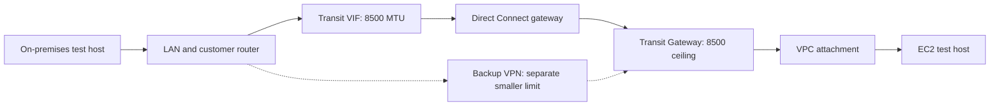

# Make Jumbo Frames Work Across Direct Connect and Transit Gateway

Author: [nawazdhandala](https://www.github.com/nawazdhandala)

Tags: AWS, Direct Connect, Networking, Troubleshooting, Routing

Description: Check the complete Direct Connect jumbo-frame path, set a transit VIF to 8500 MTU, and test packet sizes in both directions before rollout.

A Direct Connect circuit can have a healthy link, an established routing session, and a successful small ping while large application transfers stall. One possible cause is an inconsistent maximum transmission unit, or **MTU**: the largest IP packet a network segment can carry.

Jumbo frames carry more data per packet than a standard 1500-byte MTU allows. They can reduce per-packet overhead, but enabling them at one interface does not enlarge the rest of the path. This walkthrough uses an existing transit virtual interface, a Direct Connect gateway, and a Transit Gateway. Command shapes were reviewed against **AWS CLI 2.42.1**; Linux probe options are scoped to **iputils 20250605**. No production network changes or live path tests were performed for this article.

## Write down the smallest supported packet size

A **virtual interface**, or VIF, is the logical connection carrying a particular routing relationship over Direct Connect. Its type matters:

| Path | Planning limit |
|---|---|
| Public VIF | Standard 1500-byte MTU; do not apply the private/transit jumbo settings |
| Private VIF toward a virtual private gateway | The Direct Connect overview documents 1500 or 9001 |
| Transit VIF through a Direct Connect gateway to Transit Gateway | 1500 or 8500; use 8500 for this walkthrough |
| Additional VPN or appliance tunnel | Determine the inner packet limit separately, including encapsulation overhead |

The [Direct Connect MTU overview](https://docs.aws.amazon.com/directconnect/latest/UserGuide/WorkingWithVirtualInterfaces.html) distinguishes private and transit VIF sizes. Some individual console/API descriptions use generic 8500 wording even for private interfaces. This example deliberately uses a transit VIF, whose [creation API](https://docs.aws.amazon.com/directconnect/latest/APIReference/API_CreateTransitVirtualInterface.html) explicitly accepts 1500 or 8500. Do not copy its value into a different topology without checking that interface's supported behavior.



Transit Gateway supports 8500-byte packets on the relevant Direct Connect/VPC path. A host configured for 9001 does not make Transit Gateway accept 9001. Record the limit for every firewall, provider handoff, switch, and tunnel between the two hosts, using the [Transit Gateway MTU rules](https://docs.aws.amazon.com/vpc/latest/tgw/transit-gateway-quotas.html) as the AWS boundary.

Keep IP MTU and Ethernet frame size separate when talking to the carrier. Ethernet headers, VLAN tags, and frame checks are additional link-layer bytes. Ask whether the provider supports the required IP packet over the actual tagged service, rather than comparing two numbers that measure different things.

Route type also matters. In the private-VIF/VGW design, a static VPC route pointing to the virtual private gateway uses 1500 MTU; the [classic connection guidance](https://docs.aws.amazon.com/directconnect/latest/UserGuide/toolkit-classic.html) calls out that limitation. Do not transfer that restriction to Transit Gateway: its Direct Connect jumbo support includes static and propagated TGW routes and VPC routes pointing to the TGW attachment.

## Inspect capability and configuration separately

Replace the profile, Region, and resource IDs below. The configured profile needs read access to the selected Direct Connect resources. These commands only inspect them:

```bash
aws directconnect describe-connections \
  --profile network-ops --region us-east-1 \
  --connection-id dxcon-EXAMPLE \
  --query 'connections[].{ID:connectionId,State:connectionState,JumboCapable:jumboFrameCapable,LAG:lagId}' \
  --output json

aws directconnect describe-virtual-interfaces \
  --profile network-ops --region us-east-1 \
  --virtual-interface-id dxvif-EXAMPLE \
  --query 'virtualInterfaces[].{ID:virtualInterfaceId,Type:virtualInterfaceType,State:virtualInterfaceState,Connection:connectionId,MTU:mtu,JumboCapable:jumboFrameCapable}' \
  --output json
```

The [connection response](https://docs.aws.amazon.com/cli/latest/reference/directconnect/describe-connections.html) reports jumbo capability. The [VIF response](https://docs.aws.amazon.com/cli/latest/reference/directconnect/describe-virtual-interfaces.html) also reports the configured MTU. Capability alone does not establish that the VIF is using 8500 or that the customer router accepts it. Missing fields or an empty result need investigation; they are not a passing check.

For a hosted connection, involve the provider: the parent connection must support jumbo frames. For a link aggregation group, or LAG, check the associated connection arrangement and device configuration before assuming every member path is equivalent. The Direct Connect overview describes these [connection prerequisites](https://docs.aws.amazon.com/directconnect/latest/UserGuide/WorkingWithVirtualInterfaces.html).

## Plan the change around the shared physical link

Enabling jumbo frames can require an underlying physical-connection update, interrupting **all VIFs on that connection** for up to 30 seconds. Schedule the change with owners of those VIFs and verify the alternate path first. This consequence is documented by the [update operation](https://docs.aws.amazon.com/directconnect/latest/APIReference/API_UpdateVirtualInterfaceAttributes.html).

Before touching the VIF, record the current MTU, routing state, interface counters, and application baseline. Prepare router and host settings according to their own vendors' requirements. There is no universal router command that safely covers physical ports, VLAN interfaces, and provider encapsulation.

After confirming the inspected VIF is `transit`, use the following only in the approved window:

```bash
aws directconnect update-virtual-interface-attributes \
  --profile network-ops --region us-east-1 \
  --virtual-interface-id dxvif-EXAMPLE \
  --mtu 8500 \
  --query '{ID:virtualInterfaceId,State:virtualInterfaceState,MTU:mtu,JumboCapable:jumboFrameCapable}' \
  --output json
```

This changes the AWS VIF, not the on-premises equipment or EC2 operating system. Re-run the inspection commands until the interface has settled, then confirm the routing session and actual traffic. The [`update-virtual-interface-attributes` reference](https://docs.aws.amazon.com/cli/latest/reference/directconnect/update-virtual-interface-attributes.html) defines the command's fields.

## Probe the packet size, not just reachability

Choose two disposable or approved test hosts on the actual application route. Allow the required Internet Control Message Protocol (ICMP) echo and error traffic through host firewalls, security groups, and network access controls. Both endpoints and their local paths must be configured for the intended size. Avoid the router's BGP peering address as the destination: it tests a different endpoint.

On a Linux host with the pinned iputils behavior, replace `10.80.2.25` with the remote test host:

```bash
ping -4 -n -c 3 -W 2 -M do -s 1472 10.80.2.25
ping -4 -n -c 3 -W 2 -M do -s 8472 10.80.2.25
ping -4 -n -c 3 -W 2 -M do -s 8473 10.80.2.25
```

`-s` counts ICMP data bytes. With an ordinary 20-byte IPv4 header and 8-byte ICMP header, these request sizes are 1500, 8500, and 8501 bytes. `-M do` sets the don't-fragment behavior and also respects the host's known path limit; the kernel can reject a packet before transmission. `-c` limits the probe count, and `-W` bounds response waiting. These options follow the [tagged iputils manual](https://github.com/iputils/iputils/blob/20250605/doc/ping.xml).

Expect 1500 and 8500 to work on the intended jumbo path. The 8501 test should not pass unfragmented through its 8500 bottleneck. A timeout is not proof of where a packet was lost. Check for a local “message too long” error, router discard counters, and evidence at the destination. Repeat from the other host and record both directions.

For IPv6, repeat the assessment with IPv6-specific probes and header accounting; do not reuse the IPv4 payload calculation unchanged. Also test representative TCP transfers and application datagrams. Ping proves one traffic type and path, not every workload.

## Diagnose discovery and failover problems

**Path MTU Discovery**, or PMTUD, uses network error messages to tell a sender that its packets are too large. Permit IPv4 fragmentation-needed messages and IPv6 Packet Too Big messages where required; the [EC2 MTU documentation](https://docs.aws.amazon.com/AWSEC2/latest/UserGuide/network_mtu.html) explains their role.

Transit Gateway's PMTUD support depends on the ingress attachment. It supports VPC and Connect ingress, but not Direct Connect, VPN, or peering ingress. Consequently, a successful reverse-direction adjustment does not prove that an on-premises sender will learn the same limit. TCP maximum-segment-size adjustment also does not solve oversized UDP datagrams. Treat the [attachment-specific behavior](https://docs.aws.amazon.com/vpc/latest/tgw/transit-gateway-quotas.html) as part of the test plan.

Finally, rehearse failover. A VPN backup can have a smaller usable MTU because encryption adds overhead; use the [VPN-specific limits](https://docs.aws.amazon.com/vpn/latest/s2svpn/vpn-limits.html), not the transit VIF setting. Check established sessions as well as new connections after routing changes.

Accept the rollout only when the planned packet size works in both directions, representative applications remain healthy, and the documented fallback also works. If it fails, return to the recorded configuration through the same controlled change process, including compatible sender settings. Keeping a reliable smaller MTU is preferable to leaving a partially working jumbo path in service.
