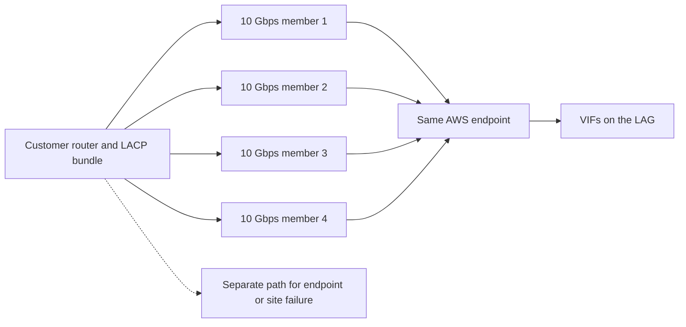

# Build a Direct Connect LAG That Can Survive Member Loss

Author: [nawazdhandala](https://www.github.com/nawazdhandala)

Tags: AWS, Direct Connect, Networking, Performance, High Availability

Description: Size Direct Connect LAGs for degraded capacity, set minimum links deliberately, and plan disruptive member changes without stranding traffic.

Four 10 Gbps connections provide 40 Gbps of nominal aggregate capacity. Lose two members and only 20 Gbps remains. A workload that normally sends 22 Gbps can then overload the surviving links even if the LAG still appears operational.

A link aggregation group, or LAG, combines physical connections into one logical interface. Link Aggregation Control Protocol, or LACP, coordinates which links participate. Building a useful LAG requires a decision about degraded capacity, not just the number of ports to order.

## Understand the common failure boundary

Direct Connect LAG members must be dedicated connections with the same speed, terminating at the same AWS endpoint. AWS supports up to four members at 1 or 10 Gbps, or two at 100 or 400 Gbps. Hosted connections are not eligible members. AWS does not support multi-chassis LAG. These requirements are in the [LAG guide](https://docs.aws.amazon.com/directconnect/latest/UserGuide/lags.html).



The bundle can tolerate some member failures, but its shared endpoint remains a shared dependency. Use a separately designed path for endpoint or location failure; four cables at one endpoint do not provide four independent sites. AWS's [Resiliency Toolkit](https://docs.aws.amazon.com/directconnect/latest/UserGuide/resiliency_toolkit.html) addresses the broader connection-placement problem.

## Calculate the minimum usable bundle

Use peak expected traffic in each direction, then allow room for bursts and uneven distribution. Suppose the busier direction needs 22 Gbps and your planning target is at most 80% aggregate utilization:

| Operational 10 Gbps members | Nominal capacity | 80% planning allowance | Can accommodate 22 Gbps within that allowance? |
| --- | --- | --- | --- |
| 4 | 40 Gbps | 32 Gbps | Yes |
| 3 | 30 Gbps | 24 Gbps | Yes |
| 2 | 20 Gbps | 16 Gbps | No |
| 1 | 10 Gbps | 8 Gbps | No |

The 80% value is an example engineering allowance, not an AWS guarantee. This workload needs at least three members under that assumption. A four-member design can lose one member while retaining the planned capacity.

The calculation is only an aggregate check. Customer devices commonly select member links using a hash of packet addresses or other flow fields. Several busy flows can select the same member while another is lightly loaded. Cisco's [EtherChannel load-balancing explanation](https://www.cisco.com/c/en/us/support/docs/lan-switching/etherchannel/12023-4.html) illustrates this behavior. Check your router's actual method and measure individual member utilization; do not promise 40 Gbps to one transfer from the aggregate figure.

Also total the workloads sharing all VIFs. A VIF is a virtual interface carrying a particular routed connection. Creating more VIFs does not add physical capacity. AWS allows VIF rate-limit allocations to exceed a LAG's capacity, so the sum of configured limits is not a reservation system. See [VIF rate limiters](https://docs.aws.amazon.com/directconnect/latest/UserGuide/vif-rate-limiters.html).

## Inspect before creating or changing anything

Use an authenticated AWS CLI profile with the relevant Direct Connect permissions. Replace the example Region and LAG ID. These examples were checked against the [AWS CLI 2.42.1 model](https://github.com/aws/aws-cli/blob/2.42.1/awscli/botocore/data/directconnect/2012-10-25/service-2.json); they have not been run against a live LAG.

```bash
aws directconnect describe-lags \
  --profile network-change --region us-east-1 \
  --lag-id dxlag-EXAMPLE \
  --query 'lags[].{Id:lagId,State:lagState,Location:location,Endpoint:awsDeviceV2,MemberSpeed:connectionsBandwidth,Minimum:minimumLinks,Members:connections[].{Id:connectionId,State:connectionState,Speed:bandwidth,Endpoint:awsDeviceV2}}' \
  --output json --no-cli-pager
```

This [read-only inventory](https://docs.aws.amazon.com/cli/latest/reference/directconnect/describe-lags.html) shows membership and the configured threshold. Compare it with live router LACP status and interface counters. A provisioned connection listed in an API response is not, by itself, proof that its member link is forwarding correctly.

Record VIF destinations, VLANs, BGP peers, routing preferences, MTUs, and encryption settings before modifying an existing bundle. BGP is the routing protocol; LACP membership and BGP route exchange are separate checks.

## Provision capacity with an explicit change plan

For an approved new four-member 10 Gbps design, the request has this shape:

```bash
aws directconnect create-lag \
  --profile network-change --region us-east-1 \
  --number-of-connections 4 \
  --location REPLACE-DIRECT-CONNECT-LOCATION \
  --connections-bandwidth 10Gbps \
  --lag-name production-four-link \
  --query '{Id:lagId,State:lagState,MemberSpeed:connectionsBandwidth,Minimum:minimumLinks,Members:connections[].connectionId}' \
  --output json --no-cli-pager
```

This requests billable infrastructure; it is not a dry run. Confirm port availability, account quotas, facility work, provider arrangements, and the encryption design before submitting it. If MACsec is required, include the appropriate eligible-port request and key/configuration plan rather than assuming encryption is automatic. The [create-lag reference](https://docs.aws.amazon.com/cli/latest/reference/directconnect/create-lag.html) documents these options.

New physical connections still require the facility authorization and installation workflow. Finish customer-side dynamic LACP configuration and verify every intended member before carrying production load. AWS's [LACP troubleshooting guidance](https://repost.aws/knowledge-center/troubleshoot-lacp-issues-direct-connect) distinguishes protocol negotiation, member state, and minimum-link problems.

If building from existing connections, reserve a maintenance window: AWS documents a connectivity interruption during conversion. Existing-member migration is not equivalent to ordering unused ports. Review the [creation procedure](https://docs.aws.amazon.com/directconnect/latest/UserGuide/create-lag.html) against the exact inventory.

## Set minimum links from the failure plan

`minimumLinks` determines how many operational members the LAG needs to remain operational. New LAGs default to zero; do not treat that default as your workload's capacity policy. With the example workload, a threshold of three prevents continued use of a two-member bundle that cannot carry 22 Gbps. See the [LAG minimum-link behavior](https://docs.aws.amazon.com/directconnect/latest/UserGuide/lags.html).

After verifying at least three working members and a tested alternate path, this command applies that policy:

```bash
aws directconnect update-lag \
  --profile network-change --region us-east-1 \
  --lag-id dxlag-EXAMPLE --minimum-links 3 \
  --query '{Id:lagId,State:lagState,Minimum:minimumLinks}' \
  --output json --no-cli-pager
```

Raising the threshold above the operational member count can immediately make the LAG non-operational. The [update reference](https://docs.aws.amazon.com/cli/latest/reference/directconnect/update-lag.html) explicitly warns about this. Coordinate the corresponding customer-router threshold and failover behavior through its vendor-supported procedure.

A threshold does not create backup capacity. If the alternate path cannot carry the workload, decide which traffic will be delayed or shed before testing a two-member failure.

## Add or remove members without bypassing the guardrail

Before adding a connection, confirm matching bandwidth and endpoint, available member slots, VIF compatibility, and the impact on any source LAG. AWS automatically moves the connection's VIF associations to the destination LAG, and association interrupts connectivity over that connection. Follow the [association requirements](https://docs.aws.amazon.com/directconnect/latest/UserGuide/associate-connection-with-lag.html).

After the approved preparation, the association command is:

```bash
aws directconnect associate-connection-with-lag \
  --profile network-change --region us-east-1 \
  --connection-id dxcon-APPROVED-MEMBER --lag-id dxlag-EXAMPLE \
  --query '{Connection:connectionId,Lag:lagId,State:connectionState}' \
  --output json --no-cli-pager
```

Use this only when a member slot is available, such as replacing a removed member or expanding a smaller bundle. A fully populated four-member 10 Gbps LAG cannot accept a fifth member. See [associate-connection-with-lag](https://docs.aws.amazon.com/cli/latest/reference/directconnect/associate-connection-with-lag.html).

Removing a member also interrupts that connection. AWS prevents disassociation that would violate the minimum threshold, and removing a member does not automatically move VIFs off the LAG. Do not lower the threshold simply to bypass a rejection; recompute capacity and move traffic first. See the [disassociation behavior](https://docs.aws.amazon.com/directconnect/latest/UserGuide/disassociate-connection-from-lag.html).

If MACsec is in use, review the LAG key behavior too: association replaces connection-level keys with the LAG's key associations. Coordinate the customer end before changing membership; review the [MACsec considerations](https://docs.aws.amazon.com/directconnect/latest/UserGuide/lags.html).

## Accept the bundle under degraded conditions

Rehearse one approved member loss in a controlled window. Verify LACP membership, per-member errors and traffic, BGP stability, application completion, and restoration. Then separately rehearse the threshold-triggered transition to the alternate path if your failure plan requires it.

Record observed convergence and application impact rather than assuming a universal failover time. Repeat the capacity review whenever workload demand, member count, shaping, or the alternate path changes. A LAG is ready when its degraded behavior meets the service requirement, not merely when every port is green.
