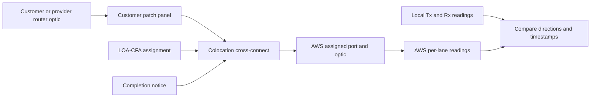

# Diagnose a Dark or Down AWS Direct Connect Link

Author: [nawazdhandala](https://www.github.com/nawazdhandala)

Tags: AWS, Direct Connect, Networking, Troubleshooting

Description: Diagnose a Direct Connect physical-link failure by matching the LOA-CFA, validating optics and cross-connects, and comparing per-lane light readings.

When a Direct Connect router reports no received light, changing a BGP neighbor cannot restore the missing optical signal. Start by locating the failure between the router port, the colocation cross-connect, and the assigned AWS port.

A useful investigation produces more than “the cable is connected.” It records the exact circuit, the ports at both ends, the measured transmit and receive levels, and the time of each observation. That evidence lets your network team, provider, and AWS investigate the same path.

This guide primarily covers a dedicated Direct Connect physical handoff. For a hosted connection, the partner owns more of the underlying path; ask the partner to obtain the corresponding physical evidence. Read-only CLI examples are scoped to **AWS CLI 2.42.1**. No optical measurements or AWS requests were executed for this article.

## Separate a dark link from a down virtual interface

A **cross-connect** is the physical connection within the colocation facility. A **virtual interface**, or VIF, is a logical interface carried over the connection. A working optical path can still have a VLAN or BGP problem.

Use a configured read-only profile with Direct Connect describe permission. Replace the profile, Region, and connection ID with your values:

```bash
aws directconnect describe-connections \
  --profile network-readonly --region us-east-1 \
  --connection-id dxcon-REPLACE_ME \
  --query 'connections[].{ID:connectionId,State:connectionState,Location:location,Bandwidth:bandwidth,Provider:providerName,Device:awsDeviceV2,LAG:lagId}' \
  --output json --no-cli-pager
```

The [connection API](https://docs.aws.amazon.com/cli/latest/reference/directconnect/describe-connections.html) distinguishes `available`, `down`, and provisioning states such as `requested` or `pending`. Match that status with your router's physical interface state. An account or Region mismatch is not evidence of a broken cable.

If the physical link is available and only the VIF is down, move to AWS's [layer-two troubleshooting procedure](https://docs.aws.amazon.com/directconnect/latest/UserGuide/ts-layer-2.html). Do not disturb working fiber to fix a VLAN configuration.



Tx means transmitted light; Rx means received light. AWS Rx measures light arriving at AWS from your direction. Your router's Rx measures light arriving from AWS through the intervening path. Label the measurement point to avoid reversing the diagnosis.

## Match the completed circuit to the LOA-CFA

The **Letter of Authorization and Connecting Facility Assignment**, or LOA-CFA, identifies the authorized AWS-side physical assignment. It is an input to ordering the cross-connect, not proof that the facility completed the work.

Download the document for the affected connection through **Connections → View details → Download LOA-CFA**, following AWS's [download procedure](https://docs.aws.amazon.com/directconnect/latest/UserGuide/download-loa-cfa.html). If the document is unavailable, check the request for additional information and the support case rather than inventing a panel assignment.

Compare the provider's written completion notice with the LOA-CFA: connection ID, facility, patch-panel assignment, ports or strands, and customer-side termination. Ask the provider to resolve any disagreement before moving cables. AWS's [physical-layer troubleshooting checklist](https://docs.aws.amazon.com/directconnect/latest/UserGuide/ts_layer_1.html) explicitly starts with that comparison.

For a new installation, confirm that the authorization remained valid while the work was completed. AWS states that an uncompleted cross-connect's authorization [expires after 90 days](https://docs.aws.amazon.com/directconnect/latest/UserGuide/Colocation.html). An old completed link does not suddenly lose light simply because its original document is older than 90 days.

Keep the document intact. The [dedicated-connection documentation](https://docs.aws.amazon.com/directconnect/latest/UserGuide/dedicated_connection.html) describes its digital signature and watermark. Send the authorized document through the provider's approved process; do not edit port details into the PDF to reconcile conflicting records.

## Verify the handoff and optic type

Check that the router is powered, the correct physical interface is administratively enabled, and its configured speed matches the ordered handoff. Confirm the installed transceiver's actual part number rather than relying on the label of a spare box.

AWS's [connection requirements](https://docs.aws.amazon.com/directconnect/latest/UserGuide/connection_options.html) specify single-mode fiber and these optical standards:

| Dedicated port speed | Optical standard |
| --- | --- |
| 1 Gbps | 1000BASE-LX, 1310 nm |
| 10 Gbps | 10GBASE-LR, 1310 nm |
| 100 Gbps | 100GBASE-LR4 |
| 400 Gbps | 400GBASE-LR4 |

For a partner handoff, distinguish the bandwidth you purchased from the physical port standard presented to your router. A hosted service's bandwidth does not necessarily identify the physical AWS port speed.

Confirm negotiation settings against the specific endpoint and handoff requirements. AWS's general connection page and physical troubleshooting page use different wording here, and the latter explicitly treats 1 Gbps negotiation as endpoint-dependent. Do not toggle negotiation repeatedly based on a generic remembered rule; establish the required setting with the provider or AWS and make a controlled change if needed.

## Collect optical evidence from both ends

Use your router vendor's operational transceiver diagnostics to record Tx, Rx, alarm flags, and the relevant lane numbers. Compare readings with the supported optic's limits. A negative dBm reading is normal for many optical links; “negative” does not mean no light.

AWS exposes `ConnectionLightLevelTx` and `ConnectionLightLevelRx`, measured at its end, with `ConnectionId` and `OpticalLaneNumber` dimensions. Its [metrics reference](https://docs.aws.amazon.com/directconnect/latest/UserGuide/monitoring-cloudwatch.html) also documents connection state and physical error counts. Inspect every reported optical lane rather than accepting one good lane as proof the whole link is healthy.

First discover the published receive-light series in the documented [`AWS/DX` namespace](https://docs.aws.amazon.com/directconnect/latest/UserGuide/viewing-metrics.html):

```bash
aws cloudwatch list-metrics \
  --profile network-readonly --region us-east-1 \
  --namespace AWS/DX --metric-name ConnectionLightLevelRx \
  --dimensions Name=ConnectionId,Value=dxcon-REPLACE_ME \
  --query 'Metrics[].{Name:MetricName,Dimensions:Dimensions}' \
  --output json --no-cli-pager
```

This needs CloudWatch read permission. [`list-metrics`](https://docs.aws.amazon.com/cli/latest/reference/cloudwatch/list-metrics.html) returns metric identities, not the light readings. An empty list can mean the wrong account, Region, unavailable telemetry, or no recently published series; it does not prove zero received light.

After confirming the exact dimensions, retrieve one lane's recent readings. Replace the connection, lane, and example UTC time window:

```bash
aws cloudwatch get-metric-statistics \
  --profile network-readonly --region us-east-1 \
  --namespace AWS/DX --metric-name ConnectionLightLevelRx \
  --dimensions Name=ConnectionId,Value=dxcon-REPLACE_ME \
               Name=OpticalLaneNumber,Value=REPLACE_WITH_REPORTED_LANE \
  --start-time 2026-11-24T10:00:00Z \
  --end-time 2026-11-24T11:00:00Z \
  --period 300 --statistics Minimum Maximum Average \
  --query 'sort_by(Datapoints,&Timestamp)' \
  --output json --no-cli-pager
```

The [statistics API](https://docs.aws.amazon.com/cli/latest/reference/cloudwatch/get-metric-statistics.html) requires the exact published dimension set. The query sorts points because the service does not guarantee chronological order. Repeat for each lane and the Tx metric. Compare the same incident window with local readings; an aggregated historical value is not an instantaneous optical measurement.

## Isolate the physical segment with the provider

Use the direction of loss to choose the next inspection. Good local Tx with poor AWS Rx points investigation toward the outbound path, but does not alone identify a bad patch lead or prove the local optic is healthy. Poor local Rx deserves the corresponding reverse-path investigation.

Ask the facility for measured optical levels across the cross-connect and confirmation of strand orientation. AWS's [layer-one guidance](https://repost.aws/knowledge-center/direct-connect-layer-1-issues) includes provider-assisted loop tests and strand reversal as diagnostic techniques. These can interrupt service: have qualified facility staff perform an agreed test on the identified circuit, preserve the original patching record, and record before/after results. Do not randomly swap live links or inspect an active fiber by eye.

Close the physical investigation when the correct link is stably up, all relevant readings are within the applicable limits, and error counters are no longer accumulating abnormally. Then verify the VIF and application path separately. If escalation is still needed, supply AWS and the provider with matching circuit identifiers, the completion notice, time-aligned measurements, and the specific segment each test cleared.
