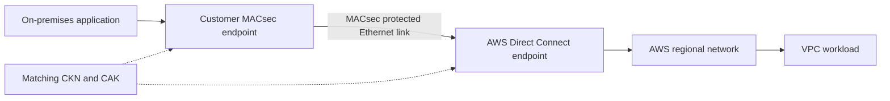

# Prepare Direct Connect MACsec and Rotate Its Keys Safely

Author: [nawazdhandala](https://www.github.com/nawazdhandala)

Tags: AWS, Direct Connect, Networking, Security, Encryption

Description: Verify Direct Connect MACsec port and cipher support, separate key association from active encryption, and plan key rotation without losing protection.

A private network connection is not automatically an encrypted connection. With AWS Direct Connect, MACsec can protect the Ethernet link between compatible edge devices, but you must select suitable ports, configure matching keys, and choose how the connection behaves when encryption fails.

The practical question is not simply “Does this router support MACsec?” It is whether this port, software release, cipher, provider handoff, and key-management process work together. This guide uses source-checked **AWS CLI 2.42.1** examples for an existing dedicated connection. Local request and output-filter checks were performed; no connection was modified or encryption negotiated during preparation.

## Identify the protected segment

**MACsec**, short for Media Access Control Security, protects traffic at the Ethernet layer. Its scope is the link between the devices terminating MACsec. It does not create an application-to-application encrypted tunnel through every subsequent network segment.



If a provider terminates the circuit before your router, establish exactly which devices are encryption endpoints and who controls them. The [AWS encryption architecture](https://docs.aws.amazon.com/reference-architecture-diagrams/latest/traffic-encryption-direct-connect/encryption-macsec.html) makes this boundary explicit. Keep application TLS or an IPsec overlay when your requirement extends beyond that link.

Hosted-connection customers cannot directly configure these MACsec properties. A partner can protect its own eligible interconnect, which is a different scope of control. Ask the partner for the protected segment and operational evidence rather than interpreting “MACsec available” as customer-controlled encryption. See the [connection configuration guidance](https://docs.aws.amazon.com/directconnect/latest/UserGuide/updateconnection.html).

## Match the port and cipher requirements

Use this as a purchase and compatibility checklist:

| Dedicated port speed | Supported cipher suites |
|---|---|
| 10 Gbps | GCM-AES-256 or GCM-AES-XPN-256 |
| 100 Gbps | GCM-AES-XPN-256 |
| 400 Gbps | GCM-AES-XPN-256 |

Availability depends on the Direct Connect location and actual port. **XPN**, extended packet numbering, expands the sequence-number space used by MACsec. The secure channel identifier, or **SCI**, must be enabled. Moving the VLAN tag outside the encrypted payload with a dot1q-in-clear setting is unsupported. Confirm these details against the [Direct Connect FAQ](https://aws.amazon.com/directconnect/faqs/) and your device's exact software/hardware support matrix.

Do not treat a configurable cipher name as proof that a line card supports it at the required speed. Request evidence for the interface type, license if applicable, forwarding capacity, and counter visibility. Record the expected behavior during key mismatch before the change window.

For a link aggregation group, or LAG, use its configuration workflow rather than independently changing one member. The [LAG update documentation](https://docs.aws.amazon.com/directconnect/latest/UserGuide/update-lag.html) explains how encryption mode applies to member connections. Include minimum-link behavior in the maintenance plan.

## Read the current state without exposing key material

Replace the profile, Region, and connection ID. The profile needs permission to describe this connection:

```bash
aws directconnect describe-connections \
  --profile network-security --region us-east-1 \
  --connection-id dxcon-EXAMPLE \
  --query 'connections[].{ID:connectionId,Link:connectionState,Capable:macSecCapable,Mode:encryptionMode,Encryption:portEncryptionStatus,LAG:lagId,Keys:macSecKeys[].{State:state,Since:startOn}}' \
  --output json
```

Interpret the fields independently:

- `Capable` describes support, not whether encryption is active.
- `Link` describes connection availability, not confidentiality.
- `Mode` describes the configured failure policy.
- `Encryption` reports `Encryption Up` or `Encryption Down`.
- A key's `associated` state records association, not proof that your router selected it.

These fields come from the [connection response](https://docs.aws.amazon.com/cli/latest/reference/directconnect/describe-connections.html). The projection omits key identifiers and secret ARNs from routine evidence. Keep operational identifiers in an access-controlled change record when needed. Missing fields, an empty result, or an unexpected LAG ID should stop assumptions about readiness.

## Prepare matching keys through an approved channel

The **Connectivity Association Key**, or CAK, is the pre-shared key. The **Connectivity Association Key Name**, or CKN, identifies that association. Direct Connect requires 64 hexadecimal characters for each value. Do not paste real pairs into tickets, shell history, screenshots, or article examples. The [association API](https://docs.aws.amazon.com/cli/latest/reference/directconnect/associate-mac-sec-key.html) accepts either a pair or a compatible existing MACsec secret ARN, not both.

For a new setup, use the Direct Connect console's **Associate key** workflow with securely generated values, then provision the same pair on the router through its approved management channel. Follow the [association procedure](https://docs.aws.amazon.com/directconnect/latest/UserGuide/associate-key-connection.html) and [router setup sequence](https://docs.aws.amazon.com/directconnect/latest/UserGuide/create-macsec-dedicated.html). An arbitrary Secrets Manager object is not automatically a valid Direct Connect MACsec secret.

The following alternative applies only when an appropriate existing MACsec secret is already available and the matching pair has been securely supplied to the router team. Replace the illustrative ARN; it is an identifier, not a secret value:

```bash
aws directconnect associate-mac-sec-key \
  --profile network-security --region us-east-1 \
  --connection-id dxcon-EXAMPLE \
  --secret-arn arn:aws:secretsmanager:us-east-1:123456789012:secret:REPLACE-MACSEC-SECRET-AbCdEf \
  --query '{Connection:connectionId,KeyStates:macSecKeys[].state}' \
  --output json
```

Run association changes only during the agreed rollout. Wait for association completion, inspect the router's negotiated cipher and active association, and confirm encrypted packet counters increase while approved test traffic runs. A successful API response cannot prove matching router configuration.

## Set the failure policy deliberately

`should_encrypt` permits unencrypted fallback if MACsec cannot be established. `must_encrypt` stops traffic when encryption is unavailable. `no_encrypt` disables MACsec protection. Choose the policy with the service owner; availability through cleartext fallback does not satisfy an encryption-required design. The [MACsec mode definitions](https://docs.aws.amazon.com/directconnect/latest/UserGuide/MACsec.html) describe the tradeoff.

For an already verified standalone connection, the approved change to require encryption is:

```bash
aws directconnect update-connection \
  --profile network-security --region us-east-1 \
  --connection-id dxcon-EXAMPLE \
  --encryption-mode must_encrypt \
  --query '{ID:connectionId,Mode:encryptionMode,Encryption:portEncryptionStatus,Link:connectionState}' \
  --output json
```

This [update command](https://docs.aws.amazon.com/cli/latest/reference/directconnect/update-connection.html) can interrupt service when encryption is not working. Verify the alternate route first, including its encryption properties. After the change, repeat the read-only check and application tests. A usable fallback is not necessarily a protected fallback.

## Rotate with overlap and evidence

Direct Connect retains up to three CKN/CAK pairs. It tries the newest pair and can fall back to the previous working pair. The automatically rotated **secure association key**, or SAK, is separate from your manually managed long-term pair. These distinctions are documented in [MACsec key rotation](https://docs.aws.amazon.com/directconnect/latest/UserGuide/MACsec.html).

Use the overlap as an operational safeguard, not a reason to skip verification:

1. Inventory existing associations and ensure there is room for the replacement. Preserve the known working pair.
2. Generate and distribute the replacement securely, scheduling both router and AWS changes together.
3. Add the replacement on AWS and configure it on the router according to the vendor's activation procedure.
4. Confirm which pair is actually active on the router. Check encryption state, traffic, error counters, and stability across the observation window.
5. Retire only the specifically identified superseded association after the replacement is proven. Recheck protection immediately afterward.

An “Encryption Up” result alone cannot distinguish successful adoption from continued use of the old pair. Keep that check explicit in the change record.

Do not use deletion of the underlying Secrets Manager secret as a rotation shortcut. AWS documents that key deletion/disassociation can affect connectivity and that removal of the last CKN can change `must_encrypt` to `should_encrypt` in its described cleanup behavior. Review the [key considerations](https://docs.aws.amazon.com/directconnect/latest/UserGuide/MACsec.html) before retirement.

## Make protection observable

Acceptance evidence should include the expected cipher, active replacement association, encryption-up status, required mode, and healthy application traffic. Monitor changes in both encryption status and mode: watching only link availability misses cleartext fallback.

If negotiation fails, compare port capability, cipher/XPN selection, SCI, and the exact pair through secure channels. Recover the known working encrypted configuration or use an approved protected alternate path. Do not silently lower the encryption requirement merely to make a link-status check turn green.
