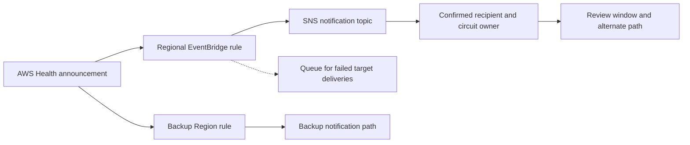

# Alert on Direct Connect Maintenance with AWS Health and EventBridge

Author: [nawazdhandala](https://www.github.com/nawazdhandala)

Tags: AWS, Direct Connect, Monitoring, Alerting, Networking

Description: Capture Direct Connect maintenance notices with AWS Health and EventBridge, verify notification delivery, and preserve reminders and event updates.

A maintenance announcement is useful only when somebody receives it, identifies the affected circuit, and checks the alternate path before work starts. Forwarding one email to a distribution list does not establish that workflow. You need a repeatable route from AWS's announcement to an accountable network owner.

This guide builds an AWS Health event rule with an Amazon Simple Notification Service (SNS) topic as its destination. The examples were checked against **AWS CLI 2.42.1**. Local pattern and request checks are described in the review records; no AWS rules, subscriptions, or maintenance events were created during preparation.

## Choose the correct event stream

AWS Health describes service events affecting your resources. EventBridge matches those events against a rule and sends matches to a **target**, such as an SNS topic. An SNS subscription then delivers the message to its recipient.

Use `aws.health` with the detail type `AWS Health Event`. The `aws.directconnect` source represents Direct Connect API activity through CloudTrail; it is not the maintenance announcement channel. See the official [Health event reference](https://docs.aws.amazon.com/eventbridge/latest/ref/events-ref-health.html) and [Direct Connect event reference](https://docs.aws.amazon.com/eventbridge/latest/ref/events-ref-directconnect.html).



Planned Direct Connect maintenance normally has advance notices, reminders, and completion updates. Emergency work can have much shorter notice. AWS also cannot report maintenance performed independently by your network provider. Keep the provider's notification process alongside this integration; consult the [Direct Connect maintenance guidance](https://docs.aws.amazon.com/directconnect/latest/UserGuide/dx-maintenance.html) for the current notification schedule.

## Decide which accounts and Regions are covered

A rule normally receives events for its own account. If circuits are owned in a networking account, creating a rule only in an application account leaves a gap. Organization-wide aggregation requires its own configuration; it does not follow automatically from membership in AWS Organizations. AWS describes these boundaries in its [Health and EventBridge integration guide](https://docs.aws.amazon.com/health/latest/ug/cloudwatch-events-health.html).

For regional coverage, deploy rules in the relevant Regions. In the standard AWS partition, Oregon (`us-west-2`) receives backup events for other Regions; N. Virginia (`us-east-1`) backs up Oregon. A single Oregon rule can collect account-specific events across Regions, but that simplified setup lacks regional redundancy and does not collect all public events. Global events require N. Virginia coverage. Choose deliberately using the [regional coverage documentation](https://docs.aws.amazon.com/health/latest/ug/choosing-a-region.html).

The diagram shows separate notification paths because routing both rules through one unavailable regional target defeats part of the redundancy. Initially, duplicate emails may be acceptable. A later ticketing integration should deduplicate deliveries without discarding updates.

## Start with a broad Direct Connect pattern

Save this as `dx-health-pattern.json`:

```json
{
  "source": ["aws.health"],
  "detail-type": ["AWS Health Event"],
  "detail": {
    "service": ["DIRECTCONNECT"]
  }
}
```

This uses the service selector shown in AWS’s [Direct Connect Health example](https://aws.amazon.com/blogs/networking-and-content-delivery/testing-aws-direct-connect-resiliency-with-resiliency-toolkit-failover-testing/) and deliberately matches all Direct Connect Health communications. It avoids guessing maintenance event-type codes or assuming every relevant notification has one category. It also retains closed-event updates. After inspecting actual messages, route scheduled changes and urgent operational issues differently downstream.

To exercise the matching rule, save this deliberately minimal **synthetic fixture** as `dx-health-test.json`. It is not a complete AWS Health payload:

```json
{
  "version": "0",
  "id": "00000000-0000-4000-8000-000000000001",
  "account": "123456789012",
  "source": "aws.health",
  "detail-type": "AWS Health Event",
  "time": "2026-11-24T12:00:00Z",
  "region": "us-east-1",
  "resources": [],
  "detail": {
    "service": "DIRECTCONNECT",
    "eventTypeCategory": "scheduledChange",
    "statusCode": "upcoming"
  }
}
```

With a configured AWS profile authorized for `events:TestEventPattern`, run:

```bash
aws events test-event-pattern \
  --profile network-ops --region us-east-1 \
  --event-pattern file://dx-health-pattern.json \
  --event file://dx-health-test.json
```

Expect `Result: true`. Changing the service to `EC2` should return false; changing the status to `closed` should remain true. This [test operation](https://docs.aws.amazon.com/cli/latest/reference/events/test-event-pattern.html) calls AWS. It neither publishes an event nor proves that a recipient can receive a notification.

## Connect a dedicated notification destination

Before deploying, prepare a standard SNS topic with confirmed subscriptions in the selected Region. Replace the example account, Region, topic, queue, and profile values below. Arrange notification routing with its owners so the first real message is actionable.

This example uses **resource-based permissions**: policies attached to the destination resources. Grant `events.amazonaws.com` permission to publish to the specific SNS topic. If encryption uses a customer-managed key, also satisfy its key-policy requirements. Merge the necessary statements into existing policies; do not replace unrelated permissions. Follow the [EventBridge target permission guidance](https://docs.aws.amazon.com/eventbridge/latest/userguide/eb-use-resource-based.html).

Prepare a standard SQS **dead-letter queue**, or DLQ, in the rule's Region. It retains events that EventBridge could not deliver to the target. Its policy must allow `events.amazonaws.com` to perform `sqs:SendMessage`, restricted to this rule's ARN. API-based target creation does not automatically supply that queue policy. See the [DLQ configuration requirements](https://docs.aws.amazon.com/eventbridge/latest/userguide/eb-rule-dlq.html).

Choose a new, unused rule name, then create it:

```bash
aws events put-rule \
  --profile network-ops --region us-east-1 \
  --name dx-health-notifications \
  --event-bus-name default \
  --event-pattern file://dx-health-pattern.json \
  --state ENABLED \
  --description 'Direct Connect Health communications'
```

The result contains the rule ARN, which identifies the rule in destination policies. [`put-rule`](https://docs.aws.amazon.com/cli/latest/reference/events/put-rule.html) also updates existing rules, replacing omitted settings, so do not reuse another team's rule name.

Save `dx-health-targets.json` after replacing its resource identifiers:

```json
[
  {
    "Id": "network-operations",
    "Arn": "arn:aws:sns:us-east-1:123456789012:dx-health",
    "RetryPolicy": {
      "MaximumEventAgeInSeconds": 86400,
      "MaximumRetryAttempts": 185
    },
    "DeadLetterConfig": {
      "Arn": "arn:aws:sqs:us-east-1:123456789012:dx-health-undelivered"
    }
  }
]
```

Attach the target after its permissions are ready:

```bash
aws events put-targets \
  --profile network-ops --region us-east-1 \
  --rule dx-health-notifications \
  --event-bus-name default \
  --targets file://dx-health-targets.json
```

Require `FailedEntryCount` to be zero and inspect any failed entries. With no input transformation, the target receives the complete matching event. The [target API documentation](https://docs.aws.amazon.com/cli/latest/reference/events/put-targets.html) explains partial failures. The explicit retry values match the documented [default retry policy](https://docs.aws.amazon.com/eventbridge/latest/userguide/eb-rule-retry-policy.html), but retries cannot repair a missing permission.

## Preserve the notification lifecycle

Record the affected account, circuit identifiers, event ARN, announced window, latest description, and assigned owner. Use `detail.eventRegion` for the affected Region; the outer `region` identifies where the event was delivered. In an aggregated account, `detail.affectedAccount` can differ from the outer account.

For automated tickets, group by affected account and event ARN, and deduplicate individual deliveries using the affected account and `communicationId`. Do not treat an event ARN as a permanent suppression key: subsequent communications can change the window or close the event. Retain page information when combining affected-resource lists. The [Health schema](https://docs.aws.amazon.com/health/latest/ug/aws-health-events-eventbridge-schema.html) and [pagination guide](https://docs.aws.amazon.com/health/latest/ug/pagnation-of-health-events.html) explain these fields.

## Accept the workflow, not just the pattern

Use three separate acceptance checks:

| Check | Passing evidence |
|---|---|
| Pattern | Expected service matches; unrelated service fails; completion updates still match |
| Delivery | Confirmed recipient receives a clearly labeled test through the approved test path; failed delivery reaches the DLQ |
| Operations | Owner maps the message to a circuit, acknowledges it, and records alternate-path readiness |

A pattern test alone does not exercise SNS permissions. A direct SNS test alone does not exercise the EventBridge target. Use a separately scoped test rule and custom event source for an end-to-end rehearsal, then verify the production rule against a real Health message when available.

Monitor failed target invocations and DLQ delivery failures as well as queue depth. Finally, check route convergence and application traffic after maintenance. A closed Health event is an announcement update, not proof that your on-premises router and applications have recovered.
