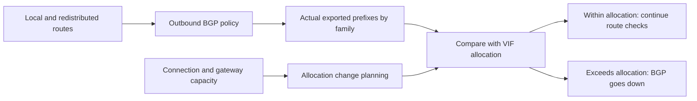

# Check Direct Connect Prefix Allocations Before BGP Drops

Author: [nawazdhandala](https://www.github.com/nawazdhandala)

Tags: AWS, Direct Connect, BGP, Networking, Troubleshooting

Description: Check the actual IPv4 and IPv6 allocations on private and transit VIFs, budget for failover routes, and avoid BGP outages caused by prefix growth.

A new branch network is added, the physical Direct Connect link stays up, and the BGP session suddenly falls into Idle. One possible cause is that the router advertised more network prefixes than the virtual interface was allocated.

The familiar “100 prefixes per address family” rule needs an update. AWS's current [Direct Connect quotas](https://docs.aws.amazon.com/directconnect/latest/UserGuide/limits.html) list 100 as the default for private and transit virtual interfaces, with configurable allocations up to 1,000 each for IPv4 and IPv6. Public VIFs have a separate 1,000-prefix limit. Check the actual allocation rather than treating 100 as a universal fixed ceiling.

This guide uses **AWS CLI 2.42.1** command shapes. Local tests checked the request structures, output filters, and planning arithmetic. No AWS APIs were called and no live allocation was changed.

## Count the routes sent in the relevant direction

A **prefix** is a network range, such as `10.20.0.0/24`. **BGP**, the Border Gateway Protocol, advertises these ranges between routers. The inbound allocation discussed here applies to routes your on-premises router sends **to AWS** over a private or transit VIF.

It is not the count of routes received from AWS, the number of hosts, or the number of lines in a firewall policy. An aggregate and a more-specific route inside it are separate advertisements if both are exported.

For each VIF, count the actual exported IPv4 and IPv6 routes after outbound filtering. Include the largest set that could be exported during failover or a migration. A healthy primary path is not enough if the surviving path exceeds its allocation after taking over another site's networks.



The [prefix-control guide](https://docs.aws.amazon.com/directconnect/latest/UserGuide/prefix-controls.html) distinguishes reserved allocation from actual use. Spare capacity elsewhere on a connection does not automatically enlarge a VIF's allocation.

## Read the interface's allocation first

Use a profile with permission to describe Direct Connect resources. Replace the Region and VIF ID; collect the result in the account that can see the interface:

```bash
aws directconnect describe-virtual-interfaces \
  --profile network-readonly --region us-east-1 \
  --virtual-interface-id dxvif-REPLACE_ME \
  --query 'virtualInterfaces[].{ID:virtualInterfaceId,Type:virtualInterfaceType,State:virtualInterfaceState,Connection:connectionId,Gateway:directConnectGatewayId,AllocatedIPv4:prefixPoolAllocatedCountIpv4,AllocatedIPv6:prefixPoolAllocatedCountIpv6,Peers:bgpPeers[].{Family:addressFamily,State:bgpStatus}}' \
  --output json --no-cli-pager
```

The [response fields](https://docs.aws.amazon.com/cli/latest/reference/directconnect/describe-virtual-interfaces.html) report the allocated counts. They are not live advertisement counters. Compare them with your router's per-neighbor exported-route inventory and AWS's available route visibility.

If a count is missing, investigate the interface type, tool version, account, and service response. Do not silently replace an unknown value with zero or 100 in an alert. This example also excludes the BGP authentication key and generated router configuration.

Use a planning table like this before a change:

| Family | Current distinct exports | Additional distinct exports during failover | Planned maximum | Current allocation |
| --- | ---: | ---: | ---: | ---: |
| IPv4 | 72 | 29 | 101 | 100 |
| IPv6 | 31 | 12 | 43 | 100 |

Here IPv4 would exceed its allocation even though IPv6 has room. Count the union of exported prefixes; duplicate copies of the same prefix in your planning inputs should not inflate the estimate. Conversely, do not merge different prefix lengths merely because their address ranges overlap.

## Check shared capacity and ownership

Before requesting a larger allocation, inspect the parent dedicated connection and, where used, the Direct Connect gateway. A **Direct Connect gateway**, or DXGW, connects VIFs to the supported AWS gateway relationships.

```bash
aws directconnect describe-connections \
  --profile network-readonly --region us-east-1 \
  --connection-id dxcon-REPLACE_ME \
  --query 'connections[].{ID:connectionId,PoolIPv4:prefixPoolSizeIpv4,FreeIPv4:prefixPoolUnallocatedCountIpv4,PoolIPv6:prefixPoolSizeIpv6,FreeIPv6:prefixPoolUnallocatedCountIpv6}' \
  --output json --no-cli-pager

aws directconnect describe-direct-connect-gateways \
  --profile network-readonly --region us-east-1 \
  --direct-connect-gateway-id REPLACE_WITH_GATEWAY_ID \
  --query 'directConnectGateways[].{ID:directConnectGatewayId,TotalAllocated:totalPrefixPoolAllocations}' \
  --output json --no-cli-pager
```

The [connection fields](https://docs.aws.amazon.com/cli/latest/reference/directconnect/describe-connections.html) expose separate per-family pool and unallocated counts. The [gateway total](https://docs.aws.amazon.com/cli/latest/reference/directconnect/describe-direct-connect-gateways.html) combines IPv4 and IPv6 allocations.

Current [prefix-pool rules](https://docs.aws.amazon.com/directconnect/latest/UserGuide/prefix-controls.html) provide 5,000 prefixes per family for 1/10 Gbps dedicated connections, 30,000 for 100 Gbps, and 50,000 for 400 Gbps. A DXGW has a combined 10,000 allocation budget. A change from 100 to 200 IPv4 prefixes consumes 100 additional units, not 200 additional units.

Hosted connections and hosted VIFs have different ownership rules. A hosted-connection customer can set its VIF allocation without managing the partner's physical-connection pool. For a hosted VIF, the parent connection owner adjusts the allocation after acceptance. Coordinate with that owner rather than assuming VIF visibility grants allocation control.

## Choose between a routing correction and more capacity

First inspect why the exported set grew. An intended site rollout is different from accidentally redistributing every connected subnet or a large internal routing table. Increasing the allocation can conceal an export-policy mistake.

For an unintended expansion, restore the approved outbound policy and verify the intended routes remain. For legitimate growth, reserve enough capacity for the reviewed maximum plus a deliberate margin. Check every failover VIF independently.

Summarization is an option only when the larger advertised network has correct reachability and ownership throughout the design. A convenient aggregate can attract traffic for unreachable subnets or hide a failure. Do not generate summaries solely to make a counter smaller.

For a reviewed change from an existing IPv4 allocation of 100 to 200, the scoped update is:

```bash
aws directconnect update-virtual-interface-attributes \
  --profile network-change --region us-east-1 \
  --virtual-interface-id dxvif-REPLACE_ME \
  --prefix-pool-allocated-count-ipv4 200 \
  --query '{ID:virtualInterfaceId,IPv4:prefixPoolAllocatedCountIpv4,IPv6:prefixPoolAllocatedCountIpv6}' \
  --output json --no-cli-pager
```

This command **changes a resource**. Use it only after confirming the owner, private/transit type, current value, shared capacity, and approved target. The [CLI option](https://docs.aws.amazon.com/cli/latest/reference/directconnect/update-virtual-interface-attributes.html) changes the selected family's allocation; this example does not request an IPv6, MTU, or SiteLink change.

AWS's [allocation management procedure](https://docs.aws.amazon.com/directconnect/latest/UserGuide/prefix-allocations.html) says the new allocation takes effect immediately and an existing BGP session stays up while advertisements remain within it. Re-read the interface afterward and confirm the expected value before expanding the route set.

## Recover and verify the entire path

If the session is already down, correlate the outage with route changes and router logs. Reduce unintended advertisements or arrange a justified allocation increase. Follow the router's recovery procedure for that peer after correcting the cause. Repeated resets without correcting the exported set can simply reproduce the outage.

An established session is only the first recovery check. Confirm expected routes, return paths, and application traffic. In the VGW propagation model, [VPC route-table quotas](https://docs.aws.amazon.com/vpc/latest/userguide/amazon-vpc-limits.html#vpc-limits-route-tables) still apply; increasing a VIF allocation does not increase downstream route-table capacity.

For ongoing operation, alert on exported count relative to the configured allocation and on unexpected count jumps. Keep the intended failover maximum in the same review record. When shrinking an allocation, reduce advertisements first: AWS rejects a target below current usage. Capacity planning should follow the traffic design, including its failure cases, rather than relying on a remembered default.
