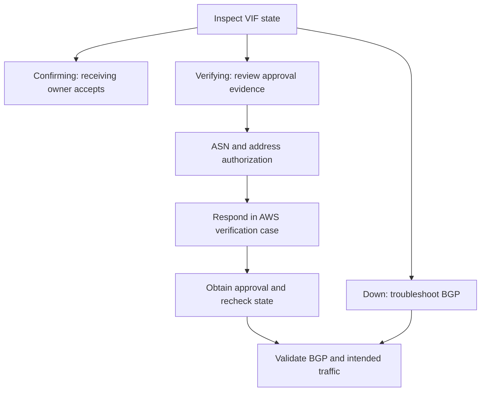

# Resolve a Direct Connect Public VIF Stuck in Verifying

Author: [nawazdhandala](https://www.github.com/nawazdhandala)

Tags: AWS, Direct Connect, BGP, Networking, Troubleshooting

Description: Resolve public VIF approval delays by checking interface state, ASN ownership, peering addresses, advertised prefixes, and the AWS verification case.

A new public Direct Connect virtual interface can stay in `verifying` even when the physical circuit is healthy and the router configuration looks correct. That state means AWS is validating the interface. Repeatedly resetting the router cannot supply missing ownership evidence.

The useful first step is to separate provisioning approval from network operation. This guide provides a read-only inventory example reviewed against **AWS CLI 2.42.1**, followed by an approval checklist and a controlled handoff to connectivity testing. The output filter was tested locally with synthetic data; no AWS account or live circuit was exercised.

## Identify the state that actually needs attention

A **virtual interface**, or VIF, is a logical connection that exchanges routes using **Border Gateway Protocol**, or BGP. Its provisioning state and the BGP session's state describe different things.

The [VirtualInterface API reference](https://docs.aws.amazon.com/directconnect/latest/APIReference/API_VirtualInterface.html) distinguishes these conditions:

| Reported state | What to investigate first |
| --- | --- |
| `confirming` | The receiving account has not yet accepted the hosted VIF |
| `verifying` | AWS public VIF validation is still outstanding |
| `pending` | Provisioning has not yet reached readiness |
| `down` | The interface's BGP connectivity needs investigation |
| `available` | Continue with route and application acceptance tests |

For a hosted public VIF, [owner confirmation](https://docs.aws.amazon.com/directconnect/latest/APIReference/API_ConfirmPublicVirtualInterface.html) is a separate step. Ask the owner of the VIF, not merely the account that owns the underlying connection, to review an outstanding confirmation.



This is a troubleshooting decision map, not a promise that every interface follows an identical state-transition sequence.

## Capture a focused inventory

Use a read-only profile authorized to describe Direct Connect interfaces. Replace the Region and VIF ID with the actual resource values. Run this in a shell that supports the quoting shown:

```bash
aws directconnect describe-virtual-interfaces \
  --profile network-readonly --region us-east-1 \
  --virtual-interface-id dxvif-REPLACE_ME \
  --query 'virtualInterfaces[].{ID:virtualInterfaceId,Type:virtualInterfaceType,State:virtualInterfaceState,Owner:ownerAccount,Connection:connectionId,ASN:asnLong,AWSASN:amazonSideAsn,Prefixes:routeFilterPrefixes[].cidr,Peers:bgpPeers[].{Family:addressFamily,Customer:customerAddress,AWS:amazonAddress,Provisioning:bgpPeerState,Session:bgpStatus}}' \
  --output json --no-cli-pager
```

The expected result is one interface with its submitted prefixes and per-address-family peer details. An empty list is a reason to check the selected account, Region, and identifier; it is not evidence that approval succeeded.

The [CLI response documentation](https://docs.aws.amazon.com/cli/latest/reference/directconnect/describe-virtual-interfaces.html) explains why the query uses `asnLong`: a sufficiently large ASN can leave the legacy `asn` field set to zero. The selected fields deliberately exclude `authKey` and the generated router configuration, which can contain that key.

Keep this snapshot with its collection time. It describes the configured resource, not an independently verified record that AWS has approved every prefix or that your router is currently advertising it.

## Separate the three resources being approved

Do not put “our IPs are valid” in a ticket and expect it to answer every ownership question. Build an inventory with separate rows for the customer ASN, the peering subnet, and each advertised destination prefix.

An **autonomous system number**, or ASN, identifies a routing domain. A public ASN identifies a registered network; a private ASN is drawn from ranges intended for private use. AWS's [public VIF routing policy](https://docs.aws.amazon.com/directconnect/latest/UserGuide/routing-and-bgp.html) explicitly permits both, including private ranges `64512–65534` and `4200000000–4294967294`.

If you use a public ASN, establish ownership or authorization. If you use a private ASN, do not assume that buying a public ASN is the necessary fix for `verifying`. Public prefix and peer-address checks still apply. The AWS side of a public VIF uses ASN `7224`, and the customer ASN must differ, as documented in the [public VIF creation procedure](https://docs.aws.amazon.com/directconnect/latest/UserGuide/create-public-vif.html).

For public IPv4 peering, inspect both endpoint addresses and their subnet masks. These are the addresses between the two BGP speakers, not automatically the source addresses used by applications. The [VIF prerequisites](https://docs.aws.amazon.com/directconnect/latest/UserGuide/WorkingWithVirtualInterfaces.html) prohibit using Elastic IPs or addresses from the Amazon BYOIP pool for public-VIF peering. AWS allocates the IPv6 peering range; you do not choose custom IPv6 peer addresses.

For each advertised prefix, record its registered owner, the business relationship authorizing your use, and the exact CIDR submitted. **CIDR** is the address-and-prefix-length notation used to identify a network. A letter authorizing one network should not be treated as authority to announce a different, larger network.

## Respond to the existing verification case

AWS's [verification troubleshooting procedure](https://repost.aws/knowledge-center/public-vif-stuck-verifying) says a case is created when verification lasts more than an hour. Check active cases in the VIF owner's account and follow the case's requests. The same procedure requires a letter of authorization on company letterhead when the ASN or prefix belongs to another organization.

Have the owner identify the authorized AWS account, VIF, and exact resources, with an authorized signer's details. Upload the requested evidence to that case. If the registered organization differs from the AWS account organization, explain the relationship rather than leaving the reviewer to infer it.

This authorization letter concerns the right to use routing resources. Keep it distinct from the physical circuit's cross-connect paperwork. A completed cross-connect does not establish ownership of an advertised public network.

For your internal handoff, use a small evidence table:

| Item | Evidence to retain | Person responsible |
| --- | --- | --- |
| VIF identity | Account, Region, VIF ID, current state, timestamp | AWS network owner |
| Customer ASN | Private-range choice or public ownership/authorization | Routing team |
| Peering addresses | Both addresses, masks, allocation source | Circuit/network owner |
| Advertised networks | Exact CIDRs and owner authorization | Address-management team |
| Review correspondence | Case ID, latest request, response timestamp | Named case coordinator |

That table is an operational aid, not an alternative to AWS's requested documents. Keep one coordinator responsible for reconciling changes so that a newer prefix list does not silently disagree with an older attachment.

## Plan approval time separately from the change window

The [creation guide](https://docs.aws.amazon.com/directconnect/latest/UserGuide/create-public-vif.html) allows up to 72 business hours for review and approval. Do not translate that into a guaranteed three-calendar-day deadline. Plan the circuit cutover after approval and connectivity testing rather than booking it around an assumed automatic transition.

If the case is waiting on your response, provide the missing information. If the complete response is already present, ask for its review status with the VIF ID and submission timestamp. Recreating the VIF adds a second resource and makes evidence reconciliation harder; it is not a general approval shortcut.

Later additions also need planning. AWS documents [adding public prefixes through Support](https://repost.aws/knowledge-center/direct-connect-add-prefix-public-vif), including authorization for third-party address space. Do not assume approval of the first network authorizes all future advertisements.

## Verify traffic after approval

Once provisioning is approved, check the correct VLAN, peer addresses, ASN, and BGP session. Then confirm the intended public prefixes are advertised and the necessary AWS routes are installed.

AWS's [public VIF setup guidance](https://repost.aws/knowledge-center/setup-direct-connect-vif) notes that prefixes advertised before approval may require a BGP reset and re-advertisement afterward. Treat any reset as a planned, scoped network change with an impact check; do not clear every neighbor on a shared router.

Finally, test the application from its real source address. Direct Connect checks that inbound traffic originates from an advertised prefix, so an approved VIF and an established session do not by themselves prove that a private source address or an unexpected NAT address will work. Record the resolved AWS destination, actual source after translation, route, and successful application response before declaring the cutover ready.
