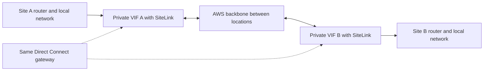

# Connect Sites with Direct Connect SiteLink Without Route Conflicts

Author: [nawazdhandala](https://www.github.com/nawazdhandala)

Tags: AWS, Direct Connect, Networking, Routing, Troubleshooting

Description: Connect two on-premises sites through Direct Connect SiteLink, inspect accepted and advertised routes, and catch duplicate advertisements before traffic fails.

Two offices already connect to AWS through Direct Connect. You want those offices to exchange traffic over the AWS network without sending it through a VPC. SiteLink provides that path between Direct Connect locations, but enabling the option is only part of the work. Each site still needs a usable route to the other, and both directions must survive the intended failure scenarios.

AWS describes SiteLink as communication between Direct Connect locations without traversing an AWS Region. A Regional workload is not required. See the [SiteLink introduction](https://aws.amazon.com/blogs/networking-and-content-delivery/introducing-aws-direct-connect-sitelink/).

This guide uses two existing private virtual interfaces attached to one Direct Connect gateway. It emphasizes a documented trap: advertising the same route from an on-premises router on multiple VIFs.

## Start with a small, explicit routing design

A virtual interface, or VIF, is the logical interface on a Direct Connect connection. BGP, the Border Gateway Protocol, exchanges routes over that interface. A prefix such as `10.10.0.0/16` describes a network address range.

Use this illustrative plan, replacing every value with your approved network configuration:

| Site | Local network | Router ASN | VIF | Direct Connect location |
| --- | --- | --- | --- | --- |
| A | `10.10.0.0/16` | 65010 | `dxvif-SITE-A` | Location A |
| B | `10.20.0.0/16` | 65020 | `dxvif-SITE-B` | Location B |

ASN means autonomous system number, the identity of a BGP routing domain. The gateway uses a different ASN, such as 64512. For this initial example, each site's local network is advertised through one VIF. Do not silently add duplicate advertisements as a shortcut to redundancy.



The dotted links show the common gateway configuration. They do not represent a requirement to route packets through a Regional VPC.

SiteLink must be enabled on the participating VIFs, which must attach to the same Direct Connect gateway. Private and transit VIFs are supported, and existing dedicated or hosted connections can be used. These are the [SiteLink FAQ prerequisites](https://aws.amazon.com/directconnect/faqs/). Check the location's support and commercial terms before changing the interfaces.

A private VIF attached directly to a virtual private gateway is not the same design. Public VIFs are also unsupported for SiteLink. Review the [supported interface table](https://docs.aws.amazon.com/directconnect/latest/UserGuide/WorkingWithVirtualInterfaces.html).

## Inspect the existing interfaces first

Use authenticated AWS CLI profiles with access to the VIFs. Replace IDs, profiles, and Regions with each interface's values. Examples were reviewed against the [AWS CLI 2.42.1 Direct Connect model](https://github.com/aws/aws-cli/blob/2.42.1/awscli/botocore/data/directconnect/2012-10-25/service-2.json); no live SiteLink deployment was performed.

```bash
aws directconnect describe-virtual-interfaces \
  --profile site-a-network --region us-east-1 \
  --virtual-interface-id dxvif-SITE-A \
  --query 'virtualInterfaces[].{Vif:virtualInterfaceId,Type:virtualInterfaceType,Gateway:directConnectGatewayId,SiteLink:siteLinkEnabled,State:virtualInterfaceState,Peers:bgpPeers[].{Family:addressFamily,Status:bgpStatus}}' \
  --output json --no-cli-pager
```

Repeat for site B using its profile, Region, and VIF ID. Expect the intended interface type and the same gateway ID. Record current SiteLink flags and peer status. The [describe command](https://docs.aws.amazon.com/cli/latest/reference/directconnect/describe-virtual-interfaces.html) returns authentication material in its full response, so this projection deliberately selects only operational fields.

Save the current router route policies separately. Establish whether SiteLink will be primary or backup to an existing WAN, meaning wide area network. Verify firewall rules for the actual remote networks and retain a way to manage both routers if the new path fails.

## Audit duplicate advertisements before enabling

AWS explicitly documents that SiteLink does not work when an on-premises router advertises the same route to AWS on multiple VIFs. Treat this as a design restriction, not a problem that can automatically be solved by changing BGP preference. See the [SiteLink routing notes](https://docs.aws.amazon.com/directconnect/latest/UserGuide/WorkingWithVirtualInterfaces.html).

For example, inspect whether site A's router advertises `10.10.0.0/16` on both a SiteLink VIF and a second VIF. Do the same for site B. Review the full router export policy, including prefixes redistributed from an internal routing protocol.

| Observation | Interpretation | Next step |
| --- | --- | --- |
| A's local prefix appears on two VIFs from A's router | Matches the documented duplicate-advertisement concern | Review the topology and export policy before activation |
| A and B claim the same local network | Address ownership is ambiguous | Resolve the addressing or translation design |
| A advertises a broad summary covering B | Separate overlap and forwarding concern | Verify which destinations the summary legitimately reaches |
| A's prefix appears once, but B rejects it | Receiver policy or BGP path issue | Inspect B's received routes and import decisions |

Do not withdraw an existing production advertisement merely to make this table look tidy. Identify its consumers and move affected traffic through an approved plan. For a redundant design, review the AWS [SiteLink routing scenarios](https://docs.aws.amazon.com/reference-architecture-diagrams/latest/electronics-hpc/routing-scenarios-with-aws-direct-connect-sitelink.html) and validate the proposed route behavior before replacing a working WAN.

## Enable one reviewed pair of interfaces

During the approved change window, enable SiteLink on A:

```bash
aws directconnect update-virtual-interface-attributes \
  --profile site-a-network --region us-east-1 \
  --virtual-interface-id dxvif-SITE-A --enable-site-link \
  --query '{Vif:virtualInterfaceId,SiteLink:siteLinkEnabled,State:virtualInterfaceState}' \
  --output json --no-cli-pager
```

Repeat for B with its correct identifiers. This changes routing capability and can incur charges; it is not a read-only test. The [update command](https://docs.aws.amazon.com/cli/latest/reference/directconnect/update-virtual-interface-attributes.html) documents `--enable-site-link` and its inverse, `--no-enable-site-link`.

The gateway learns routes over participating VIFs and advertises them to other participating VIFs. Disabling SiteLink changes that exchange, so record the previous flags as part of the recovery plan. AWS explains this behavior in its [network architecture whitepaper](https://docs.aws.amazon.com/whitepapers/latest/building-scalable-secure-multi-vpc-network-infrastructure/direct-connect.html).

## Follow a route from sender to receiver

An `up` BGP session proves that peers are communicating; it does not prove that the intended remote prefix is installed. Inspect the route at successive points.

First, list the IPv4 routes AWS accepted from A:

```bash
aws directconnect list-virtual-interface-routes \
  --profile site-a-network --region us-east-1 \
  --virtual-interface-id dxvif-SITE-A \
  --filters routeDirection=accepted,addressFamily=ipv4 \
  --query '{Routes:routes[].{Prefix:cidr,Direction:routeDirection,Path:asPath},Next:nextToken}' \
  --output json --no-cli-pager
```

Then inspect what AWS advertises toward B:

```bash
aws directconnect list-virtual-interface-routes \
  --profile site-b-network --region us-west-2 \
  --virtual-interface-id dxvif-SITE-B \
  --filters routeDirection=advertised,addressFamily=ipv4 \
  --query '{Routes:routes[].{Prefix:cidr,Direction:routeDirection,Path:asPath},Next:nextToken}' \
  --output json --no-cli-pager
```

Here `accepted` means AWS received and retained the route from the customer; `advertised` means AWS sends it toward the customer. These definitions are documented in [BGP route visibility](https://docs.aws.amazon.com/directconnect/latest/UserGuide/bgp-route-visibility.html).

If `Next` contains a token, repeat the same request with `--next-token` set to that value until no token remains. Do not conclude that a route is absent from only the first page. The [route-list API](https://docs.aws.amazon.com/cli/latest/reference/directconnect/list-virtual-interface-routes.html) exposes this pagination explicitly.

Expect A's prefix in A's accepted routes and B's advertised routes. Then inspect B's router to confirm it accepted and installed the route. Repeat in reverse for B's prefix. AWS advertising a route and your router selecting it are different events.

## Test the forwarding path and recovery

Use known test endpoints in each local network. Verify an application transaction in both directions, expected next hops, firewall counters, and packet loss under a bounded workload. If the route is present but packets disappear, investigate forwarding, return routes, and security policies rather than repeatedly toggling SiteLink.

Keep existing VPC-to-site traffic in the test plan. Enabling SiteLink can change Regional traffic's path preference with respect to AS-path length and associated Region; this is documented in the [VIF routing behavior](https://docs.aws.amazon.com/directconnect/latest/UserGuide/WorkingWithVirtualInterfaces.html). A successful office-to-office test does not prove those older paths remain unchanged.

Rehearse the intended WAN or SiteLink failure only within the approved scope. Restore saved flags and route policy deliberately if acceptance fails, then verify the previous path again. Retain evidence of accepted routes, advertised routes, router selections, and application results. That chain of evidence makes a routing black hole diagnosable without guessing from a green BGP status.
