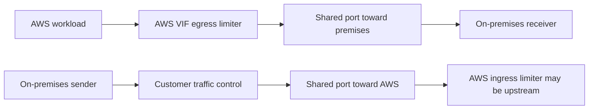

# Limit Direct Connect VIF Traffic on a Shared Dedicated Port

Author: [nawazdhandala](https://www.github.com/nawazdhandala)

Tags: AWS, Direct Connect, Networking, Performance, Monitoring

Description: Apply Direct Connect VIF rate limits with a port-wide capacity plan, account for ingress policing location, and verify drops and application behavior.

A backup job sharing a Direct Connect port with interactive applications can turn a healthy connection into a congested one. The physical link stays up, routing remains established, and users still experience timeouts. Increasing the circuit size is one option; containing the backup workload is another.

Direct Connect VIF Rate Limiters set a bandwidth ceiling for a virtual interface. Excess traffic is dropped, so the feature needs a traffic plan and application-level validation. This walkthrough assumes an existing **dedicated 10 Gbps connection**, with its VIFs managed by your team. Commands were checked against **AWS CLI 2.42.1**. No live rate limits or traffic tests were applied for this article.

## Understand what the limiter changes

A **virtual interface**, or VIF, carries a logical routing relationship over the physical connection. A limiter acts on that interface's traffic, rather than identifying individual applications within it. If backups and production share the same VIF, limiting the VIF affects both.

AWS introduced the feature for dedicated connections, with bidirectional limits and CloudWatch measurements for utilization and drops. The [feature announcement](https://aws.amazon.com/about-aws/whats-new/2026/06/aws-direct-connect-now-supports-vif-rate-limiters/) describes its purpose and supported capacity range.

Treat it as policing: traffic above the allowance can be discarded. It does not ask a sender to postpone a backup or turn the port into a scheduler with guaranteed application reservations. Where the application supports a transfer limit or concurrency control, use that to reduce offered load before packets reach a policer.

## Protect the congested direction

AWS egress means traffic traveling from AWS toward your premises. AWS ingress means traffic traveling toward AWS. The placement of the limiter matters:



For egress, enforcement protects the shared connection before traffic leaves AWS. For ingress, enforcement can occur beyond the device terminating the physical port, allowing congestion before the AWS limiter acts. Pair it with customer-side traffic control. This placement caveat is documented in [Rate Limiters and traffic direction](https://docs.aws.amazon.com/directconnect/latest/UserGuide/vif-rate-limiters.html).

Translate the symptom into a direction before changing anything. Slow downloads from AWS and slow uploads to AWS can require different customer-router controls, even when they belong to the same VIF. Record the sender, receiver, circuit, and time window instead of labeling every problem “inbound.”

## Inventory the whole shared port

Use a read-capable profile and replace the Region and connection ID:

```bash
aws directconnect describe-connections \
  --profile network-ops --region us-east-1 \
  --connection-id dxcon-EXAMPLE \
  --query 'connections[].{ID:connectionId,Capacity:bandwidth,LAG:lagId,LimiterStatus:rateLimiterStatus}' \
  --output json

aws directconnect describe-virtual-interfaces \
  --profile network-ops --region us-east-1 \
  --connection-id dxcon-EXAMPLE \
  --query 'virtualInterfaces[].{ID:virtualInterfaceId,Name:virtualInterfaceName,Type:virtualInterfaceType,State:virtualInterfaceState,Limit:rateLimit}' \
  --output json
```

These [connection](https://docs.aws.amazon.com/cli/latest/reference/directconnect/describe-connections.html) and [VIF](https://docs.aws.amazon.com/cli/latest/reference/directconnect/describe-virtual-interfaces.html) queries avoid printing BGP authentication material. Match each VIF to an owner and workload before choosing a target.

`rateLimiterStatus` reports counts in use, remaining, and allowed, plus allocated bandwidth. Its [`remaining` field](https://docs.aws.amazon.com/directconnect/latest/APIReference/API_RateLimiterStatus.html) counts available limiters; it is not unused gigabits per second. The published [quota](https://docs.aws.amazon.com/directconnect/latest/UserGuide/limits.html) starts at ten limiters per dedicated connection. Inspect the actual status rather than inferring it from the number of VIFs.

If an output is empty or a field is missing, verify the account, Region, API/client version, and console state. Do not convert an absent limit into a zero-bandwidth setting. If the connection belongs to a LAG, review the LAG allocation and member-failure capacity before applying this single-port example.

## Budget ceilings without promising reservations

Suppose the port has these planned settings:

| VIF | Planned ceiling | Reason |
|---|---|---|
| Interactive production | Unlimited | Avoid imposing a new application ceiling during the first rollout |
| Backup | 2 Gbps | Contain a transfer that previously consumed most of the port |
| Analytics | 3 Gbps | Bound a second background workload |

This is a deliberately oversubscribed plan. Counting Unlimited as the 10 Gbps port capacity gives `10 + 2 + 3 = 15 Gbps`, or 150% of physical capacity. It does not manufacture another 5 Gbps.

The limits are static and do not respond to another VIF's utilization. Unlimited VIFs remain capable of congesting their neighbors. AWS explains that [oversubscription behavior](https://docs.aws.amazon.com/directconnect/latest/UserGuide/vif-rate-limiters.html); interpret the arithmetic as a worst-case planning check, not a utilization forecast.

If production needs 6 Gbps while the two background workloads sustain their ceilings, the requested total is 11 Gbps. The design still needs smaller background ceilings, scheduling, another circuit, or an explicitly accepted degradation policy. Confirm those tradeoffs with workload owners before declaring the port protected.

## Apply one measured change

Begin with an approved test window, a recorded baseline, and the previous allocation. Choose a valid bandwidth string; the API's [VIF rate-limit contract](https://docs.aws.amazon.com/directconnect/latest/APIReference/API_VirtualInterface.html) lists discrete supported values and requires the limit not to exceed the parent connection or LAG capacity. Do not assume any decimal rate is accepted.

After replacing the VIF ID with the backup interface identified above, apply its planned ceiling:

```bash
aws directconnect update-virtual-interface-attributes \
  --profile network-ops --region us-east-1 \
  --virtual-interface-id dxvif-BACKUP \
  --rate-limit 2Gbps \
  --query '{ID:virtualInterfaceId,State:virtualInterfaceState,Limit:rateLimit}' \
  --output json
```

The profile now needs update permission. This [`update-virtual-interface-attributes` command](https://docs.aws.amazon.com/cli/latest/reference/directconnect/update-virtual-interface-attributes.html) changes the selected VIF's allocation. It does not configure the sender or customer router.

Re-run the inventory and compare the returned limit with the change record. A successful response establishes configuration acceptance, not the achieved traffic ceiling or absence of packet loss. Verify provisioned state before ramping approved test traffic.

## Measure offered traffic and discarded packets together

Use `VirtualInterfaceUtilizationIngress` and `VirtualInterfaceUtilizationEgress` with the corresponding `VirtualInterfacePolicedPpsIngress` and `VirtualInterfacePolicedPpsEgress` series. Utilization is measured before policing and can exceed 100%; the policed packet rates identify discarded traffic. These semantics are in the [limiter monitoring reference](https://docs.aws.amazon.com/directconnect/latest/UserGuide/vif-rate-limiters.html).

Discover the published egress-drop series without guessing its complete dimensions:

```bash
aws cloudwatch list-metrics \
  --profile network-ops --region us-east-1 \
  --namespace AWS/DX \
  --metric-name VirtualInterfacePolicedPpsEgress \
  --dimensions Name=VirtualInterfaceId,Value=dxvif-BACKUP \
  --query 'Metrics[].{Name:MetricName,Dimensions:Dimensions}' \
  --output json
```

This requires CloudWatch read permission and returns identities, not datapoints. Use the full returned dimension set when graphing the metric. The [`list-metrics` documentation](https://docs.aws.amazon.com/cli/latest/reference/cloudwatch/list-metrics.html) describes discovery delays and filtering.

Compare a quiet baseline, a controlled transfer below the ceiling, and a scoped transfer that briefly offers more than the ceiling. Measure backup completion time, retransmissions, and production latency alongside the AWS series. Avoid an unbounded bandwidth flood: the ingress placement limitation can still affect unrelated VIFs.

A lower utilization percentage after raising the ceiling is not necessarily less traffic. At a constant 1 Gbps, a 2 Gbps denominator yields 50%; a 4 Gbps denominator yields 25%. Mark allocation changes on the graph so reviewers can explain that discontinuity.

## Define success and rollback before rollout

Accept the change when the intended VIF has the configured ceiling, background work still meets its completion target, and neighboring applications remain within their agreed latency and error budgets during the rehearsal. Evaluate both directions and the reduced-capacity failover case.

If drops make the backup unusable, first reduce offered load or schedule it differently. Raising or removing the limiter restores capacity competition, so coordinate that decision with the other owners. To remove a limiter, use the console's documented **Rate Limiters → Edit → Unlimited** workflow; do not invent a `0` or `unlimited` CLI value.

Keep the final record small but useful: old and new ceiling, direction tested, workload measurements, observed drops, customer-side controls, and the rollback decision. That provides evidence the shared service improved, rather than merely proving that a setting changed.
