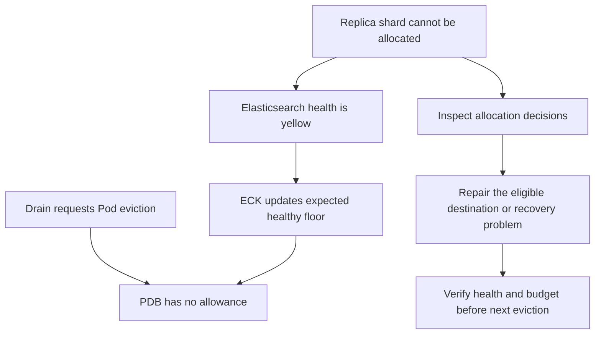

# Diagnose Shard Health Blocking an ECK Node Drain

Author: [nawazdhandala](https://www.github.com/nawazdhandala)

Tags: Kubernetes, ECK, Elasticsearch, PodDisruptionBudget

Description: Trace a blocked ECK drain from the disruption budget to unassigned shards, interpret allocation decisions, and verify recovery before continuing maintenance.

Every Elasticsearch Pod looks ready, yet draining a Kubernetes node keeps receiving disruption-budget errors. The missing evidence may be inside Elasticsearch: a replica shard has no eligible destination, so ECK deliberately withholds permission for another disruption.

A shard is a portion of an index. A primary shard holds the active primary copy, and replica shards provide additional copies. Kubernetes Pod readiness and Elasticsearch shard allocation answer different questions. A process can be reachable while its cluster lacks the redundancy needed for safe maintenance.

This walkthrough follows **ECK 3.2.0's default single-PDB behavior** and **Elasticsearch 9.1.0 REST interfaces**. Enterprise installations can use role-specific budgets, and custom PDB overrides change the decision. Establish which policy is active before applying the single-budget explanation to your cluster.

## Establish why the eviction is blocked

For a multi-node cluster using the default single PDB, ECK's pinned implementation permits no disruption when its observed Elasticsearch health is yellow, red, or unknown. Green health can allow one, subject to topology checks. Single-node clusters are a separate case. [ECK 3.2.0 policy calculation](https://github.com/elastic/cloud-on-k8s/blob/v3.2.0/pkg/controller/elasticsearch/pdb/reconcile_default.go)



Pause further maintenance while collecting evidence. Replace the context, namespace, and cluster name in these read-only commands:

```bash
kubectl --context staging -n observability get elasticsearch search -o json |
  jq '{health: .status.health, phase: .status.phase,
       override: .spec.podDisruptionBudget}'
kubectl --context staging -n observability get pdb -o wide
kubectl --context staging -n observability get pods \
  -l elasticsearch.k8s.elastic.co/cluster-name=search -o wide
```

Inspect the budget that selects the Pod named in the eviction error. For the default budget in this example:

```bash
kubectl --context staging -n observability get pdb search-es-default -o yaml
```

Compare `currentHealthy`, `desiredHealthy`, and `disruptionsAllowed`. Three ready Pods with a desired healthy count of three leave no allowance. That can be an intentional ECK health response, not a broken Kubernetes counter. Inspect the selector and check for overlapping PDBs as well. [Elastic budget behavior](https://www.elastic.co/docs/deploy-manage/deploy/cloud-on-k8s/pod-disruption-budget)

Do not confuse a node drain with an operator-driven rolling upgrade. ECK's `updateStrategy.changeBudget` controls a different operation. Changing it does not repair an unassigned replica or necessarily change the PDB consulted by the eviction API. [ECK update strategy](https://www.elastic.co/docs/deploy-manage/deploy/cloud-on-k8s/update-strategy)

## Query the same Elasticsearch cluster directly

Run the HTTP examples below in **Kibana Dev Tools Console** connected to the affected cluster. Console accepts this simplified request syntax through its configured connection. Use an approved account with cluster `monitor` privilege; the CAT shard inspection also requires index `monitor` privileges for the indices inspected. Keep the existing authenticated, certificate-verified connection. [Console requests](https://www.elastic.co/docs/explore-analyze/query-filter/tools/console), [Cluster health permissions](https://www.elastic.co/docs/api/elasticsearch/operation/operation-cluster-health), [CAT shard permissions](https://www.elastic.co/docs/api/elasticsearch/operation/operation-cat-shards)

```http
GET /_cluster/health
```

Read `status`, `unassigned_shards`, `initializing_shards`, and `relocating_shards` together:

| Status | What it means |
|---|---|
| Green | All primary and replica shards are allocated |
| Yellow | Primaries are allocated, but at least one replica is unassigned |
| Red | At least one primary is unassigned; some data is unavailable |

Yellow can still serve requests, but another node loss may remove the only available copy of some data. Red deserves a recovery investigation before discretionary maintenance. A cluster can also be green while shards are moving, so retain the recovery counts rather than reducing the result to one color. [Health interpretation](https://www.elastic.co/docs/troubleshoot/elasticsearch/red-yellow-cluster-status)

Compare this response with ECK's reported health and the PDB observation time. Those controllers reconcile asynchronously. If Elasticsearch is green but ECK still reports unknown or stale health, inspect operator connectivity, authentication, and reconciliation errors rather than weakening the budget.

## Find one unassigned shard and explain it

Use CAT output for this interactive investigation:

```http
GET /_cat/shards?v=true&h=index,shard,prirep,state,node,unassigned.reason&s=state
```

Find a row with `UNASSIGNED`. The `prirep` column identifies `p` for a primary or `r` for a replica. Record its exact index name, shard number, and copy type. CAT APIs are intended for human inspection, rather than an application integration. [CAT shards API](https://www.elastic.co/docs/api/elasticsearch/operation/operation-cat-shards)

Next explain that specific shard. Replace the example index and number with the row you observed; use `primary: true` for a primary:

```http
POST /_cluster/allocation/explain?include_disk_info=true
{
  "index": "logs-app-2026.11.24",
  "shard": 0,
  "primary": false
}
```

Despite using POST, this endpoint explains placement decisions; it does not perform a reroute. Specifying the shard makes repeated observations comparable. An empty request can choose an arbitrary unassigned shard, which is less useful when several problems coexist. [Allocation explanation API](https://www.elastic.co/docs/api/elasticsearch/operation/operation-cluster-allocation-explain), [Pinned request definition](https://github.com/elastic/elasticsearch/blob/v9.1.0/rest-api-spec/src/main/resources/rest-api-spec/api/cluster.allocation_explain.json)

Read `can_allocate`, the explanatory text, and each relevant entry in `node_allocation_decisions`. A **decider** is a named rule that accepts or rejects a possible destination. `unassigned_info.reason` describes how the shard became unassigned; it is not necessarily the reason allocation remains blocked now.

For example, `NODE_LEFT` can explain the original loss while a `disk_threshold` decision explains why remaining nodes cannot accept the copy. Fixing only the original node incident might leave the current placement problem unresolved. [Reading allocation explanations](https://www.elastic.co/docs/troubleshoot/elasticsearch/cluster-allocation-api-examples)

## Match the decision to a specific recovery action

| Evidence | Next investigation |
|---|---|
| `disk_threshold` rejects destinations | Available disk, watermarks, shard sizes, and approved capacity recovery |
| `filter`, `data_tier`, or `awareness` rejects destinations | Required node attributes, roles, zones, and whether eligible capacity actually exists |
| `same_shard` rejects a node | Whether the primary already resides there and another eligible node is available |
| `max_retry` reports repeated allocation failure | The underlying recovery error before requesting another allocation attempt |
| `can_allocate: no_valid_shard_copy` | Recovery options for the missing valid copy, including retained nodes and backups |

These are diagnostic directions, not permission to remove constraints indiscriminately. Placement rules can encode failure-domain requirements, and disk thresholds protect a node from exhausting storage. Repair capacity or configuration with the cluster's intended redundancy understood. [Allocation controls](https://www.elastic.co/docs/reference/elasticsearch/configuration-reference/cluster-level-shard-allocation-routing-settings)

Check the Kubernetes side of the expected destination too. A new Elasticsearch Pod that is Pending, has an unbound volume, or cannot attach its storage has not added usable shard capacity. For a specific affected replacement, substitute its real name:

```bash
kubectl --context staging -n observability describe pod search-es-default-2
kubectl --context staging -n observability get pvc
```

Use its events to distinguish scheduling, volume, and container-start failures. Do not delete a persistent volume claim to make a blocked recovery disappear. Likewise, lowering replica counts solely to turn health green changes redundancy instead of restoring it. Removing the PDB would change the eviction result while leaving the shard problem intact.

## Verify recovery before resuming the drain

After the targeted repair, repeat the allocation explanation and inspect whether unassigned copies are recovering. This bounded health request waits for the stated conditions without changing allocation settings:

```http
GET /_cluster/health?wait_for_status=green&wait_for_no_relocating_shards=true&wait_for_no_initializing_shards=true&timeout=30s
```

Check `timed_out`, status, and shard counts. A timeout means the requested conditions did not arrive within that observation period; it is not a reason to force eviction. [Health wait parameters](https://www.elastic.co/docs/api/elasticsearch/operation/operation-cluster-health)

Then confirm ECK has observed the recovered state and the actual PDB allows the planned disruption. In the pinned single-budget logic, green health can still block maintenance when a multi-node cluster has only one master, data, or ingest node. Investigate that topology rather than assuming every green cluster must permit a drain.

Resume one controlled maintenance step, watch client errors and recovery, and reassess before proceeding. The evidence should show both restored Elasticsearch redundancy and an appropriate Kubernetes budget, with no unresolved replacement-capacity problem hidden behind ready Pod counts.
