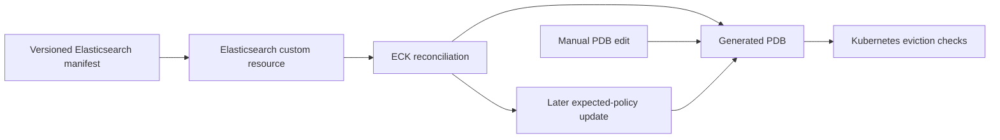

# Change an ECK PDB Without the Operator Reverting It

Author: [nawazdhandala](https://www.github.com/nawazdhandala)

Tags: Kubernetes, ECK, Elasticsearch, PodDisruptionBudget

Description: Put a durable disruption-budget override in the Elasticsearch resource, preview a guarded patch, and distinguish ECK defaults from disabling budget management.

You edit an Elasticsearch PodDisruptionBudget, then discover that its old settings have returned. The edit may have worked initially. The problem is that the budget is an output of the Elastic Cloud on Kubernetes operator, usually called ECK, rather than the place where its desired policy is defined.

A durable change belongs in the Elasticsearch custom resource or in an explicitly designed handoff to externally managed budgets. Editing the generated PDB leaves two writers with different intentions.

This guide follows **ECK 3.2.0** source and its Elasticsearch custom resource definition, with **kubectl 1.34.0** examples. It modifies an existing staging Elasticsearch resource named `search`; it does not install Elasticsearch or change its software version.

## Confirm that ECK owns the budget

A PDB is a policy object, not a running process. Its resource version changing does not mean an Elasticsearch Pod restarted. The Kubernetes disruption controller also updates PDB status as readiness changes. Compare the policy's specification separately from its calculated status.

Replace `staging` and namespace `observability`, then inspect PDBs owned by the `search` Elasticsearch resource:

```bash
kubectl --context staging -n observability get pdb -o json |
  jq '.items[] |
    select(any(.metadata.ownerReferences[]?;
      .kind == "Elasticsearch" and .name == "search")) |
    {name: .metadata.name, uid: .metadata.uid,
     resourceVersion: .metadata.resourceVersion,
     owners: .metadata.ownerReferences, spec, status}'
kubectl --context staging -n observability get elasticsearch search \
  -o json > search-before.json
```

The owner reference identifies ECK's relationship to the generated object. Keep the PDB UID: an unchanged UID with a new resource version means an update, while a new UID indicates replacement. Neither observation proves a workload restart. [Kubernetes object identity](https://kubernetes.io/docs/concepts/overview/working-with-objects/names/), [ECK generated PDB metadata](https://github.com/elastic/cloud-on-k8s/blob/v3.2.0/pkg/controller/elasticsearch/pdb/reconcile_default.go)

ECK computes the expected policy from the Elasticsearch resource and, for defaults, cluster health and topology. Its reconciliation code updates the generated resource when its expected template changes. Do not assume every manual edit is reverted immediately; a later reconciliation or health change can expose the conflict. [Pinned reconciliation implementation](https://github.com/elastic/cloud-on-k8s/blob/v3.2.0/pkg/controller/elasticsearch/pdb/reconcile_default.go)



## Choose between defaults, an override, and external ownership

These configurations have different meanings:

| Elasticsearch configuration | Meaning |
|---|---|
| No `spec.podDisruptionBudget` field | ECK selects its default policy behavior |
| `spec.podDisruptionBudget.spec` with a complete policy | ECK manages the specified override |
| `spec.podDisruptionBudget: {}` | Disable ECK's managed PDBs |

An empty object is **not** a request to reset to defaults. In the pinned API implementation, an explicitly empty template is disabled, while a missing template is different. [Template semantics](https://github.com/elastic/cloud-on-k8s/blob/v3.2.0/pkg/apis/common/v1/common.go)

The default also depends on operator version and license. ECK 3.2 introduced Enterprise behavior that can create budgets grouped by Elasticsearch roles; older versions use the single-budget behavior. Supplying a custom PDB specification selects the custom policy path instead of those automatic role budgets. [Elastic PDB guidance](https://www.elastic.co/docs/deploy-manage/deploy/cloud-on-k8s/pod-disruption-budget)

That matters operationally: a fixed availability floor replaces ECK's automatic health-sensitive decision. Three Kubernetes-ready Pods do not prove that Elasticsearch has safe shard placement or the required role distribution. Do not use an override merely to silence a blocked drain.

## Define the policy in the Elasticsearch manifest

Suppose a reviewed staging topology has three Elasticsearch Pods and its policy requires at least two Ready Pods during voluntary disruption. Add this fragment under the existing resource's `spec`:

```yaml
spec:
  podDisruptionBudget:
    spec:
      minAvailable: 2
      selector:
        matchLabels:
          elasticsearch.k8s.elastic.co/cluster-name: search
```

This is a fragment to merge into the complete Elasticsearch manifest, not a standalone resource. Preserve `version`, `nodeSets`, storage, security settings, and other existing configuration. The selector targets Pods in this Elasticsearch cluster, not every Pod in the namespace.

Use an integer `minAvailable` for this example. It is an absolute healthy-Pod floor, so scaling from three to six Pods would not preserve a “one at a time” disruption limit. Reassess the policy when topology or capacity changes. Elastic's example uses this form for its cluster-wide selector. [Custom budget example](https://www.elastic.co/docs/deploy-manage/deploy/cloud-on-k8s/pod-disruption-budget), [Kubernetes PDB specification](https://kubernetes.io/docs/tasks/run-application/configure-pdb/)

Commit the intended field to whichever manifest, chart, or GitOps configuration owns the Elasticsearch resource. Otherwise that higher-level manager can revert the custom resource, even though ECK is correctly applying it.

## Preview a narrow change against the existing resource

For a controlled API preview, use the snapshot from the first step to build a JSON Patch. JSON Patch is an ordered list of explicit operations; its `test` operations reject a stale snapshot.

```bash
jq '
  .metadata.name as $cluster |
  (.spec.podDisruptionBudget // {}) as $template |
  [
    {op: "test", path: "/metadata/uid", value: .metadata.uid},
    {op: "test", path: "/metadata/resourceVersion",
      value: .metadata.resourceVersion},
    {op: "add", path: "/spec/podDisruptionBudget",
      value: ($template + {spec: {
        minAvailable: 2,
        selector: {matchLabels: {
          "elasticsearch.k8s.elastic.co/cluster-name": $cluster
        }}
      }})}
  ]' search-before.json > pdb-override.json
kubectl --context staging -n observability patch elasticsearch search \
  --type=json --patch-file pdb-override.json --dry-run=server -o json \
  > search-preview.json
jq '.spec.podDisruptionBudget' search-preview.json
```

The patch retains existing template metadata, replaces the policy specification completely, and leaves other Elasticsearch fields alone. Replacing the specification avoids retaining an old `maxUnavailable` alongside the new `minAvailable`. The `add` operation can create the field or replace its existing value. The server dry-run does not persist the change. [Kubernetes patch methods](https://kubernetes.io/docs/tasks/manage-kubernetes-objects/update-api-object-kubectl-patch/), [JSON Patch add semantics](https://www.rfc-editor.org/rfc/rfc6902#section-4.1)

If a UID or resource-version test fails, take a fresh snapshot and review what changed. Do not remove the guards just to force an old proposal through. ECK status updates can legitimately change the resource version between preparation and submission.

A successful preview checks the custom resource against the installed API. It does not prove that ECK will reconcile successfully or that Elasticsearch can tolerate an eviction. Reconcile the approved change through the resource's normal configuration owner, then observe the generated policy before maintenance.

## Verify what ECK actually generated

Read the custom resource and all budgets again:

```bash
kubectl --context staging -n observability get elasticsearch search -o json |
  jq '{generation: .metadata.generation,
       budget: .spec.podDisruptionBudget, status}'
kubectl --context staging -n observability get pdb -o wide
kubectl --context staging -n observability get pods \
  -l elasticsearch.k8s.elastic.co/cluster-name=search --show-labels
```

Confirm the generated PDB has the intended selector and only the chosen availability field. Check its current healthy count, desired healthy count, and allowed disruptions. These are calculated results, not settings to edit. Also inspect independently managed PDBs for overlapping selectors.

If the custom resource contains the override but the output does not, inspect operator events and logs, installed CRD/operator versions, permissions, and any paused management state. If the override disappears from the custom resource itself, inspect the system that applies that resource. Those failures occur at different points in the diagram.

## Return to defaults without accidentally disabling protection

To restore defaults, remove `spec.podDisruptionBudget` from the desired Elasticsearch manifest and let its configuration owner reconcile the removal. Verify that the live field is actually absent; deleting a line from an arbitrary local YAML file does not guarantee field removal under every apply strategy.

To move to external PDBs, `{}` disables ECK's managed budgets, and the pinned reconciler removes its managed objects. That requires a planned replacement policy and sequencing; it is not a harmless troubleshooting toggle. Also remember that an empty object in a JSON **merge patch** does not clear an existing populated object. Use an explicit whole-field replacement when that is the intended change. [ECK disable handling](https://github.com/elastic/cloud-on-k8s/blob/v3.2.0/pkg/controller/elasticsearch/pdb/reconcile_with_roles.go), [JSON Merge Patch behavior](https://www.rfc-editor.org/rfc/rfc7396#section-2)

Keep one authoritative path for the policy. ECK can then reconcile toward your declared requirement, and future maintenance reviews can find that requirement in the Elasticsearch manifest instead of relying on an unexplained edit to a generated object.
