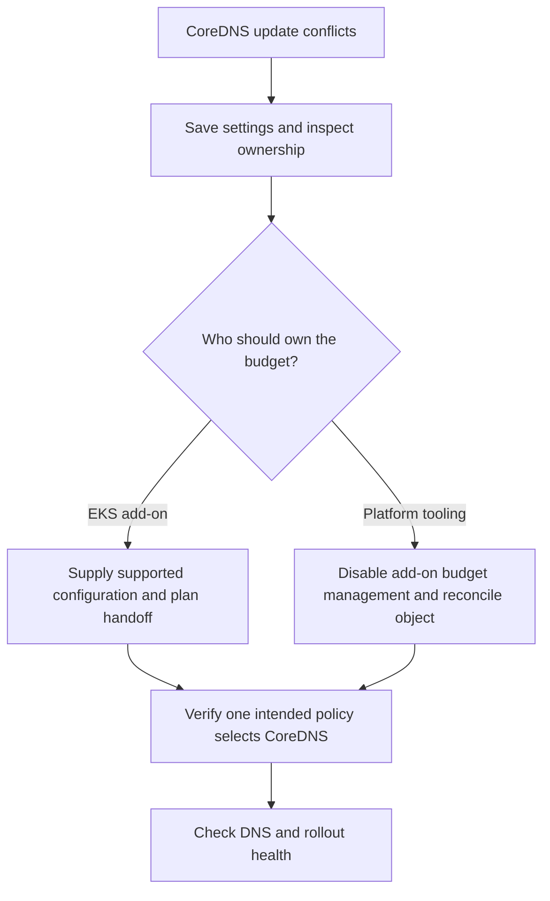

# Resolve CoreDNS Add-on Upgrades That Conflict with a PDB

Author: [nawazdhandala](https://www.github.com/nawazdhandala)

Tags: Kubernetes, Amazon EKS, CoreDNS, PodDisruptionBudget

Description: Diagnose CoreDNS add-on budget conflicts, preserve DNS customizations, and plan a controlled handoff to an EKS-managed PodDisruptionBudget.

Your CoreDNS upgrade fails because a PodDisruptionBudget already exists. Deleting the object might unblock the update, but it also removes a protection whose owner and purpose may still matter. Running the update with overwrite can affect customizations beyond that budget.

The useful question is who should manage CoreDNS's disruption policy after the upgrade. Once that is explicit, you can reconcile the old object, preserve DNS settings, and verify the result without repeatedly fighting the add-on manager.

This guide covers the **Amazon EKS-managed CoreDNS add-on**, not a self-managed Helm installation. Examples were checked with **AWS CLI 2.38.1**, **kubectl 1.34.0**, and **jq 1.6**. The target add-on version is an explicit placeholder: select and pin an exact compatible EKS build before executing an update.

## Separate two different failures

AWS documents that introducing the add-on's managed PDB can conflict with an existing budget. Its supported remedies include overriding conflicting settings or removing the existing PDB before retrying. Neither choice should be made without reviewing the current configuration. [CoreDNS upgrade considerations](https://docs.aws.amazon.com/eks/latest/userguide/managing-coredns.html)

Also distinguish an add-on update conflict from an eviction failure:

| Symptom | What to investigate |
|---|---|
| Update reports a conflict on `PodDisruptionBudget/coredns` | Existing fields, field managers, and intended ownership |
| Update succeeds but node drains fail | Budget allowance and whether multiple budgets select CoreDNS Pods |
| Updated CoreDNS Pods never become Ready | Probe path, Corefile plugins, scheduling, and application health |

Two differently named PDBs can select the same Pods even though they do not collide as Kubernetes objects. Renaming an old budget does not resolve that overlap. In the reviewed Kubernetes 1.34 eviction implementation, more than one matching PDB produces an error. [Eviction handling](https://github.com/kubernetes/kubernetes/blob/v1.34.0/pkg/registry/core/pod/storage/eviction.go)



## Save the current settings and identify the other manager

Replace the AWS region, cluster name, and Kubernetes context. Run these read-only commands from a new incident directory so old snapshots are not overwritten:

```bash
aws eks describe-addon --region us-east-1 \
  --cluster-name example-cluster --addon-name coredns \
  --output json > addon-before.json
kubectl --context staging -n kube-system get deployment coredns \
  -o yaml --show-managed-fields > deployment-before.yaml
kubectl --context staging -n kube-system get configmap coredns \
  -o yaml > configmap-before.yaml
kubectl --context staging -n kube-system get pdb \
  -o yaml --show-managed-fields > budgets-before.yaml
```

The AWS response includes the installed version, configured values, and health information. If `describe-addon` reports that no managed add-on exists, investigate self-managed installation or migration instead of blindly issuing `update-addon`. [Describe add-on](https://docs.aws.amazon.com/cli/latest/reference/eks/describe-addon.html)

Read the reported conflict's object and field paths. Inspect `metadata.managedFields` on that object: Kubernetes records which manager controls particular fields. An older GitOps definition, Terraform configuration, or manual apply can be the other writer. EKS uses server-side apply for field management. [EKS field ownership](https://docs.aws.amazon.com/eks/latest/userguide/kubernetes-field-management.html)

Compare every budget selector with actual CoreDNS Pod labels. Budget names and labels on the PDB object do not establish which Pods it protects. Arrange any source-of-truth change so the old reconciler does not recreate the conflicting policy immediately after the migration.

## Pin a compatible build and inspect its schema

Read the cluster version, then list compatible builds:

```bash
cluster_version=$(aws eks describe-cluster --region us-east-1 \
  --name example-cluster --query 'cluster.version' --output text)
aws eks describe-addon-versions --region us-east-1 \
  --addon-name coredns --kubernetes-version "$cluster_version" \
  --query 'addons[].addonVersions[].{version:addonVersion,compatibilities:compatibilities}' \
  --output json
```

Choose a supported upgrade target from that response and your platform's release policy. Do not assume an upstream CoreDNS image tag is an EKS add-on build. [Available add-on versions](https://docs.aws.amazon.com/cli/latest/reference/eks/describe-addon-versions.html)

Replace the placeholder below with that exact build and keep it for the remaining commands:

```bash
target_version=REPLACE_WITH_COMPATIBLE_EKSBUILD
aws eks describe-addon-configuration --region us-east-1 \
  --addon-name coredns --addon-version "$target_version" \
  --query 'configurationSchema' --output text > target-schema.json
jq . target-schema.json
```

The schema defines the accepted configuration keys and types for that build. Confirm it supports `podDisruptionBudget.enabled` and your chosen availability field. The managed settings support either `minAvailable` or `maxUnavailable`; do not supply both. AWS's documented configurable defaults enable the PDB with `maxUnavailable: 1`. [Configuration schema API](https://docs.aws.amazon.com/cli/latest/reference/eks/describe-addon-configuration.html), [Configurable CoreDNS budgets](https://aws.amazon.com/blogs/containers/recent-changes-to-the-coredns-add-on/)

## Prepare a complete configuration document

For the EKS-managed path, first decode the saved settings. The following expects the stored `configurationValues` to be JSON, as commonly returned for JSON-configured add-ons:

```bash
jq -e '(.addon.configurationValues // "{}") | fromjson |
  if type == "object" then . else error("Expected a configuration object") end' \
  addon-before.json > configured-before.json
jq '.podDisruptionBudget = {enabled: true, maxUnavailable: 1}' \
  configured-before.json > proposed-config.json
```

If the stored value is YAML, convert it with a trusted YAML parser first; a JSON decoding failure is not permission to replace all settings with `{}`. The second command retains other top-level settings while replacing the budget configuration, so an old `minAvailable` does not accidentally remain beside `maxUnavailable`.

The example allowance must fit your DNS capacity. With two healthy replicas it can permit losing one; it is not a recommendation to maintain only one usable DNS server during every failure scenario.

Review the complete document against `target-schema.json`. Preserve custom `corefile`, replica settings, resources, and placement settings where supported. AWS documents that when you supply `configurationValues`, omitted advanced settings can reset to defaults. A small budget-only document can therefore erase an unrelated customization. [Advanced configuration behavior](https://aws.amazon.com/blogs/containers/amazon-eks-add-ons-advanced-configuration/)

The saved add-on configuration also cannot reveal every manual edit made directly to live Kubernetes objects. Compare the Deployment and ConfigMap snapshots. Translate required supported customizations into the proposed document, and account separately for fields outside the add-on schema. Treat snapshots as review evidence, not manifests to reapply wholesale.

## Choose conflict resolution deliberately

| Mode | Effect on conflicting settings |
|---|---|
| `NONE` | Leaves existing values unchanged; the update can fail |
| `PRESERVE` | Preserves existing custom values; test the resulting behavior |
| `OVERWRITE` | Allows EKS to replace conflicting edits; review all affected settings |

These modes are not a Kubernetes dry-run. For a reviewed handoff to the managed PDB, the documented overwrite path looks like this:

```bash
aws eks update-addon --region us-east-1 \
  --cluster-name example-cluster --addon-name coredns \
  --addon-version "$target_version" \
  --configuration-values file://proposed-config.json \
  --resolve-conflicts OVERWRITE
```

Run it only after the competing reconciler has an agreed handoff, the configuration document is complete, and a staging rehearsal has passed. This changes the managed add-on and may roll CoreDNS Pods. Record the returned update ID. If the error instead reports an invalid specification, such as both availability fields remaining on the live PDB, inspect that object and its writers rather than repeatedly changing the conflict flag. [Update parameters](https://docs.aws.amazon.com/cli/latest/reference/eks/update-addon.html), [CoreDNS update procedure](https://docs.aws.amazon.com/eks/latest/userguide/coredns-add-on-update.html)

For externally managed budgets, disable managed PDB creation through the supported add-on configuration and reconcile ownership explicitly. AWS notes that setting `enabled: false` does **not** delete the existing PDB; downgrading does not remove it either. Plan any removal as a bounded handoff with DNS capacity verified, rather than leaving two overlapping policies or an indefinite gap. [CoreDNS PDB lifecycle](https://docs.aws.amazon.com/eks/latest/userguide/managing-coredns.html)

## Verify the migration at three levels

```bash
aws eks describe-addon --region us-east-1 \
  --cluster-name example-cluster --addon-name coredns \
  --query 'addon.{version:addonVersion,status:status,health:health}' --output json
kubectl --context staging -n kube-system rollout status deployment/coredns \
  --timeout=5m
kubectl --context staging -n kube-system get pdb -o wide
```

Confirm the intended version reaches `ACTIVE`, the rollout completes, and exactly the intended budget selects the DNS Pods. Check its specification and allowance against the actual healthy replica count.

Then test DNS from representative application namespaces, including any private forwarding zones you customized. A successful Deployment rollout alone cannot prove those paths work. If a custom Corefile is retained, ensure it enables the `ready` plugin when the Deployment probes `/ready`. [CoreDNS readiness endpoint](https://coredns.io/plugins/ready/)

The operational result should be working DNS and one durable policy owner, not merely a cleared update error.
