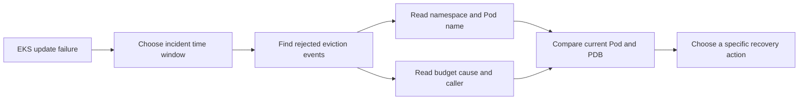

# Find the PDB Behind an EKS PodEvictionFailure with Audit Logs

Author: [nawazdhandala](https://www.github.com/nawazdhandala)

Tags: Kubernetes, Amazon EKS, PodDisruptionBudget, Audit Logging

Description: Trace failed EKS node-group evictions through audit events, identify the responsible disruption budget, and separate historical evidence from current Pod state.

An Amazon EKS managed node-group update fails with `PodEvictionFailure`. The cluster contains dozens of PodDisruptionBudgets, and several currently allow zero disruptions. Editing whichever budget looks strictest is a poor way to identify the cause.

Start with the rejected eviction request. Its audit event identifies the Pod, namespace, caller, time, and server response. For a normal budget rejection, the response can also name the PDB and describe its healthy-Pod requirement. That gives you an evidence trail before changing availability policy.

The response examples below were checked against a disposable **Kubernetes 1.34.0** API server. AWS commands follow the AWS CLI v2 interface; the local command checks used **2.38.1**. CloudWatch queries require access to your account's logs and were reviewed against AWS documentation, not executed against a live EKS cluster.

## Establish the failed operation and time window

EKS documents `PodEvictionFailure` when draining cannot complete within 15 minutes without a forced update. Restrictive or overlapping PDBs are possible causes, but workloads tolerating all taints can also keep a node occupied. The error code alone does not prove which condition occurred. [Managed node update behavior](https://docs.aws.amazon.com/eks/latest/userguide/managed-node-update-behavior.html)

With read access to EKS, replace all four example values and capture the update details:

```bash
aws eks describe-update \
  --region us-east-1 \
  --name example-cluster \
  --nodegroup-name example-workers \
  --update-id REPLACE_WITH_UPDATE_ID \
  --query 'update.{id:id,status:status,createdAt:createdAt,errors:errors}' \
  --output json
```

Save the update ID, error details, affected resources, and approximate failure time from your maintenance records. The creation time is the start of the update, not necessarily the start of draining. Select a narrow log window covering the failed drain and the minutes leading up to it. [Describe an EKS update](https://docs.aws.amazon.com/cli/latest/reference/eks/describe-update.html)



## Confirm that the evidence was collected

Check whether audit logging is enabled:

```bash
aws eks describe-cluster \
  --region us-east-1 --name example-cluster \
  --query 'cluster.{version:version,logging:logging.clusterLogging}' \
  --output json
```

Look for `audit` in an enabled logging entry. EKS sends these events to `/aws/eks/example-cluster/cluster`, in streams beginning with `kube-apiserver-audit-`. Delivery is best effort and can take several minutes. Logging and log queries incur CloudWatch charges. [EKS control-plane logging](https://docs.aws.amazon.com/eks/latest/userguide/control-plane-logs.html), [Describe cluster](https://docs.aws.amazon.com/cli/latest/reference/eks/describe-cluster.html)

If logging was disabled during the incident, enabling it now does not reconstruct old requests. Arrange audit collection before the next controlled attempt, and use existing maintenance logs and retained workload snapshots for the earlier failure. An empty query is also compatible with the wrong account, region, time range, retention window, or incomplete delivery.

## Find the rejected eviction, including non-429 failures

Open CloudWatch Logs Insights, select the cluster log group and incident window, and use **Logs Insights QL**:

```text
fields jsonParse(@message) as event
| filter @logStream like /kube-apiserver-audit/
| filter event.stage = "ResponseComplete"
| filter event.objectRef.resource = "pods"
    and event.objectRef.subresource = "eviction"
| filter event.responseStatus.code >= 400
| fields @timestamp, event.auditID,
    event.objectRef.namespace, event.objectRef.name,
    event.user.username, event.responseStatus.code,
    event.responseStatus.message,
    event.responseObject.details.causes[0].message,
    event.responseStatus.details.causes[0].message, @message
| sort @timestamp asc
| limit 200
```

This parses the JSON event explicitly, keeps completed responses, and shows both the general error and the first detailed cause where present. Expand the raw message to inspect every cause. Filtering only HTTP 429 would miss the overlapping-budget error returned as HTTP 500 by the reviewed Kubernetes version. [Query syntax](https://docs.aws.amazon.com/AmazonCloudWatch/latest/logs/CWL_QuerySyntax.html), [JSON maps and list access](https://docs.aws.amazon.com/AmazonCloudWatch/latest/logs/CWL_QuerySyntax-operations-functions.html)

The result limit bounds displayed rows, not the full scanned time range. Narrow the window further if retries fill the results. Do not initially restrict the caller to a guessed EKS username: inspect the actual caller and correlate it with the maintenance operation. Other controllers or administrators may have attempted evictions during the same period.

AWS's troubleshooting guide also recommends locating eviction requests in audit logs. The additional response details are what make the investigation useful when several PDBs appear restrictive. [EKS update troubleshooting](https://www.repost.aws/knowledge-center/eks-node-group-update-failures)

## Read the cause, not only the HTTP code

In the local Kubernetes 1.34.0 test, a blocked eviction included this cause:

```json
{
  "reason": "DisruptionBudget",
  "message": "The disruption budget checkout needs 2 healthy pods and has 2 currently"
}
```

The budget is `checkout` in the Pod's namespace. Two healthy Pods satisfy its floor, but evicting another healthy Pod would leave only one. That is different from a budget whose controller has not processed its latest specification.

| Audit response | Interpretation |
|---|---|
| 429 with a budget name and healthy counts | The budget currently has no permitted disruption |
| 429 saying the named budget is still being processed | Check reconciliation and observed generation before changing the availability requirement |
| 500 reporting more than one PDB | Identify overlapping selectors; the reviewed eviction implementation does not combine the budgets |
| Another 403, 429, or 5xx message | Inspect that cause; authorization, admission, throttling, or other failures need a different investigation |

These messages come from the eviction handler, not a universal interpretation of HTTP status codes. Response fields and recorded detail depend on Kubernetes version and audit policy. `responseObject` requires response-body logging; inspect `responseStatus` and the complete retained event as well. [Kubernetes eviction implementation](https://github.com/kubernetes/kubernetes/blob/v1.34.0/pkg/registry/core/pod/storage/eviction.go), [Audit event fields](https://github.com/kubernetes/kubernetes/blob/v1.34.0/staging/src/k8s.io/apiserver/pkg/apis/audit/v1/types.go)

For locally retained raw JSON events, one object per line in `evictions.jsonl`, this read-only extraction prints the complete cause list:

```bash
jq 'select(.stage == "ResponseComplete" and
      .objectRef.resource == "pods" and
      .objectRef.subresource == "eviction" and
      (.responseStatus.code // 0) >= 400) |
    {auditID, time: .stageTimestamp,
     namespace: .objectRef.namespace, pod: .objectRef.name,
     caller: .user.username, code: .responseStatus.code,
     message: .responseStatus.message,
     causes: (.responseObject.details.causes //
              .responseStatus.details.causes // [])}' evictions.jsonl
```

This expects the raw event messages, not a CloudWatch query-result wrapper or a CSV export.

## Compare historical evidence with the current objects

Using the namespace, Pod, and budget found in the event, collect current state. Replace the context and names here:

```bash
kubectl --context staging -n retail get pod checkout-0 -o json |
  jq '{name: .metadata.name, uid: .metadata.uid,
       labels: .metadata.labels, node: .spec.nodeName,
       deleting: .metadata.deletionTimestamp}'
kubectl --context staging -n retail get pdb checkout -o json |
  jq '{name: .metadata.name, uid: .metadata.uid,
       generation: .metadata.generation, spec, status}'
kubectl --context staging -n retail get pdb -o wide
```

A Pod name can have been reused, and either object can have changed since the failure. Current healthy counts do not disprove yesterday's rejection. Preserve the event's audit ID and timestamp alongside the new snapshot.

If no cause names a budget, compare the Pod's labels with every PDB selector in that namespace, including `matchExpressions`. PDB selection uses Pod labels, not the PDB object's own labels. In `policy/v1`, an empty selector matches every Pod in the namespace, which makes an accidental overlap easy to miss. [PDB selectors](https://kubernetes.io/docs/tasks/run-application/configure-pdb/), [Label matching](https://kubernetes.io/docs/concepts/overview/working-with-objects/labels/)

Choose recovery from that evidence: restore unhealthy replicas, make replacement capacity schedulable, repair stalled reconciliation, or consolidate unintended overlapping budgets. Change the intended availability floor only with the application's capacity and quorum requirements understood. A forced node update bypasses the protection; it does not identify the cause.

Before retrying maintenance, confirm the intended Pods are healthy, the selected budget has processed its current generation, and it permits the planned disruption. Retain one incident record connecting the EKS update, rejected request, responsible policy, and verified recovery.
