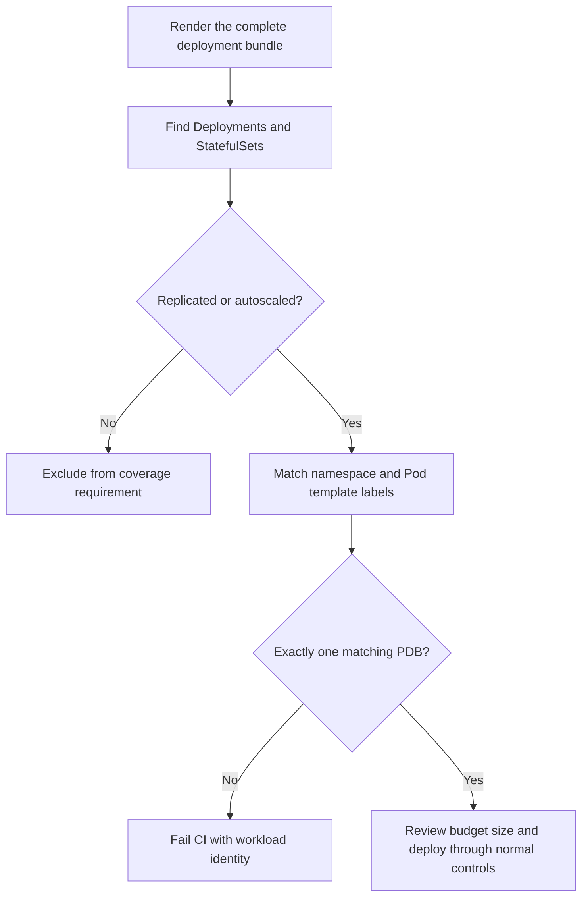

# Enforce PDB Coverage for Replicated Workloads in CI

Author: [nawazdhandala](https://www.github.com/nawazdhandala)

Tags: Kubernetes, PodDisruptionBudget, CI/CD, Go

Description: Check PDB coverage for Deployments and StatefulSets before deployment, with explicit exceptions for Jobs, single replicas, and autoscaling.

A rule saying “every workload needs a PodDisruptionBudget” sounds reasonable until a one-off migration Job fails admission or a single-replica installation acquires a budget that prevents maintenance. The useful requirement is narrower: replicated services should have an intentional disruption policy, and exceptions should be visible.

This guide builds a continuous integration (CI) check over rendered Kubernetes manifests. It checks related objects together, before anything reaches the cluster. The example targets Kubernetes 1.34 resource versions and uses Go 1.25.0 with `k8s.io/apimachinery v0.34.0`. It is a coverage gate, followed by a separate availability review.

## Define exactly which workloads need coverage

A PodDisruptionBudget, or PDB, limits voluntary evictions of selected Pods. It does not make an application highly available, and it does not govern every way a Pod can disappear. Kubernetes documents both these limits and the effect of budgets that permit no voluntary disruption. [PDB configuration guidance](https://v1-34.docs.kubernetes.io/docs/tasks/run-application/configure-pdb/)

For this example, adopt the following organization policy:

| Manifest | Coverage requirement |
|---|---|
| Deployment or StatefulSet with at least two declared replicas | Exactly one matching PDB |
| Deployment or StatefulSet with omitted replicas, zero replicas, or one replica | No PDB required unless the autoscaling rule below applies |
| Workload targeted by an included HPA with `maxReplicas` greater than one | Exactly one matching PDB, even if its initial replica field is omitted |
| Job, CronJob, DaemonSet, or other resource | Outside this gate |

A Job represents work that finishes. Its retry and completion behavior deserves a different review from the minimum serving capacity of a long-running service. Excluding Jobs from this coverage requirement does not certify that interrupting them is harmless. [Kubernetes Jobs](https://v1-34.docs.kubernetes.io/docs/concepts/workloads/controllers/job/)

The HPA exception matters because a HorizontalPodAutoscaler changes its target's scale. A manifest without `spec.replicas` can still represent a service that normally runs several copies. This gate deliberately treats the declared autoscaling range as evidence that coverage is required. It does not decide whether the chosen budget works at the HPA's minimum size. [Horizontal Pod Autoscaling](https://v1-34.docs.kubernetes.io/docs/tasks/run-application/horizontal-pod-autoscale/)



## Match selectors, not naming conventions

A PDB named `checkout` does not automatically protect a Deployment named `checkout`. The PDB's selector must match labels in the workload's **Pod template**, within the same namespace. Labels on the Deployment object itself are insufficient. Selectors can contain both equality checks and expressions such as `In` or `Exists`. [Labels and selectors](https://kubernetes.io/docs/concepts/overview/working-with-objects/labels/)

The accompanying [complete checker source](https://github.com/OneUptime/blog/blob/master/posts/2026-11-24-enforce-pdb-coverage-deployments-statefulsets-ci/check.go) uses Kubernetes' own selector conversion and matching library. Its essential comparison is:

```go
matches := 0
for _, selector := range pdbs[o.Metadata.Namespace] {
    if selector.Matches(labels.Set(o.Spec.Template.Metadata.Labels)) {
        matches++
    }
}
if matches != 1 {
    return fmt.Errorf("%s: expected one PDB, found %d", id, matches)
}
```

Here, `pdbs` contains parsed selectors grouped by namespace, `o` is a workload, and `id` includes its namespace, kind, and name. This excerpt explains the decision; use the complete linked file to run it.

The checker rejects selectors that select everything in a namespace. A null selector selects nothing and therefore cannot satisfy coverage. It also rejects invalid selector expressions. These behaviors use the pinned [selector helper implementation](https://github.com/kubernetes/apimachinery/blob/v0.34.0/pkg/apis/meta/v1/helpers.go), rather than approximating expressions with string comparisons.

## Run the gate on a complete bundle

Download the linked source as `check.go` into an empty tools directory. With Go 1.25.0 installed, prepare and build it:

```bash
go mod init example.invalid/pdb-coverage
go get k8s.io/apimachinery@v0.34.0
go mod tidy
go build -o pdb-coverage check.go
```

These commands obtain build dependencies and create a local executable. Commit the resulting `go.mod` and `go.sum` with your CI tooling so subsequent runs use reviewed dependencies. A disconnected runner needs those dependencies prepared through your normal offline process. [Go dependency management](https://go.dev/doc/modules/managing-dependencies)

Provide a schema-validated, multi-document YAML bundle containing the intended Deployments, StatefulSets, PDBs, and `autoscaling/v2` HPAs. The decoder accepts ordinary YAML documents separated by `---`; flatten Kubernetes `List` objects first. The program rejects duplicate identities instead of guessing which duplicate wins. [Kubernetes YAML decoder](https://github.com/kubernetes/apimachinery/blob/v0.34.0/pkg/util/yaml/decoder.go)

```bash
# Replace retail with the namespace used for namespace-less resources.
./pdb-coverage retail < rendered.yaml
```

Success prints the number of workloads checked. A missing PDB produces a nonzero exit and a message such as `retail/Deployment/checkout: expected one PDB, found 0`. Make that exit status a required deployment check; do not hide it with an unconditional success step.

Use the **same rendered artifact** for checking and deployment. Include HPAs managed by another chart, and include the intended PDB inventory when policies are managed separately. Otherwise the checker cannot know about those relationships. Treat externally supplied inventory as a reviewed dependency, not an excuse to concatenate an old cluster export indefinitely.

This is not a complete Kubernetes schema validator. It deliberately reads only the fields needed for coverage. Keep your existing schema checks, target-cluster API validation, and secret-handling controls around the bundle.

## Make passing mean something useful

The following PDB covers Pods labeled `app: checkout` in `retail`:

```yaml
apiVersion: policy/v1
kind: PodDisruptionBudget
metadata:
  name: checkout
  namespace: retail
spec:
  minAvailable: 2
  selector:
    matchLabels:
      app: checkout
```

With a three-replica checkout service, this expresses a two-Pod floor. It is only an example: a two-voter database or an application requiring three healthy workers needs a different design.

Review four things after coverage passes: whether the selector includes another workload, whether the minimum scale supports the budget, whether readiness represents usable capacity, and whether nodes have enough replacement capacity. The checker catches multiple PDBs matching one template, but it does not prove that one broad, nonempty PDB selects only one controller. It also does not inspect every existing Pod.

Skipping a single-replica workload means CI does not require a PDB for it. It does **not** remove an existing restrictive PDB or promise uninterrupted maintenance. Document the singleton's downtime expectation, then review any supplied budget separately.

## Close the operational gaps

Start by collecting failures on representative bundles. Fix labels, incomplete inventory, and accidental omissions before making the check required. Keep test cases for a missing PDB, overlapping PDBs, different namespaces, expression selectors, an autoscaled workload without `replicas`, and excluded Jobs.

A CI gate protects the delivery paths that run it. A direct API change, a later PDB deletion, or a scale change can invalidate its result. Use periodic inventory checks for drift. If you also enforce coverage through admission, design for cross-resource ordering and deletion: a workload-first installation cannot satisfy a requirement for an already existing PDB. The [Kyverno coverage policy example](https://release-1-11-0.kyverno.io/policies/other/require-pdb/require-pdb/) illustrates that preexisting-object approach; it is a separate enforcement model from checking a whole bundle.

The provided checker was compiled and exercised locally against 30 input fixtures, including exclusion, autoscaling, selector, overlap, namespace, and malformed-policy cases. Those tests verify the gate's decisions. They do not demonstrate a live admission policy, a successful drain, or application availability during disruption.
