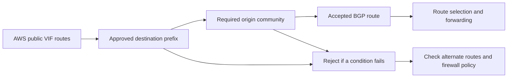

# Filter AWS Direct Connect Public VIF Routes with FRRouting

Author: [nawazdhandala](https://www.github.com/nawazdhandala)

Tags: AWS, Direct Connect, BGP, Networking, Routing

Description: Build a public VIF receive policy using prefix lists and AWS BGP communities, with a scoped FRRouting example and checks for unexpected fallback paths.

An established public Direct Connect virtual interface can deliver more routes than an application needs. Accepting all of them might move unrelated AWS traffic onto the circuit. Filtering too aggressively can have the opposite effect: a required service suddenly follows an internet default route or becomes unreachable.

The useful policy question is specific: which destinations should this router learn through this VIF, and which AWS origin scope is acceptable? This tutorial combines those two requirements in a **FRRouting 10.4.0** configuration fragment. It assumes an already working public VIF and focuses on received routes, not interface provisioning or outbound prefix approval.

The fragment was checked against official documentation and tagged source. Local checks exercised policy boundaries and the source's match-combination behavior; a live FRRouting daemon and Direct Connect session were not tested.

## Keep the two community directions separate

A **BGP community** is a label attached to a route. AWS labels routes it sends to you, and accepts different labels on routes you send to AWS.

For received public-VIF routes, AWS documents `7224:8100` for the associated local Region and `7224:8200` for the associated continent. Routes from other continents lack those scope tags. Separately, `7224:9100`, `7224:9200`, and `7224:9300` control propagation scope for your advertisements into AWS. These directions are described in the [Direct Connect routing guide](https://docs.aws.amazon.com/directconnect/latest/UserGuide/routing-and-bgp.html).

Do not filter received routes for `7224:9100` because you want local AWS destinations. That is the wrong direction. Also, absence of a regional scope tag does not mean a route has no communities: AWS advertises its public routes with `NO_EXPORT`.

For this example, the requirement is: accept an approved destination range **and** require the local-Region community. If your application needs global services or another Region, change the design before adopting this condition.



Rejecting a route only removes this path from consideration. It does not necessarily block packets to the destination.

## Build the destination list from evidence

Record the application's DNS names, their resolved addresses, the routes covering those addresses, and the communities seen on those routes. Include dependencies such as authentication, object storage, and regional failover endpoints. A successful test of one API call is not a complete application inventory.

Use AWS's published address data as an input, not as a verbatim BGP table. The [public VIF documentation](https://docs.aws.amazon.com/directconnect/latest/UserGuide/WorkingWithVirtualInterfaces.html) says announcements may be aggregated or split differently from `ip-ranges.json`; it also notes that BYOIP addresses are omitted from that file even though they can be advertised over the VIF.

A **prefix list** matches network ranges and optionally their prefix lengths. Decide whether each entry should allow an exact route, smaller networks inside it, or neither. Permitting a large aggregate just to make one missing service work can unexpectedly include many other destinations.

Preserve the observed routes and the previous configuration before changing policy. Your rollback should restore a known prior policy, not replace it with an unrestricted permit rule.

## Combine prefix and community checks in one entry

The following is a lab configuration fragment for an existing IPv4 peer. `192.0.2.0/24` and `203.0.113.1` are [documentation addresses](https://datatracker.ietf.org/doc/html/rfc5737), not real AWS destinations or a usable Direct Connect peer. Replace them and the sample local ASN before deployment. The existing peer's VLAN, remote ASN, authentication, outbound policy, and other configuration remain prerequisites.

```text
ip prefix-list DX-APPROVED-V4 seq 10 permit 192.0.2.0/24 le 32
!
bgp community-list standard DX-LOCAL-REGION permit 7224:8100
!
route-map DX-PUBLIC-IN permit 10
 match ip address prefix-list DX-APPROVED-V4
 match community DX-LOCAL-REGION
!
route-map DX-PUBLIC-IN deny 100
!
router bgp 64512
 address-family ipv4 unicast
  neighbor 203.0.113.1 route-map DX-PUBLIC-IN in
 exit-address-family
!
```

The [FRR prefix-list syntax](https://docs.frrouting.org/en/stable-10.4/filter.html) makes `le 32` significant. This entry accepts the `/24` and more-specific IPv4 routes inside it. Without `le` or `ge`, the prefix length must match exactly. It does not permit an enclosing `/23` or an unrelated `/24`.

Both match clauses are in the same route-map entry. FRR's [10.4.0 match evaluation](https://github.com/FRRouting/frr/blob/frr-10.4.0/lib/routemap.c) requires these different matching conditions to succeed together. Putting the prefix and community checks in separate permitting entries would allow either entry to admit a route, weakening the intended policy.

The community match does not use `exact-match`, so additional communities such as `NO_EXPORT` do not disqualify a route. The final deny entry makes the rejection behavior visible. FRR also documents an implicit deny when no route-map entry matches in its [route-map reference](https://docs.frrouting.org/en/stable-10.4/routemap.html).

Do not paste the neighbor line over an existing inbound route-map without reviewing that policy. Merge any necessary existing checks into the replacement, test the full result, and keep its prior name and contents for rollback.

## Test the boundaries before rollout

Use a lab peer to advertise controlled routes with these attributes. The addresses below describe fixtures only; they must not be advertised to AWS.

| Fixture | Expected result | Reason |
| --- | --- | --- |
| `192.0.2.0/24`, community `7224:8100` | Accept | Both conditions match |
| `192.0.2.128/25`, communities `7224:8100` and `NO_EXPORT` | Accept | Allowed more-specific route; extra community is fine |
| `192.0.2.0/24`, only `7224:8200` | Reject | Required local-Region tag is missing |
| `198.51.100.0/24`, community `7224:8100` | Reject | Destination range is not allowed |
| `192.0.2.0/23`, community `7224:8100` | Reject | Enclosing aggregate exceeds the allowed range |
| `0.0.0.0/0`, community `7224:8100` | Reject | Default route is outside the allowlist |

Also test a route with no communities. It must be rejected. Test IPv6 separately if the VIF has an IPv6 session: this IPv4 route-map attachment does not establish your IPv6 receive policy.

These tests should include the installed forwarding route and an application probe. An accepted BGP route can still lose to another path, and a rejected route can still be covered by an existing default route.

## Inspect the result without changing the router

On a router running the reviewed FRR release, use an operator account authorized to access its [VTY shell](https://docs.frrouting.org/en/stable-10.4/vtysh.html). Replace the peer address before running these read-only commands:

```bash
vtysh -c 'show ip prefix-list DX-APPROVED-V4'
vtysh -c 'show bgp community-list DX-LOCAL-REGION detail'
vtysh -c 'show route-map DX-PUBLIC-IN'
vtysh -c 'show bgp ipv4 unicast neighbors 203.0.113.1 routes json'
```

The [BGP command reference](https://docs.frrouting.org/en/stable-10.4/bgp.html) describes `routes` as the routes accepted by inbound policy. Compare them with the expected fixture results, then inspect the selected path for real application destinations.

Do not confuse that output with a complete pre-policy received-route archive. In [FRR 10.4.0 source](https://github.com/FRRouting/frr/blob/frr-10.4.0/bgpd/bgp_route.c), `received-routes` requires inbound soft reconfiguration. Enabling retained pre-policy routes is a separate memory and operations decision, not a free diagnostic switch.

## Roll out with a fallback decision

Before the change, decide what should happen if a required destination is filtered. Is another approved circuit acceptable? Is internet fallback permitted? Should a firewall block the flow? Route policy and packet filtering serve different purposes, so verify both.

Apply the reviewed configuration through your normal scoped change process and use the release-appropriate policy refresh procedure. Monitor route-count changes and application results. If a required route disappears, compare its prefix length and communities with the conditions before broadening the allowlist.

Finally, retain `NO_EXPORT` and explicit outbound restrictions so received AWS routes cannot leak into public internet routing. Review destination-list changes as application dependencies evolve. A useful filter stays narrow because its owners understand what it admits, not because its original configuration has remained untouched for years.
