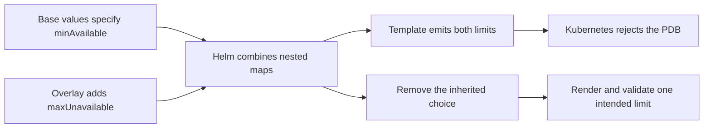

# Fix Helm PDB Values That Set Both Availability Limits

Author: [nawazdhandala](https://www.github.com/nawazdhandala)

Tags: Kubernetes, Helm, PodDisruptionBudget, Troubleshooting

Description: Trace conflicting PDB limits through Helm value merging, correct inherited settings, and validate rendered manifests without confusing zero with an unset value.

A Helm upgrade fails because a PodDisruptionBudget contains both `minAvailable` and `maxUnavailable`. You open the newest values file and see only `maxUnavailable`. Where did the other field come from?

Usually, the answer is another layer of configuration. Helm combines chart defaults, supplied values, and command-line overrides. Adding a different key does not necessarily remove an earlier key. The result can be valid YAML that the Kubernetes API rejects.

This guide reproduces the problem by rendering the official **cert-manager chart v1.18.2** with **Helm 3.17.3**. That pinned chart is a reproducible example, not a recommendation to install an older cert-manager release. The API behavior was checked against Kubernetes **1.34.0**.

## Identify the invalid combination

A PDB expresses its availability limit in one of two ways: the number that must remain available, or the number permitted to be unavailable. Kubernetes rejects a specification with both fields set to non-null values. There is no precedence rule that makes one silently override the other. [Kubernetes PDB validation](https://github.com/kubernetes/kubernetes/blob/v1.34.0/pkg/apis/policy/validation/validation.go)

The issue is not limited to positive numbers. `minAvailable: 0` and `maxUnavailable: 0` are both supplied values. Setting an unwanted field to zero does not unset it. In particular, `maxUnavailable: 0` intentionally permits no voluntary disruption. [PDB configuration semantics](https://kubernetes.io/docs/tasks/run-application/configure-pdb/)



## Reproduce the merge without installing anything

In an empty working directory, download the pinned chart:

```bash
helm pull oci://quay.io/jetstack/charts/cert-manager   --version v1.18.2 --untar
```

This downloads chart files; it does not install cert-manager or its custom resource definitions. The OCI location is the project's documented chart distribution channel. [cert-manager Helm installation documentation](https://cert-manager.io/docs/installation/helm/)

Save this as `base.yaml`:

```yaml
podDisruptionBudget:
  enabled: true
  minAvailable: 1
```

Save this as `overlay.yaml`:

```yaml
podDisruptionBudget:
  maxUnavailable: 1
```

Now render only the controller's PDB:

```bash
helm template cert-manager ./cert-manager   --namespace cert-manager --kube-version 1.34.0   --show-only templates/poddisruptionbudget.yaml   -f base.yaml -f overlay.yaml > rendered-pdb.yaml
```

The output contains both `minAvailable: 1` and `maxUnavailable: 1`. Helm has retained two different keys in the nested map. The later file wins when it supplies the **same** key; it does not replace the entire `podDisruptionBudget` map merely because that map appears again. [Values-file behavior](https://helm.sh/docs/v3/chart_template_guide/values_files/)

In this particular chart, the controller template checks whether each key exists and can emit both. The chart's shipped values have neither limit explicitly set; the template supplies a default only when neither key exists. Our reproduction introduces the first limit through `base.yaml`, not through an alleged unconditional chart default. [Tagged values](https://github.com/cert-manager/cert-manager/blob/v1.18.2/deploy/charts/cert-manager/values.yaml) and [controller PDB template](https://github.com/cert-manager/cert-manager/blob/v1.18.2/deploy/charts/cert-manager/templates/poddisruptionbudget.yaml)

## Correct the source of the inherited limit

If you own the base file, remove its old limit and maintain one clear choice. For this rendering exercise, save the following as `fixed.yaml` and use it instead of the two earlier files:

```yaml
podDisruptionBudget:
  enabled: true
  maxUnavailable: 1
```

```bash
helm template cert-manager ./cert-manager   --namespace cert-manager --kube-version 1.34.0   --show-only templates/poddisruptionbudget.yaml   -f fixed.yaml > rendered-pdb.yaml
```

The controller PDB should now contain only `maxUnavailable: 1`. In a real installation, preserve every other required setting when preparing corrected values. A tiny reproduction file is not a complete production configuration.

If a shared base cannot be changed, an explicit YAML null can express that an inherited setting should be cleared. For this chart and merge sequence, use this replacement overlay:

```yaml
podDisruptionBudget:
  minAvailable: null
  maxUnavailable: 1
```

Render again with `-f base.yaml -f null-overlay.yaml`. In the tested version, the template still emits an empty `minAvailable:` line because it checks key existence. YAML parses that value as null, and the Kubernetes API accepts the resulting PDB with only `maxUnavailable` active.

That detail matters: inspecting text for the two field names is weaker than inspecting parsed values. Helm's coalescing behavior and a chart's template both affect how null is rendered. Do not assume every chart deletes the line, and do not use an empty string as a universal workaround. [Helm coalescing implementation](https://github.com/helm/helm/blob/v3.17.3/pkg/chartutil/coalesce.go)

## Account for saved release values

For an existing release, inspect both user-supplied and computed values:

```bash
helm get values cert-manager -n cert-manager
helm get values cert-manager -n cert-manager --all
```

Use the correct context and treat this output as sensitive. Look for the unwanted field in saved values, environment overlays, parent configuration, and command-line settings. The chart also has separate PDB settings for components such as the webhook and CA injector; correcting the controller path does not automatically change those components. [Helm value inspection](https://helm.sh/docs/v3/helm/helm_get_values/)

An upgrade using `--reuse-values` can carry forward the old limit. Conversely, `--reset-values` rebuilds from chart defaults plus supplied settings and can discard unrelated customizations. Choose the upgrade's value strategy deliberately, using a reviewed complete configuration. Do not add a reset flag merely to make this one validation error disappear. [Helm upgrade options](https://helm.sh/docs/v3/helm/helm_upgrade/)

## Check parsed output and API acceptance

For the single-PDB render above, save this as `check-pdb.py`. It requires Python 3 and PyYAML 6.0.3:

```python
from pathlib import Path
import yaml

objects = [o for o in yaml.safe_load_all(Path('rendered-pdb.yaml').read_text())
           if o and o.get('kind') == 'PodDisruptionBudget']
if len(objects) != 1:
    raise SystemExit('Expected exactly one controller PDB')
spec = objects[0]['spec']
active = [key for key in ('minAvailable', 'maxUnavailable')
          if spec.get(key) is not None]
if len(active) != 1:
    raise SystemExit(f'Expected one non-null limit, found: {active}')
print(f'Chosen limit: {active[0]}={spec[active[0]]!r}')
```

Run `python3 check-pdb.py` in the same directory. The corrected output prints the chosen field. The conflicting output exits unsuccessfully. Zero is retained as an active choice because the check compares with `None`, not truthiness.

This CI policy intentionally requires one non-null limit. It is stricter than merely checking the API's prohibition on both fields. It does not validate limit types, selector correctness, or whether the chosen number protects your application's required capacity.

For those remaining API checks, use an approved staging context with the `cert-manager` namespace already present:

```bash
kubectl --context staging -n cert-manager apply   --dry-run=server -f rendered-pdb.yaml
```

Server-side dry-run sends the resource through API validation and admission without persisting it. It still requires appropriate permissions. Validate the full release through your normal pipeline too: `--show-only` deliberately excluded the chart's other resources. [Server dry-run](https://kubernetes.io/docs/reference/using-api/api-concepts/#dry-run) and [Helm template options](https://helm.sh/docs/v3/helm/helm_template/)

For chart maintainers, reject conflicting active values before emitting YAML and add render tests for integer zero, percentages, null overrides, and inherited values. Avoid using a simple `if` or `default` check to distinguish an unset limit from numeric zero, because Helm treats zero as empty. [Helm template functions](https://helm.sh/docs/v3/chart_template_guide/function_list/)

The official chart renders and eight local parser checks were executed for this article. API dry-run checks rejected two active limits, accepted the intended single-limit/null forms, and checked zero, percentage, and negative-value boundaries without persisting a PDB. No cert-manager installation, real upgrade, or disruption test was performed.
