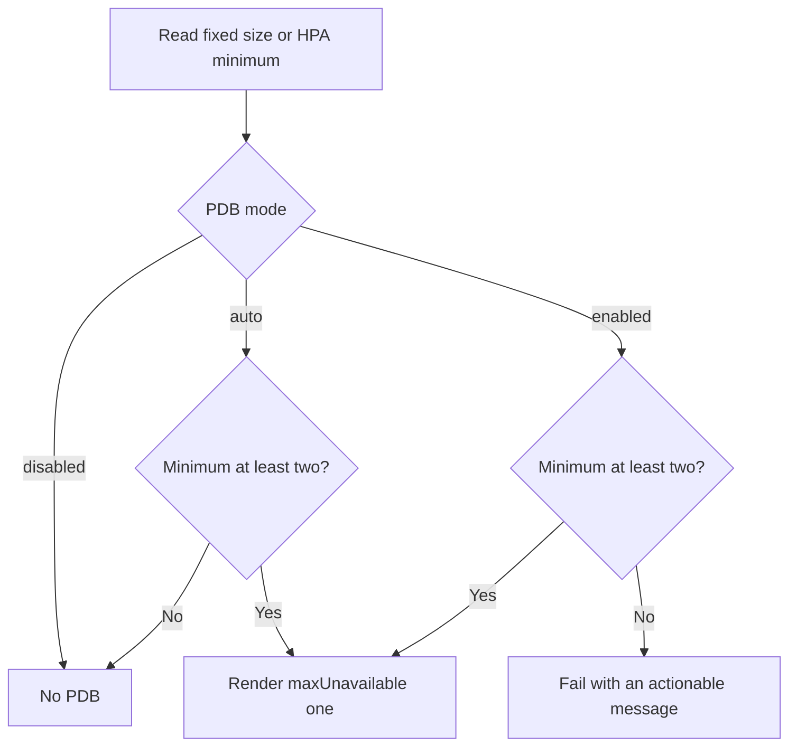

# Keep Helm PDB Defaults Safe for Single-Replica Installations

Author: [nawazdhandala](https://www.github.com/nawazdhandala)

Tags: Kubernetes, Helm, PodDisruptionBudget, CI/CD

Description: Design explicit Helm PDB modes, account for autoscaling minimums, and test chart output so single-replica installations can complete maintenance.

Your chart installs successfully with one replica. Months later, a node upgrade stalls because the chart also created a PodDisruptionBudget with `minAvailable: 1`. The application is healthy, but evicting its only Pod would violate that policy.

This is a chart contract problem. A default should explain whether a small installation accepts downtime during maintenance, requires extra capacity first, or deliberately blocks voluntary eviction. Hiding that decision inside a template creates surprises.

This tutorial builds a small, locally renderable PDB chart fixture. The examples were tested with **Helm 3.17.3**, using **Kubernetes 1.34.0** as the render target. They illustrate a stateless service whose replicas are interchangeable, not a consensus database with a separately calculated quorum.

## Choose the behavior before writing the condition

For a single healthy Pod, `minAvailable: 1` permits no voluntary eviction. Changing it to `maxUnavailable: 1` permits the entire service to become unavailable. Neither setting manufactures a replacement Pod before a drain. Kubernetes explicitly documents these small-replica consequences. [PDB configuration guidance](https://kubernetes.io/docs/tasks/run-application/configure-pdb/)

The example chart offers three modes:

| Mode | Minimum configured replicas below two | Minimum configured replicas at least two |
|---|---|---|
| `auto` | Render no PDB | Render a PDB allowing one unavailable Pod |
| `disabled` | Render no PDB | Render no PDB |
| `enabled` | Fail rendering with an explanation | Render the PDB |

Here, “minimum” means `replicaCount` for a fixed-size service, or the HorizontalPodAutoscaler's configured `minReplicas` when autoscaling is enabled. Checking only the initial replica count misses a service that later scales down to one. The HPA changes the target workload's scale within its configured bounds. [HPA behavior](https://v1-34.docs.kubernetes.io/docs/tasks/run-application/horizontal-pod-autoscale/)

With `auto`, a single-replica installation accepts that ordinary maintenance can interrupt service. Document that tradeoff in the chart's values reference. For users who require uninterrupted service, require sufficient replicas, placement, readiness, and replacement capacity as part of the deployment design.



## Create a small rendering fixture

Create `maintenance-demo/templates/`. Save this as `maintenance-demo/Chart.yaml`:

```yaml
apiVersion: v2
name: maintenance-demo
version: 0.1.0
kubeVersion: '>=1.21.0-0'
description: PDB rendering fixture for a stateless workload
```

This fixture emits only a PDB, so it isolates the decision without installing an application. Its chart version is a local example version. The API constraint permits `policy/v1`; it does not certify compatibility of an application's other templates.

Save the defaults as `maintenance-demo/values.yaml`:

```yaml
replicaCount: 1
autoscaling:
  enabled: false
  minReplicas: 2
pdb:
  mode: auto
```

When adapting this to your real chart, use the same autoscaling values that configure its HPA. If a different system controls scaling, define and validate an explicit operational minimum rather than pretending `replicaCount` describes it.

## Validate values before converting them

Save this as `maintenance-demo/values.schema.json`:

```json
{
  "$schema": "http://json-schema.org/draft-07/schema#",
  "type": "object",
  "required": ["replicaCount", "autoscaling", "pdb"],
  "properties": {
    "replicaCount": {"type": "integer", "minimum": 0},
    "autoscaling": {
      "type": "object",
      "required": ["enabled", "minReplicas"],
      "properties": {
        "enabled": {"type": "boolean"},
        "minReplicas": {"type": "integer", "minimum": 1}
      }
    },
    "pdb": {
      "type": "object",
      "required": ["mode"],
      "properties": {
        "mode": {"type": "string", "enum": ["auto", "enabled", "disabled"]}
      }
    }
  }
}
```

The schema rejects negative replica counts, nonnumeric counts, and misspelled modes. It permits an explicit fixed size of zero and requires a positive HPA minimum for this example's supported configuration. Helm checks chart value schemas during linting, rendering, installation, and upgrades. [Chart schema documentation](https://helm.sh/docs/v3/topics/charts/#schema-files)

Avoid silently converting an invalid string to a count. Also be careful with `default`: Helm treats numeric zero as empty, so a fallback can accidentally replace an intentional zero. Validated inputs let this template use the supplied numbers directly. [Template functions](https://helm.sh/docs/v3/chart_template_guide/function_list/)

## Render only the intended budget

Save this as `maintenance-demo/templates/pdb.yaml`:

```gotemplate
{{- $minimum := int .Values.replicaCount -}}
{{- if .Values.autoscaling.enabled -}}
  {{- $minimum = int .Values.autoscaling.minReplicas -}}
{{- end -}}
{{- $mode := .Values.pdb.mode -}}
{{- if and (eq $mode "enabled") (lt $minimum 2) -}}
  {{- fail "pdb.mode=enabled requires a minimum of two replicas; choose disabled or increase the minimum" -}}
{{- end -}}
{{- if or (eq $mode "enabled") (and (eq $mode "auto") (ge $minimum 2)) }}
apiVersion: policy/v1
kind: PodDisruptionBudget
metadata:
  name: {{ .Release.Name }}
  namespace: {{ .Release.Namespace }}
spec:
  maxUnavailable: 1
  selector:
    matchLabels:
      app.kubernetes.io/name: maintenance-demo
      app.kubernetes.io/instance: {{ .Release.Name | quote }}
{{- end }}
```

The first block chooses the configured minimum. The second rejects an explicit request for protection that the example's minimum cannot support. The final condition emits a resource only when the selected mode calls for one.

`maxUnavailable: 1` is an integer and is the only budget-size field emitted. This is a deliberate policy for the example service, not a universal setting for all applications. A workload that cannot tolerate one unavailable replica needs a different policy contract.

In your application chart, share selector labels with the workload's Pod template, usually through a named helper. The fixture uses both application name and release instance. Copying just its PDB while your Pods use unrelated labels would create an object that protects nothing. Do not put a rollout hash in the selector or broaden it to every Pod in the namespace. [Kubernetes label selectors](https://kubernetes.io/docs/concepts/overview/working-with-objects/labels/)

## Test absence as carefully as presence

From the directory containing `maintenance-demo`, run:

```bash
helm lint ./maintenance-demo --strict
helm template checkout ./maintenance-demo   --namespace retail --kube-version 1.34.0 > single.yaml
helm template checkout ./maintenance-demo   --namespace retail --kube-version 1.34.0   --set replicaCount=3 > replicated.yaml
```

Lint should succeed. `single.yaml` should contain no Kubernetes objects; `replicated.yaml` should contain one `policy/v1` PDB for `retail`, with the release-specific selector and integer `maxUnavailable: 1`.

Now verify the error path:

```bash
helm template checkout ./maintenance-demo   --namespace retail --kube-version 1.34.0   --set pdb.mode=enabled
```

This intentionally exits unsuccessfully because the default count is one. Expect the message explaining the two-replica minimum. Assert that nonzero exit in CI rather than treating it as a broken test.

Extend the matrix with fixed counts zero and two, `disabled` at three replicas, HPA minimums one and two, and invalid mode/count inputs. Parse rendered YAML in tests and count PDB objects; searching for the word `PodDisruptionBudget` in comments is not a reliable assertion. Check the selector against the real workload template as well.

`helm template` renders locally and does not prove that the API server accepts every resource or that a drain will succeed. Keep target-cluster validation and a scoped staging maintenance rehearsal separate. [Template command reference](https://helm.sh/docs/v3/helm/helm_template/) and [lint reference](https://helm.sh/docs/v3/helm/helm_lint/)

## Review upgrades as well as fresh installations

Changing a chart default affects existing releases. Before rollout, inspect their saved values and manifests using read-only commands:

```bash
helm get values checkout -n retail --all
helm get manifest checkout -n retail
```

Replace the release and namespace. Treat the output as sensitive because release values and manifests can contain credentials. Compare the old release with the newly rendered result, including whether an existing PDB would disappear. Do not assume that fixing a default overrides a user's saved settings. [Saved values](https://helm.sh/docs/v3/helm/helm_get_values/) and [release manifest](https://helm.sh/docs/v3/helm/helm_get_manifest/)

Also review scaling changes after installation. Rendering a PDB at two replicas does not stop someone from manually reducing the workload to one. A Deployment rollout has its own availability settings, and its controller-driven replacement behavior is distinct from an eviction-based drain. [Deployment rolling updates](https://kubernetes.io/docs/concepts/workloads/controllers/deployment/#rolling-update-deployment)

The fixture passed strict linting and 16 local render/error cases. Rendered PDBs also passed Kubernetes 1.34 schema checks. No Helm release was installed or upgraded, and no workload or node was disrupted. Those checks establish predictable chart output; application maintenance still needs its own evidence.
