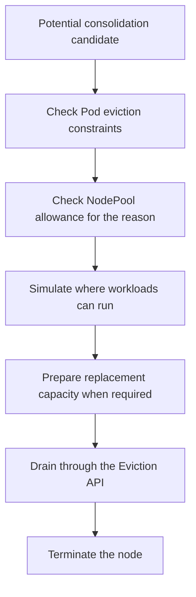

# Karpenter PDBs vs. NodePool Budgets: Find the Consolidation Blocker

Author: [nawazdhandala](https://www.github.com/nawazdhandala)

Tags: Kubernetes, PodDisruptionBudget, Karpenter, Troubleshooting

Description: Separate Pod eviction protection from NodePool disruption limits, identify which one blocks Karpenter consolidation, and preview policy changes without weakening workload availability.

Karpenter can have permission to disrupt a node at the NodePool level and still be unable to evict one application Pod on it. Increasing the NodePool allowance does not resolve that application's PodDisruptionBudget (PDB). Conversely, healthy applications with spare Pod capacity do not override a NodePool policy that currently permits no consolidation.

Both controls matter, but they count different things. This guide uses Karpenter v1.8.0 source and its `karpenter.sh/v1` API. It covers dynamic NodePools used for consolidation, not fixed-size NodePools with `spec.replicas` set. In that pinned API, static pools ignore the consolidation settings discussed here. [Versioned NodePool API](https://github.com/kubernetes-sigs/karpenter/blob/v1.8.0/pkg/apis/v1/nodepool.go).

## Separate the two availability questions

| Control | What it selects or counts | Question it answers |
|---|---|---|
| Kubernetes PDB | Label-selected Pods within one namespace | Can a covered Pod eviction proceed while preserving the workload's healthy floor? |
| NodePool disruption budget | Karpenter-managed nodes belonging to that NodePool | How many nodes may start the relevant voluntary disruption operation now? |

A PDB belongs to a namespace and uses a selector. A NodePool is cluster-scoped and contains its budgets under `spec.disruption.budgets`. A Pod can run on a NodePool's node while being protected by an independently managed application PDB. [PDB API](https://kubernetes.io/docs/reference/kubernetes-api/policy/pod-disruption-budget-v1/), [NodePool CRD](https://github.com/kubernetes-sigs/karpenter/blob/v1.8.0/pkg/apis/crds/karpenter.sh_nodepools.yaml).

For example, an eight-node pool might permit one node disruption. A candidate node hosting the only healthy replica of a service with `minAvailable: 1` is still unsuitable for ordinary consolidation. The node allowance is not a permission to remove that Pod's protection.



These are decision stages, not guarantees that previously observed state remains unchanged. Karpenter's termination process uses the Eviction API, so a later health change can still matter during draining. [Pinned disruption control flow](https://github.com/aws/karpenter-provider-aws/blob/v1.8.0/website/content/en/docs/concepts/disruption.md#control-flow).

## Read the event before editing either budget

Use a verified context and the actual candidate node name. These commands are read-only:

```bash
CTX=staging-context
NODE=replace-with-candidate-node
kubectl --context="$CTX" describe node "$NODE"
kubectl --context="$CTX" get node "$NODE" -o yaml
kubectl --context="$CTX" get pods --all-namespaces --field-selector "spec.nodeName=$NODE" -o wide
```

Look at recent events, their timestamps, and the node's `karpenter.sh/nodepool` label. Karpenter can report a Pod-related block against a Node or NodeClaim, and a budget-related block against a NodePool. A NodeClaim is Karpenter's object representing requested node capacity and its lifecycle. [Versioned NodeClaim guide](https://github.com/aws/karpenter-provider-aws/blob/v1.8.0/website/content/en/docs/concepts/nodeclaims.md). Event reasons alone can be broad; read the associated message and object. [Pinned event definitions](https://github.com/kubernetes-sigs/karpenter/blob/v1.8.0/pkg/controllers/disruption/events/events.go), [kubectl describe](https://kubernetes.io/docs/reference/kubectl/generated/kubectl_describe/).

Use the NodePool name you found rather than assuming it is `default`:

```bash
POOL=replace-with-nodepool-name
kubectl --context="$CTX" get nodepool "$POOL" -o yaml
kubectl --context="$CTX" describe nodepool "$POOL"
kubectl --context="$CTX" get nodeclaims -l "karpenter.sh/nodepool=$POOL" -o wide
```

Record whether the message points to a namespace/PDB, a disruption reason with no node allowance, a scheduling constraint, or a replacement-capacity problem. Those lead to different repairs.

## Investigate a Pod budget block

For each application Pod on the node, inspect the PDBs in its namespace and compare their complete selectors with its labels. Read the selected population across all nodes, not just the candidate node. A healthy replica elsewhere may provide the required headroom; an unready replacement elsewhere may explain its absence.

Useful fields include `currentHealthy`, `desiredHealthy`, `disruptionsAllowed`, `observedGeneration`, and outstanding `disruptedPods`. Confirm that status reflects the current specification. Repair an unhealthy replica or scheduling failure before lowering a healthy floor that still represents the application's requirement.

Also look for accidental overlap. The pinned v1.8.0 Karpenter implementation explicitly treats a Pod matching multiple PDBs as blocked, even when each budget has positive allowance. Do not assume that independently acceptable budgets can always be combined. [Pinned PDB eligibility implementation](https://github.com/kubernetes-sigs/karpenter/blob/v1.8.0/pkg/utils/pdb/pdb.go).

A positive allowance need not cover every Pod on the node simultaneously. Karpenter's eligibility helper distinguishes whether Pods can be evicted at all from whether they can all be evicted together. Replacement readiness and drain timing still determine whether an operation completes.

## Investigate a NodePool budget block

Read every configured budget and its active time window. In v1.8.0, the supported reasons are `Empty`, `Underutilized`, and `Drifted`; omitting reasons applies a budget across those voluntary disruption reasons. Karpenter uses the most restrictive applicable active limit. A permissive entry does not cancel a stricter one. [Budget fields and evaluation](https://github.com/kubernetes-sigs/karpenter/blob/v1.8.0/pkg/apis/v1/nodepool.go).

Node readiness and ongoing deletion also consume headroom. The pinned implementation counts eligible managed, initialized nodes and subtracts nodes already disrupting or not Ready. A node that satisfies both conditions is counted once in that subtraction. Do not copy a simplified formula that double-counts it. Percentages round upward before the current unavailable-node count is deducted. [Budget mapping implementation](https://github.com/kubernetes-sigs/karpenter/blob/v1.8.0/pkg/controllers/disruption/helpers.go).

Consider a static limit of one node: with no unavailable nodes, one voluntary disruption can be eligible. If another counted node is already deleting or not Ready, there may be no remaining allowance, even though every application's PDB permits an eviction. Increasing the limit changes infrastructure concurrency; it does not repair that other node.

## Preview an explicit policy in staging

The following is a **merge-patch document**, not a complete NodePool. Save it as `disruption-preview.yaml` for an existing staging NodePool. It illustrates an overall ceiling of one node while pausing underutilized-node consolidation:

```yaml
spec:
  disruption:
    consolidationPolicy: WhenEmptyOrUnderutilized
    consolidateAfter: 1m
    budgets:
      - nodes: "1"
      - nodes: "0"
        reasons:
          - Underutilized
```

`consolidateAfter` delays consideration after workload changes. The second budget makes the effective allowance for `Underutilized` zero; `Empty` and `Drifted` remain subject to the first budget and other eligibility checks. This is an intentional pause example, not a fix for a blocking application PDB.

Preview it without persisting the change:

```bash
kubectl --context="$CTX" patch nodepool "$POOL" --type=merge --patch-file=disruption-preview.yaml --dry-run=server -o yaml
```

JSON merge patch replaces the `budgets` array as a whole. Review and preserve any existing scheduled or reason-specific restrictions before preparing a real change. A successful dry run checks the resulting API object; it does not run Karpenter's consolidation planner or prove that a node can be removed. [Merge-patch list behavior](https://kubernetes.io/docs/tasks/manage-kubernetes-objects/update-api-object-kubectl-patch/), [patch options](https://kubernetes.io/docs/reference/kubectl/generated/kubectl_patch/).

## Verify the right outcome

After an approved repair, wait for fresh readiness, PDB status, and Karpenter events. A repaired PDB block might reveal a NodePool limit next. A cleared NodePool limit might reveal that the Pods cannot fit elsewhere. Treat each updated reason as new evidence rather than repeatedly increasing disruption allowances.

Keep ordinary consolidation separate from forced lifecycle events. In the pinned release, NodePool budgets do not provide blanket protection against expiration or interruption. A configured NodeClaim termination deadline can ultimately force removal of remaining Pods; changing it is not a routine way to solve a consolidation warning. [Versioned lifecycle and termination behavior](https://github.com/aws/karpenter-provider-aws/blob/v1.8.0/website/content/en/docs/concepts/disruption.md#terminationgraceperiod).

A useful resolution records which control blocked progress, why its limit was reached, and whether the later outcome preserved the application's healthy capacity. Sometimes keeping the node is the correct result: reducing cost is only useful when the workload can safely move.
