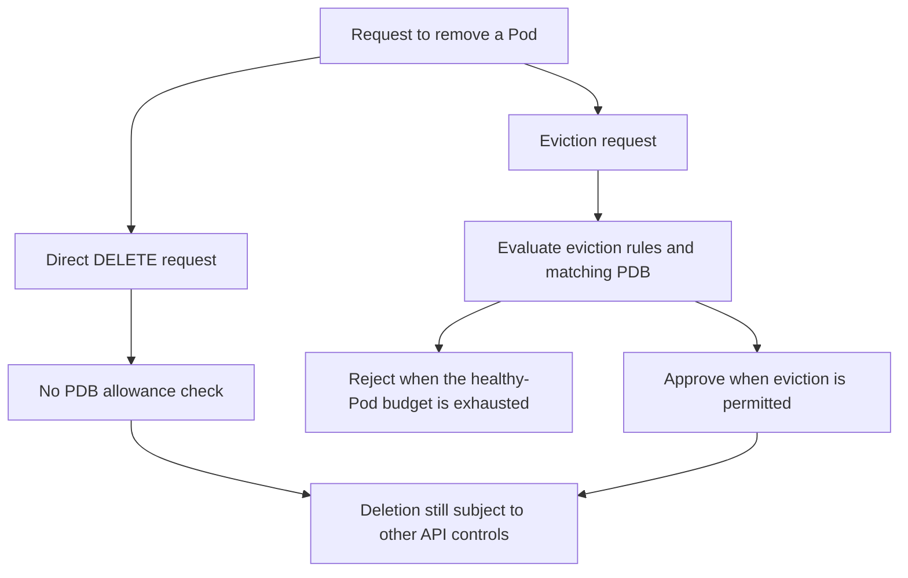

# Pod Deletion vs. Drain: How PDB Protection Works

Author: [nawazdhandala](https://www.github.com/nawazdhandala)

Tags: Kubernetes, PodDisruptionBudget, Troubleshooting, High Availability

Description: Compare Pod deletion with eviction, understand drain flags, and use server dry runs to investigate PDB behavior without removing a workload.

A PodDisruptionBudget reports zero allowed disruptions, yet someone successfully deletes a protected Pod. The budget did not necessarily fail. The request may have used the Pod deletion API, which does not enforce PDBs.

A normal `kubectl drain` follows a different path: it requests eviction when the server supports it. The eviction API checks the matching budget before approving a budgeted removal. A PDB is therefore an availability control for particular operations, not a general prohibition on deleting Pods. [Kubernetes disruption boundaries](https://kubernetes.io/docs/concepts/workloads/pods/disruptions/).

This guide uses Kubernetes and kubectl v1.34.0 for a locally tested API comparison. It separates what the server checks from what a complete node drain and application shutdown would need to prove.

## Identify the request, not just the command's intention

Both deletion and eviction can eventually terminate a Pod, but they enter the API through different endpoints:

| Operation | API request | PDB behavior |
|---|---|---|
| Direct Pod deletion | `DELETE /api/v1/namespaces/NS/pods/POD` | Does not enforce the disruption budget |
| Pod eviction | `POST /api/v1/namespaces/NS/pods/POD/eviction` | Evaluates the applicable eviction rules and budget |
| Normal drain with eviction support | Eviction requests for eligible Pods | Uses the eviction checks |
| Drain with eviction disabled | Direct deletion requests | Bypasses those budget checks |

An eviction request contains an `Eviction` object even though the endpoint is under the core Pod API. `policy/v1` is the object's API version. Rejection with HTTP 429 can indicate that the PDB currently prevents the requested eviction; inspect the response's explanation rather than treating every 429 as the same problem. [API-initiated eviction](https://kubernetes.io/docs/concepts/scheduling-eviction/api-eviction/).

The v1.34.0 drain implementation explicitly chooses between eviction and deletion. It falls back to deletion if eviction support is unavailable, or uses deletion when `DisableEviction` is set. The distinction assumes eviction support and no bypass flag. [Pinned drain implementation](https://github.com/kubernetes/kubernetes/blob/v1.34.0/staging/src/k8s.io/kubectl/pkg/drain/drain.go).



Authorization and admission policy still apply to direct deletion. “Bypasses a PDB” does not mean “bypasses every security control” or “always succeeds.”

## Do not confuse drain force with deletion force

The word `force` appears in more than one command, with different meanings.

For `kubectl drain`, `--force` permits proceeding past certain unmanaged-Pod checks. It does not itself disable eviction or tell the API server to ignore a PDB. The separate `--disable-eviction` flag switches drain to deletion. [Drain flags](https://kubernetes.io/docs/reference/kubectl/generated/kubectl_drain/), [unmanaged-Pod filter](https://github.com/kubernetes/kubernetes/blob/v1.34.0/staging/src/k8s.io/kubectl/pkg/drain/filters.go).

For `kubectl delete`, `--force` concerns immediate removal of the API object and can leave uncertainty about whether the process has stopped on the node. Ordinary direct deletion already bypasses PDB enforcement; force is not required for that bypass. This distinction matters especially for workloads where two processes sharing an identity or storage can corrupt data. [Delete command reference](https://kubernetes.io/docs/reference/kubectl/generated/kubectl_delete/).

Do not add either force or eviction-disable flags merely because maintenance is taking longer than expected. First identify the exact rejection and the service capacity the budget is protecting.

## Compare the APIs without removing the Pod

Use a disposable staging workload for this exercise. It should have one Running, Ready Pod selected by exactly one PDB with `minAvailable: 1`, a reconciled `disruptionsAllowed: 0`, and no deletion already in progress. These conditions isolate the healthy-Pod budget check from unhealthy-Pod exceptions.

You need permissions to read the objects, create `pods/eviction` requests, and delete Pods. Dry runs still require authorization. Replace all names below with your staging objects; `checkout-demo` is a placeholder Pod name, not necessarily a Deployment-generated name.

```bash
CTX=staging-context
NS=pdb-delete-lab
POD=checkout-demo
PDB=checkout-demo

kubectl --context="$CTX" -n "$NS" get pod "$POD" -o yaml
kubectl --context="$CTX" -n "$NS" get pdb "$PDB" -o yaml
```

Confirm the PDB selector matches the Pod and `status.observedGeneration` equals `metadata.generation`. Readiness must be true; a `Running` phase alone is insufficient. [PDB configuration and status](https://v1-34.docs.kubernetes.io/docs/tasks/run-application/configure-pdb/).

Capture the Pod's unique identifier, then build an eviction body tied to that specific object:

```bash
POD_UID=$(kubectl --context="$CTX" -n "$NS" get pod "$POD" \
  -o jsonpath='{.metadata.uid}')
test -n "$POD_UID" || exit 1

cat > eviction.json <<EOF
{
  "apiVersion": "policy/v1",
  "kind": "Eviction",
  "metadata": {"name": "$POD", "namespace": "$NS"},
  "deleteOptions": {"preconditions": {"uid": "$POD_UID"}}
}
EOF
```

The UID precondition prevents the eviction request from targeting a different Pod recreated under the same name. The request shape follows the documented eviction API and its delete options. [Eviction resource definition](https://github.com/kubernetes/kubernetes/blob/v1.34.0/staging/src/k8s.io/api/policy/v1/types.go), [delete-option preconditions](https://github.com/kubernetes/kubernetes/blob/v1.34.0/staging/src/k8s.io/apimachinery/pkg/apis/meta/v1/types.go).

Send the eviction request with server dry run explicitly in the URL:

```bash
kubectl --context="$CTX" create \
  --raw "/api/v1/namespaces/$NS/pods/$POD/eviction?dryRun=All" \
  -f eviction.json
```

With the stated healthy-Pod conditions, expect a budget-related rejection. Keep `dryRun=All` in the URL: removing it changes this into a real eviction request. `--raw` posts the body to the specified API endpoint. [kubectl create reference](https://kubernetes.io/docs/reference/kubectl/generated/kubectl_create/), [server dry-run semantics](https://kubernetes.io/docs/reference/using-api/api-concepts/#dry-run).

Now compare a direct deletion dry run:

```bash
kubectl --context="$CTX" -n "$NS" delete pod "$POD" --dry-run=server
```

This request can be accepted despite the zero disruption allowance because it takes the deletion path. Other permissions or admission policies may reject it independently. Preserve `--dry-run=server`; there is no reason to remove the Pod to establish which check applies.

In our isolated v1.34.0 API-server test, the eviction dry run was rejected for the budget, while the deletion dry run succeeded. The Pod UID, deletion timestamp, allowance, and pending-disruption map remained unchanged. The test supplied Pod and PDB status as fixtures because envtest has no kubelet or disruption controller. It did not exercise a real application, replacement scheduling, or node drain. [envtest scope](https://book.kubebuilder.io/reference/envtest.html).

## Investigate the blocked drain at the right layer

A drain does more than remove one Pod: it marks the node unschedulable, filters Pods, requests their removal, and waits. It can encounter DaemonSets, unmanaged Pods, local data, permission failures, or an exhausted budget. `--ignore-daemonsets` leaves DaemonSet-managed Pods alone; it does not make them disappear. [Drain behavior](https://kubernetes.io/docs/reference/kubectl/generated/kubectl_drain/).

Read the failure message before changing the workload. For a budget rejection, inspect selected Pods, readiness, the required healthy count, and whether replacements can be scheduled elsewhere. For local-storage or controller-ownership failures, investigate those separately. A lower PDB minimum does not fix a missing controller or establish that local data can be discarded.

A failed or timed-out drain is not an automatic rollback. Some Pods may already have been evicted, and the node may remain unschedulable. Inspect both workload health and node state before retrying or returning the node to service.

For routine maintenance, restore capacity or adjust the maintenance sequence while preserving the agreed application floor. If an incident requires intentionally bypassing that protection, treat it as a separate availability decision with an explicit recovery plan. A successful direct deletion is evidence about an API path, not evidence that the service could afford the interruption.
