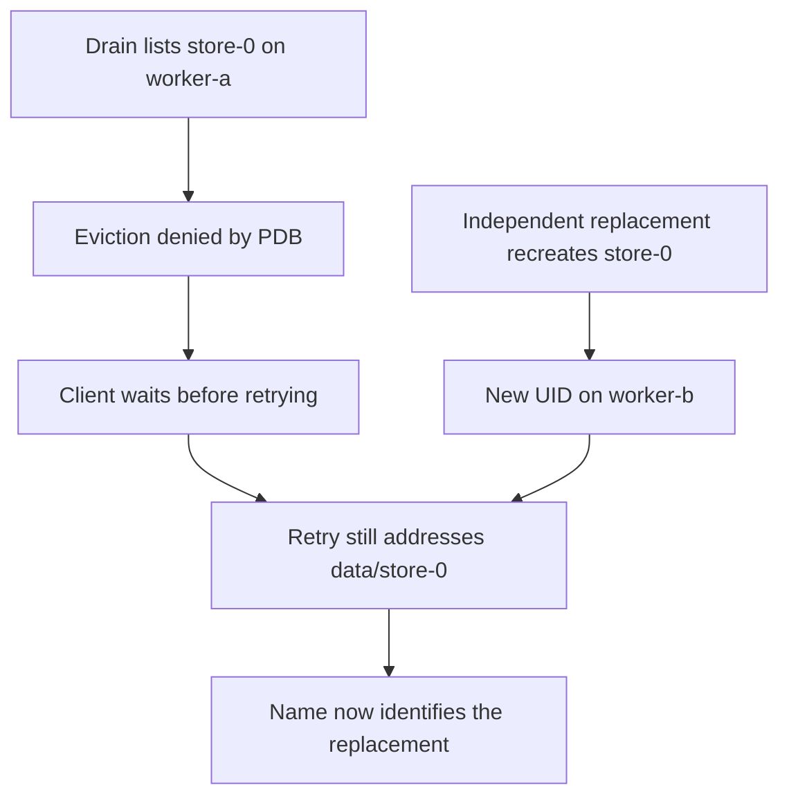

# Investigate Drain Retries for a Recreated StatefulSet Pod

Author: [nawazdhandala](https://www.github.com/nawazdhandala)

Tags: Kubernetes, StatefulSet, PodDisruptionBudget, Troubleshooting

Description: Compare Pod UIDs and node assignments when kubectl drain keeps retrying a reused StatefulSet name, then restart the drain from a verified current inventory.

Your terminal keeps printing that `store-0` cannot be evicted because of its PodDisruptionBudget. Yet `kubectl get pods -o wide` shows `store-0` running on a different node. Before changing the budget, establish whether the terminal and the API are referring to the same Pod object.

A StatefulSet preserves an ordinal name such as `store-0` across replacements. Kubernetes does not move an existing Pod object between nodes. The controller can create a new object with the same name and a different UID, or unique identifier. A name alone therefore cannot establish that the original member is still on the node being drained. [Pod identity](https://kubernetes.io/docs/concepts/workloads/pods/pod-lifecycle/#pod-lifetime), [StatefulSet identity](https://kubernetes.io/docs/concepts/workloads/controllers/statefulset/#pod-identity)

This guide examines **kubectl 1.34.0**, with its corresponding `k8s.io/kubectl` **0.34.0** source. Treat this as a version-specific investigation, not a claim that every client release has identical retry behavior.

## Understand the stale-client scenario

The reviewed drain implementation initially lists Pods using the target node's `spec.nodeName`. It then retries eviction for those selected objects. Its eviction request is addressed by namespace and name and does not attach a Pod UID precondition. A rejected request can be retried without reselecting Pods from the original node. The completion-wait path checks UID changes, but that path is reached after a successful eviction request. [Pinned drain implementation](https://github.com/kubernetes/kubectl/blob/v0.34.0/pkg/drain/drain.go)

That creates a distinction between the client's original inventory and the current object behind a reused name:



The upstream report describes this symptom with a 1.33 client, while another contributor reported difficulty reproducing it with a different setup. A report is a useful lead, not evidence that an arbitrary cluster has the same failure. Record your client version and inspect object identity. [Upstream investigation](https://github.com/kubernetes/kubernetes/issues/138229)

## Capture identity before maintenance when possible

Use explicit context and node names. The examples assume namespace `data`, StatefulSet member `store-0`, and target node `worker-a`. Replace those placeholders with reviewed values. You need `kubectl`, `jq`, and permission to list Pods across namespaces.

Before starting a maintenance drain, save the node's Pod inventory:

```bash
kubectl --context staging version --client -o yaml
kubectl --context staging get pods -A \
  --field-selector spec.nodeName=worker-a -o json > worker-a-before.json
```

The saved JSON contains the original UIDs, creation times, owners, and node assignments. It is a snapshot, so record when it was captured and keep it with the maintenance log. The field selector restricts the list to that node. [Supported Pod field selectors](https://kubernetes.io/docs/concepts/overview/working-with-objects/field-selectors/)

If the drain is already retrying and no snapshot exists, do not fabricate a previous UID from the Pod name. Earlier API audit records or a previously captured object may supply the missing evidence. You can still check whether the current object is on the target node.

## Compare the current object with the original inventory

Run these read-only commands in a separate terminal:

```bash
kubectl --context staging -n data get pod store-0 -o json > pod-now.json
kubectl --context staging get pods -A \
  --field-selector spec.nodeName=worker-a -o json > worker-a-now.json
jq '{namespace: .metadata.namespace, name: .metadata.name,
  uid: .metadata.uid, created: .metadata.creationTimestamp,
  node: .spec.nodeName, deleting: .metadata.deletionTimestamp,
  phase: .status.phase}' pod-now.json
jq '[.items[] | {namespace: .metadata.namespace, name: .metadata.name,
  uid: .metadata.uid, node: .spec.nodeName}]' worker-a-now.json
```

Then inspect the saved original entry, if available:

```bash
jq '.items[] |
  select(.metadata.namespace == "data" and .metadata.name == "store-0") |
  {uid: .metadata.uid, node: .spec.nodeName,
   created: .metadata.creationTimestamp}' worker-a-before.json
```

Different UIDs prove replacement. A current `node` of `worker-b`, combined with absence from `worker-a-now.json`, shows that this replacement is not a current member of the drained node's inventory.

Interpret the other cases separately:

| Observation | Next investigation |
|---|---|
| Original UID remains on `worker-a` | The original Pod still needs normal eviction or termination diagnosis |
| New UID exists with no assigned node | Replacement scheduling is incomplete |
| New UID is on `worker-b` | Investigate a stale retry against the reused name |
| Pod is currently absent | Preserve the NotFound result and check controller recovery |
| Replacement is terminating | Determine which actor requested its deletion before retrying maintenance |

A Running phase does not prove readiness or application health. Check those independently before treating the replacement as recovered capacity.

## Inspect the current budget without relaxing it

```bash
kubectl --context staging -n data describe pdb store
kubectl --context staging -n data get pod store-0 -o json |
  jq '{owners: .metadata.ownerReferences,
    conditions: .status.conditions,
    deletionTimestamp: .metadata.deletionTimestamp}'
kubectl --context staging get node worker-a -o json |
  jq '{name: .metadata.name, unschedulable: .spec.unschedulable}'
```

The current PDB may correctly protect the replacement on `worker-b`. Removing that protection merely to silence an old retry can expose the healthy replacement to an unintended eviction.

Also preserve the exact error. Admission webhooks, insufficient healthy capacity, overlapping PDBs, and authorization failures have different explanations. Zero allowance alone does not establish a stale-client problem. [API-initiated eviction](https://kubernetes.io/docs/concepts/scheduling-eviction/api-eviction/)

## Restart from the node's current inventory

Once the evidence shows that the retry concerns a replacement outside the target node, stop the affected foreground drain process with Ctrl+C. If a maintenance controller owns the operation, pause or restart that specific operation through its supported interface instead of launching competing drains.

Stopping the client does not undo completed evictions, restore Pods, or automatically uncordon the node. Confirm that `worker-a` remains intentionally unschedulable. Recheck all workloads still on it and the health of replacements elsewhere.

When the current inventory is safe to drain, start a fresh, bounded operation using the reviewed flags for your environment:

```bash
kubectl --context staging drain worker-a --ignore-daemonsets --timeout=5m
```

This new invocation lists Pods currently assigned to `worker-a`. `--ignore-daemonsets` permits proceeding while leaving DaemonSet-managed Pods alone. The example intentionally retains normal refusals for unmanaged Pods and local `emptyDir` data; investigate any such refusal before choosing additional flags. [Drain options](https://kubernetes.io/docs/reference/kubectl/generated/kubectl_drain/)

Do not confuse `--force` with a budget override: it addresses unmanaged-Pod cases. `--disable-eviction` switches to deletion and bypasses PDB checks, so it is not a repair for a stale inventory. A timeout bounds the wait; it does not repair the workload or guarantee the node is ready for shutdown.

## What the local reproduction established

In a disposable Kubernetes 1.34.0 API fixture, kubectl 1.34.0 first received a PDB rejection for an object on `worker-a`. The test harness then replaced that fixture with the same name, a different UID, and `worker-b` as its assigned node. The original drain retried afterward. Interrupting it left `worker-a` cordoned, and a fresh drain completed without deleting the replacement.

The PDB and Pod status were seeded explicitly. No scheduler, StatefulSet controller, kubelet, or real application ran, so this validates the client/API sequence rather than a production migration. Keep the same distinction in an incident report: include versions, timestamps, old and new UIDs, node assignments, exact errors, and the outcome of a fresh inventory. That evidence is far more useful than describing the situation as a Pod that “moved.”
